# Accessories

Generated by `npm run assets:catalog` from the game registries and `public/pixel/`. Do not edit by hand: rename an asset in `scripts/assets/names.json`.

Neck, ring and charm icons.

53 assets. Refer to an asset by its **name**.

## charm

| Name | Picture | Size | Status | Used by | Source file |
| --- | --- | --- | --- | --- | --- |
| `item_acorn_charm` | 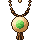 | 40x40 | used | acorn_charm | `pixel/icons/item_acorn_charm.png` |
| `item_cloth_charm` |  | 40x40 | planned | cloth_charm | `pixel/icons/item_cloth_charm.png` |
| `item_obsidian_charm` | 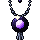 | 40x40 | used | obsidian_charm | `pixel/icons/item_obsidian_charm.png` |
| `item_steel_charm` | 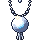 | 40x40 | planned | steel_charm | `pixel/icons/item_steel_charm.png` |

## charm G1

| Name | Picture | Size | Status | Used by | Source file |
| --- | --- | --- | --- | --- | --- |
| `art_ph_charm_g1` |  | 64x64 | placeholder |  | `pixel/items/charm/ph_g1.png` |

## charm G2

| Name | Picture | Size | Status | Used by | Source file |
| --- | --- | --- | --- | --- | --- |
| `item_rabbit_foot` |  | 40x40 | used | rabbit_foot | `pixel/icons/item_rabbit_foot.png` |

## charm G3

| Name | Picture | Size | Status | Used by | Source file |
| --- | --- | --- | --- | --- | --- |
| `item_bone_token` | 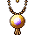 | 40x40 | used | bone_token | `pixel/icons/item_bone_token.png` |

## charm G4

| Name | Picture | Size | Status | Used by | Source file |
| --- | --- | --- | --- | --- | --- |
| `art_ph_charm_g4` |  | 64x64 | placeholder |  | `pixel/items/charm/ph_g4.png` |

## charm G5

| Name | Picture | Size | Status | Used by | Source file |
| --- | --- | --- | --- | --- | --- |
| `art_ph_charm_g5` |  | 64x64 | placeholder |  | `pixel/items/charm/ph_g5.png` |

## charm G6

| Name | Picture | Size | Status | Used by | Source file |
| --- | --- | --- | --- | --- | --- |
| `art_ph_charm_g6` |  | 64x64 | placeholder |  | `pixel/items/charm/ph_g6.png` |

## charm G7

| Name | Picture | Size | Status | Used by | Source file |
| --- | --- | --- | --- | --- | --- |
| `art_ph_charm_g7` |  | 64x64 | placeholder |  | `pixel/items/charm/ph_g7.png` |

## charm G8

| Name | Picture | Size | Status | Used by | Source file |
| --- | --- | --- | --- | --- | --- |
| `art_ph_charm_g8` |  | 64x64 | placeholder |  | `pixel/items/charm/ph_g8.png` |

## charm G9

| Name | Picture | Size | Status | Used by | Source file |
| --- | --- | --- | --- | --- | --- |
| `art_ph_charm_g9` |  | 64x64 | placeholder |  | `pixel/items/charm/ph_g9.png` |

## charm S1

| Name | Picture | Size | Status | Used by | Source file |
| --- | --- | --- | --- | --- | --- |
| `art_ph_charm_s1` |  | 64x64 | placeholder |  | `pixel/items/charm/ph_s1.png` |

## charm S2

| Name | Picture | Size | Status | Used by | Source file |
| --- | --- | --- | --- | --- | --- |
| `art_ph_charm_s2` |  | 64x64 | placeholder |  | `pixel/items/charm/ph_s2.png` |

## charm S3

| Name | Picture | Size | Status | Used by | Source file |
| --- | --- | --- | --- | --- | --- |
| `art_ph_charm_s3` |  | 64x64 | placeholder |  | `pixel/items/charm/ph_s3.png` |

## neck

| Name | Picture | Size | Status | Used by | Source file |
| --- | --- | --- | --- | --- | --- |
| `item_cloth_amulet` | 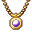 | 40x40 | planned | cloth_amulet | `pixel/icons/item_cloth_amulet.png` |
| `item_obsidian_pendant` | 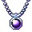 | 40x40 | used | obsidian_pendant | `pixel/icons/item_obsidian_pendant.png` |
| `item_steel_gorget` | 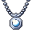 | 40x40 | planned | steel_gorget | `pixel/icons/item_steel_gorget.png` |
| `item_wooden_pendant` | 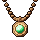 | 40x40 | planned | wooden_pendant | `pixel/icons/item_wooden_pendant.png` |

## neck G1

| Name | Picture | Size | Status | Used by | Source file |
| --- | --- | --- | --- | --- | --- |
| `art_cord_pendant` | 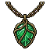 | 64x64 | used | cord_pendant | `pixel/items/neck/cord_pendant.png` |

## neck G2

| Name | Picture | Size | Status | Used by | Source file |
| --- | --- | --- | --- | --- | --- |
| `art_bone_beads` | 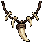 | 64x64 | used | bone_beads | `pixel/items/neck/bone_beads.png` |
| `art_fang_necklace` |  | 64x64 | used | fang_necklace | `pixel/items/neck/fang_necklace.png` |
| `art_leaf_amulet` |  | 64x64 | used | leaf_amulet | `pixel/items/neck/leaf_amulet.png` |

## neck G3

| Name | Picture | Size | Status | Used by | Source file |
| --- | --- | --- | --- | --- | --- |
| `art_copper_pendant` | 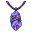 | 64x64 | used | copper_pendant | `pixel/items/neck/copper_pendant.png` |

## neck G4

| Name | Picture | Size | Status | Used by | Source file |
| --- | --- | --- | --- | --- | --- |
| `art_amethyst_shard_necklace` |  | 64x64 | used | amethyst_shard_necklace | `pixel/items/neck/amethyst_shard_necklace.png` |

## neck G5

| Name | Picture | Size | Status | Used by | Source file |
| --- | --- | --- | --- | --- | --- |
| `art_ember_medallion` |  | 64x64 | used | ember_medallion | `pixel/items/neck/ember_medallion.png` |
| `art_emerald_amulet` |  | 64x64 | used | emerald_amulet | `pixel/items/neck/emerald_amulet.png` |
| `art_heartstone_pendant` |  | 64x64 | used | heartstone_pendant | `pixel/items/neck/heartstone_pendant.png` |
| `art_moon_pendant` |  | 64x64 | used | moon_pendant | `pixel/items/neck/moon_pendant.png` |
| `art_sun_locket` |  | 64x64 | used | sun_locket | `pixel/items/neck/sun_locket.png` |

## neck G6

| Name | Picture | Size | Status | Used by | Source file |
| --- | --- | --- | --- | --- | --- |
| `art_nightshard_pendant` |  | 64x64 | used | nightshard_pendant | `pixel/items/neck/nightshard_pendant.png` |
| `art_ruby_teardrop` |  | 64x64 | used | ruby_teardrop | `pixel/items/neck/ruby_teardrop.png` |

## neck G7

| Name | Picture | Size | Status | Used by | Source file |
| --- | --- | --- | --- | --- | --- |
| `art_winged_sapphire_pendant` |  | 64x64 | planned | winged_sapphire_pendant | `pixel/items/neck/winged_sapphire_pendant.png` |

## neck G8

| Name | Picture | Size | Status | Used by | Source file |
| --- | --- | --- | --- | --- | --- |
| `art_seraph_collar` |  | 64x64 | planned | seraph_collar | `pixel/items/neck/seraph_collar.png` |

## ring

| Name | Picture | Size | Status | Used by | Source file |
| --- | --- | --- | --- | --- | --- |
| `item_cloth_ring` | 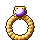 | 40x40 | planned | cloth_ring | `pixel/icons/item_cloth_ring.png` |
| `item_obsidian_ring` | 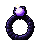 | 40x40 | used | obsidian_ring | `pixel/icons/item_obsidian_ring.png` |
| `item_steel_ring` | 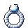 | 40x40 | planned | steel_ring | `pixel/icons/item_steel_ring.png` |
| `item_wooden_ring` | 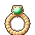 | 40x40 | planned | wooden_ring | `pixel/icons/item_wooden_ring.png` |

## ring G1

| Name | Picture | Size | Status | Used by | Source file |
| --- | --- | --- | --- | --- | --- |
| `art_twig_ring` | 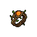 | 64x64 | used | twig_ring | `pixel/items/ring/twig_ring.png` |

## ring G2

| Name | Picture | Size | Status | Used by | Source file |
| --- | --- | --- | --- | --- | --- |
| `art_copper_band` | 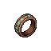 | 64x64 | used | copper_band | `pixel/items/ring/copper_band.png` |
| `art_thornvine_ring` |  | 64x64 | used | thornvine_ring | `pixel/items/ring/thornvine_ring.png` |
| `art_turquoise_band` |  | 64x64 | used | turquoise_band | `pixel/items/ring/turquoise_band.png` |

## ring G3

| Name | Picture | Size | Status | Used by | Source file |
| --- | --- | --- | --- | --- | --- |
| `art_iron_band` |  | 64x64 | used | iron_band | `pixel/items/ring/iron_band.png` |
| `art_iron_signet` | 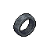 | 64x64 | used | iron_signet | `pixel/items/ring/iron_signet.png` |

## ring G4

| Name | Picture | Size | Status | Used by | Source file |
| --- | --- | --- | --- | --- | --- |
| `art_emerald_signet` |  | 64x64 | used | emerald_signet | `pixel/items/ring/emerald_signet.png` |
| `art_gold_signet` |  | 64x64 | used | gold_signet | `pixel/items/ring/gold_signet.png` |
| `art_ruby_signet` |  | 64x64 | used | ruby_signet | `pixel/items/ring/ruby_signet.png` |

## ring G5

| Name | Picture | Size | Status | Used by | Source file |
| --- | --- | --- | --- | --- | --- |
| `art_amethyst_ring` |  | 64x64 | used | amethyst_ring | `pixel/items/ring/amethyst_ring.png` |
| `art_steel_sapphire_ring` |  | 64x64 | used | steel_sapphire_ring | `pixel/items/ring/steel_sapphire_ring.png` |

## ring G6

| Name | Picture | Size | Status | Used by | Source file |
| --- | --- | --- | --- | --- | --- |
| `art_skull_ring` |  | 64x64 | used | skull_ring | `pixel/items/ring/skull_ring.png` |

## ring G7

| Name | Picture | Size | Status | Used by | Source file |
| --- | --- | --- | --- | --- | --- |
| `art_sapphire_teardrop_ring` |  | 64x64 | planned | sapphire_teardrop_ring | `pixel/items/ring/sapphire_teardrop_ring.png` |

## ring G8

| Name | Picture | Size | Status | Used by | Source file |
| --- | --- | --- | --- | --- | --- |
| `art_crimson_crown_ring` |  | 64x64 | planned | crimson_crown_ring | `pixel/items/ring/crimson_crown_ring.png` |
