# Armor

Generated by `npm run assets:catalog` from the game registries and `public/pixel/`. Do not edit by hand: rename an asset in `scripts/assets/names.json`.

Head, shoulder, chest, hands, legs, feet, cape and belt icons, by grade.

134 assets. Refer to an asset by its **name**.

## belt G1

| Name | Picture | Size | Status | Used by | Source file |
| --- | --- | --- | --- | --- | --- |
| `art_worn_leather_belt` |  | 64x64 | used | worn_leather_belt | `pixel/items/belt/worn_leather_belt.png` |

## belt G2

| Name | Picture | Size | Status | Used by | Source file |
| --- | --- | --- | --- | --- | --- |
| `art_tanned_sash` |  | 64x64 | used | tanned_sash | `pixel/items/belt/tanned_sash.png` |

## belt G3

| Name | Picture | Size | Status | Used by | Source file |
| --- | --- | --- | --- | --- | --- |
| `art_ironbuckle_belt` |  | 64x64 | used | ironbuckle_belt | `pixel/items/belt/ironbuckle_belt.png` |

## belt G4

| Name | Picture | Size | Status | Used by | Source file |
| --- | --- | --- | --- | --- | --- |
| `art_alchemist_bandolier` |  | 64x64 | unused |  | `pixel/items/belt/alchemist_bandolier.png` |
| `art_chain_girdle` |  | 64x64 | unused |  | `pixel/items/belt/chain_girdle.png` |

## belt G5

| Name | Picture | Size | Status | Used by | Source file |
| --- | --- | --- | --- | --- | --- |
| `art_hunter_trophy_belt` |  | 64x64 | unused |  | `pixel/items/belt/hunter_trophy_belt.png` |

## belt G6

| Name | Picture | Size | Status | Used by | Source file |
| --- | --- | --- | --- | --- | --- |
| `art_studded_nightbelt` |  | 64x64 | unused |  | `pixel/items/belt/studded_nightbelt.png` |

## belt G7

| Name | Picture | Size | Status | Used by | Source file |
| --- | --- | --- | --- | --- | --- |
| `art_runebound_girdle` |  | 64x64 | unused |  | `pixel/items/belt/runebound_girdle.png` |

## belt G8

| Name | Picture | Size | Status | Used by | Source file |
| --- | --- | --- | --- | --- | --- |
| `art_ruby_cincture` |  | 64x64 | unused |  | `pixel/items/belt/ruby_cincture.png` |

## belt G9

| Name | Picture | Size | Status | Used by | Source file |
| --- | --- | --- | --- | --- | --- |
| `art_crownguard_belt` |  | 64x64 | unused |  | `pixel/items/belt/crownguard_belt.png` |

## belt S1

| Name | Picture | Size | Status | Used by | Source file |
| --- | --- | --- | --- | --- | --- |
| `art_sunforged_cincture` |  | 64x64 | unused |  | `pixel/items/belt/sunforged_cincture.png` |

## belt S2

| Name | Picture | Size | Status | Used by | Source file |
| --- | --- | --- | --- | --- | --- |
| `art_warden_plate_belt` |  | 64x64 | unused |  | `pixel/items/belt/warden_plate_belt.png` |

## cape

| Name | Picture | Size | Status | Used by | Source file |
| --- | --- | --- | --- | --- | --- |
| `item_cloth_cape` |  | 40x40 | planned | cloth_cape | `pixel/icons/item_cloth_cape.png` |
| `item_leather_cloak` |  | 40x40 | planned | leather_cloak | `pixel/icons/item_leather_cloak.png` |
| `item_obsidian_cloak` |  | 40x40 | used | obsidian_cloak | `pixel/icons/item_obsidian_cloak.png` |
| `item_steel_cloak` |  | 40x40 | planned | steel_cloak | `pixel/icons/item_steel_cloak.png` |

## cape G1

| Name | Picture | Size | Status | Used by | Source file |
| --- | --- | --- | --- | --- | --- |
| `item_rag_cloak` |  | 40x40 | used | rag_cloak | `pixel/icons/item_rag_cloak.png` |

## cape G2

| Name | Picture | Size | Status | Used by | Source file |
| --- | --- | --- | --- | --- | --- |
| `item_hide_cloak` |  | 40x40 | used | hide_cloak | `pixel/icons/item_hide_cloak.png` |

## cape G3

| Name | Picture | Size | Status | Used by | Source file |
| --- | --- | --- | --- | --- | --- |
| `item_travellers_cape` |  | 40x40 | used | travellers_cape | `pixel/icons/item_travellers_cape.png` |

## cape G4

| Name | Picture | Size | Status | Used by | Source file |
| --- | --- | --- | --- | --- | --- |
| `art_ph_cape_g4` |  | 64x64 | placeholder |  | `pixel/items/cape/ph_g4.png` |

## cape G5

| Name | Picture | Size | Status | Used by | Source file |
| --- | --- | --- | --- | --- | --- |
| `art_ph_cape_g5` |  | 64x64 | placeholder |  | `pixel/items/cape/ph_g5.png` |

## cape G6

| Name | Picture | Size | Status | Used by | Source file |
| --- | --- | --- | --- | --- | --- |
| `art_ph_cape_g6` |  | 64x64 | placeholder |  | `pixel/items/cape/ph_g6.png` |

## cape G7

| Name | Picture | Size | Status | Used by | Source file |
| --- | --- | --- | --- | --- | --- |
| `art_ph_cape_g7` |  | 64x64 | placeholder |  | `pixel/items/cape/ph_g7.png` |

## cape G8

| Name | Picture | Size | Status | Used by | Source file |
| --- | --- | --- | --- | --- | --- |
| `art_ph_cape_g8` |  | 64x64 | placeholder |  | `pixel/items/cape/ph_g8.png` |

## cape G9

| Name | Picture | Size | Status | Used by | Source file |
| --- | --- | --- | --- | --- | --- |
| `art_ph_cape_g9` |  | 64x64 | placeholder |  | `pixel/items/cape/ph_g9.png` |

## cape S1

| Name | Picture | Size | Status | Used by | Source file |
| --- | --- | --- | --- | --- | --- |
| `art_ph_cape_s1` |  | 64x64 | placeholder |  | `pixel/items/cape/ph_s1.png` |

## cape S2

| Name | Picture | Size | Status | Used by | Source file |
| --- | --- | --- | --- | --- | --- |
| `art_ph_cape_s2` |  | 64x64 | placeholder |  | `pixel/items/cape/ph_s2.png` |

## cape S3

| Name | Picture | Size | Status | Used by | Source file |
| --- | --- | --- | --- | --- | --- |
| `art_ph_cape_s3` |  | 64x64 | placeholder |  | `pixel/items/cape/ph_s3.png` |

## chest

| Name | Picture | Size | Status | Used by | Source file |
| --- | --- | --- | --- | --- | --- |
| `item_cloth_robe` |  | 40x40 | planned | cloth_robe | `pixel/icons/item_cloth_robe.png` |
| `item_leather_vest` | 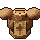 | 40x40 | planned | leather_vest | `pixel/icons/item_leather_vest.png` |
| `item_obsidian_cuirass` |  | 40x40 | used | obsidian_cuirass | `pixel/icons/item_obsidian_cuirass.png` |
| `item_steel_cuirass` |  | 40x40 | used | steel_cuirass | `pixel/icons/item_steel_cuirass.png` |
| `spare_chest_bluesteel_plate` | 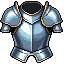 | 64x64 | spare |  | `pixel/items/chest/_bluesteel_plate.png` |
| `spare_chest_rusted_plate` | 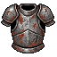 | 64x64 | spare |  | `pixel/items/chest/_rusted_plate.png` |
| `spare_chest_winged_lion_plate` |  | 64x64 | spare |  | `pixel/items/chest/_winged_lion_plate.png` |

## chest G1

| Name | Picture | Size | Status | Used by | Source file |
| --- | --- | --- | --- | --- | --- |
| `item_rag_tunic` |  | 40x40 | used | rag_tunic | `pixel/icons/item_rag_tunic.png` |

## chest G2

| Name | Picture | Size | Status | Used by | Source file |
| --- | --- | --- | --- | --- | --- |
| `item_hide_jerkin` |  | 40x40 | used | hide_jerkin | `pixel/icons/item_hide_jerkin.png` |

## chest G3

| Name | Picture | Size | Status | Used by | Source file |
| --- | --- | --- | --- | --- | --- |
| `item_iron_mail` |  | 40x40 | used | iron_mail | `pixel/icons/item_iron_mail.png` |

## chest G4

| Name | Picture | Size | Status | Used by | Source file |
| --- | --- | --- | --- | --- | --- |
| `art_steel_cuirass` | 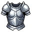 | 64x64 | unused |  | `pixel/items/chest/steel_cuirass.png` |

## chest G5

| Name | Picture | Size | Status | Used by | Source file |
| --- | --- | --- | --- | --- | --- |
| `art_knights_breastplate` | 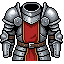 | 64x64 | used | knights_breastplate | `pixel/items/chest/knights_breastplate.png` |

## chest G6

| Name | Picture | Size | Status | Used by | Source file |
| --- | --- | --- | --- | --- | --- |
| `art_obsidian_plate` | 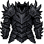 | 64x64 | unused |  | `pixel/items/chest/obsidian_plate.png` |

## chest G7

| Name | Picture | Size | Status | Used by | Source file |
| --- | --- | --- | --- | --- | --- |
| `art_runed_hauberk` | 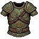 | 64x64 | planned | runed_hauberk | `pixel/items/chest/runed_hauberk.png` |

## chest G8

| Name | Picture | Size | Status | Used by | Source file |
| --- | --- | --- | --- | --- | --- |
| `art_ancient_cuirass` | 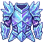 | 64x64 | planned | ancient_cuirass | `pixel/items/chest/ancient_cuirass.png` |

## chest G9

| Name | Picture | Size | Status | Used by | Source file |
| --- | --- | --- | --- | --- | --- |
| `art_dragonheart_plate` | 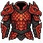 | 64x64 | planned | dragonheart_plate | `pixel/items/chest/dragonheart_plate.png` |

## chest S1

| Name | Picture | Size | Status | Used by | Source file |
| --- | --- | --- | --- | --- | --- |
| `art_sunhoney_vestments` | 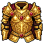 | 64x64 | planned | sunhoney_vestments | `pixel/items/chest/sunhoney_vestments.png` |

## chest S2

| Name | Picture | Size | Status | Used by | Source file |
| --- | --- | --- | --- | --- | --- |
| `art_ashen_plate` | 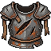 | 64x64 | planned | ashen_plate | `pixel/items/chest/ashen_plate.png` |

## chest S3

| Name | Picture | Size | Status | Used by | Source file |
| --- | --- | --- | --- | --- | --- |
| `art_blightbound_robe` | 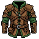 | 64x64 | planned | blightbound_robe | `pixel/items/chest/blightbound_robe.png` |

## feet

| Name | Picture | Size | Status | Used by | Source file |
| --- | --- | --- | --- | --- | --- |
| `item_cloth_slippers` |  | 40x40 | planned | cloth_slippers | `pixel/icons/item_cloth_slippers.png` |
| `item_leather_boots` | 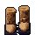 | 40x40 | planned | leather_boots | `pixel/icons/item_leather_boots.png` |
| `item_obsidian_sabatons` |  | 40x40 | used | obsidian_sabatons | `pixel/icons/item_obsidian_sabatons.png` |
| `item_steel_sabatons` |  | 40x40 | used | steel_sabatons | `pixel/icons/item_steel_sabatons.png` |

## feet G1

| Name | Picture | Size | Status | Used by | Source file |
| --- | --- | --- | --- | --- | --- |
| `art_rag_shoes` | 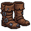 | 64x64 | used | rag_shoes | `pixel/items/feet/rag_shoes.png` |
| `art_wanderer_boots` |  | 64x64 | used | wanderer_boots | `pixel/items/feet/wanderer_boots.png` |

## feet G2

| Name | Picture | Size | Status | Used by | Source file |
| --- | --- | --- | --- | --- | --- |
| `art_fur_lined_boots` |  | 64x64 | used | fur_lined_boots | `pixel/items/feet/fur_lined_boots.png` |
| `art_hide_boots` | 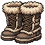 | 64x64 | used | hide_boots | `pixel/items/feet/hide_boots.png` |
| `art_mossweave_boots` |  | 64x64 | used | mossweave_boots | `pixel/items/feet/mossweave_boots.png` |

## feet G3

| Name | Picture | Size | Status | Used by | Source file |
| --- | --- | --- | --- | --- | --- |
| `art_iron_boots` | 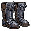 | 64x64 | used | iron_boots | `pixel/items/feet/iron_boots.png` |
| `art_ironbound_boots` |  | 64x64 | used | ironbound_boots | `pixel/items/feet/ironbound_boots.png` |

## feet G4

| Name | Picture | Size | Status | Used by | Source file |
| --- | --- | --- | --- | --- | --- |
| `art_plated_sabatons` |  | 64x64 | used | plated_sabatons | `pixel/items/feet/plated_sabatons.png` |

## feet G6

| Name | Picture | Size | Status | Used by | Source file |
| --- | --- | --- | --- | --- | --- |
| `art_shadowstep_boots` |  | 64x64 | used | shadowstep_boots | `pixel/items/feet/shadowstep_boots.png` |

## feet G7

| Name | Picture | Size | Status | Used by | Source file |
| --- | --- | --- | --- | --- | --- |
| `art_frostglass_boots` |  | 64x64 | planned | frostglass_boots | `pixel/items/feet/frostglass_boots.png` |

## feet G8

| Name | Picture | Size | Status | Used by | Source file |
| --- | --- | --- | --- | --- | --- |
| `art_drake_scale_boots` |  | 64x64 | planned | drake_scale_boots | `pixel/items/feet/drake_scale_boots.png` |
| `art_sunsilk_boots` |  | 64x64 | planned | sunsilk_boots | `pixel/items/feet/sunsilk_boots.png` |

## hands

| Name | Picture | Size | Status | Used by | Source file |
| --- | --- | --- | --- | --- | --- |
| `item_cloth_gloves` |  | 40x40 | planned | cloth_gloves | `pixel/icons/item_cloth_gloves.png` |
| `item_leather_gloves` |  | 40x40 | planned | leather_gloves | `pixel/icons/item_leather_gloves.png` |
| `item_obsidian_gauntlets` |  | 40x40 | used | obsidian_gauntlets | `pixel/icons/item_obsidian_gauntlets.png` |
| `item_steel_gauntlets` |  | 40x40 | used | steel_gauntlets | `pixel/icons/item_steel_gauntlets.png` |
| `spare_hands_worn_leather_gloves` | 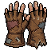 | 64x64 | spare |  | `pixel/items/hands/_worn_leather_gloves.png` |

## hands G1

| Name | Picture | Size | Status | Used by | Source file |
| --- | --- | --- | --- | --- | --- |
| `item_rag_wraps` | 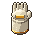 | 40x40 | used | rag_wraps | `pixel/icons/item_rag_wraps.png` |

## hands G2

| Name | Picture | Size | Status | Used by | Source file |
| --- | --- | --- | --- | --- | --- |
| `item_hide_gloves` | 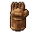 | 40x40 | used | hide_gloves | `pixel/icons/item_hide_gloves.png` |

## hands G3

| Name | Picture | Size | Status | Used by | Source file |
| --- | --- | --- | --- | --- | --- |
| `item_iron_gauntlets` |  | 40x40 | used | iron_gauntlets | `pixel/icons/item_iron_gauntlets.png` |

## hands G4

| Name | Picture | Size | Status | Used by | Source file |
| --- | --- | --- | --- | --- | --- |
| `art_steel_gauntlets` | 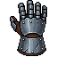 | 64x64 | unused |  | `pixel/items/hands/steel_gauntlets.png` |

## hands G5

| Name | Picture | Size | Status | Used by | Source file |
| --- | --- | --- | --- | --- | --- |
| `art_knights_gauntlets` | 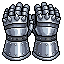 | 64x64 | used | knights_gauntlets | `pixel/items/hands/knights_gauntlets.png` |

## hands G6

| Name | Picture | Size | Status | Used by | Source file |
| --- | --- | --- | --- | --- | --- |
| `art_obsidian_grips` | 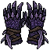 | 64x64 | unused |  | `pixel/items/hands/obsidian_grips.png` |

## hands G7

| Name | Picture | Size | Status | Used by | Source file |
| --- | --- | --- | --- | --- | --- |
| `art_runed_gloves` | 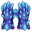 | 64x64 | planned | runed_gloves | `pixel/items/hands/runed_gloves.png` |

## hands G8

| Name | Picture | Size | Status | Used by | Source file |
| --- | --- | --- | --- | --- | --- |
| `art_ancient_handguards` | 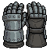 | 64x64 | planned | ancient_handguards | `pixel/items/hands/ancient_handguards.png` |

## hands G9

| Name | Picture | Size | Status | Used by | Source file |
| --- | --- | --- | --- | --- | --- |
| `art_titans_fists` | 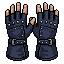 | 64x64 | planned | titans_fists | `pixel/items/hands/titans_fists.png` |

## hands S1

| Name | Picture | Size | Status | Used by | Source file |
| --- | --- | --- | --- | --- | --- |
| `art_sunhoney_gloves` |  | 64x64 | planned | sunhoney_gloves | `pixel/items/hands/sunhoney_gloves.png` |

## hands S2

| Name | Picture | Size | Status | Used by | Source file |
| --- | --- | --- | --- | --- | --- |
| `art_warlords_gauntlets` |  | 64x64 | planned | warlords_gauntlets | `pixel/items/hands/warlords_gauntlets.png` |

## hands S3

| Name | Picture | Size | Status | Used by | Source file |
| --- | --- | --- | --- | --- | --- |
| `art_shroud_claws` | 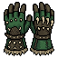 | 64x64 | planned | shroud_claws | `pixel/items/hands/shroud_claws.png` |

## head

| Name | Picture | Size | Status | Used by | Source file |
| --- | --- | --- | --- | --- | --- |
| `item_cloth_hat` |  | 40x40 | planned | cloth_hat | `pixel/icons/item_cloth_hat.png` |
| `item_leather_cap` |  | 40x40 | planned | leather_cap | `pixel/icons/item_leather_cap.png` |
| `item_obsidian_helm` |  | 40x40 | used | obsidian_helm | `pixel/icons/item_obsidian_helm.png` |
| `item_steel_helm` |  | 40x40 | used | steel_helm | `pixel/icons/item_steel_helm.png` |
| `spare_head_crusader_helm` | 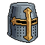 | 64x64 | spare |  | `pixel/items/head/_crusader_helm.png` |
| `spare_head_rusted_helm` | 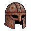 | 64x64 | spare |  | `pixel/items/head/_rusted_helm.png` |
| `spare_head_spartan_helm` | 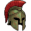 | 64x64 | spare |  | `pixel/items/head/_spartan_helm.png` |

## head G1

| Name | Picture | Size | Status | Used by | Source file |
| --- | --- | --- | --- | --- | --- |
| `item_rag_hood` |  | 40x40 | used | rag_hood | `pixel/icons/item_rag_hood.png` |

## head G2

| Name | Picture | Size | Status | Used by | Source file |
| --- | --- | --- | --- | --- | --- |
| `item_hide_cap` |  | 40x40 | used | hide_cap | `pixel/icons/item_hide_cap.png` |

## head G3

| Name | Picture | Size | Status | Used by | Source file |
| --- | --- | --- | --- | --- | --- |
| `item_iron_cap` |  | 40x40 | used | iron_cap | `pixel/icons/item_iron_cap.png` |

## head G4

| Name | Picture | Size | Status | Used by | Source file |
| --- | --- | --- | --- | --- | --- |
| `art_steel_helm` |  | 64x64 | unused |  | `pixel/items/head/steel_helm.png` |

## head G5

| Name | Picture | Size | Status | Used by | Source file |
| --- | --- | --- | --- | --- | --- |
| `art_knights_greathelm` |  | 64x64 | used | knights_greathelm | `pixel/items/head/knights_greathelm.png` |

## head G6

| Name | Picture | Size | Status | Used by | Source file |
| --- | --- | --- | --- | --- | --- |
| `art_obsidian_visage` |  | 64x64 | unused |  | `pixel/items/head/obsidian_visage.png` |

## head G7

| Name | Picture | Size | Status | Used by | Source file |
| --- | --- | --- | --- | --- | --- |
| `art_runed_circlet` |  | 64x64 | planned | runed_circlet | `pixel/items/head/runed_circlet.png` |

## head G8

| Name | Picture | Size | Status | Used by | Source file |
| --- | --- | --- | --- | --- | --- |
| `art_ancient_warhelm` | 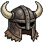 | 64x64 | planned | ancient_warhelm | `pixel/items/head/ancient_warhelm.png` |

## head G9

| Name | Picture | Size | Status | Used by | Source file |
| --- | --- | --- | --- | --- | --- |
| `art_crown_of_embers` |  | 64x64 | planned | crown_of_embers | `pixel/items/head/crown_of_embers.png` |

## head S1

| Name | Picture | Size | Status | Used by | Source file |
| --- | --- | --- | --- | --- | --- |
| `art_sunhoney_crown` |  | 64x64 | planned | sunhoney_crown | `pixel/items/head/sunhoney_crown.png` |

## head S2

| Name | Picture | Size | Status | Used by | Source file |
| --- | --- | --- | --- | --- | --- |
| `art_ashen_warlords_visor` |  | 64x64 | planned | ashen_warlords_visor | `pixel/items/head/ashen_warlords_visor.png` |

## head S3

| Name | Picture | Size | Status | Used by | Source file |
| --- | --- | --- | --- | --- | --- |
| `art_blightbound_cowl` |  | 64x64 | planned | blightbound_cowl | `pixel/items/head/blightbound_cowl.png` |

## legs

| Name | Picture | Size | Status | Used by | Source file |
| --- | --- | --- | --- | --- | --- |
| `item_cloth_trousers` | 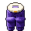 | 40x40 | planned | cloth_trousers | `pixel/icons/item_cloth_trousers.png` |
| `item_leather_leggings` |  | 40x40 | planned | leather_leggings | `pixel/icons/item_leather_leggings.png` |
| `item_obsidian_greaves` | 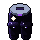 | 40x40 | used | obsidian_greaves | `pixel/icons/item_obsidian_greaves.png` |
| `item_steel_greaves` |  | 40x40 | used | steel_greaves | `pixel/icons/item_steel_greaves.png` |

## legs G1

| Name | Picture | Size | Status | Used by | Source file |
| --- | --- | --- | --- | --- | --- |
| `art_drover_breeches` |  | 64x64 | used | drover_breeches | `pixel/items/legs/drover_breeches.png` |
| `art_patched_trousers` |  | 64x64 | used | patched_trousers | `pixel/items/legs/patched_trousers.png` |
| `art_rag_trousers` | 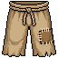 | 64x64 | used | rag_trousers | `pixel/items/legs/rag_trousers.png` |

## legs G2

| Name | Picture | Size | Status | Used by | Source file |
| --- | --- | --- | --- | --- | --- |
| `art_fur_trimmed_leggings` |  | 64x64 | used | fur_trimmed_leggings | `pixel/items/legs/fur_trimmed_leggings.png` |
| `art_hide_leggings` | 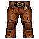 | 64x64 | used | hide_leggings | `pixel/items/legs/hide_leggings.png` |
| `art_tanned_leather_pants` |  | 64x64 | used | tanned_leather_pants | `pixel/items/legs/tanned_leather_pants.png` |

## legs G3

| Name | Picture | Size | Status | Used by | Source file |
| --- | --- | --- | --- | --- | --- |
| `art_chainmail_leggings` |  | 64x64 | used | chainmail_leggings | `pixel/items/legs/chainmail_leggings.png` |
| `art_iron_chausses` | 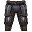 | 64x64 | used | iron_chausses | `pixel/items/legs/iron_chausses.png` |
| `art_ranger_pants` |  | 64x64 | used | ranger_pants | `pixel/items/legs/ranger_pants.png` |

## legs G4

| Name | Picture | Size | Status | Used by | Source file |
| --- | --- | --- | --- | --- | --- |
| `art_steel_legplates` |  | 64x64 | used | steel_legplates | `pixel/items/legs/steel_legplates.png` |

## legs G5

| Name | Picture | Size | Status | Used by | Source file |
| --- | --- | --- | --- | --- | --- |
| `art_knightly_legguards` |  | 64x64 | used | knightly_legguards | `pixel/items/legs/knightly_legguards.png` |

## legs G6

| Name | Picture | Size | Status | Used by | Source file |
| --- | --- | --- | --- | --- | --- |
| `art_shadow_trousers` |  | 64x64 | used | shadow_trousers | `pixel/items/legs/shadow_trousers.png` |

## legs G7

| Name | Picture | Size | Status | Used by | Source file |
| --- | --- | --- | --- | --- | --- |
| `art_runed_skirt` |  | 64x64 | planned | runed_skirt | `pixel/items/legs/runed_skirt.png` |
| `art_verdant_greaves` |  | 64x64 | planned | verdant_greaves | `pixel/items/legs/verdant_greaves.png` |

## legs G8

| Name | Picture | Size | Status | Used by | Source file |
| --- | --- | --- | --- | --- | --- |
| `art_royal_silk_trousers` |  | 64x64 | planned | royal_silk_trousers | `pixel/items/legs/royal_silk_trousers.png` |

## shoulder

| Name | Picture | Size | Status | Used by | Source file |
| --- | --- | --- | --- | --- | --- |
| `item_cloth_mantle` |  | 40x40 | planned | cloth_mantle | `pixel/icons/item_cloth_mantle.png` |
| `item_leather_pauldrons` | 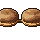 | 40x40 | planned | leather_pauldrons | `pixel/icons/item_leather_pauldrons.png` |
| `item_obsidian_pauldrons` |  | 40x40 | used | obsidian_pauldrons | `pixel/icons/item_obsidian_pauldrons.png` |
| `item_steel_pauldrons` |  | 40x40 | used | steel_pauldrons | `pixel/icons/item_steel_pauldrons.png` |

## shoulder G1

| Name | Picture | Size | Status | Used by | Source file |
| --- | --- | --- | --- | --- | --- |
| `item_patched_mantle` |  | 40x40 | used | patched_mantle | `pixel/icons/item_patched_mantle.png` |

## shoulder G2

| Name | Picture | Size | Status | Used by | Source file |
| --- | --- | --- | --- | --- | --- |
| `item_hide_pauldrons` |  | 40x40 | used | hide_pauldrons | `pixel/icons/item_hide_pauldrons.png` |

## shoulder G3

| Name | Picture | Size | Status | Used by | Source file |
| --- | --- | --- | --- | --- | --- |
| `item_iron_spaulders` |  | 40x40 | used | iron_spaulders | `pixel/icons/item_iron_spaulders.png` |

## shoulder G4

| Name | Picture | Size | Status | Used by | Source file |
| --- | --- | --- | --- | --- | --- |
| `art_ph_shoulder_g4` |  | 64x64 | placeholder |  | `pixel/items/shoulder/ph_g4.png` |

## shoulder G5

| Name | Picture | Size | Status | Used by | Source file |
| --- | --- | --- | --- | --- | --- |
| `art_ph_shoulder_g5` |  | 64x64 | placeholder |  | `pixel/items/shoulder/ph_g5.png` |

## shoulder G6

| Name | Picture | Size | Status | Used by | Source file |
| --- | --- | --- | --- | --- | --- |
| `art_ph_shoulder_g6` |  | 64x64 | placeholder |  | `pixel/items/shoulder/ph_g6.png` |

## shoulder G7

| Name | Picture | Size | Status | Used by | Source file |
| --- | --- | --- | --- | --- | --- |
| `art_ph_shoulder_g7` |  | 64x64 | placeholder |  | `pixel/items/shoulder/ph_g7.png` |

## shoulder G8

| Name | Picture | Size | Status | Used by | Source file |
| --- | --- | --- | --- | --- | --- |
| `art_ph_shoulder_g8` |  | 64x64 | placeholder |  | `pixel/items/shoulder/ph_g8.png` |

## shoulder G9

| Name | Picture | Size | Status | Used by | Source file |
| --- | --- | --- | --- | --- | --- |
| `art_ph_shoulder_g9` |  | 64x64 | placeholder |  | `pixel/items/shoulder/ph_g9.png` |

## shoulder S1

| Name | Picture | Size | Status | Used by | Source file |
| --- | --- | --- | --- | --- | --- |
| `art_ph_shoulder_s1` |  | 64x64 | placeholder |  | `pixel/items/shoulder/ph_s1.png` |

## shoulder S2

| Name | Picture | Size | Status | Used by | Source file |
| --- | --- | --- | --- | --- | --- |
| `art_ph_shoulder_s2` |  | 64x64 | placeholder |  | `pixel/items/shoulder/ph_s2.png` |

## shoulder S3

| Name | Picture | Size | Status | Used by | Source file |
| --- | --- | --- | --- | --- | --- |
| `art_ph_shoulder_s3` |  | 64x64 | placeholder |  | `pixel/items/shoulder/ph_s3.png` |
