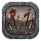
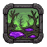
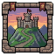
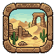
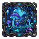
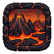
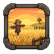
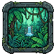
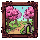

# Biomes

Generated by `npm run assets:catalog` from the game registries and `public/pixel/`. Do not edit by hand: rename an asset in `scripts/assets/names.json`.

Framed 80px landscape vignettes per biome (Sprite Fusion). One per rebirth biome is shown in the "New land unlocked" window; the rest are alternatives, the older biomes and extras.

9 assets. Refer to an asset by its **name**.

## battlefield (in the game)

| Name | Picture | Size | Status | Used by | Source file |
| --- | --- | --- | --- | --- | --- |
| `biome_battlefield_1` |  | 80x80 | used | RebirthUnlockModal | `pixel/new_assets/biomes/biome_battlefield_1.png` |

## blight (in the game)

| Name | Picture | Size | Status | Used by | Source file |
| --- | --- | --- | --- | --- | --- |
| `biome_blight_1` |  | 80x80 | used | RebirthUnlockModal | `pixel/new_assets/biomes/biome_blight_1.png` |

## castle (alternatives)

| Name | Picture | Size | Status | Used by | Source file |
| --- | --- | --- | --- | --- | --- |
| `biome_castle_1` |  | 64x64 | reuse |  | `pixel/new_assets/biomes/biome_castle_1.png` |

## extras (no such biome in the game)

| Name | Picture | Size | Status | Used by | Source file |
| --- | --- | --- | --- | --- | --- |
| `biome_extra_desert` |  | 80x80 | reuse |  | `pixel/new_assets/biomes/biome_extra_desert.png` |
| `biome_extra_mushroom_cave` |  | 80x80 | reuse |  | `pixel/new_assets/biomes/biome_extra_mushroom_cave.png` |
| `biome_extra_volcano` |  | 80x80 | reuse |  | `pixel/new_assets/biomes/biome_extra_volcano.png` |

## fields (in the game)

| Name | Picture | Size | Status | Used by | Source file |
| --- | --- | --- | --- | --- | --- |
| `biome_fields_1` |  | 80x80 | used | RebirthUnlockModal | `pixel/new_assets/biomes/biome_fields_1.png` |

## jungle (in the game)

| Name | Picture | Size | Status | Used by | Source file |
| --- | --- | --- | --- | --- | --- |
| `biome_jungle_1` |  | 80x80 | used | RebirthUnlockModal | `pixel/new_assets/biomes/biome_jungle_1.png` |

## orchard (in the game)

| Name | Picture | Size | Status | Used by | Source file |
| --- | --- | --- | --- | --- | --- |
| `biome_orchard_1` |  | 80x80 | used | RebirthUnlockModal | `pixel/new_assets/biomes/biome_orchard_1.png` |
