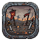
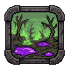
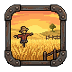
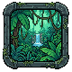
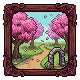

# Biomes

Generated by `npm run assets:catalog` from the game registries and `public/pixel/`. Do not edit by hand: rename an asset in `scripts/assets/names.json`.

Framed 80px landscape vignettes, one per rebirth biome, shown in the "New land unlocked" window.

6 assets. Refer to an asset by its **name**.

## battlefield (in the game)

| Name | Picture | Size | Status | Used by | Source file |
| --- | --- | --- | --- | --- | --- |
| `biome_battlefield_1` |  | 80x80 | used | RebirthUnlockModal | `pixel/ui/biomes/biome_battlefield_1.png` |

## blight (in the game)

| Name | Picture | Size | Status | Used by | Source file |
| --- | --- | --- | --- | --- | --- |
| `biome_blight_1` |  | 80x80 | used | RebirthUnlockModal | `pixel/ui/biomes/biome_blight_1.png` |

## fields (in the game)

| Name | Picture | Size | Status | Used by | Source file |
| --- | --- | --- | --- | --- | --- |
| `biome_fields_1` |  | 80x80 | used | RebirthUnlockModal | `pixel/ui/biomes/biome_fields_1.png` |

## jungle (in the game)

| Name | Picture | Size | Status | Used by | Source file |
| --- | --- | --- | --- | --- | --- |
| `biome_jungle_1` |  | 80x80 | used | RebirthUnlockModal | `pixel/ui/biomes/biome_jungle_1.png` |

## lava (in the game)

| Name | Picture | Size | Status | Used by | Source file |
| --- | --- | --- | --- | --- | --- |
| `biome_lava_1` |  | 80x80 | used | RebirthUnlockModal | `pixel/ui/biomes/biome_lava_1.png` |

## orchard (in the game)

| Name | Picture | Size | Status | Used by | Source file |
| --- | --- | --- | --- | --- | --- |
| `biome_orchard_1` |  | 80x80 | used | RebirthUnlockModal | `pixel/ui/biomes/biome_orchard_1.png` |
