# Buildings

Generated by `npm run assets:catalog` from the game registries and `public/pixel/`. Do not edit by hand: rename an asset in `scripts/assets/names.json`.

The map buildings, the 10 castle levels and the 14 castle skins (not wired yet), the Idol statues, and the village packs waiting in the pool.

108 assets. Refer to an asset by its **name**.

## castle

| Name | Picture | Size | Status | Used by | Source file |
| --- | --- | --- | --- | --- | --- |
| `castle_1` | 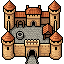 | 64x64 | used | castle level 1 | `pixel/castles/castle_1.png` |
| `castle_10` | 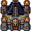 | 64x64 | used | castle level 10 | `pixel/castles/castle_10.png` |
| `castle_2` | 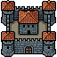 | 64x64 | used | castle level 2 | `pixel/castles/castle_2.png` |
| `castle_3` | 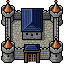 | 64x64 | used | castle level 3 | `pixel/castles/castle_3.png` |
| `castle_4` | 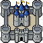 | 64x64 | used | castle level 4 | `pixel/castles/castle_4.png` |
| `castle_5` | 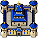 | 64x64 | used | castle level 5 | `pixel/castles/castle_5.png` |
| `castle_6` | 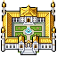 | 64x64 | used | castle level 6 | `pixel/castles/castle_6.png` |
| `castle_7` |  | 64x64 | used | castle level 7 | `pixel/castles/castle_7.png` |
| `castle_8` |  | 64x64 | used | castle level 8 | `pixel/castles/castle_8.png` |
| `castle_9` | 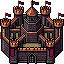 | 64x64 | used | castle level 9 | `pixel/castles/castle_9.png` |
| `castle_loading` | 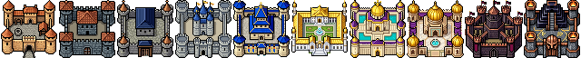 | 640x64 | used | loading screen | `pixel/castles/castle_loading.png` |

## castle skin

| Name | Picture | Size | Status | Used by | Source file |
| --- | --- | --- | --- | --- | --- |
| `castle_skin_1` |  | 64x64 | planned |  | `pixel/castles/castle_skin_1.png` |
| `castle_skin_10` |  | 64x64 | planned |  | `pixel/castles/castle_skin_10.png` |
| `castle_skin_12` | 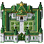 | 64x64 | planned |  | `pixel/castles/castle_skin_12.png` |
| `castle_skin_13` | 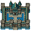 | 64x64 | planned |  | `pixel/castles/castle_skin_13.png` |
| `castle_skin_14` | 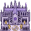 | 64x64 | planned |  | `pixel/castles/castle_skin_14.png` |
| `castle_skin_2` | 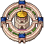 | 64x64 | planned |  | `pixel/castles/castle_skin_2.png` |
| `castle_skin_3` | 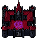 | 64x64 | planned |  | `pixel/castles/castle_skin_3.png` |
| `castle_skin_4` | 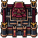 | 64x64 | planned |  | `pixel/castles/castle_skin_4.png` |
| `castle_skin_5` | 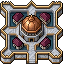 | 64x64 | planned |  | `pixel/castles/castle_skin_5.png` |
| `castle_skin_6` |  | 64x64 | planned |  | `pixel/castles/castle_skin_6.png` |
| `castle_skin_7` |  | 64x64 | planned |  | `pixel/castles/castle_skin_7.png` |
| `castle_skin_8` | 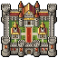 | 64x64 | planned |  | `pixel/castles/castle_skin_8.png` |
| `castle_skin_9` | 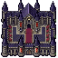 | 64x64 | planned |  | `pixel/castles/castle_skin_9.png` |

## idol statues (alternatives)

| Name | Picture | Size | Status | Used by | Source file |
| --- | --- | --- | --- | --- | --- |
| `idol_alt_flower_stall` | 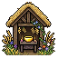 | 64x64 | unused |  | `pixel/idols/idol_alt_flower_stall.png` |
| `idol_alt_lava_obelisk` |  | 64x64 | unused |  | `pixel/idols/idol_alt_lava_obelisk.png` |
| `idol_alt_mossy_tree_face` |  | 64x64 | unused |  | `pixel/idols/idol_alt_mossy_tree_face.png` |
| `idol_alt_root_face` |  | 64x64 | unused |  | `pixel/idols/idol_alt_root_face.png` |
| `idol_alt_rune_stone` | 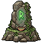 | 64x64 | unused |  | `pixel/idols/idol_alt_rune_stone.png` |
| `idol_alt_serpent_statue` |  | 64x64 | unused |  | `pixel/idols/idol_alt_serpent_statue.png` |
| `idol_alt_torii_gate` |  | 64x64 | unused |  | `pixel/idols/idol_alt_torii_gate.png` |
| `idol_alt_wooden_mask` |  | 64x64 | unused |  | `pixel/idols/idol_alt_wooden_mask.png` |

## idol statues (primary, planned)

| Name | Picture | Size | Status | Used by | Source file |
| --- | --- | --- | --- | --- | --- |
| `forest` | 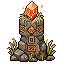 | 64x64 | planned |  | `pixel/idols/forest.png` |
| `hills` | 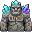 | 64x64 | planned |  | `pixel/idols/hills.png` |
| `idol_battlefield_war_memorial` | 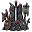 | 64x64 | planned |  | `pixel/idols/idol_battlefield_war_memorial.png` |
| `idol_blight_maw_crystal` | 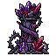 | 64x64 | planned |  | `pixel/idols/idol_blight_maw_crystal.png` |
| `idol_coast_lighthouse` |  | 64x64 | planned |  | `pixel/idols/idol_coast_lighthouse.png` |
| `idol_fields_sun_statue` |  | 64x64 | planned |  | `pixel/idols/idol_fields_sun_statue.png` |
| `idol_forest_elder_tree` |  | 64x64 | planned |  | `pixel/idols/idol_forest_elder_tree.png` |
| `idol_hills_ram_statue` |  | 64x64 | planned |  | `pixel/idols/idol_hills_ram_statue.png` |
| `idol_jungle_totem_of_the_wild` |  | 64x64 | planned |  | `pixel/idols/idol_jungle_totem_of_the_wild.png` |
| `idol_lake_eye_obelisk` | 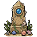 | 64x64 | planned |  | `pixel/idols/idol_lake_eye_obelisk.png` |
| `idol_orchard_blossom_shrine` |  | 64x64 | planned |  | `pixel/idols/idol_orchard_blossom_shrine.png` |
| `idol_plains_wind_stones` |  | 64x64 | planned |  | `pixel/idols/idol_plains_wind_stones.png` |
| `idol_swamp_witch_tree` |  | 64x64 | planned |  | `pixel/idols/idol_swamp_witch_tree.png` |
| `idol_tundra_frost_totem` | 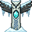 | 64x64 | planned |  | `pixel/idols/idol_tundra_frost_totem.png` |
| `lake` | 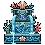 | 64x64 | planned |  | `pixel/idols/lake.png` |
| `orchid` |  | 64x64 | planned |  | `pixel/idols/orchid.png` |
| `tundra` | 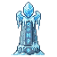 | 64x64 | planned |  | `pixel/idols/tundra.png` |

## idols (planned)

| Name | Picture | Size | Status | Used by | Source file |
| --- | --- | --- | --- | --- | --- |
| `idol_blue_gray_ruins` | 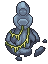 | 48x64 | planned | Idols, IDL-96 | `pixel/assets_to_assess_and_use/map_details_ruins_buildings/Assets/Blue-gray_ruins3.png` |

## village pack 80px (named)

| Name | Picture | Size | Status | Used by | Source file |
| --- | --- | --- | --- | --- | --- |
| `building_village_abandoned_house` |  | 80x80 | used | building:rotworks | `pixel/assets_to_assess_and_use/more_buildings/Abandoned House.png` |
| `building_village_abandoned_house_2` |  | 80x80 | unused |  | `pixel/assets_to_assess_and_use/more_buildings/Abandoned House 2.png` |
| `building_village_abandoned_tower` |  | 80x80 | used | building:coresiphon | `pixel/assets_to_assess_and_use/more_buildings/Abandoned Tower.png` |
| `building_village_adventurers_guild` |  | 80x80 | unused |  | `pixel/assets_to_assess_and_use/more_buildings/Adventurers Guild.png` |
| `building_village_bakery` | 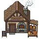 | 80x80 | unused |  | `pixel/assets_to_assess_and_use/more_buildings/Bakery.png` |
| `building_village_beekeepers_hut` |  | 80x80 | used | building:apiary | `pixel/assets_to_assess_and_use/more_buildings/Beekeepers Hut.png` |
| `building_village_blacksmith_house` |  | 80x80 | used | building:scrapforge | `pixel/assets_to_assess_and_use/more_buildings/Blacksmith House.png` |
| `building_village_bookbinders_house` |  | 80x80 | unused |  | `pixel/assets_to_assess_and_use/more_buildings/Bookbinders House.png` |
| `building_village_brewers_house` |  | 80x80 | unused |  | `pixel/assets_to_assess_and_use/more_buildings/Brewers House.png` |
| `building_village_butcher_shop` |  | 80x80 | unused |  | `pixel/assets_to_assess_and_use/more_buildings/Butcher Shop.png` |
| `building_village_carpenters_house` |  | 80x80 | used | building:saptapper | `pixel/assets_to_assess_and_use/more_buildings/Carpenters House.png` |
| `building_village_cheese_makers_house` |  | 80x80 | unused |  | `pixel/assets_to_assess_and_use/more_buildings/Cheese Makers House.png` |
| `building_village_church` | 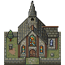 | 80x80 | unused |  | `pixel/assets_to_assess_and_use/more_buildings/Church.png` |
| `building_village_clock_tower_building` |  | 80x80 | unused |  | `pixel/assets_to_assess_and_use/more_buildings/Clock Tower Building.png` |
| `building_village_doctors_house` |  | 80x80 | unused |  | `pixel/assets_to_assess_and_use/more_buildings/Doctors House.png` |
| `building_village_farmers_house` |  | 80x80 | used | building:farmstead | `pixel/assets_to_assess_and_use/more_buildings/Farmers House.png` |
| `building_village_fishermans_hut` |  | 80x80 | used | building:fishery | `pixel/assets_to_assess_and_use/more_buildings/Fishermans Hut.png` |
| `building_village_florists_house` |  | 80x80 | used | building:blossomyard | `pixel/assets_to_assess_and_use/more_buildings/Florists House.png` |
| `building_village_fortune_tellers_tent` |  | 80x80 | unused |  | `pixel/assets_to_assess_and_use/more_buildings/Fortune Tellers Tent.png` |
| `building_village_general_store` |  | 80x80 | unused |  | `pixel/assets_to_assess_and_use/more_buildings/General Store.png` |
| `building_village_glassmakers_house` |  | 80x80 | unused |  | `pixel/assets_to_assess_and_use/more_buildings/Glassmakers House.png` |
| `building_village_guard_house` |  | 80x80 | used | building:warcamp | `pixel/assets_to_assess_and_use/more_buildings/Guard House.png` |
| `building_village_herbalist_house` |  | 80x80 | used | building:herbgarden | `pixel/assets_to_assess_and_use/more_buildings/Herbalist House.png` |
| `building_village_hunters_cabin` |  | 80x80 | used | building:icecutter | `pixel/assets_to_assess_and_use/more_buildings/Hunters Cabin.png` |
| `building_village_jewelers_house` |  | 80x80 | used | building:pearldiver | `pixel/assets_to_assess_and_use/more_buildings/Jewelers House.png` |
| `building_village_library` | 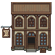 | 80x80 | unused |  | `pixel/assets_to_assess_and_use/more_buildings/Library.png` |
| `building_village_lumberjack_house` |  | 80x80 | used | building:lumberyard | `pixel/assets_to_assess_and_use/more_buildings/Lumberjack House.png` |
| `building_village_mansion` | 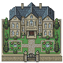 | 80x80 | unused |  | `pixel/assets_to_assess_and_use/more_buildings/Mansion.png` |
| `building_village_mapmakers_house` |  | 80x80 | unused |  | `pixel/assets_to_assess_and_use/more_buildings/Mapmakers House.png` |
| `building_village_mayors_residence` |  | 80x80 | unused |  | `pixel/assets_to_assess_and_use/more_buildings/Mayors Residence.png` |
| `building_village_merchant_house` |  | 80x80 | used | building:harbor | `pixel/assets_to_assess_and_use/more_buildings/Merchant House.png` |
| `building_village_mill_house` |  | 80x80 | used | building:saltworks | `pixel/assets_to_assess_and_use/more_buildings/Mill House.png` |
| `building_village_mine_entrance_building` |  | 80x80 | used | building:quarry | `pixel/assets_to_assess_and_use/more_buildings/Mine Entrance Building.png` |
| `building_village_musicians_house` |  | 80x80 | unused |  | `pixel/assets_to_assess_and_use/more_buildings/Musicians House.png` |
| `building_village_noble_house` |  | 80x80 | unused |  | `pixel/assets_to_assess_and_use/more_buildings/Noble House.png` |
| `building_village_observatory` | 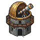 | 80x80 | unused |  | `pixel/assets_to_assess_and_use/more_buildings/Observatory.png` |
| `building_village_orphanage` | 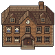 | 80x80 | unused |  | `pixel/assets_to_assess_and_use/more_buildings/Orphanage.png` |
| `building_village_painters_house` |  | 80x80 | used | building:dyeworks | `pixel/assets_to_assess_and_use/more_buildings/Painters House.png` |
| `building_village_perfumers_house` |  | 80x80 | used | building:venompress | `pixel/assets_to_assess_and_use/more_buildings/Perfumers House.png` |
| `building_village_post_house` |  | 80x80 | unused |  | `pixel/assets_to_assess_and_use/more_buildings/Post House.png` |
| `building_village_potters_house` |  | 80x80 | unused |  | `pixel/assets_to_assess_and_use/more_buildings/Potters House.png` |
| `building_village_prison_jail_house` |  | 80x80 | unused |  | `pixel/assets_to_assess_and_use/more_buildings/Prison Jail House.png` |
| `building_village_school_house` |  | 80x80 | unused |  | `pixel/assets_to_assess_and_use/more_buildings/School House.png` |
| `building_village_scribes_house` |  | 80x80 | unused |  | `pixel/assets_to_assess_and_use/more_buildings/Scribes House.png` |
| `building_village_small_wooden_cottage` |  | 80x80 | used | building:junglecamp | `pixel/assets_to_assess_and_use/more_buildings/Small Wooden Cottage.png` |
| `building_village_stable` | 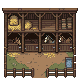 | 80x80 | unused |  | `pixel/assets_to_assess_and_use/more_buildings/Stable.png` |
| `building_village_stone_village_house` |  | 80x80 | unused |  | `pixel/assets_to_assess_and_use/more_buildings/Stone Village House.png` |
| `building_village_storage_house` |  | 80x80 | used | building:granary | `pixel/assets_to_assess_and_use/more_buildings/Storage House.png` |
| `building_village_tailors_house` |  | 80x80 | unused |  | `pixel/assets_to_assess_and_use/more_buildings/Tailors House.png` |
| `building_village_tavern` | 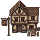 | 80x80 | unused |  | `pixel/assets_to_assess_and_use/more_buildings/Tavern.png` |
| `building_village_temple_building` |  | 80x80 | unused |  | `pixel/assets_to_assess_and_use/more_buildings/Temple Building.png` |
| `building_village_thieves_hideout` |  | 80x80 | unused |  | `pixel/assets_to_assess_and_use/more_buildings/Thieves Hideout.png` |
| `building_village_town_hall` |  | 80x80 | unused |  | `pixel/assets_to_assess_and_use/more_buildings/Town Hall.png` |
| `building_village_town_house` |  | 80x80 | unused |  | `pixel/assets_to_assess_and_use/more_buildings/Town House.png` |
| `building_village_toy_makers_house` |  | 80x80 | unused |  | `pixel/assets_to_assess_and_use/more_buildings/Toy Makers House.png` |
| `building_village_watchmakers_house` |  | 80x80 | unused |  | `pixel/assets_to_assess_and_use/more_buildings/Watchmakers House.png` |
| `building_village_wizard_hut` |  | 80x80 | used | building:sporecellar | `pixel/assets_to_assess_and_use/more_buildings/Wizard Hut.png` |
| `building_village_workshop_house` |  | 80x80 | used | building:deepmine | `pixel/assets_to_assess_and_use/more_buildings/Workshop House.png` |
