# Buildings

Generated by `npm run assets:catalog` from the game registries and `public/pixel/`. Do not edit by hand: rename an asset in `scripts/assets/names.json`.

The 16 map buildings, the 10 castle levels and the 7 castle skins (not wired yet), and the village packs waiting in the reuse pool.

248 assets. Refer to an asset by its **name**.

## castle

| Name | Picture | Size | Status | Used by | Source file |
| --- | --- | --- | --- | --- | --- |
| `castle_1` | 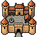 | 64x64 | used | castle level 1 | `pixel/castles/castle_1.png` |
| `castle_10` |  | 64x64 | used | castle level 10 | `pixel/castles/castle_10.png` |
| `castle_2` | 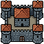 | 64x64 | used | castle level 2 | `pixel/castles/castle_2.png` |
| `castle_3` |  | 64x64 | used | castle level 3 | `pixel/castles/castle_3.png` |
| `castle_4` |  | 64x64 | used | castle level 4 | `pixel/castles/castle_4.png` |
| `castle_5` |  | 64x64 | used | castle level 5 | `pixel/castles/castle_5.png` |
| `castle_6` |  | 64x64 | used | castle level 6 | `pixel/castles/castle_6.png` |
| `castle_7` |  | 64x64 | used | castle level 7 | `pixel/castles/castle_7.png` |
| `castle_8` |  | 64x64 | used | castle level 8 | `pixel/castles/castle_8.png` |
| `castle_9` |  | 64x64 | used | castle level 9 | `pixel/castles/castle_9.png` |
| `castle_loading` | 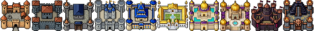 | 640x64 | used | loading screen | `pixel/castles/castle_loading.png` |

## castle skin

| Name | Picture | Size | Status | Used by | Source file |
| --- | --- | --- | --- | --- | --- |
| `castle_skin_1` |  | 64x64 | planned |  | `pixel/castles/castle_skin_1.png` |
| `castle_skin_2` |  | 64x64 | planned |  | `pixel/castles/castle_skin_2.png` |
| `castle_skin_3` |  | 64x64 | planned |  | `pixel/castles/castle_skin_3.png` |
| `castle_skin_4` |  | 64x64 | planned |  | `pixel/castles/castle_skin_4.png` |
| `castle_skin_5` |  | 64x64 | planned |  | `pixel/castles/castle_skin_5.png` |
| `castle_skin_6` |  | 64x64 | planned |  | `pixel/castles/castle_skin_6.png` |
| `castle_skin_7` |  | 64x64 | planned |  | `pixel/castles/castle_skin_7.png` |

## idol statues (alternatives)

| Name | Picture | Size | Status | Used by | Source file |
| --- | --- | --- | --- | --- | --- |
| `idol_alt_flower_stall` |  | 64x64 | reuse |  | `pixel/new_assets/idols/idol_alt_flower_stall.png` |
| `idol_alt_lava_obelisk` |  | 64x64 | reuse |  | `pixel/new_assets/idols/idol_alt_lava_obelisk.png` |
| `idol_alt_mossy_tree_face` |  | 64x64 | reuse |  | `pixel/new_assets/idols/idol_alt_mossy_tree_face.png` |
| `idol_alt_root_face` |  | 64x64 | reuse |  | `pixel/new_assets/idols/idol_alt_root_face.png` |
| `idol_alt_rune_stone` |  | 64x64 | reuse |  | `pixel/new_assets/idols/idol_alt_rune_stone.png` |
| `idol_alt_serpent_statue` |  | 64x64 | reuse |  | `pixel/new_assets/idols/idol_alt_serpent_statue.png` |
| `idol_alt_torii_gate` |  | 64x64 | reuse |  | `pixel/new_assets/idols/idol_alt_torii_gate.png` |
| `idol_alt_wooden_mask` |  | 64x64 | reuse |  | `pixel/new_assets/idols/idol_alt_wooden_mask.png` |

## idol statues (primary, planned)

| Name | Picture | Size | Status | Used by | Source file |
| --- | --- | --- | --- | --- | --- |
| `idol_battlefield_war_memorial` |  | 64x64 | planned |  | `pixel/new_assets/idols/idol_battlefield_war_memorial.png` |
| `idol_blight_maw_crystal` | 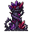 | 64x64 | planned |  | `pixel/new_assets/idols/idol_blight_maw_crystal.png` |
| `idol_coast_lighthouse` |  | 64x64 | planned |  | `pixel/new_assets/idols/idol_coast_lighthouse.png` |
| `idol_fields_sun_statue` |  | 64x64 | planned |  | `pixel/new_assets/idols/idol_fields_sun_statue.png` |
| `idol_forest_elder_tree` |  | 64x64 | planned |  | `pixel/new_assets/idols/idol_forest_elder_tree.png` |
| `idol_hills_ram_statue` |  | 64x64 | planned |  | `pixel/new_assets/idols/idol_hills_ram_statue.png` |
| `idol_jungle_totem_of_the_wild` |  | 64x64 | planned |  | `pixel/new_assets/idols/idol_jungle_totem_of_the_wild.png` |
| `idol_lake_eye_obelisk` |  | 64x64 | planned |  | `pixel/new_assets/idols/idol_lake_eye_obelisk.png` |
| `idol_orchard_blossom_shrine` |  | 64x64 | planned |  | `pixel/new_assets/idols/idol_orchard_blossom_shrine.png` |
| `idol_plains_wind_stones` |  | 64x64 | planned |  | `pixel/new_assets/idols/idol_plains_wind_stones.png` |
| `idol_swamp_witch_tree` |  | 64x64 | planned |  | `pixel/new_assets/idols/idol_swamp_witch_tree.png` |
| `idol_tundra_frost_totem` |  | 64x64 | planned |  | `pixel/new_assets/idols/idol_tundra_frost_totem.png` |

## idols (planned)

| Name | Picture | Size | Status | Used by | Source file |
| --- | --- | --- | --- | --- | --- |
| `idol_blue_gray_ruins` |  | 48x64 | planned | Idols, IDL-96 | `pixel/assets_to_assess_and_use/map_details_ruins_buildings/Assets/Blue-gray_ruins3.png` (variants: none, shadow, texture, texture-dark) |
| `idol_dark_totem` |  | 128x128 | planned | Idols, IDL-96 | `pixel/assets_to_assess_and_use/misc/Objects_separately/128/Dark_totem_dark_shadow2.png` |

## medieval pack 52px

| Name | Picture | Size | Status | Used by | Source file |
| --- | --- | --- | --- | --- | --- |
| `building_medieval_001` |  | 52x52 | reuse |  | `pixel/assets_to_assess_and_use/buildings/medieval-buildings-pixel-art-pack (1).png` |
| `building_medieval_002` |  | 52x52 | reuse |  | `pixel/assets_to_assess_and_use/buildings/medieval-buildings-pixel-art-pack (2).png` |
| `building_medieval_003` |  | 52x52 | reuse |  | `pixel/assets_to_assess_and_use/buildings/medieval-buildings-pixel-art-pack (3).png` |
| `building_medieval_004` |  | 52x52 | reuse |  | `pixel/assets_to_assess_and_use/buildings/medieval-buildings-pixel-art-pack (4).png` |
| `building_medieval_005` |  | 52x52 | reuse |  | `pixel/assets_to_assess_and_use/buildings/medieval-buildings-pixel-art-pack (5).png` |
| `building_medieval_006` |  | 52x52 | reuse |  | `pixel/assets_to_assess_and_use/buildings/medieval-buildings-pixel-art-pack (6).png` |
| `building_medieval_007` |  | 52x52 | reuse |  | `pixel/assets_to_assess_and_use/buildings/medieval-buildings-pixel-art-pack (7).png` |
| `building_medieval_008` |  | 52x52 | reuse |  | `pixel/assets_to_assess_and_use/buildings/medieval-buildings-pixel-art-pack (8).png` |
| `building_medieval_009` |  | 52x52 | reuse |  | `pixel/assets_to_assess_and_use/buildings/medieval-buildings-pixel-art-pack (9).png` |
| `building_medieval_010` |  | 52x52 | reuse |  | `pixel/assets_to_assess_and_use/buildings/medieval-buildings-pixel-art-pack (10).png` |
| `building_medieval_011` |  | 52x52 | reuse |  | `pixel/assets_to_assess_and_use/buildings/medieval-buildings-pixel-art-pack (11).png` |
| `building_medieval_012` |  | 52x52 | reuse |  | `pixel/assets_to_assess_and_use/buildings/medieval-buildings-pixel-art-pack (12).png` |
| `building_medieval_013` |  | 52x52 | reuse |  | `pixel/assets_to_assess_and_use/buildings/medieval-buildings-pixel-art-pack (13).png` |
| `building_medieval_014` |  | 52x52 | reuse |  | `pixel/assets_to_assess_and_use/buildings/medieval-buildings-pixel-art-pack (14).png` |
| `building_medieval_015` |  | 52x52 | reuse |  | `pixel/assets_to_assess_and_use/buildings/medieval-buildings-pixel-art-pack (15).png` |
| `building_medieval_016` |  | 52x52 | reuse |  | `pixel/assets_to_assess_and_use/buildings/medieval-buildings-pixel-art-pack (16).png` |
| `building_medieval_017` |  | 52x52 | reuse |  | `pixel/assets_to_assess_and_use/buildings/medieval-buildings-pixel-art-pack (17).png` |
| `building_medieval_018` |  | 52x52 | reuse |  | `pixel/assets_to_assess_and_use/buildings/medieval-buildings-pixel-art-pack (18).png` |
| `building_medieval_019` |  | 52x52 | reuse |  | `pixel/assets_to_assess_and_use/buildings/medieval-buildings-pixel-art-pack (19).png` |
| `building_medieval_020` |  | 52x52 | reuse |  | `pixel/assets_to_assess_and_use/buildings/medieval-buildings-pixel-art-pack (20).png` |
| `building_medieval_021` |  | 52x52 | reuse |  | `pixel/assets_to_assess_and_use/buildings/medieval-buildings-pixel-art-pack (21).png` |
| `building_medieval_022` |  | 52x52 | reuse |  | `pixel/assets_to_assess_and_use/buildings/medieval-buildings-pixel-art-pack (22).png` |
| `building_medieval_023` |  | 52x52 | reuse |  | `pixel/assets_to_assess_and_use/buildings/medieval-buildings-pixel-art-pack (23).png` |
| `building_medieval_024` |  | 52x52 | reuse |  | `pixel/assets_to_assess_and_use/buildings/medieval-buildings-pixel-art-pack (24).png` |
| `building_medieval_025` |  | 52x52 | reuse |  | `pixel/assets_to_assess_and_use/buildings/medieval-buildings-pixel-art-pack (25).png` |
| `building_medieval_026` |  | 52x52 | reuse |  | `pixel/assets_to_assess_and_use/buildings/medieval-buildings-pixel-art-pack (26).png` |
| `building_medieval_027` |  | 52x52 | reuse |  | `pixel/assets_to_assess_and_use/buildings/medieval-buildings-pixel-art-pack (27).png` |
| `building_medieval_028` |  | 52x52 | reuse |  | `pixel/assets_to_assess_and_use/buildings/medieval-buildings-pixel-art-pack (28).png` |
| `building_medieval_029` |  | 52x52 | reuse |  | `pixel/assets_to_assess_and_use/buildings/medieval-buildings-pixel-art-pack (29).png` |
| `building_medieval_030` |  | 52x52 | reuse |  | `pixel/assets_to_assess_and_use/buildings/medieval-buildings-pixel-art-pack (30).png` |
| `building_medieval_031` |  | 52x52 | reuse |  | `pixel/assets_to_assess_and_use/buildings/medieval-buildings-pixel-art-pack (31).png` |
| `building_medieval_032` |  | 52x52 | reuse |  | `pixel/assets_to_assess_and_use/buildings/medieval-buildings-pixel-art-pack (32).png` |
| `building_medieval_033` |  | 52x52 | reuse |  | `pixel/assets_to_assess_and_use/buildings/medieval-buildings-pixel-art-pack (33).png` |
| `building_medieval_034` |  | 52x52 | reuse |  | `pixel/assets_to_assess_and_use/buildings/medieval-buildings-pixel-art-pack (34).png` |
| `building_medieval_035` |  | 52x52 | reuse |  | `pixel/assets_to_assess_and_use/buildings/medieval-buildings-pixel-art-pack (35).png` |
| `building_medieval_036` |  | 52x52 | reuse |  | `pixel/assets_to_assess_and_use/buildings/medieval-buildings-pixel-art-pack (36).png` |
| `building_medieval_037` |  | 52x52 | reuse |  | `pixel/assets_to_assess_and_use/buildings/medieval-buildings-pixel-art-pack (37).png` |
| `building_medieval_038` |  | 52x52 | reuse |  | `pixel/assets_to_assess_and_use/buildings/medieval-buildings-pixel-art-pack (38).png` |
| `building_medieval_039` |  | 52x52 | reuse |  | `pixel/assets_to_assess_and_use/buildings/medieval-buildings-pixel-art-pack (39).png` |
| `building_medieval_040` |  | 52x52 | reuse |  | `pixel/assets_to_assess_and_use/buildings/medieval-buildings-pixel-art-pack (40).png` |
| `building_medieval_041` |  | 52x52 | reuse |  | `pixel/assets_to_assess_and_use/buildings/medieval-buildings-pixel-art-pack (41).png` |
| `building_medieval_042` |  | 52x52 | reuse |  | `pixel/assets_to_assess_and_use/buildings/medieval-buildings-pixel-art-pack (42).png` |
| `building_medieval_043` |  | 52x52 | reuse |  | `pixel/assets_to_assess_and_use/buildings/medieval-buildings-pixel-art-pack (43).png` |
| `building_medieval_044` |  | 52x52 | reuse |  | `pixel/assets_to_assess_and_use/buildings/medieval-buildings-pixel-art-pack (44).png` |
| `building_medieval_045` |  | 52x52 | reuse |  | `pixel/assets_to_assess_and_use/buildings/medieval-buildings-pixel-art-pack (45).png` |
| `building_medieval_046` |  | 52x52 | reuse |  | `pixel/assets_to_assess_and_use/buildings/medieval-buildings-pixel-art-pack (46).png` |
| `building_medieval_047` |  | 52x52 | reuse |  | `pixel/assets_to_assess_and_use/buildings/medieval-buildings-pixel-art-pack (47).png` |
| `building_medieval_048` |  | 52x52 | reuse |  | `pixel/assets_to_assess_and_use/buildings/medieval-buildings-pixel-art-pack (48).png` |
| `building_medieval_049` |  | 52x52 | reuse |  | `pixel/assets_to_assess_and_use/buildings/medieval-buildings-pixel-art-pack (49).png` |
| `building_medieval_050` |  | 52x52 | reuse |  | `pixel/assets_to_assess_and_use/buildings/medieval-buildings-pixel-art-pack (50).png` |
| `building_medieval_051` |  | 52x52 | reuse |  | `pixel/assets_to_assess_and_use/buildings/medieval-buildings-pixel-art-pack (51).png` |
| `building_medieval_052` |  | 52x52 | reuse |  | `pixel/assets_to_assess_and_use/buildings/medieval-buildings-pixel-art-pack (52).png` |
| `building_medieval_053` |  | 52x52 | reuse |  | `pixel/assets_to_assess_and_use/buildings/medieval-buildings-pixel-art-pack (53).png` |
| `building_medieval_054` |  | 52x52 | reuse |  | `pixel/assets_to_assess_and_use/buildings/medieval-buildings-pixel-art-pack (54).png` |
| `building_medieval_055` |  | 52x52 | reuse |  | `pixel/assets_to_assess_and_use/buildings/medieval-buildings-pixel-art-pack (55).png` |
| `building_medieval_056` |  | 52x52 | reuse |  | `pixel/assets_to_assess_and_use/buildings/medieval-buildings-pixel-art-pack (56).png` |
| `building_medieval_057` |  | 52x52 | reuse |  | `pixel/assets_to_assess_and_use/buildings/medieval-buildings-pixel-art-pack (57).png` |
| `building_medieval_058` |  | 52x52 | reuse |  | `pixel/assets_to_assess_and_use/buildings/medieval-buildings-pixel-art-pack (58).png` |
| `building_medieval_059` |  | 52x52 | reuse |  | `pixel/assets_to_assess_and_use/buildings/medieval-buildings-pixel-art-pack (59).png` |
| `building_medieval_060` |  | 52x52 | reuse |  | `pixel/assets_to_assess_and_use/buildings/medieval-buildings-pixel-art-pack (60).png` |
| `building_medieval_061` |  | 52x52 | reuse |  | `pixel/assets_to_assess_and_use/buildings/medieval-buildings-pixel-art-pack (61).png` |
| `building_medieval_062` |  | 52x52 | reuse |  | `pixel/assets_to_assess_and_use/buildings/medieval-buildings-pixel-art-pack (62).png` |
| `building_medieval_063` |  | 52x52 | reuse |  | `pixel/assets_to_assess_and_use/buildings/medieval-buildings-pixel-art-pack (63).png` |
| `building_medieval_064` |  | 52x52 | reuse |  | `pixel/assets_to_assess_and_use/buildings/medieval-buildings-pixel-art-pack (64).png` |
| `building_medieval_065` |  | 52x52 | reuse |  | `pixel/assets_to_assess_and_use/buildings/medieval-buildings-pixel-art-pack (65).png` |
| `building_medieval_066` |  | 52x52 | reuse |  | `pixel/assets_to_assess_and_use/buildings/medieval-buildings-pixel-art-pack (66).png` |
| `building_medieval_067` |  | 52x52 | reuse |  | `pixel/assets_to_assess_and_use/buildings/medieval-buildings-pixel-art-pack (67).png` |
| `building_medieval_068` |  | 52x52 | reuse |  | `pixel/assets_to_assess_and_use/buildings/medieval-buildings-pixel-art-pack (68).png` |
| `building_medieval_069` |  | 52x52 | reuse |  | `pixel/assets_to_assess_and_use/buildings/medieval-buildings-pixel-art-pack (69).png` |
| `building_medieval_070` |  | 52x52 | reuse |  | `pixel/assets_to_assess_and_use/buildings/medieval-buildings-pixel-art-pack (70).png` |
| `building_medieval_071` |  | 52x52 | reuse |  | `pixel/assets_to_assess_and_use/buildings/medieval-buildings-pixel-art-pack (71).png` |
| `building_medieval_072` |  | 52x52 | reuse |  | `pixel/assets_to_assess_and_use/buildings/medieval-buildings-pixel-art-pack (72).png` |
| `building_medieval_073` |  | 52x52 | reuse |  | `pixel/assets_to_assess_and_use/buildings/medieval-buildings-pixel-art-pack (73).png` |
| `building_medieval_074` |  | 52x52 | reuse |  | `pixel/assets_to_assess_and_use/buildings/medieval-buildings-pixel-art-pack (74).png` |
| `building_medieval_075` |  | 52x52 | reuse |  | `pixel/assets_to_assess_and_use/buildings/medieval-buildings-pixel-art-pack (75).png` |
| `building_medieval_076` |  | 52x52 | reuse |  | `pixel/assets_to_assess_and_use/buildings/medieval-buildings-pixel-art-pack (76).png` |
| `building_medieval_077` |  | 52x52 | reuse |  | `pixel/assets_to_assess_and_use/buildings/medieval-buildings-pixel-art-pack (77).png` |
| `building_medieval_078` |  | 52x52 | reuse |  | `pixel/assets_to_assess_and_use/buildings/medieval-buildings-pixel-art-pack (78).png` |
| `building_medieval_079` |  | 52x52 | reuse |  | `pixel/assets_to_assess_and_use/buildings/medieval-buildings-pixel-art-pack (79).png` |
| `building_medieval_080` |  | 52x52 | reuse |  | `pixel/assets_to_assess_and_use/buildings/medieval-buildings-pixel-art-pack (80).png` |
| `building_medieval_081` |  | 52x52 | reuse |  | `pixel/assets_to_assess_and_use/buildings/medieval-buildings-pixel-art-pack (81).png` |
| `building_medieval_082` |  | 52x52 | reuse |  | `pixel/assets_to_assess_and_use/buildings/medieval-buildings-pixel-art-pack (82).png` |
| `building_medieval_083` |  | 52x52 | reuse |  | `pixel/assets_to_assess_and_use/buildings/medieval-buildings-pixel-art-pack (83).png` |
| `building_medieval_084` |  | 52x52 | reuse |  | `pixel/assets_to_assess_and_use/buildings/medieval-buildings-pixel-art-pack (84).png` |
| `building_medieval_085` |  | 52x52 | reuse |  | `pixel/assets_to_assess_and_use/buildings/medieval-buildings-pixel-art-pack (85).png` |
| `building_medieval_086` |  | 52x52 | reuse |  | `pixel/assets_to_assess_and_use/buildings/medieval-buildings-pixel-art-pack (86).png` |
| `building_medieval_087` |  | 52x52 | reuse |  | `pixel/assets_to_assess_and_use/buildings/medieval-buildings-pixel-art-pack (87).png` |
| `building_medieval_088` |  | 52x52 | reuse |  | `pixel/assets_to_assess_and_use/buildings/medieval-buildings-pixel-art-pack (88).png` |
| `building_medieval_089` |  | 52x52 | reuse |  | `pixel/assets_to_assess_and_use/buildings/medieval-buildings-pixel-art-pack (89).png` |
| `building_medieval_090` |  | 52x52 | reuse |  | `pixel/assets_to_assess_and_use/buildings/medieval-buildings-pixel-art-pack (90).png` |
| `building_medieval_091` |  | 52x52 | reuse |  | `pixel/assets_to_assess_and_use/buildings/medieval-buildings-pixel-art-pack (91).png` |
| `building_medieval_092` |  | 52x52 | reuse |  | `pixel/assets_to_assess_and_use/buildings/medieval-buildings-pixel-art-pack (92).png` |
| `building_medieval_093` |  | 52x52 | reuse |  | `pixel/assets_to_assess_and_use/buildings/medieval-buildings-pixel-art-pack (93).png` |
| `building_medieval_094` |  | 52x52 | reuse |  | `pixel/assets_to_assess_and_use/buildings/medieval-buildings-pixel-art-pack (94).png` |
| `building_medieval_095` |  | 52x52 | reuse |  | `pixel/assets_to_assess_and_use/buildings/medieval-buildings-pixel-art-pack (95).png` |
| `building_medieval_096` |  | 52x52 | reuse |  | `pixel/assets_to_assess_and_use/buildings/medieval-buildings-pixel-art-pack (96).png` |
| `building_medieval_097` |  | 52x52 | reuse |  | `pixel/assets_to_assess_and_use/buildings/medieval-buildings-pixel-art-pack (97).png` |
| `building_medieval_098` |  | 52x52 | reuse |  | `pixel/assets_to_assess_and_use/buildings/medieval-buildings-pixel-art-pack (98).png` |
| `building_medieval_099` |  | 52x52 | reuse |  | `pixel/assets_to_assess_and_use/buildings/medieval-buildings-pixel-art-pack (99).png` |
| `building_medieval_100` |  | 52x52 | reuse |  | `pixel/assets_to_assess_and_use/buildings/medieval-buildings-pixel-art-pack (100).png` |
| `building_medieval_101` |  | 52x52 | reuse |  | `pixel/assets_to_assess_and_use/buildings/medieval-buildings-pixel-art-pack (101).png` |
| `building_medieval_102` |  | 52x52 | reuse |  | `pixel/assets_to_assess_and_use/buildings/medieval-buildings-pixel-art-pack (102).png` |
| `building_medieval_103` |  | 52x52 | reuse |  | `pixel/assets_to_assess_and_use/buildings/medieval-buildings-pixel-art-pack (103).png` |
| `building_medieval_104` |  | 52x52 | reuse |  | `pixel/assets_to_assess_and_use/buildings/medieval-buildings-pixel-art-pack (104).png` |
| `building_medieval_105` |  | 52x52 | reuse |  | `pixel/assets_to_assess_and_use/buildings/medieval-buildings-pixel-art-pack (105).png` |
| `building_medieval_106` |  | 52x52 | reuse |  | `pixel/assets_to_assess_and_use/buildings/medieval-buildings-pixel-art-pack (106).png` |
| `building_medieval_107` |  | 52x52 | reuse |  | `pixel/assets_to_assess_and_use/buildings/medieval-buildings-pixel-art-pack (107).png` |
| `building_medieval_108` |  | 52x52 | reuse |  | `pixel/assets_to_assess_and_use/buildings/medieval-buildings-pixel-art-pack (108).png` |
| `building_medieval_109` |  | 52x52 | reuse |  | `pixel/assets_to_assess_and_use/buildings/medieval-buildings-pixel-art-pack (109).png` |
| `building_medieval_110` |  | 52x52 | reuse |  | `pixel/assets_to_assess_and_use/buildings/medieval-buildings-pixel-art-pack (110).png` |
| `building_medieval_111` |  | 52x52 | reuse |  | `pixel/assets_to_assess_and_use/buildings/medieval-buildings-pixel-art-pack (111).png` |
| `building_medieval_112` |  | 52x52 | reuse |  | `pixel/assets_to_assess_and_use/buildings/medieval-buildings-pixel-art-pack (112).png` |
| `building_medieval_113` |  | 52x52 | reuse |  | `pixel/assets_to_assess_and_use/buildings/medieval-buildings-pixel-art-pack (113).png` |
| `building_medieval_114` |  | 52x52 | reuse |  | `pixel/assets_to_assess_and_use/buildings/medieval-buildings-pixel-art-pack (114).png` |
| `building_medieval_115` |  | 52x52 | reuse |  | `pixel/assets_to_assess_and_use/buildings/medieval-buildings-pixel-art-pack (115).png` |
| `building_medieval_116` |  | 52x52 | reuse |  | `pixel/assets_to_assess_and_use/buildings/medieval-buildings-pixel-art-pack (116).png` |
| `building_medieval_117` |  | 52x52 | reuse |  | `pixel/assets_to_assess_and_use/buildings/medieval-buildings-pixel-art-pack (117).png` |
| `building_medieval_118` |  | 52x52 | reuse |  | `pixel/assets_to_assess_and_use/buildings/medieval-buildings-pixel-art-pack (118).png` |
| `building_medieval_119` |  | 52x52 | reuse |  | `pixel/assets_to_assess_and_use/buildings/medieval-buildings-pixel-art-pack (119).png` |
| `building_medieval_120` |  | 52x52 | reuse |  | `pixel/assets_to_assess_and_use/buildings/medieval-buildings-pixel-art-pack (120).png` |
| `building_medieval_121` |  | 52x52 | reuse |  | `pixel/assets_to_assess_and_use/buildings/medieval-buildings-pixel-art-pack (121).png` |
| `building_medieval_122` |  | 52x52 | reuse |  | `pixel/assets_to_assess_and_use/buildings/medieval-buildings-pixel-art-pack (122).png` |
| `building_medieval_123` |  | 52x52 | reuse |  | `pixel/assets_to_assess_and_use/buildings/medieval-buildings-pixel-art-pack (123).png` |
| `building_medieval_124` |  | 52x52 | reuse |  | `pixel/assets_to_assess_and_use/buildings/medieval-buildings-pixel-art-pack (124).png` |
| `building_medieval_125` |  | 52x52 | reuse |  | `pixel/assets_to_assess_and_use/buildings/medieval-buildings-pixel-art-pack (125).png` |
| `building_medieval_126` |  | 52x52 | reuse |  | `pixel/assets_to_assess_and_use/buildings/medieval-buildings-pixel-art-pack (126).png` |
| `building_medieval_127` |  | 52x52 | reuse |  | `pixel/assets_to_assess_and_use/buildings/medieval-buildings-pixel-art-pack (127).png` |
| `building_medieval_128` |  | 52x52 | reuse |  | `pixel/assets_to_assess_and_use/buildings/medieval-buildings-pixel-art-pack (128).png` |
| `building_medieval_129` |  | 52x52 | reuse |  | `pixel/assets_to_assess_and_use/buildings/medieval-buildings-pixel-art-pack (129).png` |
| `building_medieval_130` |  | 52x52 | reuse |  | `pixel/assets_to_assess_and_use/buildings/medieval-buildings-pixel-art-pack (130).png` |
| `building_medieval_131` |  | 52x52 | reuse |  | `pixel/assets_to_assess_and_use/buildings/medieval-buildings-pixel-art-pack (131).png` |
| `building_medieval_132` |  | 52x52 | reuse |  | `pixel/assets_to_assess_and_use/buildings/medieval-buildings-pixel-art-pack (132).png` |
| `building_medieval_133` |  | 52x52 | reuse |  | `pixel/assets_to_assess_and_use/buildings/medieval-buildings-pixel-art-pack (133).png` |
| `building_medieval_134` |  | 52x52 | reuse |  | `pixel/assets_to_assess_and_use/buildings/medieval-buildings-pixel-art-pack (134).png` |
| `building_medieval_135` |  | 52x52 | reuse |  | `pixel/assets_to_assess_and_use/buildings/medieval-buildings-pixel-art-pack (135).png` |
| `building_medieval_136` |  | 52x52 | reuse |  | `pixel/assets_to_assess_and_use/buildings/medieval-buildings-pixel-art-pack (136).png` |
| `building_medieval_137` |  | 52x52 | reuse |  | `pixel/assets_to_assess_and_use/buildings/medieval-buildings-pixel-art-pack (137).png` |
| `building_medieval_138` |  | 52x52 | reuse |  | `pixel/assets_to_assess_and_use/buildings/medieval-buildings-pixel-art-pack (138).png` |
| `building_medieval_139` |  | 52x52 | reuse |  | `pixel/assets_to_assess_and_use/buildings/medieval-buildings-pixel-art-pack (139).png` |
| `building_medieval_140` |  | 52x52 | reuse |  | `pixel/assets_to_assess_and_use/buildings/medieval-buildings-pixel-art-pack (140).png` |
| `building_medieval_141` |  | 52x52 | reuse |  | `pixel/assets_to_assess_and_use/buildings/medieval-buildings-pixel-art-pack (141).png` |
| `building_medieval_142` |  | 52x52 | reuse |  | `pixel/assets_to_assess_and_use/buildings/medieval-buildings-pixel-art-pack (142).png` |
| `building_medieval_143` |  | 52x52 | reuse |  | `pixel/assets_to_assess_and_use/buildings/medieval-buildings-pixel-art-pack (143).png` |
| `building_medieval_144` |  | 52x52 | reuse |  | `pixel/assets_to_assess_and_use/buildings/medieval-buildings-pixel-art-pack (144).png` |
| `building_medieval_145` |  | 52x52 | reuse |  | `pixel/assets_to_assess_and_use/buildings/medieval-buildings-pixel-art-pack (145).png` |
| `building_medieval_146` |  | 52x52 | reuse |  | `pixel/assets_to_assess_and_use/buildings/medieval-buildings-pixel-art-pack (146).png` |
| `building_medieval_147` |  | 52x52 | reuse |  | `pixel/assets_to_assess_and_use/buildings/medieval-buildings-pixel-art-pack (147).png` |
| `building_medieval_148` |  | 52x52 | reuse |  | `pixel/assets_to_assess_and_use/buildings/medieval-buildings-pixel-art-pack (148).png` |
| `building_medieval_149` |  | 52x52 | reuse |  | `pixel/assets_to_assess_and_use/buildings/medieval-buildings-pixel-art-pack (149).png` |
| `building_medieval_150` |  | 52x52 | reuse |  | `pixel/assets_to_assess_and_use/buildings/medieval-buildings-pixel-art-pack (150).png` |

## village pack 80px (named)

| Name | Picture | Size | Status | Used by | Source file |
| --- | --- | --- | --- | --- | --- |
| `building_village_abandoned_house` |  | 80x80 | reuse |  | `pixel/assets_to_assess_and_use/more_buildings/Abandoned House.png` |
| `building_village_abandoned_house_2` |  | 80x80 | reuse |  | `pixel/assets_to_assess_and_use/more_buildings/Abandoned House 2.png` |
| `building_village_abandoned_tower` |  | 80x80 | reuse |  | `pixel/assets_to_assess_and_use/more_buildings/Abandoned Tower.png` |
| `building_village_adventurers_guild` |  | 80x80 | reuse |  | `pixel/assets_to_assess_and_use/more_buildings/Adventurers Guild.png` |
| `building_village_bakery` | 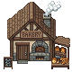 | 80x80 | reuse |  | `pixel/assets_to_assess_and_use/more_buildings/Bakery.png` |
| `building_village_beekeepers_hut` |  | 80x80 | reuse |  | `pixel/assets_to_assess_and_use/more_buildings/Beekeepers Hut.png` |
| `building_village_blacksmith_house` |  | 80x80 | used | building:coalpit | `pixel/assets_to_assess_and_use/more_buildings/Blacksmith House.png` |
| `building_village_bookbinders_house` |  | 80x80 | reuse |  | `pixel/assets_to_assess_and_use/more_buildings/Bookbinders House.png` |
| `building_village_brewers_house` |  | 80x80 | reuse |  | `pixel/assets_to_assess_and_use/more_buildings/Brewers House.png` |
| `building_village_butcher_shop` |  | 80x80 | reuse |  | `pixel/assets_to_assess_and_use/more_buildings/Butcher Shop.png` |
| `building_village_carpenters_house` |  | 80x80 | used | building:saptapper | `pixel/assets_to_assess_and_use/more_buildings/Carpenters House.png` |
| `building_village_cheese_makers_house` |  | 80x80 | reuse |  | `pixel/assets_to_assess_and_use/more_buildings/Cheese Makers House.png` |
| `building_village_church` | 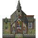 | 80x80 | reuse |  | `pixel/assets_to_assess_and_use/more_buildings/Church.png` |
| `building_village_clock_tower_building` |  | 80x80 | reuse |  | `pixel/assets_to_assess_and_use/more_buildings/Clock Tower Building.png` |
| `building_village_doctors_house` |  | 80x80 | reuse |  | `pixel/assets_to_assess_and_use/more_buildings/Doctors House.png` |
| `building_village_farmers_house` |  | 80x80 | reuse |  | `pixel/assets_to_assess_and_use/more_buildings/Farmers House.png` |
| `building_village_fishermans_hut` |  | 80x80 | used | building:fishery | `pixel/assets_to_assess_and_use/more_buildings/Fishermans Hut.png` |
| `building_village_florists_house` |  | 80x80 | reuse |  | `pixel/assets_to_assess_and_use/more_buildings/Florists House.png` |
| `building_village_fortune_tellers_tent` |  | 80x80 | reuse |  | `pixel/assets_to_assess_and_use/more_buildings/Fortune Tellers Tent.png` |
| `building_village_general_store` |  | 80x80 | reuse |  | `pixel/assets_to_assess_and_use/more_buildings/General Store.png` |
| `building_village_glassmakers_house` |  | 80x80 | reuse |  | `pixel/assets_to_assess_and_use/more_buildings/Glassmakers House.png` |
| `building_village_guard_house` |  | 80x80 | reuse |  | `pixel/assets_to_assess_and_use/more_buildings/Guard House.png` |
| `building_village_herbalist_house` |  | 80x80 | used | building:herbgarden | `pixel/assets_to_assess_and_use/more_buildings/Herbalist House.png` |
| `building_village_hunters_cabin` |  | 80x80 | used | building:icecutter | `pixel/assets_to_assess_and_use/more_buildings/Hunters Cabin.png` |
| `building_village_jewelers_house` |  | 80x80 | used | building:pearldiver | `pixel/assets_to_assess_and_use/more_buildings/Jewelers House.png` |
| `building_village_library` | 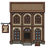 | 80x80 | reuse |  | `pixel/assets_to_assess_and_use/more_buildings/Library.png` |
| `building_village_lumberjack_house` |  | 80x80 | used | building:lumberyard | `pixel/assets_to_assess_and_use/more_buildings/Lumberjack House.png` |
| `building_village_mansion` | 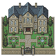 | 80x80 | reuse |  | `pixel/assets_to_assess_and_use/more_buildings/Mansion.png` |
| `building_village_mapmakers_house` |  | 80x80 | reuse |  | `pixel/assets_to_assess_and_use/more_buildings/Mapmakers House.png` |
| `building_village_mayors_residence` |  | 80x80 | reuse |  | `pixel/assets_to_assess_and_use/more_buildings/Mayors Residence.png` |
| `building_village_merchant_house` |  | 80x80 | used | building:harbor | `pixel/assets_to_assess_and_use/more_buildings/Merchant House.png` |
| `building_village_mill_house` |  | 80x80 | used | building:saltworks | `pixel/assets_to_assess_and_use/more_buildings/Mill House.png` |
| `building_village_mine_entrance_building` |  | 80x80 | used | building:quarry | `pixel/assets_to_assess_and_use/more_buildings/Mine Entrance Building.png` |
| `building_village_musicians_house` |  | 80x80 | reuse |  | `pixel/assets_to_assess_and_use/more_buildings/Musicians House.png` |
| `building_village_noble_house` |  | 80x80 | reuse |  | `pixel/assets_to_assess_and_use/more_buildings/Noble House.png` |
| `building_village_observatory` |  | 80x80 | reuse |  | `pixel/assets_to_assess_and_use/more_buildings/Observatory.png` |
| `building_village_orphanage` | 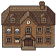 | 80x80 | reuse |  | `pixel/assets_to_assess_and_use/more_buildings/Orphanage.png` |
| `building_village_painters_house` |  | 80x80 | reuse |  | `pixel/assets_to_assess_and_use/more_buildings/Painters House.png` |
| `building_village_perfumers_house` |  | 80x80 | reuse |  | `pixel/assets_to_assess_and_use/more_buildings/Perfumers House.png` |
| `building_village_post_house` |  | 80x80 | reuse |  | `pixel/assets_to_assess_and_use/more_buildings/Post House.png` |
| `building_village_potters_house` |  | 80x80 | reuse |  | `pixel/assets_to_assess_and_use/more_buildings/Potters House.png` |
| `building_village_prison_jail_house` |  | 80x80 | reuse |  | `pixel/assets_to_assess_and_use/more_buildings/Prison Jail House.png` |
| `building_village_school_house` |  | 80x80 | reuse |  | `pixel/assets_to_assess_and_use/more_buildings/School House.png` |
| `building_village_scribes_house` |  | 80x80 | reuse |  | `pixel/assets_to_assess_and_use/more_buildings/Scribes House.png` |
| `building_village_small_wooden_cottage` |  | 80x80 | used | building:peatworks | `pixel/assets_to_assess_and_use/more_buildings/Small Wooden Cottage.png` |
| `building_village_stable` | 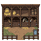 | 80x80 | reuse |  | `pixel/assets_to_assess_and_use/more_buildings/Stable.png` |
| `building_village_stone_village_house` |  | 80x80 | reuse |  | `pixel/assets_to_assess_and_use/more_buildings/Stone Village House.png` |
| `building_village_storage_house` |  | 80x80 | used | building:granary | `pixel/assets_to_assess_and_use/more_buildings/Storage House.png` |
| `building_village_tailors_house` |  | 80x80 | reuse |  | `pixel/assets_to_assess_and_use/more_buildings/Tailors House.png` |
| `building_village_tavern` | 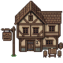 | 80x80 | reuse |  | `pixel/assets_to_assess_and_use/more_buildings/Tavern.png` |
| `building_village_temple_building` |  | 80x80 | reuse |  | `pixel/assets_to_assess_and_use/more_buildings/Temple Building.png` |
| `building_village_thieves_hideout` |  | 80x80 | reuse |  | `pixel/assets_to_assess_and_use/more_buildings/Thieves Hideout.png` |
| `building_village_town_hall` |  | 80x80 | reuse |  | `pixel/assets_to_assess_and_use/more_buildings/Town Hall.png` |
| `building_village_town_house` |  | 80x80 | reuse |  | `pixel/assets_to_assess_and_use/more_buildings/Town House.png` |
| `building_village_toy_makers_house` |  | 80x80 | reuse |  | `pixel/assets_to_assess_and_use/more_buildings/Toy Makers House.png` |
| `building_village_watchmakers_house` |  | 80x80 | reuse |  | `pixel/assets_to_assess_and_use/more_buildings/Watchmakers House.png` |
| `building_village_wizard_hut` |  | 80x80 | used | building:sporecellar | `pixel/assets_to_assess_and_use/more_buildings/Wizard Hut.png` |
| `building_village_workshop_house` |  | 80x80 | used | building:deepmine | `pixel/assets_to_assess_and_use/more_buildings/Workshop House.png` |
