# Map details

Generated by `npm run assets:catalog` from the game registries and `public/pixel/`. Do not edit by hand: rename an asset in `scripts/assets/names.json`.

Trees, bushes, rocks, minerals, ruins, props and creatures to dress the map. None is wired yet; use a variant that matches the ground.

471 assets. Refer to an asset by its **name**.

## bushes

| Name | Picture | Size | Status | Used by | Source file |
| --- | --- | --- | --- | --- | --- |
| `bush_autumn_bush1` | 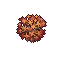 | 64x64 | reuse |  | `pixel/assets_to_assess_and_use/bushes_map_details_mostly/Assets/Autumn_bush1.png` (variants: none, shadow, texture, texture-dark) |
| `bush_autumn_bush2` | 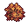 | 32x32 | reuse |  | `pixel/assets_to_assess_and_use/bushes_map_details_mostly/Assets/Autumn_bush2.png` (variants: none, shadow, texture, texture-dark) |
| `bush_autumn_bush3` |  | 16x16 | reuse |  | `pixel/assets_to_assess_and_use/bushes_map_details_mostly/Assets/Autumn_bush3.png` (variants: none, shadow, texture, texture-dark) |
| `bush_blue_flowers1` | 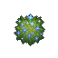 | 64x64 | reuse |  | `pixel/assets_to_assess_and_use/bushes_map_details_mostly/Assets/Bush_blue_flowers1.png` (variants: none, shadow, texture, texture-dark) |
| `bush_blue_flowers2` | 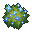 | 32x32 | reuse |  | `pixel/assets_to_assess_and_use/bushes_map_details_mostly/Assets/Bush_blue_flowers2.png` (variants: none, shadow, texture, texture-dark) |
| `bush_blue_flowers3` |  | 16x16 | reuse |  | `pixel/assets_to_assess_and_use/bushes_map_details_mostly/Assets/Bush_blue_flowers3.png` (variants: none, shadow, texture, texture-dark) |
| `bush_broken_tree1` |  | 16x16 | reuse |  | `pixel/assets_to_assess_and_use/bushes_map_details_mostly/Assets/Broken_tree1.png` (variants: none, shadow, texture, texture-dark) |
| `bush_broken_tree2` |  | 16x16 | reuse |  | `pixel/assets_to_assess_and_use/bushes_map_details_mostly/Assets/Broken_tree2.png` (variants: none, shadow, texture, texture-dark) |
| `bush_burned_tree1` |  | 32x32 | reuse |  | `pixel/assets_to_assess_and_use/bushes_map_details_mostly/Assets/Burned_tree1.png` (variants: none, shadow, texture, texture-dark) |
| `bush_burned_tree2` |  | 32x32 | reuse |  | `pixel/assets_to_assess_and_use/bushes_map_details_mostly/Assets/Burned_tree2.png` (variants: none, shadow, texture, texture-dark) |
| `bush_cactus1_1` |  | 32x32 | reuse |  | `pixel/assets_to_assess_and_use/bushes_map_details_mostly/Assets/Cactus1_1.png` (variants: none, shadow, texture, texture-dark) |
| `bush_cactus1_2` |  | 32x32 | reuse |  | `pixel/assets_to_assess_and_use/bushes_map_details_mostly/Assets/Cactus1_2.png` (variants: none, shadow, texture, texture-dark) |
| `bush_cactus1_3` |  | 16x16 | reuse |  | `pixel/assets_to_assess_and_use/bushes_map_details_mostly/Assets/Cactus1_3.png` (variants: none, shadow, texture, texture-dark) |
| `bush_cactus2_1` |  | 64x64 | reuse |  | `pixel/assets_to_assess_and_use/bushes_map_details_mostly/Assets/Cactus2_1.png` (variants: none, shadow, texture, texture-dark) |
| `bush_cactus2_2` |  | 32x32 | reuse |  | `pixel/assets_to_assess_and_use/bushes_map_details_mostly/Assets/Cactus2_2.png` (variants: none, shadow, texture, texture-dark) |
| `bush_cactus2_3` |  | 16x16 | reuse |  | `pixel/assets_to_assess_and_use/bushes_map_details_mostly/Assets/Cactus2_3.png` (variants: none, shadow, texture, texture-dark) |
| `bush_fern1_1` |  | 64x64 | reuse |  | `pixel/assets_to_assess_and_use/bushes_map_details_mostly/Assets/Fern1_1.png` (variants: none, shadow, texture, texture-dark) |
| `bush_fern1_2` |  | 32x32 | reuse |  | `pixel/assets_to_assess_and_use/bushes_map_details_mostly/Assets/Fern1_2.png` (variants: none, shadow, texture, texture-dark) |
| `bush_fern1_3` |  | 16x16 | reuse |  | `pixel/assets_to_assess_and_use/bushes_map_details_mostly/Assets/Fern1_3.png` (variants: none, shadow, texture, texture-dark) |
| `bush_fern2_1` |  | 64x64 | reuse |  | `pixel/assets_to_assess_and_use/bushes_map_details_mostly/Assets/Fern2_1.png` (variants: none, shadow, texture, texture-dark) |
| `bush_fern2_2` |  | 32x32 | reuse |  | `pixel/assets_to_assess_and_use/bushes_map_details_mostly/Assets/Fern2_2.png` (variants: none, shadow, texture, texture-dark) |
| `bush_fern2_3` |  | 16x16 | reuse |  | `pixel/assets_to_assess_and_use/bushes_map_details_mostly/Assets/Fern2_3.png` (variants: none, shadow, texture, texture-dark) |
| `bush_orange_flowers1` |  | 64x64 | reuse |  | `pixel/assets_to_assess_and_use/bushes_map_details_mostly/Assets/Bush_orange_flowers1.png` (variants: none, shadow, texture, texture-dark) |
| `bush_orange_flowers2` |  | 32x32 | reuse |  | `pixel/assets_to_assess_and_use/bushes_map_details_mostly/Assets/Bush_orange_flowers2.png` (variants: none, shadow, texture, texture-dark) |
| `bush_orange_flowers3` |  | 16x16 | reuse |  | `pixel/assets_to_assess_and_use/bushes_map_details_mostly/Assets/Bush_orange_flowers3.png` (variants: none, shadow, texture, texture-dark) |
| `bush_pink_flowers1` |  | 64x64 | reuse |  | `pixel/assets_to_assess_and_use/bushes_map_details_mostly/Assets/Bush_pink_flowers1.png` (variants: none, shadow, texture, texture-dark) |
| `bush_pink_flowers2` |  | 32x32 | reuse |  | `pixel/assets_to_assess_and_use/bushes_map_details_mostly/Assets/Bush_pink_flowers2.png` (variants: none, shadow, texture, texture-dark) |
| `bush_pink_flowers3` |  | 16x16 | reuse |  | `pixel/assets_to_assess_and_use/bushes_map_details_mostly/Assets/Bush_pink_flowers3.png` (variants: none, shadow, texture, texture-dark) |
| `bush_red_flowers1` |  | 64x64 | reuse |  | `pixel/assets_to_assess_and_use/bushes_map_details_mostly/Assets/Bush_red_flowers1.png` (variants: none, shadow, texture, texture-dark) |
| `bush_red_flowers2` |  | 32x32 | reuse |  | `pixel/assets_to_assess_and_use/bushes_map_details_mostly/Assets/Bush_red_flowers2.png` (variants: none, shadow, texture, texture-dark) |
| `bush_red_flowers3` |  | 16x16 | reuse |  | `pixel/assets_to_assess_and_use/bushes_map_details_mostly/Assets/Bush_red_flowers3.png` (variants: none, shadow, texture, texture-dark) |
| `bush_simple1_1` |  | 32x32 | reuse |  | `pixel/assets_to_assess_and_use/bushes_map_details_mostly/Assets/Bush_simple1_1.png` (variants: none, shadow, texture, texture-dark) |
| `bush_simple1_2` |  | 32x32 | reuse |  | `pixel/assets_to_assess_and_use/bushes_map_details_mostly/Assets/Bush_simple1_2.png` (variants: none, shadow, texture, texture-dark) |
| `bush_simple1_3` |  | 16x16 | reuse |  | `pixel/assets_to_assess_and_use/bushes_map_details_mostly/Assets/Bush_simple1_3.png` (variants: none, shadow, texture, texture-dark) |
| `bush_simple2_1` |  | 32x32 | reuse |  | `pixel/assets_to_assess_and_use/bushes_map_details_mostly/Assets/Bush_simple2_1.png` (variants: none, shadow, texture, texture-dark) |
| `bush_simple2_2` |  | 32x32 | reuse |  | `pixel/assets_to_assess_and_use/bushes_map_details_mostly/Assets/Bush_simple2_2.png` (variants: none, shadow, texture, texture-dark) |
| `bush_simple2_3` |  | 16x16 | reuse |  | `pixel/assets_to_assess_and_use/bushes_map_details_mostly/Assets/Bush_simple2_3.png` (variants: none, shadow, texture, texture-dark) |
| `bush_snow_bush1` |  | 64x64 | reuse |  | `pixel/assets_to_assess_and_use/bushes_map_details_mostly/Assets/Snow_bush1.png` (variants: none, shadow, texture, texture-dark) |
| `bush_snow_bush2` |  | 32x32 | reuse |  | `pixel/assets_to_assess_and_use/bushes_map_details_mostly/Assets/Snow_bush2.png` (variants: none, shadow, texture, texture-dark) |
| `bush_snow_bush3` |  | 16x16 | reuse |  | `pixel/assets_to_assess_and_use/bushes_map_details_mostly/Assets/Snow_bush3.png` (variants: none, shadow, texture, texture-dark) |

## bushes (sheet)

| Name | Picture | Size | Status | Used by | Source file |
| --- | --- | --- | --- | --- | --- |
| `bush_sheet_assets_shadow_source` | 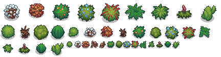 | 432x112 | reuse |  | `pixel/assets_to_assess_and_use/bushes_map_details_mostly/Assets_shadow_source.png` |
| `bush_sheet_assets_source` | 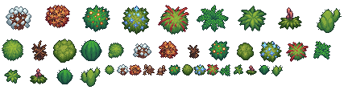 | 432x112 | reuse |  | `pixel/assets_to_assess_and_use/bushes_map_details_mostly/Assets_source.png` (variants: none, texture, texture-dark) |

## creatures and temple sheets (sheet)

| Name | Picture | Size | Status | Used by | Source file |
| --- | --- | --- | --- | --- | --- |
| `mapmisc_sheet_exterior_objects` | 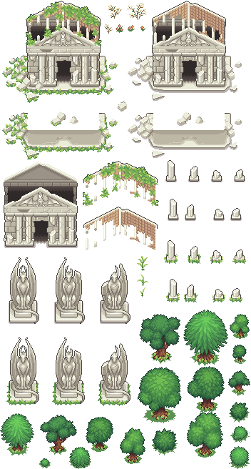 | 352x656 | reuse |  | `pixel/assets_to_assess_and_use/map_details_misc/Exterior_objects.png` |
| `mapmisc_sheet_ghost` | 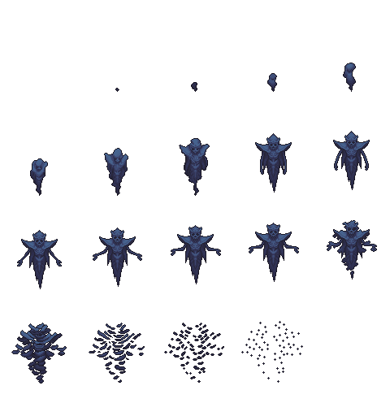 | 480x512 | reuse |  | `pixel/assets_to_assess_and_use/map_details_misc/Ghost.png` |
| `mapmisc_sheet_leader_summon` |  | 160x96 | reuse |  | `pixel/assets_to_assess_and_use/map_details_misc/Leader_summon.png` |
| `mapmisc_sheet_objects_interior` | 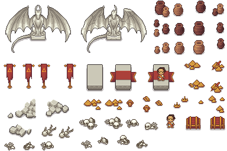 | 384x256 | reuse |  | `pixel/assets_to_assess_and_use/map_details_misc/Objects_interior.png` |
| `mapmisc_sheet_spikes` | 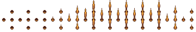 | 384x64 | reuse |  | `pixel/assets_to_assess_and_use/map_details_misc/Spikes.png` |
| `mapmisc_sheet_spots` | 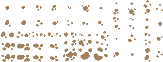 | 336x128 | reuse |  | `pixel/assets_to_assess_and_use/map_details_misc/Spots.png` |
| `mapmisc_sheet_trees_grass_alternative_fit` | 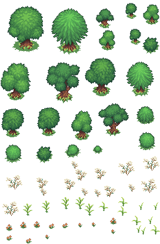 | 272x416 | reuse |  | `pixel/assets_to_assess_and_use/map_details_misc/Trees_grass_alternative_fit.png` |

## dark and bone props

| Name | Picture | Size | Status | Used by | Source file |
| --- | --- | --- | --- | --- | --- |
| `prop_beige_rpck_dark_shadow1_s128` | 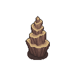 | 128x128 | reuse |  | `pixel/assets_to_assess_and_use/misc/Objects_separately/128/Beige_rpck_dark_shadow1.png` |
| `prop_beige_rpck_dark_shadow2_s64` | 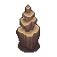 | 64x64 | reuse |  | `pixel/assets_to_assess_and_use/misc/Objects_separately/64/Beige_rpck_dark_shadow2.png` |
| `prop_beige_rpck_dark_shadow3_s64` | 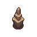 | 64x64 | reuse |  | `pixel/assets_to_assess_and_use/misc/Objects_separately/64/Beige_rpck_dark_shadow3.png` |
| `prop_beige_rpck_light_shadow1_s128` | 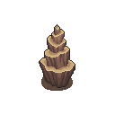 | 128x128 | reuse |  | `pixel/assets_to_assess_and_use/misc/Objects_separately/128/Beige_rpck_light_shadow1.png` |
| `prop_beige_rpck_light_shadow2_s64` | 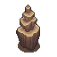 | 64x64 | reuse |  | `pixel/assets_to_assess_and_use/misc/Objects_separately/64/Beige_rpck_light_shadow2.png` |
| `prop_beige_rpck_light_shadow3_s64` | 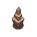 | 64x64 | reuse |  | `pixel/assets_to_assess_and_use/misc/Objects_separately/64/Beige_rpck_light_shadow3.png` |
| `prop_blue_green_crystal_dark_shadow1_s64` | 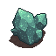 | 64x64 | reuse |  | `pixel/assets_to_assess_and_use/misc/Objects_separately/64/Blue-green_crystal_dark_shadow1.png` |
| `prop_blue_green_crystal_dark_shadow2_s64` | 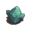 | 64x64 | reuse |  | `pixel/assets_to_assess_and_use/misc/Objects_separately/64/Blue-green_crystal_dark_shadow2.png` |
| `prop_blue_green_crystal_dark_shadow3_s32` | 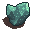 | 32x32 | reuse |  | `pixel/assets_to_assess_and_use/misc/Objects_separately/32/Blue-green_crystal_dark_shadow3.png` |
| `prop_blue_green_crystal_dark_shadow4_s16` | 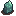 | 16x16 | reuse |  | `pixel/assets_to_assess_and_use/misc/Objects_separately/16/Blue-green_crystal_dark_shadow4.png` |
| `prop_blue_green_crystal_light_shadow1_s64` | 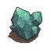 | 64x64 | reuse |  | `pixel/assets_to_assess_and_use/misc/Objects_separately/64/Blue-green_crystal_light_shadow1.png` |
| `prop_blue_green_crystal_light_shadow2_s64` | 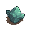 | 64x64 | reuse |  | `pixel/assets_to_assess_and_use/misc/Objects_separately/64/Blue-green_crystal_light_shadow2.png` |
| `prop_blue_green_crystal_light_shadow3_s32` | 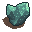 | 32x32 | reuse |  | `pixel/assets_to_assess_and_use/misc/Objects_separately/32/Blue-green_crystal_light_shadow3.png` |
| `prop_blue_green_crystal_light_shadow4_s16` | 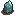 | 16x16 | reuse |  | `pixel/assets_to_assess_and_use/misc/Objects_separately/16/Blue-green_crystal_light_shadow4.png` |
| `prop_bonefire_dark_shadow_s64` | 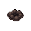 | 64x64 | reuse |  | `pixel/assets_to_assess_and_use/misc/Objects_separately/64/Bonefire_dark_shadow.png` |
| `prop_bonefire_light_shadow_s64` | 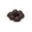 | 64x64 | reuse |  | `pixel/assets_to_assess_and_use/misc/Objects_separately/64/Bonefire_light_shadow.png` |
| `prop_building1_dark_shadow_s128` |  | 128x128 | reuse |  | `pixel/assets_to_assess_and_use/misc/Objects_separately/128/Building1_dark_shadow.png` |
| `prop_building1_light_shadow_s128` |  | 128x128 | reuse |  | `pixel/assets_to_assess_and_use/misc/Objects_separately/128/Building1_light_shadow.png` |
| `prop_building2_dark_shadow_s128` |  | 128x128 | reuse |  | `pixel/assets_to_assess_and_use/misc/Objects_separately/128/Building2_dark_shadow.png` |
| `prop_building2_light_shadow_s128` |  | 128x128 | reuse |  | `pixel/assets_to_assess_and_use/misc/Objects_separately/128/Building2_light_shadow.png` |
| `prop_caveman_statue_dark_shadow1_s64` | 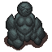 | 64x64 | reuse |  | `pixel/assets_to_assess_and_use/misc/Objects_separately/64/caveman_statue_dark_shadow1.png` |
| `prop_caveman_statue_dark_shadow2_s64` |  | 64x64 | reuse |  | `pixel/assets_to_assess_and_use/misc/Objects_separately/64/caveman_statue_dark_shadow2.png` |
| `prop_caveman_statue_light_shadow1_s64` | 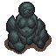 | 64x64 | reuse |  | `pixel/assets_to_assess_and_use/misc/Objects_separately/64/caveman_statue_light_shadow1.png` |
| `prop_caveman_statue_light_shadow2_s64` |  | 64x64 | reuse |  | `pixel/assets_to_assess_and_use/misc/Objects_separately/64/caveman_statue_light_shadow2.png` |
| `prop_centipede_dark_shadow1_s256` | 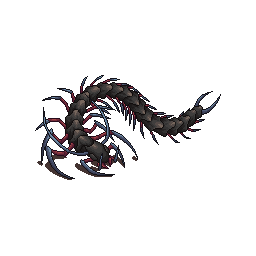 | 256x256 | reuse |  | `pixel/assets_to_assess_and_use/misc/Objects_separately/256/centipede_dark_shadow1.png` |
| `prop_centipede_dark_shadow2_s256` | 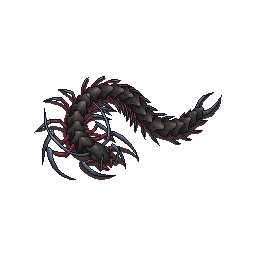 | 256x256 | reuse |  | `pixel/assets_to_assess_and_use/misc/Objects_separately/256/centipede_dark_shadow2.png` |
| `prop_centipede_light_shadow1_s256` | 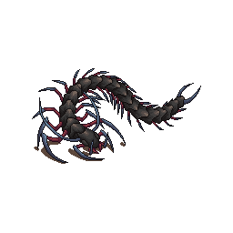 | 256x256 | reuse |  | `pixel/assets_to_assess_and_use/misc/Objects_separately/256/centipede_light_shadow1.png` |
| `prop_centipede_light_shadow2_s256` | 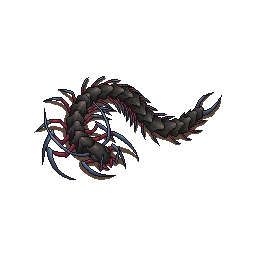 | 256x256 | reuse |  | `pixel/assets_to_assess_and_use/misc/Objects_separately/256/centipede_light_shadow2.png` |
| `prop_cocoon_web_s128` | 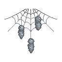 | 128x128 | reuse |  | `pixel/assets_to_assess_and_use/misc/Objects_separately/128/cocoon_web.png` |
| `prop_crystal_blue_green_vertical1_s64` |  | 64x64 | reuse |  | `pixel/assets_to_assess_and_use/misc/Objects_separately/64/crystal_blue-green_vertical1.png` |
| `prop_crystal_blue_green_vertical2_s32` |  | 32x32 | reuse |  | `pixel/assets_to_assess_and_use/misc/Objects_separately/32/crystal_blue-green_vertical2.png` |
| `prop_crystal_blue_green_vertical3_s64` |  | 64x64 | reuse |  | `pixel/assets_to_assess_and_use/misc/Objects_separately/64/crystal_blue-green_vertical3.png` |
| `prop_crystal_blue_green_vertical4_s32` |  | 32x32 | reuse |  | `pixel/assets_to_assess_and_use/misc/Objects_separately/32/crystal_blue-green_vertical4.png` |
| `prop_dark_totem_dark_shadow1_s256` |  | 256x256 | reuse |  | `pixel/assets_to_assess_and_use/misc/Objects_separately/256/Dark_totem_dark_shadow1.png` |
| `prop_dark_totem_dark_shadow2_s128` |  | 128x128 | reuse |  | `pixel/assets_to_assess_and_use/misc/Objects_separately/128/Dark_totem_dark_shadow2.png` |
| `prop_dark_totem_dark_shadow3_s128` |  | 128x128 | reuse |  | `pixel/assets_to_assess_and_use/misc/Objects_separately/128/Dark_totem_dark_shadow3.png` |
| `prop_dark_totem_dark_shadow4_s128` |  | 128x128 | reuse |  | `pixel/assets_to_assess_and_use/misc/Objects_separately/128/Dark_totem_dark_shadow4.png` |
| `prop_dark_totem_dark_shadow5_s64` |  | 64x64 | reuse |  | `pixel/assets_to_assess_and_use/misc/Objects_separately/64/Dark_totem_dark_shadow5.png` |
| `prop_demon_scull_dark_shadow_s128` |  | 128x128 | reuse |  | `pixel/assets_to_assess_and_use/misc/Objects_separately/128/Demon_scull_dark_shadow.png` |
| `prop_demon_scull_light_shadow_s128` |  | 128x128 | reuse |  | `pixel/assets_to_assess_and_use/misc/Objects_separately/128/Demon_scull_light_shadow.png` |
| `prop_dinosaur_skeleton_full_dark_shadow_s256` |  | 256x256 | reuse |  | `pixel/assets_to_assess_and_use/misc/Objects_separately/256/Dinosaur_skeleton_full_dark_shadow.png` |
| `prop_dinosaur_skeleton_full_light_shadow_s256` | 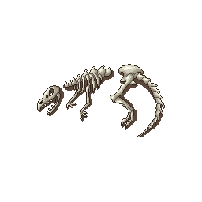 | 256x256 | reuse |  | `pixel/assets_to_assess_and_use/misc/Objects_separately/256/Dinosaur_skeleton_full_light_shadow.png` |
| `prop_dinosaur_skeleton_head_dark_shadow_s64` |  | 64x64 | reuse |  | `pixel/assets_to_assess_and_use/misc/Objects_separately/64/Dinosaur_skeleton__head_dark_shadow.png` |
| `prop_dinosaur_skeleton_light_dark_shadow_s64` |  | 64x64 | reuse |  | `pixel/assets_to_assess_and_use/misc/Objects_separately/64/Dinosaur_skeleton__light_dark_shadow.png` |
| `prop_dinosaur_skeleton_part1_dark_shadow_s128` |  | 128x128 | reuse |  | `pixel/assets_to_assess_and_use/misc/Objects_separately/128/Dinosaur_skeleton_part1_dark_shadow.png` |
| `prop_dinosaur_skeleton_part1_light_shadow_s128` | 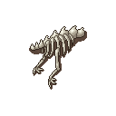 | 128x128 | reuse |  | `pixel/assets_to_assess_and_use/misc/Objects_separately/128/Dinosaur_skeleton_part1_light_shadow.png` |
| `prop_dinosaur_skeleton_part2_dark_shadow_s128` |  | 128x128 | reuse |  | `pixel/assets_to_assess_and_use/misc/Objects_separately/128/Dinosaur_skeleton_part2_dark_shadow.png` |
| `prop_dinosaur_skeleton_part2_light_shadow_s128` | 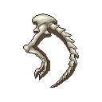 | 128x128 | reuse |  | `pixel/assets_to_assess_and_use/misc/Objects_separately/128/Dinosaur_skeleton_part2_light_shadow.png` |
| `prop_gates_dark_shadow1_s64` |  | 64x64 | reuse |  | `pixel/assets_to_assess_and_use/misc/Objects_separately/64/Gates_dark_shadow1.png` |
| `prop_gates_dark_shadow2_s64` |  | 64x64 | reuse |  | `pixel/assets_to_assess_and_use/misc/Objects_separately/64/Gates_dark_shadow2.png` |
| `prop_gates_dark_shadow3_s128` |  | 128x128 | reuse |  | `pixel/assets_to_assess_and_use/misc/Objects_separately/128/Gates_dark_shadow3.png` |
| `prop_gates_light_shadow1_s128` | 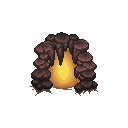 | 128x128 | reuse |  | `pixel/assets_to_assess_and_use/misc/Objects_separately/128/Gates_light_shadow1.png` |
| `prop_gates_light_shadow2_s64` |  | 64x64 | reuse |  | `pixel/assets_to_assess_and_use/misc/Objects_separately/64/Gates_light_shadow2.png` |
| `prop_gates_light_shadow3_s64` |  | 64x64 | reuse |  | `pixel/assets_to_assess_and_use/misc/Objects_separately/64/Gates_light_shadow3.png` |
| `prop_human_skeleton_dark_shadow_s32` |  | 32x32 | reuse |  | `pixel/assets_to_assess_and_use/misc/Objects_separately/32/Human_skeleton_dark_shadow.png` |
| `prop_human_skeleton_light_shadow_s32` |  | 32x32 | reuse |  | `pixel/assets_to_assess_and_use/misc/Objects_separately/32/Human_skeleton_light_shadow.png` |
| `prop_magic_circle_dark_shadow_s128` |  | 128x128 | reuse |  | `pixel/assets_to_assess_and_use/misc/Objects_separately/128/magic_circle_dark_shadow.png` |
| `prop_magic_circle_light_shadow_s128` |  | 128x128 | reuse |  | `pixel/assets_to_assess_and_use/misc/Objects_separately/128/magic_circle_light_shadow.png` |
| `prop_magic_circle2_dark_shadow_s128` |  | 128x128 | reuse |  | `pixel/assets_to_assess_and_use/misc/Objects_separately/128/magic_circle2_dark_shadow.png` |
| `prop_magic_circle2_light_shadow_s128` |  | 128x128 | reuse |  | `pixel/assets_to_assess_and_use/misc/Objects_separately/128/magic_circle2_light_shadow.png` |
| `prop_mushroom1_dark_shadow1_s64` |  | 64x64 | reuse |  | `pixel/assets_to_assess_and_use/misc/Objects_separately/64/mushroom1_dark_shadow1.png` |
| `prop_mushroom1_dark_shadow2_s64` |  | 64x64 | reuse |  | `pixel/assets_to_assess_and_use/misc/Objects_separately/64/mushroom1_dark_shadow2.png` |
| `prop_mushroom1_dark_shadow3_s32` | 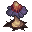 | 32x32 | reuse |  | `pixel/assets_to_assess_and_use/misc/Objects_separately/32/mushroom1_dark_shadow3.png` |
| `prop_mushroom1_light_shadow1_s64` |  | 64x64 | reuse |  | `pixel/assets_to_assess_and_use/misc/Objects_separately/64/mushroom1_light_shadow1.png` |
| `prop_mushroom1_light_shadow2_s64` |  | 64x64 | reuse |  | `pixel/assets_to_assess_and_use/misc/Objects_separately/64/mushroom1_light_shadow2.png` |
| `prop_mushroom1_light_shadow3_s32` |  | 32x32 | reuse |  | `pixel/assets_to_assess_and_use/misc/Objects_separately/32/mushroom1_light_shadow3.png` |
| `prop_mushroom2_dark_shadow1_s128` |  | 128x128 | reuse |  | `pixel/assets_to_assess_and_use/misc/Objects_separately/128/mushroom2_dark_shadow1.png` |
| `prop_mushroom2_dark_shadow2_s64` |  | 64x64 | reuse |  | `pixel/assets_to_assess_and_use/misc/Objects_separately/64/mushroom2_dark_shadow2.png` |
| `prop_mushroom2_dark_shadow3_s64` |  | 64x64 | reuse |  | `pixel/assets_to_assess_and_use/misc/Objects_separately/64/mushroom2_dark_shadow3.png` |
| `prop_mushroom2_light_shadow1_s128` |  | 128x128 | reuse |  | `pixel/assets_to_assess_and_use/misc/Objects_separately/128/mushroom2_light_shadow1.png` |
| `prop_mushroom2_light_shadow2_s64` |  | 64x64 | reuse |  | `pixel/assets_to_assess_and_use/misc/Objects_separately/64/mushroom2_light_shadow2.png` |
| `prop_mushroom2_light_shadow3_s64` |  | 64x64 | reuse |  | `pixel/assets_to_assess_and_use/misc/Objects_separately/64/mushroom2_light_shadow3.png` |
| `prop_mushroom3_dark_shadow1_s128` |  | 128x128 | reuse |  | `pixel/assets_to_assess_and_use/misc/Objects_separately/128/mushroom3_dark_shadow1.png` |
| `prop_mushroom3_dark_shadow2_s128` |  | 128x128 | reuse |  | `pixel/assets_to_assess_and_use/misc/Objects_separately/128/mushroom3_dark_shadow2.png` |
| `prop_mushroom3_dark_shadow3_s64` |  | 64x64 | reuse |  | `pixel/assets_to_assess_and_use/misc/Objects_separately/64/mushroom3_dark_shadow3.png` |
| `prop_mushroom3_light_shadow1_s128` |  | 128x128 | reuse |  | `pixel/assets_to_assess_and_use/misc/Objects_separately/128/mushroom3_light_shadow1.png` |
| `prop_mushroom3_light_shadow2_s128` |  | 128x128 | reuse |  | `pixel/assets_to_assess_and_use/misc/Objects_separately/128/mushroom3_light_shadow2.png` |
| `prop_mushroom3_light_shadow3_s64` |  | 64x64 | reuse |  | `pixel/assets_to_assess_and_use/misc/Objects_separately/64/mushroom3_light_shadow3.png` |
| `prop_mushroom4_dark_shadow1_s64` |  | 64x64 | reuse |  | `pixel/assets_to_assess_and_use/misc/Objects_separately/64/mushroom4_dark_shadow1.png` |
| `prop_mushroom4_dark_shadow2_s64` |  | 64x64 | reuse |  | `pixel/assets_to_assess_and_use/misc/Objects_separately/64/mushroom4_dark_shadow2.png` |
| `prop_mushroom4_dark_shadow3_s32` |  | 32x32 | reuse |  | `pixel/assets_to_assess_and_use/misc/Objects_separately/32/mushroom4_dark_shadow3.png` |
| `prop_mushroom4_light_shadow1_s64` |  | 64x64 | reuse |  | `pixel/assets_to_assess_and_use/misc/Objects_separately/64/mushroom4_light_shadow1.png` |
| `prop_mushroom4_light_shadow2_s64` | 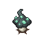 | 64x64 | reuse |  | `pixel/assets_to_assess_and_use/misc/Objects_separately/64/mushroom4_light_shadow2.png` |
| `prop_mushroom4_light_shadow3_s32` |  | 32x32 | reuse |  | `pixel/assets_to_assess_and_use/misc/Objects_separately/32/mushroom4_light_shadow3.png` |
| `prop_white_crystal_dark_shadow1_s64` |  | 64x64 | reuse |  | `pixel/assets_to_assess_and_use/misc/Objects_separately/64/white_crystal_dark_shadow1.png` |
| `prop_white_crystal_dark_shadow2_s64` |  | 64x64 | reuse |  | `pixel/assets_to_assess_and_use/misc/Objects_separately/64/white_crystal_dark_shadow2.png` |
| `prop_white_crystal_dark_shadow3_s32` |  | 32x32 | reuse |  | `pixel/assets_to_assess_and_use/misc/Objects_separately/32/white_crystal_dark_shadow3.png` |
| `prop_white_crystal_dark_shadow4_s16` |  | 16x16 | reuse |  | `pixel/assets_to_assess_and_use/misc/Objects_separately/16/white_crystal_dark_shadow4.png` |
| `prop_white_crystal_light_shadow1_1_s64` |  | 64x64 | reuse |  | `pixel/assets_to_assess_and_use/misc/Objects_separately/64/white_crystal_light_shadow1-1.png` |
| `prop_white_crystal_light_shadow1_s256` | 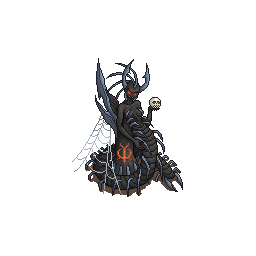 | 256x256 | reuse |  | `pixel/assets_to_assess_and_use/misc/Objects_separately/256/white_crystal_light_shadow1.png` |
| `prop_white_crystal_light_shadow2_1_s64` |  | 64x64 | reuse |  | `pixel/assets_to_assess_and_use/misc/Objects_separately/64/white_crystal_light_shadow2-1.png` |
| `prop_white_crystal_light_shadow2_s128` |  | 128x128 | reuse |  | `pixel/assets_to_assess_and_use/misc/Objects_separately/128/white_crystal_light_shadow2.png` |
| `prop_white_crystal_light_shadow3_1_s32` |  | 32x32 | reuse |  | `pixel/assets_to_assess_and_use/misc/Objects_separately/32/white_crystal_light_shadow3-1.png` |
| `prop_white_crystal_light_shadow3_s128` |  | 128x128 | reuse |  | `pixel/assets_to_assess_and_use/misc/Objects_separately/128/white_crystal_light_shadow3.png` |
| `prop_white_crystal_light_shadow4_1_s16` |  | 16x16 | reuse |  | `pixel/assets_to_assess_and_use/misc/Objects_separately/16/white_crystal_light_shadow4-1.png` |
| `prop_white_crystal_light_shadow4_s128` |  | 128x128 | reuse |  | `pixel/assets_to_assess_and_use/misc/Objects_separately/128/white_crystal_light_shadow4.png` |
| `prop_white_crystal_light_shadow5_s64` |  | 64x64 | reuse |  | `pixel/assets_to_assess_and_use/misc/Objects_separately/64/white_crystal_light_shadow5.png` |
| `prop_white_crystal_vertical1_s64` |  | 64x64 | reuse |  | `pixel/assets_to_assess_and_use/misc/Objects_separately/64/white_crystal_vertical1.png` |
| `prop_white_crystal_vertical2_s32` | 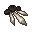 | 32x32 | reuse |  | `pixel/assets_to_assess_and_use/misc/Objects_separately/32/white_crystal_vertical2.png` |
| `prop_white_crystal_vertical3_s64` |  | 64x64 | reuse |  | `pixel/assets_to_assess_and_use/misc/Objects_separately/64/white_crystal_vertical3.png` |
| `prop_white_crystal_vertical4_s32` | 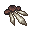 | 32x32 | reuse |  | `pixel/assets_to_assess_and_use/misc/Objects_separately/32/white_crystal_vertical4.png` |

## dark and bone props (sheet)

| Name | Picture | Size | Status | Used by | Source file |
| --- | --- | --- | --- | --- | --- |
| `prop_sheet_cave_objects_source` | 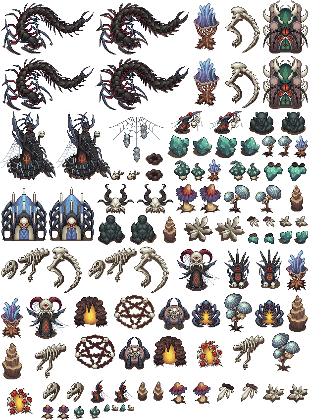 | 624x848 | reuse |  | `pixel/assets_to_assess_and_use/misc/Cave_objects_source.png` |

## fantasy trees and mushrooms

| Name | Picture | Size | Status | Used by | Source file |
| --- | --- | --- | --- | --- | --- |
| `fantasy_beige_green_mushroom1` |  | 64x64 | reuse |  | `pixel/assets_to_assess_and_use/misc_map_details/Assets_no_shadow/Beige_green_mushroom1.png` (variants: none, shadow) |
| `fantasy_beige_green_mushroom2` |  | 64x64 | reuse |  | `pixel/assets_to_assess_and_use/misc_map_details/Assets_no_shadow/Beige_green_mushroom2.png` (variants: none, shadow) |
| `fantasy_beige_green_mushroom3` |  | 32x32 | reuse |  | `pixel/assets_to_assess_and_use/misc_map_details/Assets_no_shadow/Beige_green_mushroom3.png` (variants: none, shadow) |
| `fantasy_blue_green_balls_tree1` |  | 64x64 | reuse |  | `pixel/assets_to_assess_and_use/misc_map_details/Assets_no_shadow/Blue-green_balls_tree1.png` (variants: none, shadow) |
| `fantasy_blue_green_balls_tree2` |  | 64x64 | reuse |  | `pixel/assets_to_assess_and_use/misc_map_details/Assets_no_shadow/Blue-green_balls_tree2.png` (variants: none, shadow) |
| `fantasy_blue_green_balls_tree3` |  | 32x32 | reuse |  | `pixel/assets_to_assess_and_use/misc_map_details/Assets_no_shadow/Blue-green_balls_tree3.png` (variants: none, shadow) |
| `fantasy_chanterelles1` | 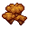 | 32x32 | reuse |  | `pixel/assets_to_assess_and_use/misc_map_details/Assets_no_shadow/Chanterelles1.png` (variants: none, shadow) |
| `fantasy_chanterelles2` | 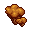 | 32x32 | reuse |  | `pixel/assets_to_assess_and_use/misc_map_details/Assets_no_shadow/Chanterelles2.png` (variants: none, shadow) |
| `fantasy_chanterelles3` |  | 32x32 | reuse |  | `pixel/assets_to_assess_and_use/misc_map_details/Assets_no_shadow/Chanterelles3.png` (variants: none, shadow) |
| `fantasy_curved_tree1` | 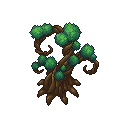 | 128x128 | reuse |  | `pixel/assets_to_assess_and_use/misc_map_details/Assets_no_shadow/Curved_tree1.png` (variants: none, shadow) |
| `fantasy_curved_tree2` | 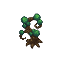 | 128x128 | reuse |  | `pixel/assets_to_assess_and_use/misc_map_details/Assets_no_shadow/Curved_tree2.png` (variants: none, shadow) |
| `fantasy_curved_tree3` | 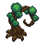 | 64x64 | reuse |  | `pixel/assets_to_assess_and_use/misc_map_details/Assets_no_shadow/Curved_tree3.png` (variants: none, shadow) |
| `fantasy_ent_man` |  | 128x128 | reuse |  | `pixel/assets_to_assess_and_use/misc_map_details/Assets_no_shadow/Ent_man.png` (variants: none, shadow) |
| `fantasy_ent_woman` |  | 128x128 | reuse |  | `pixel/assets_to_assess_and_use/misc_map_details/Assets_no_shadow/Ent_woman.png` (variants: none, shadow) |
| `fantasy_light_balls_tree1` |  | 128x128 | reuse |  | `pixel/assets_to_assess_and_use/misc_map_details/Assets_no_shadow/Light_balls_tree1.png` (variants: none, shadow) |
| `fantasy_light_balls_tree2` |  | 128x128 | reuse |  | `pixel/assets_to_assess_and_use/misc_map_details/Assets_no_shadow/Light_balls_tree2.png` (variants: none, shadow) |
| `fantasy_light_balls_tree3` |  | 64x64 | reuse |  | `pixel/assets_to_assess_and_use/misc_map_details/Assets_no_shadow/Light_balls_tree3.png` (variants: none, shadow) |
| `fantasy_living_gazebo1` |  | 128x128 | reuse |  | `pixel/assets_to_assess_and_use/misc_map_details/Assets_no_shadow/Living gazebo1.png` (variants: none, shadow) |
| `fantasy_living_gazebo2` |  | 128x128 | reuse |  | `pixel/assets_to_assess_and_use/misc_map_details/Assets_no_shadow/Living gazebo2.png` (variants: none, shadow) |
| `fantasy_luminous_tree1` |  | 128x128 | reuse |  | `pixel/assets_to_assess_and_use/misc_map_details/Assets_no_shadow/Luminous_tree1.png` (variants: none, shadow) |
| `fantasy_luminous_tree2` |  | 128x128 | reuse |  | `pixel/assets_to_assess_and_use/misc_map_details/Assets_no_shadow/Luminous_tree2.png` (variants: none, shadow) |
| `fantasy_luminous_tree3` |  | 64x64 | reuse |  | `pixel/assets_to_assess_and_use/misc_map_details/Assets_no_shadow/Luminous_tree3.png` (variants: none, shadow) |
| `fantasy_luminous_tree4` |  | 64x64 | reuse |  | `pixel/assets_to_assess_and_use/misc_map_details/Assets_no_shadow/Luminous_tree4.png` (variants: none, shadow) |
| `fantasy_mega_tree1` |  | 256x256 | reuse |  | `pixel/assets_to_assess_and_use/misc_map_details/Assets_no_shadow/Mega_tree1.png` (variants: none, shadow) |
| `fantasy_mega_tree2` |  | 128x128 | reuse |  | `pixel/assets_to_assess_and_use/misc_map_details/Assets_no_shadow/Mega_tree2.png` (variants: none, shadow) |
| `fantasy_swirling_tree1` |  | 128x128 | reuse |  | `pixel/assets_to_assess_and_use/misc_map_details/Assets_no_shadow/Swirling tree1.png` (variants: none, shadow) |
| `fantasy_swirling_tree2` |  | 128x128 | reuse |  | `pixel/assets_to_assess_and_use/misc_map_details/Assets_no_shadow/Swirling tree2.png` (variants: none, shadow) |
| `fantasy_swirling_tree3` |  | 64x64 | reuse |  | `pixel/assets_to_assess_and_use/misc_map_details/Assets_no_shadow/Swirling tree3.png` (variants: none, shadow) |
| `fantasy_tree_idol_deer` |  | 128x128 | reuse |  | `pixel/assets_to_assess_and_use/misc_map_details/Assets_no_shadow/Tree_idol_deer.png` (variants: none, shadow) |
| `fantasy_tree_idol_dragon` |  | 256x256 | reuse |  | `pixel/assets_to_assess_and_use/misc_map_details/Assets_no_shadow/Tree_idol_dragon.png` (variants: none, shadow) |
| `fantasy_tree_idol_human` |  | 128x128 | reuse |  | `pixel/assets_to_assess_and_use/misc_map_details/Assets_no_shadow/Tree_idol_human.png` (variants: none, shadow) |
| `fantasy_tree_idol_wolf` |  | 128x128 | reuse |  | `pixel/assets_to_assess_and_use/misc_map_details/Assets_no_shadow/Tree_idol_wolf.png` (variants: none, shadow) |
| `fantasy_white_red_mushroom1` |  | 128x128 | reuse |  | `pixel/assets_to_assess_and_use/misc_map_details/Assets_no_shadow/White-red_mushroom1.png` (variants: none, shadow) |
| `fantasy_white_red_mushroom2` |  | 64x64 | reuse |  | `pixel/assets_to_assess_and_use/misc_map_details/Assets_no_shadow/White-red_mushroom2.png` (variants: none, shadow) |
| `fantasy_white_red_mushroom3` |  | 64x64 | reuse |  | `pixel/assets_to_assess_and_use/misc_map_details/Assets_no_shadow/White-red_mushroom3.png` (variants: none, shadow) |
| `fantasy_white_tree1` |  | 128x128 | reuse |  | `pixel/assets_to_assess_and_use/misc_map_details/Assets_no_shadow/White_tree1.png` (variants: none, shadow) |
| `fantasy_white_tree2` |  | 64x64 | reuse |  | `pixel/assets_to_assess_and_use/misc_map_details/Assets_no_shadow/White_tree2.png` (variants: none, shadow) |
| `fantasy_willow1` |  | 128x128 | reuse |  | `pixel/assets_to_assess_and_use/misc_map_details/Assets_no_shadow/Willow1.png` (variants: none, shadow) |
| `fantasy_willow2` |  | 128x128 | reuse |  | `pixel/assets_to_assess_and_use/misc_map_details/Assets_no_shadow/Willow2.png` (variants: none, shadow) |
| `fantasy_willow3` |  | 64x64 | reuse |  | `pixel/assets_to_assess_and_use/misc_map_details/Assets_no_shadow/Willow3.png` (variants: none, shadow) |

## fantasy trees and mushrooms (sheet)

| Name | Picture | Size | Status | Used by | Source file |
| --- | --- | --- | --- | --- | --- |
| `fantasy_sheet_assets_source` |  | 688x384 | reuse |  | `pixel/assets_to_assess_and_use/misc_map_details/Assets_source.png` |

## farm part

| Name | Picture | Size | Status | Used by | Source file |
| --- | --- | --- | --- | --- | --- |
| `farm_barn` |  | 75x68 | used | farm window | `pixel/farm/barn.png` |
| `farm_barrel` |  | 14x15 | used | farm window | `pixel/farm/barrel.png` |
| `farm_bucket` |  | 10x10 | used | farm window | `pixel/farm/bucket.png` |
| `farm_bush_0` |  | 19x15 | used | farm window | `pixel/farm/bush_0.png` |
| `farm_bush_1` |  | 24x19 | used | farm window | `pixel/farm/bush_1.png` |
| `farm_bush_2` |  | 29x23 | used | farm window | `pixel/farm/bush_2.png` |
| `farm_coop` |  | 40x38 | used | farm window | `pixel/farm/coop.png` |
| `farm_crate` |  | 20x17 | used | farm window | `pixel/farm/crate.png` |
| `farm_dirt_0` |  | 28x14 | used | farm window | `pixel/farm/dirt_0.png` |
| `farm_dirt_1` |  | 42x20 | used | farm window | `pixel/farm/dirt_1.png` |
| `farm_dirt_2` |  | 60x30 | used | farm window | `pixel/farm/dirt_2.png` |
| `farm_fence_post` |  | 13x17 | used | farm window | `pixel/farm/fence_post.png` |
| `farm_fence_x` |  | 25x22 | used | farm window | `pixel/farm/fence_x.png` |
| `farm_fence_y` |  | 28x22 | used | farm window | `pixel/farm/fence_y.png` |
| `farm_flower_0` |  | 4x4 | used | farm window | `pixel/farm/flower_0.png` |
| `farm_flower_1` |  | 4x4 | used | farm window | `pixel/farm/flower_1.png` |
| `farm_flower_2` |  | 4x4 | used | farm window | `pixel/farm/flower_2.png` |
| `farm_gate` |  | 44x33 | used | farm window | `pixel/farm/gate.png` |
| `farm_hay` |  | 34x26 | used | farm window | `pixel/farm/hay.png` |
| `farm_meadow` |  | 96x96 | used | farm window background (repeats) | `pixel/bg/farm_meadow.png` |
| `farm_pine` |  | 35x42 | used | farm window | `pixel/farm/pine.png` |
| `farm_pond` |  | 67x36 | used | farm window | `pixel/farm/pond.png` |
| `farm_stone_0` |  | 8x7 | used | farm window | `pixel/farm/stone_0.png` |
| `farm_stone_1` |  | 10x8 | used | farm window | `pixel/farm/stone_1.png` |
| `farm_stone_2` |  | 13x11 | used | farm window | `pixel/farm/stone_2.png` |
| `farm_tank` |  | 28x22 | used | farm window | `pixel/farm/tank.png` |
| `farm_trough_x` |  | 29x21 | used | farm window | `pixel/farm/trough_x.png` |
| `farm_trough_y` |  | 28x21 | used | farm window | `pixel/farm/trough_y.png` |

## farm plants sheet (sheet)

| Name | Picture | Size | Status | Used by | Source file |
| --- | --- | --- | --- | --- | --- |
| `farmplants_sheet_plants` |  | 768x432 | reuse |  | `pixel/assets_to_assess_and_use/map_details/Plants.png` |

## minerals

| Name | Picture | Size | Status | Used by | Source file |
| --- | --- | --- | --- | --- | --- |
| `mineral_black_crystal1` |  | 64x64 | reuse |  | `pixel/assets_to_assess_and_use/minerals_map_details_or_resources_crafting_etc/Assets/Black_crystal1.png` (variants: none, shadow, texture, texture-dark) |
| `mineral_black_crystal2` |  | 64x64 | reuse |  | `pixel/assets_to_assess_and_use/minerals_map_details_or_resources_crafting_etc/Assets/Black_crystal2.png` (variants: none, shadow, texture, texture-dark) |
| `mineral_black_crystal3` |  | 32x32 | reuse |  | `pixel/assets_to_assess_and_use/minerals_map_details_or_resources_crafting_etc/Assets/Black_crystal3.png` (variants: none, shadow, texture, texture-dark) |
| `mineral_black_crystal4` |  | 16x16 | reuse |  | `pixel/assets_to_assess_and_use/minerals_map_details_or_resources_crafting_etc/Assets/Black_crystal4.png` (variants: none, shadow, texture, texture-dark) |
| `mineral_blue_crystal` |  | 16x16 | reuse |  | `pixel/assets_to_assess_and_use/minerals_map_details_or_resources_crafting_etc/Assets_texture_shadow_dark/Blue_crystal.png` |
| `mineral_blue_crystal1` |  | 64x64 | reuse |  | `pixel/assets_to_assess_and_use/minerals_map_details_or_resources_crafting_etc/Assets/Blue_crystal1.png` (variants: none, shadow, texture, texture-dark) |
| `mineral_blue_crystal2` |  | 64x64 | reuse |  | `pixel/assets_to_assess_and_use/minerals_map_details_or_resources_crafting_etc/Assets/Blue_crystal2.png` (variants: none, shadow, texture, texture-dark) |
| `mineral_blue_crystal3` |  | 32x32 | reuse |  | `pixel/assets_to_assess_and_use/minerals_map_details_or_resources_crafting_etc/Assets/Blue_crystal3.png` (variants: none, shadow, texture, texture-dark) |
| `mineral_blue_crystal4` |  | 16x16 | reuse |  | `pixel/assets_to_assess_and_use/minerals_map_details_or_resources_crafting_etc/Assets/Blue_crystal4.png` (variants: none, shadow, texture) |
| `mineral_dark_red_crystal1` |  | 64x64 | reuse |  | `pixel/assets_to_assess_and_use/minerals_map_details_or_resources_crafting_etc/Assets/Dark_red_ crystal1.png` (variants: none, shadow, texture, texture-dark) |
| `mineral_dark_red_crystal2` |  | 64x64 | reuse |  | `pixel/assets_to_assess_and_use/minerals_map_details_or_resources_crafting_etc/Assets/Dark_red_ crystal2.png` (variants: none, shadow, texture, texture-dark) |
| `mineral_dark_red_crystal3` |  | 32x32 | reuse |  | `pixel/assets_to_assess_and_use/minerals_map_details_or_resources_crafting_etc/Assets/Dark_red_ crystal3.png` (variants: none, shadow, texture, texture-dark) |
| `mineral_dark_red_crystal4` |  | 16x16 | reuse |  | `pixel/assets_to_assess_and_use/minerals_map_details_or_resources_crafting_etc/Assets/Dark_red_ crystal4.png` (variants: none, shadow, texture, texture-dark) |
| `mineral_green_crystal1` |  | 64x64 | reuse |  | `pixel/assets_to_assess_and_use/minerals_map_details_or_resources_crafting_etc/Assets/Green_crystal1.png` (variants: none, shadow, texture, texture-dark) |
| `mineral_green_crystal2` |  | 64x64 | reuse |  | `pixel/assets_to_assess_and_use/minerals_map_details_or_resources_crafting_etc/Assets/Green_crystal2.png` (variants: none, shadow, texture, texture-dark) |
| `mineral_green_crystal3` |  | 32x32 | reuse |  | `pixel/assets_to_assess_and_use/minerals_map_details_or_resources_crafting_etc/Assets/Green_crystal3.png` (variants: none, shadow, texture, texture-dark) |
| `mineral_green_crystal4` |  | 16x16 | reuse |  | `pixel/assets_to_assess_and_use/minerals_map_details_or_resources_crafting_etc/Assets/Green_crystal4.png` (variants: none, shadow, texture, texture-dark) |
| `mineral_pink_crystal1` |  | 64x64 | reuse |  | `pixel/assets_to_assess_and_use/minerals_map_details_or_resources_crafting_etc/Assets/Pink_crystal1.png` (variants: none, shadow, texture, texture-dark) |
| `mineral_pink_crystal2` |  | 64x64 | reuse |  | `pixel/assets_to_assess_and_use/minerals_map_details_or_resources_crafting_etc/Assets/Pink_crystal2.png` (variants: none, shadow, texture, texture-dark) |
| `mineral_pink_crystal3` |  | 32x32 | reuse |  | `pixel/assets_to_assess_and_use/minerals_map_details_or_resources_crafting_etc/Assets/Pink_crystal3.png` (variants: none, shadow, texture, texture-dark) |
| `mineral_pink_crystal4` |  | 16x16 | reuse |  | `pixel/assets_to_assess_and_use/minerals_map_details_or_resources_crafting_etc/Assets/Pink_crystal4.png` (variants: none, shadow, texture, texture-dark) |
| `mineral_red_crystal1` |  | 64x64 | reuse |  | `pixel/assets_to_assess_and_use/minerals_map_details_or_resources_crafting_etc/Assets/Red_crystal1.png` (variants: none, shadow, texture, texture-dark) |
| `mineral_red_crystal2` |  | 64x64 | reuse |  | `pixel/assets_to_assess_and_use/minerals_map_details_or_resources_crafting_etc/Assets/Red_crystal2.png` (variants: none, shadow, texture, texture-dark) |
| `mineral_red_crystal3` |  | 32x32 | reuse |  | `pixel/assets_to_assess_and_use/minerals_map_details_or_resources_crafting_etc/Assets/Red_crystal3.png` (variants: none, shadow, texture, texture-dark) |
| `mineral_red_crystal4` |  | 16x16 | reuse |  | `pixel/assets_to_assess_and_use/minerals_map_details_or_resources_crafting_etc/Assets/Red_crystal4.png` (variants: none, shadow, texture, texture-dark) |
| `mineral_violet_crystal1` |  | 64x64 | reuse |  | `pixel/assets_to_assess_and_use/minerals_map_details_or_resources_crafting_etc/Assets/Violet_crystal1.png` (variants: none, shadow, texture, texture-dark) |
| `mineral_violet_crystal2` |  | 64x64 | reuse |  | `pixel/assets_to_assess_and_use/minerals_map_details_or_resources_crafting_etc/Assets/Violet_crystal2.png` (variants: none, shadow, texture, texture-dark) |
| `mineral_violet_crystal3` |  | 32x32 | reuse |  | `pixel/assets_to_assess_and_use/minerals_map_details_or_resources_crafting_etc/Assets/Violet_crystal3.png` (variants: none, shadow, texture, texture-dark) |
| `mineral_violet_crystal4` |  | 16x16 | reuse |  | `pixel/assets_to_assess_and_use/minerals_map_details_or_resources_crafting_etc/Assets/Violet_crystal4.png` (variants: none, shadow, texture, texture-dark) |
| `mineral_white_crystal1` |  | 64x64 | reuse |  | `pixel/assets_to_assess_and_use/minerals_map_details_or_resources_crafting_etc/Assets/White_crystal1.png` (variants: none, shadow, texture, texture-dark) |
| `mineral_white_crystal2` |  | 64x64 | reuse |  | `pixel/assets_to_assess_and_use/minerals_map_details_or_resources_crafting_etc/Assets/White_crystal2.png` (variants: none, shadow, texture, texture-dark) |
| `mineral_white_crystal3` |  | 32x32 | reuse |  | `pixel/assets_to_assess_and_use/minerals_map_details_or_resources_crafting_etc/Assets/White_crystal3.png` (variants: none, shadow, texture, texture-dark) |
| `mineral_white_crystal4` |  | 16x16 | reuse |  | `pixel/assets_to_assess_and_use/minerals_map_details_or_resources_crafting_etc/Assets/White_crystal4.png` (variants: none, shadow, texture, texture-dark) |
| `mineral_yellow_crystal1` |  | 64x64 | reuse |  | `pixel/assets_to_assess_and_use/minerals_map_details_or_resources_crafting_etc/Assets/Yellow_crystal1.png` (variants: none, shadow, texture, texture-dark) |
| `mineral_yellow_crystal2` |  | 64x64 | reuse |  | `pixel/assets_to_assess_and_use/minerals_map_details_or_resources_crafting_etc/Assets/Yellow_crystal2.png` (variants: none, shadow, texture, texture-dark) |
| `mineral_yellow_crystal3` |  | 32x32 | reuse |  | `pixel/assets_to_assess_and_use/minerals_map_details_or_resources_crafting_etc/Assets/Yellow_crystal3.png` (variants: none, shadow, texture, texture-dark) |
| `mineral_yellow_crystal4` |  | 16x16 | reuse |  | `pixel/assets_to_assess_and_use/minerals_map_details_or_resources_crafting_etc/Assets/Yellow_crystal4.png` (variants: none, shadow, texture, texture-dark) |
| `mineral_yellow_green_crystal1` |  | 64x64 | reuse |  | `pixel/assets_to_assess_and_use/minerals_map_details_or_resources_crafting_etc/Assets/Yellow-green_crystal1.png` (variants: none, shadow, texture, texture-dark) |
| `mineral_yellow_green_crystal2` |  | 64x64 | reuse |  | `pixel/assets_to_assess_and_use/minerals_map_details_or_resources_crafting_etc/Assets/Yellow-green_crystal2.png` (variants: none, shadow, texture, texture-dark) |
| `mineral_yellow_green_crystal3` |  | 32x32 | reuse |  | `pixel/assets_to_assess_and_use/minerals_map_details_or_resources_crafting_etc/Assets/Yellow-green_crystal3.png` (variants: none, shadow, texture, texture-dark) |
| `mineral_yellow_green_crystal4` |  | 16x16 | reuse |  | `pixel/assets_to_assess_and_use/minerals_map_details_or_resources_crafting_etc/Assets/Yellow-green_crystal4.png` (variants: none, shadow, texture, texture-dark) |

## minerals (sheet)

| Name | Picture | Size | Status | Used by | Source file |
| --- | --- | --- | --- | --- | --- |
| `mineral_sheet_assets_shadow_source` |  | 640x144 | reuse |  | `pixel/assets_to_assess_and_use/minerals_map_details_or_resources_crafting_etc/Assets_shadow_source.png` |
| `mineral_sheet_assets_source` |  | 640x144 | reuse |  | `pixel/assets_to_assess_and_use/minerals_map_details_or_resources_crafting_etc/Assets_source.png` (variants: none, texture, texture-dark) |

## rocks

| Name | Picture | Size | Status | Used by | Source file |
| --- | --- | --- | --- | --- | --- |
| `rock_rock1_1` |  | 64x64 | reuse |  | `pixel/assets_to_assess_and_use/map_details_3/Objects_separately/Rock1_1_no_shadow.png` (variants: none, shadow) |
| `rock_rock1_2` |  | 64x64 | reuse |  | `pixel/assets_to_assess_and_use/map_details_3/Objects_separately/Rock1_2_no_shadow.png` (variants: none, shadow) |
| `rock_rock1_3` |  | 32x32 | reuse |  | `pixel/assets_to_assess_and_use/map_details_3/Objects_separately/Rock1_3_no_shadow.png` (variants: none, shadow) |
| `rock_rock1_4` |  | 32x32 | reuse |  | `pixel/assets_to_assess_and_use/map_details_3/Objects_separately/Rock1_4_no_shadow.png` (variants: none, shadow) |
| `rock_rock1_5` |  | 16x16 | reuse |  | `pixel/assets_to_assess_and_use/map_details_3/Objects_separately/Rock1_5_no_shadow.png` (variants: none, shadow) |
| `rock_rock1_grass_shadow_dark1` |  | 64x64 | reuse |  | `pixel/assets_to_assess_and_use/map_details_3/Objects_separately/Rock1_grass_shadow_dark1.png` |
| `rock_rock1_grass_shadow_dark2` |  | 64x64 | reuse |  | `pixel/assets_to_assess_and_use/map_details_3/Objects_separately/Rock1_grass_shadow_dark2.png` |
| `rock_rock1_grass_shadow_dark3` |  | 32x32 | reuse |  | `pixel/assets_to_assess_and_use/map_details_3/Objects_separately/Rock1_grass_shadow_dark3.png` |
| `rock_rock1_grass_shadow_dark4` |  | 32x32 | reuse |  | `pixel/assets_to_assess_and_use/map_details_3/Objects_separately/Rock1_grass_shadow_dark4.png` |
| `rock_rock1_grass_shadow_dark5` |  | 16x16 | reuse |  | `pixel/assets_to_assess_and_use/map_details_3/Objects_separately/Rock1_grass_shadow_dark5.png` |
| `rock_rock1_grass_shadow1` |  | 64x64 | reuse |  | `pixel/assets_to_assess_and_use/map_details_3/Objects_separately/Rock1_grass_shadow1.png` |
| `rock_rock1_grass_shadow2` |  | 64x64 | reuse |  | `pixel/assets_to_assess_and_use/map_details_3/Objects_separately/Rock1_grass_shadow2.png` |
| `rock_rock1_grass_shadow3` |  | 32x32 | reuse |  | `pixel/assets_to_assess_and_use/map_details_3/Objects_separately/Rock1_grass_shadow3.png` |
| `rock_rock1_grass_shadow4` |  | 32x32 | reuse |  | `pixel/assets_to_assess_and_use/map_details_3/Objects_separately/Rock1_grass_shadow4.png` |
| `rock_rock1_grass_shadow5` |  | 16x16 | reuse |  | `pixel/assets_to_assess_and_use/map_details_3/Objects_separately/Rock1_grass_shadow5.png` |
| `rock_rock2_1` |  | 64x64 | reuse |  | `pixel/assets_to_assess_and_use/map_details_3/Objects_separately/Rock2_1_no_shadow.png` (variants: none, shadow) |
| `rock_rock2_2` |  | 64x64 | reuse |  | `pixel/assets_to_assess_and_use/map_details_3/Objects_separately/Rock2_2_no_shadow.png` (variants: none, shadow) |
| `rock_rock2_3` |  | 32x32 | reuse |  | `pixel/assets_to_assess_and_use/map_details_3/Objects_separately/Rock2_3_no_shadow.png` (variants: none, shadow) |
| `rock_rock2_4` |  | 32x32 | reuse |  | `pixel/assets_to_assess_and_use/map_details_3/Objects_separately/Rock2_4_no_shadow.png` (variants: none, shadow) |
| `rock_rock2_5` |  | 16x16 | reuse |  | `pixel/assets_to_assess_and_use/map_details_3/Objects_separately/Rock2_5_no_shadow.png` (variants: none, shadow) |
| `rock_rock2_grass_shadow_dark1` |  | 64x64 | reuse |  | `pixel/assets_to_assess_and_use/map_details_3/Objects_separately/Rock2_grass_shadow_dark1.png` |
| `rock_rock2_grass_shadow_dark2` |  | 64x64 | reuse |  | `pixel/assets_to_assess_and_use/map_details_3/Objects_separately/Rock2_grass_shadow_dark2.png` |
| `rock_rock2_grass_shadow_dark3` |  | 32x32 | reuse |  | `pixel/assets_to_assess_and_use/map_details_3/Objects_separately/Rock2_grass_shadow_dark3.png` |
| `rock_rock2_grass_shadow_dark4` |  | 32x32 | reuse |  | `pixel/assets_to_assess_and_use/map_details_3/Objects_separately/Rock2_grass_shadow_dark4.png` |
| `rock_rock2_grass_shadow_dark5` |  | 16x16 | reuse |  | `pixel/assets_to_assess_and_use/map_details_3/Objects_separately/Rock2_grass_shadow_dark5.png` |
| `rock_rock2_grass_shadow1` |  | 64x64 | reuse |  | `pixel/assets_to_assess_and_use/map_details_3/Objects_separately/Rock2_grass_shadow1.png` |
| `rock_rock2_grass_shadow2` |  | 64x64 | reuse |  | `pixel/assets_to_assess_and_use/map_details_3/Objects_separately/Rock2_grass_shadow2.png` |
| `rock_rock2_grass_shadow3` |  | 32x32 | reuse |  | `pixel/assets_to_assess_and_use/map_details_3/Objects_separately/Rock2_grass_shadow3.png` |
| `rock_rock2_grass_shadow4` |  | 32x32 | reuse |  | `pixel/assets_to_assess_and_use/map_details_3/Objects_separately/Rock2_grass_shadow4.png` |
| `rock_rock2_grass_shadow5` |  | 16x16 | reuse |  | `pixel/assets_to_assess_and_use/map_details_3/Objects_separately/Rock2_grass_shadow5.png` |
| `rock_rock3_1` |  | 64x64 | reuse |  | `pixel/assets_to_assess_and_use/map_details_3/Objects_separately/Rock3_1_no_shadow.png` (variants: none, shadow) |
| `rock_rock3_2` |  | 64x64 | reuse |  | `pixel/assets_to_assess_and_use/map_details_3/Objects_separately/Rock3_2_no_shadow.png` (variants: none, shadow) |
| `rock_rock3_3` |  | 32x32 | reuse |  | `pixel/assets_to_assess_and_use/map_details_3/Objects_separately/Rock3_3_no_shadow.png` (variants: none, shadow) |
| `rock_rock3_4` |  | 32x32 | reuse |  | `pixel/assets_to_assess_and_use/map_details_3/Objects_separately/Rock3_4_no_shadow.png` (variants: none, shadow) |
| `rock_rock3_5` |  | 16x16 | reuse |  | `pixel/assets_to_assess_and_use/map_details_3/Objects_separately/Rock3_5_no_shadow.png` (variants: none, shadow) |
| `rock_rock4_1` |  | 64x64 | reuse |  | `pixel/assets_to_assess_and_use/map_details_3/Objects_separately/Rock4_1_no_shadow.png` (variants: none, shadow) |
| `rock_rock4_2` |  | 64x64 | reuse |  | `pixel/assets_to_assess_and_use/map_details_3/Objects_separately/Rock4_2_no_shadow.png` (variants: none, shadow) |
| `rock_rock4_3` |  | 32x32 | reuse |  | `pixel/assets_to_assess_and_use/map_details_3/Objects_separately/Rock4_3_no_shadow.png` (variants: none, shadow) |
| `rock_rock4_4` |  | 32x32 | reuse |  | `pixel/assets_to_assess_and_use/map_details_3/Objects_separately/Rock4_4_no_shadow.png` (variants: none, shadow) |
| `rock_rock4_5` |  | 16x16 | reuse |  | `pixel/assets_to_assess_and_use/map_details_3/Objects_separately/Rock4_5_no_shadow.png` (variants: none, shadow) |
| `rock_rock4_grass_shadow_dark1` |  | 64x64 | reuse |  | `pixel/assets_to_assess_and_use/map_details_3/Objects_separately/Rock4_grass_shadow_dark1.png` |
| `rock_rock4_grass_shadow_dark2` |  | 64x64 | reuse |  | `pixel/assets_to_assess_and_use/map_details_3/Objects_separately/Rock4_grass_shadow_dark2.png` |
| `rock_rock4_grass_shadow_dark3` |  | 32x32 | reuse |  | `pixel/assets_to_assess_and_use/map_details_3/Objects_separately/Rock4_grass_shadow_dark3.png` |
| `rock_rock4_grass_shadow_dark4` |  | 32x32 | reuse |  | `pixel/assets_to_assess_and_use/map_details_3/Objects_separately/Rock4_grass_shadow_dark4.png` |
| `rock_rock4_grass_shadow_dark5` |  | 16x16 | reuse |  | `pixel/assets_to_assess_and_use/map_details_3/Objects_separately/Rock4_grass_shadow_dark5.png` |
| `rock_rock4_grass_shadow1` |  | 64x64 | reuse |  | `pixel/assets_to_assess_and_use/map_details_3/Objects_separately/Rock4_grass_shadow1.png` |
| `rock_rock4_grass_shadow2` |  | 64x64 | reuse |  | `pixel/assets_to_assess_and_use/map_details_3/Objects_separately/Rock4_grass_shadow2.png` |
| `rock_rock4_grass_shadow3` |  | 32x32 | reuse |  | `pixel/assets_to_assess_and_use/map_details_3/Objects_separately/Rock4_grass_shadow3.png` |
| `rock_rock4_grass_shadow4` |  | 32x32 | reuse |  | `pixel/assets_to_assess_and_use/map_details_3/Objects_separately/Rock4_grass_shadow4.png` |
| `rock_rock4_grass_shadow5` |  | 16x16 | reuse |  | `pixel/assets_to_assess_and_use/map_details_3/Objects_separately/Rock4_grass_shadow5.png` |
| `rock_rock5_1` |  | 64x64 | reuse |  | `pixel/assets_to_assess_and_use/map_details_3/Objects_separately/Rock5_1_no_shadow.png` (variants: none, shadow) |
| `rock_rock5_2` |  | 64x64 | reuse |  | `pixel/assets_to_assess_and_use/map_details_3/Objects_separately/Rock5_2_no_shadow.png` (variants: none, shadow) |
| `rock_rock5_3` |  | 32x32 | reuse |  | `pixel/assets_to_assess_and_use/map_details_3/Objects_separately/Rock5_3_no_shadow.png` (variants: none, shadow) |
| `rock_rock5_4` |  | 32x32 | reuse |  | `pixel/assets_to_assess_and_use/map_details_3/Objects_separately/Rock5_4_no_shadow.png` (variants: none, shadow) |
| `rock_rock5_5` |  | 16x16 | reuse |  | `pixel/assets_to_assess_and_use/map_details_3/Objects_separately/Rock5_5_no_shadow.png` (variants: none, shadow) |
| `rock_rock5_grass_shadow_dark1` |  | 64x64 | reuse |  | `pixel/assets_to_assess_and_use/map_details_3/Objects_separately/Rock5_grass_shadow_dark1.png` |
| `rock_rock5_grass_shadow_dark2` |  | 64x64 | reuse |  | `pixel/assets_to_assess_and_use/map_details_3/Objects_separately/Rock5_grass_shadow_dark2.png` |
| `rock_rock5_grass_shadow_dark3` |  | 32x32 | reuse |  | `pixel/assets_to_assess_and_use/map_details_3/Objects_separately/Rock5_grass_shadow_dark3.png` |
| `rock_rock5_grass_shadow_dark4` |  | 32x32 | reuse |  | `pixel/assets_to_assess_and_use/map_details_3/Objects_separately/Rock5_grass_shadow_dark4.png` |
| `rock_rock5_grass_shadow_dark5` |  | 16x16 | reuse |  | `pixel/assets_to_assess_and_use/map_details_3/Objects_separately/Rock5_grass_shadow_dark5.png` |
| `rock_rock5_grass_shadow1` |  | 64x64 | reuse |  | `pixel/assets_to_assess_and_use/map_details_3/Objects_separately/Rock5_grass_shadow1.png` |
| `rock_rock5_grass_shadow2` |  | 64x64 | reuse |  | `pixel/assets_to_assess_and_use/map_details_3/Objects_separately/Rock5_grass_shadow2.png` |
| `rock_rock5_grass_shadow3` |  | 32x32 | reuse |  | `pixel/assets_to_assess_and_use/map_details_3/Objects_separately/Rock5_grass_shadow3.png` |
| `rock_rock5_grass_shadow4` |  | 32x32 | reuse |  | `pixel/assets_to_assess_and_use/map_details_3/Objects_separately/Rock5_grass_shadow4.png` |
| `rock_rock5_grass_shadow5` |  | 16x16 | reuse |  | `pixel/assets_to_assess_and_use/map_details_3/Objects_separately/Rock5_grass_shadow5.png` |
| `rock_rock6_1` |  | 64x64 | reuse |  | `pixel/assets_to_assess_and_use/map_details_3/Objects_separately/Rock6_1_no_shadow.png` (variants: none, shadow) |
| `rock_rock6_2` |  | 64x64 | reuse |  | `pixel/assets_to_assess_and_use/map_details_3/Objects_separately/Rock6_2_no_shadow.png` (variants: none, shadow) |
| `rock_rock6_3` |  | 32x32 | reuse |  | `pixel/assets_to_assess_and_use/map_details_3/Objects_separately/Rock6_3_no_shadow.png` (variants: none, shadow) |
| `rock_rock6_4` |  | 32x32 | reuse |  | `pixel/assets_to_assess_and_use/map_details_3/Objects_separately/Rock6_4_no_shadow.png` (variants: none, shadow) |
| `rock_rock6_5` |  | 16x16 | reuse |  | `pixel/assets_to_assess_and_use/map_details_3/Objects_separately/Rock6_5_no_shadow.png` (variants: none, shadow) |
| `rock_rock6_grass_shadow_dark1` |  | 64x64 | reuse |  | `pixel/assets_to_assess_and_use/map_details_3/Objects_separately/Rock6_grass_shadow_dark1.png` |
| `rock_rock6_grass_shadow_dark2` |  | 64x64 | reuse |  | `pixel/assets_to_assess_and_use/map_details_3/Objects_separately/Rock6_grass_shadow_dark2.png` |
| `rock_rock6_grass_shadow_dark3` |  | 32x32 | reuse |  | `pixel/assets_to_assess_and_use/map_details_3/Objects_separately/Rock6_grass_shadow_dark3.png` |
| `rock_rock6_grass_shadow_dark4` |  | 32x32 | reuse |  | `pixel/assets_to_assess_and_use/map_details_3/Objects_separately/Rock6_grass_shadow_dark4.png` |
| `rock_rock6_grass_shadow_dark5` |  | 16x16 | reuse |  | `pixel/assets_to_assess_and_use/map_details_3/Objects_separately/Rock6_grass_shadow_dark5.png` |
| `rock_rock6_grass_shadow1` |  | 64x64 | reuse |  | `pixel/assets_to_assess_and_use/map_details_3/Objects_separately/Rock6_grass_shadow1.png` |
| `rock_rock6_grass_shadow2` |  | 64x64 | reuse |  | `pixel/assets_to_assess_and_use/map_details_3/Objects_separately/Rock6_grass_shadow2.png` |
| `rock_rock6_grass_shadow3` |  | 32x32 | reuse |  | `pixel/assets_to_assess_and_use/map_details_3/Objects_separately/Rock6_grass_shadow3.png` |
| `rock_rock6_grass_shadow4` |  | 32x32 | reuse |  | `pixel/assets_to_assess_and_use/map_details_3/Objects_separately/Rock6_grass_shadow4.png` |
| `rock_rock6_grass_shadow5` |  | 16x16 | reuse |  | `pixel/assets_to_assess_and_use/map_details_3/Objects_separately/Rock6_grass_shadow5.png` |
| `rock_rock7_1` |  | 64x64 | reuse |  | `pixel/assets_to_assess_and_use/map_details_3/Objects_separately/Rock7_1_no_shadow.png` (variants: none, shadow) |
| `rock_rock7_2` |  | 64x64 | reuse |  | `pixel/assets_to_assess_and_use/map_details_3/Objects_separately/Rock7_2_no_shadow.png` (variants: none, shadow) |
| `rock_rock7_3` |  | 32x32 | reuse |  | `pixel/assets_to_assess_and_use/map_details_3/Objects_separately/Rock7_3_no_shadow.png` (variants: none, shadow) |
| `rock_rock7_4` |  | 32x32 | reuse |  | `pixel/assets_to_assess_and_use/map_details_3/Objects_separately/Rock7_4_no_shadow.png` (variants: none, shadow) |
| `rock_rock7_5` |  | 16x16 | reuse |  | `pixel/assets_to_assess_and_use/map_details_3/Objects_separately/Rock7_5_no_shadow.png` (variants: none, shadow) |
| `rock_rock7_water_shadow_dark1` |  | 64x64 | reuse |  | `pixel/assets_to_assess_and_use/map_details_3/Objects_separately/Rock7_water_shadow_dark1.png` |
| `rock_rock7_water_shadow_dark2` |  | 64x64 | reuse |  | `pixel/assets_to_assess_and_use/map_details_3/Objects_separately/Rock7_water_shadow_dark2.png` |
| `rock_rock7_water_shadow_dark3` |  | 32x32 | reuse |  | `pixel/assets_to_assess_and_use/map_details_3/Objects_separately/Rock7_water_shadow_dark3.png` |
| `rock_rock7_water_shadow_dark4` |  | 32x32 | reuse |  | `pixel/assets_to_assess_and_use/map_details_3/Objects_separately/Rock7_water_shadow_dark4.png` |
| `rock_rock7_water_shadow_dark5` |  | 16x16 | reuse |  | `pixel/assets_to_assess_and_use/map_details_3/Objects_separately/Rock7_water_shadow_dark5.png` |
| `rock_rock7_water_shadow1` |  | 64x64 | reuse |  | `pixel/assets_to_assess_and_use/map_details_3/Objects_separately/Rock7_water_shadow1.png` |
| `rock_rock7_water_shadow2` |  | 64x64 | reuse |  | `pixel/assets_to_assess_and_use/map_details_3/Objects_separately/Rock7_water_shadow2.png` |
| `rock_rock7_water_shadow3` |  | 32x32 | reuse |  | `pixel/assets_to_assess_and_use/map_details_3/Objects_separately/Rock7_water_shadow3.png` |
| `rock_rock7_water_shadow4` |  | 32x32 | reuse |  | `pixel/assets_to_assess_and_use/map_details_3/Objects_separately/Rock7_water_shadow4.png` |
| `rock_rock7_water_shadow5` |  | 16x16 | reuse |  | `pixel/assets_to_assess_and_use/map_details_3/Objects_separately/Rock7_water_shadow5.png` |
| `rock_rock8_1` |  | 64x64 | reuse |  | `pixel/assets_to_assess_and_use/map_details_3/Objects_separately/Rock8_1_no_shadow.png` (variants: none, shadow) |
| `rock_rock8_2` |  | 64x64 | reuse |  | `pixel/assets_to_assess_and_use/map_details_3/Objects_separately/Rock8_2_no_shadow.png` (variants: none, shadow) |
| `rock_rock8_3` |  | 32x32 | reuse |  | `pixel/assets_to_assess_and_use/map_details_3/Objects_separately/Rock8_3_no_shadow.png` (variants: none, shadow) |
| `rock_rock8_4` |  | 32x32 | reuse |  | `pixel/assets_to_assess_and_use/map_details_3/Objects_separately/Rock8_4_no_shadow.png` (variants: none, shadow) |
| `rock_rock8_5` |  | 16x16 | reuse |  | `pixel/assets_to_assess_and_use/map_details_3/Objects_separately/Rock8_5_no_shadow.png` (variants: none, shadow) |
| `rock_rock8_ground_shadow_dark1` |  | 64x64 | reuse |  | `pixel/assets_to_assess_and_use/map_details_3/Objects_separately/Rock8_ground_shadow_dark1.png` |
| `rock_rock8_ground_shadow_dark2` |  | 64x64 | reuse |  | `pixel/assets_to_assess_and_use/map_details_3/Objects_separately/Rock8_ground_shadow_dark2.png` |
| `rock_rock8_ground_shadow_dark3` |  | 32x32 | reuse |  | `pixel/assets_to_assess_and_use/map_details_3/Objects_separately/Rock8_ground_shadow_dark3.png` |
| `rock_rock8_ground_shadow_dark4` |  | 32x32 | reuse |  | `pixel/assets_to_assess_and_use/map_details_3/Objects_separately/Rock8_ground_shadow_dark4.png` |
| `rock_rock8_ground_shadow_dark5` |  | 16x16 | reuse |  | `pixel/assets_to_assess_and_use/map_details_3/Objects_separately/Rock8_ground_shadow_dark5.png` |
| `rock_rock8_ground_shadow1` |  | 64x64 | reuse |  | `pixel/assets_to_assess_and_use/map_details_3/Objects_separately/Rock8_ground_shadow1.png` |
| `rock_rock8_ground_shadow2` |  | 64x64 | reuse |  | `pixel/assets_to_assess_and_use/map_details_3/Objects_separately/Rock8_ground_shadow2.png` |
| `rock_rock8_ground_shadow3` |  | 32x32 | reuse |  | `pixel/assets_to_assess_and_use/map_details_3/Objects_separately/Rock8_ground_shadow3.png` |
| `rock_rock8_ground_shadow4` |  | 32x32 | reuse |  | `pixel/assets_to_assess_and_use/map_details_3/Objects_separately/Rock8_ground_shadow4.png` |
| `rock_rock8_ground_shadow5` |  | 16x16 | reuse |  | `pixel/assets_to_assess_and_use/map_details_3/Objects_separately/Rock8_ground_shadow5.png` |
| `rock_rokc3_snow_shadow_dark1` |  | 64x64 | reuse |  | `pixel/assets_to_assess_and_use/map_details_3/Objects_separately/Rokc3_snow_shadow_dark1.png` |
| `rock_rokc3_snow_shadow_dark2` |  | 64x64 | reuse |  | `pixel/assets_to_assess_and_use/map_details_3/Objects_separately/Rokc3_snow_shadow_dark2.png` |
| `rock_rokc3_snow_shadow_dark3` |  | 32x32 | reuse |  | `pixel/assets_to_assess_and_use/map_details_3/Objects_separately/Rokc3_snow_shadow_dark3.png` |
| `rock_rokc3_snow_shadow_dark4` |  | 32x32 | reuse |  | `pixel/assets_to_assess_and_use/map_details_3/Objects_separately/Rokc3_snow_shadow_dark4.png` |
| `rock_rokc3_snow_shadow_dark5` |  | 16x16 | reuse |  | `pixel/assets_to_assess_and_use/map_details_3/Objects_separately/Rokc3_snow_shadow_dark5.png` |
| `rock_rokc3_snow_shadow1` |  | 64x64 | reuse |  | `pixel/assets_to_assess_and_use/map_details_3/Objects_separately/Rokc3_snow_shadow1.png` |
| `rock_rokc3_snow_shadow2` |  | 64x64 | reuse |  | `pixel/assets_to_assess_and_use/map_details_3/Objects_separately/Rokc3_snow_shadow2.png` |
| `rock_rokc3_snow_shadow3` |  | 32x32 | reuse |  | `pixel/assets_to_assess_and_use/map_details_3/Objects_separately/Rokc3_snow_shadow3.png` |
| `rock_rokc3_snow_shadow4` |  | 32x32 | reuse |  | `pixel/assets_to_assess_and_use/map_details_3/Objects_separately/Rokc3_snow_shadow4.png` |
| `rock_rokc3_snow_shadow5` |  | 16x16 | reuse |  | `pixel/assets_to_assess_and_use/map_details_3/Objects_separately/Rokc3_snow_shadow5.png` |

## rocks (sheet)

| Name | Picture | Size | Status | Used by | Source file |
| --- | --- | --- | --- | --- | --- |
| `rock_sheet_rocks_source` |  | 256x304 | reuse |  | `pixel/assets_to_assess_and_use/map_details_3/Rocks_source_no_shadow.png` (variants: none, shadow, texture, texture-dark) |

## ruins

| Name | Picture | Size | Status | Used by | Source file |
| --- | --- | --- | --- | --- | --- |
| `ruin_blue_gray_ruins1` |  | 112x128 | reuse |  | `pixel/assets_to_assess_and_use/map_details_ruins_buildings/Assets/Blue-gray_ruins1.png` (variants: none, shadow, texture, texture-dark) |
| `ruin_blue_gray_ruins2` |  | 80x80 | reuse |  | `pixel/assets_to_assess_and_use/map_details_ruins_buildings/Assets/Blue-gray_ruins2.png` (variants: none, shadow, texture, texture-dark) |
| `ruin_blue_gray_ruins3` |  | 48x64 | reuse |  | `pixel/assets_to_assess_and_use/map_details_ruins_buildings/Assets/Blue-gray_ruins3.png` (variants: none, shadow, texture, texture-dark) |
| `ruin_blue_gray_ruins4` |  | 48x48 | reuse |  | `pixel/assets_to_assess_and_use/map_details_ruins_buildings/Assets/Blue-gray_ruins4.png` (variants: none, shadow, texture, texture-dark) |
| `ruin_blue_gray_ruins5` |  | 32x32 | reuse |  | `pixel/assets_to_assess_and_use/map_details_ruins_buildings/Assets/Blue-gray_ruins5.png` (variants: none, shadow, texture, texture-dark) |
| `ruin_brown_gray_ruins1` |  | 112x112 | reuse |  | `pixel/assets_to_assess_and_use/map_details_ruins_buildings/Assets/Brown-gray_ruins1.png` (variants: none, shadow, texture, texture-dark) |
| `ruin_brown_gray_ruins2` |  | 80x80 | reuse |  | `pixel/assets_to_assess_and_use/map_details_ruins_buildings/Assets/Brown-gray_ruins2.png` (variants: none, shadow, texture, texture-dark) |
| `ruin_brown_gray_ruins3` |  | 64x64 | reuse |  | `pixel/assets_to_assess_and_use/map_details_ruins_buildings/Assets/Brown-gray_ruins3.png` (variants: none, shadow, texture, texture-dark) |
| `ruin_brown_gray_ruins4` |  | 48x48 | reuse |  | `pixel/assets_to_assess_and_use/map_details_ruins_buildings/Assets/Brown-gray_ruins4.png` (variants: none, shadow, texture, texture-dark) |
| `ruin_brown_gray_ruins5` |  | 32x32 | reuse |  | `pixel/assets_to_assess_and_use/map_details_ruins_buildings/Assets/Brown-gray_ruins5.png` (variants: none, shadow, texture, texture-dark) |
| `ruin_brown_ruins1` |  | 112x112 | reuse |  | `pixel/assets_to_assess_and_use/map_details_ruins_buildings/Assets/Brown_ruins1.png` (variants: none, shadow, texture, texture-dark) |
| `ruin_brown_ruins2` |  | 80x80 | reuse |  | `pixel/assets_to_assess_and_use/map_details_ruins_buildings/Assets/Brown_ruins2.png` (variants: none, shadow, texture, texture-dark) |
| `ruin_brown_ruins3` |  | 64x64 | reuse |  | `pixel/assets_to_assess_and_use/map_details_ruins_buildings/Assets/Brown_ruins3.png` (variants: none, shadow, texture, texture-dark) |
| `ruin_brown_ruins4` |  | 48x48 | reuse |  | `pixel/assets_to_assess_and_use/map_details_ruins_buildings/Assets/Brown_ruins4.png` (variants: none, shadow, texture, texture-dark) |
| `ruin_brown_ruins5` |  | 32x32 | reuse |  | `pixel/assets_to_assess_and_use/map_details_ruins_buildings/Assets/Brown_ruins5.png` (variants: none, shadow, texture, texture-dark) |
| `ruin_sand_ruins1` |  | 96x96 | reuse |  | `pixel/assets_to_assess_and_use/map_details_ruins_buildings/Assets/Sand_ruins1.png` (variants: none, shadow, texture, texture-dark) |
| `ruin_sand_ruins2` |  | 80x64 | reuse |  | `pixel/assets_to_assess_and_use/map_details_ruins_buildings/Assets/Sand_ruins2.png` (variants: none, shadow, texture, texture-dark) |
| `ruin_sand_ruins3` |  | 64x64 | reuse |  | `pixel/assets_to_assess_and_use/map_details_ruins_buildings/Assets/Sand_ruins3.png` (variants: none, shadow, texture, texture-dark) |
| `ruin_sand_ruins4` |  | 48x48 | reuse |  | `pixel/assets_to_assess_and_use/map_details_ruins_buildings/Assets/Sand_ruins4.png` (variants: none, shadow, texture, texture-dark) |
| `ruin_sand_ruins5` |  | 32x32 | reuse |  | `pixel/assets_to_assess_and_use/map_details_ruins_buildings/Assets/Sand_ruins5.png` (variants: none, shadow, texture, texture-dark) |
| `ruin_snow_ruins1` |  | 112x96 | reuse |  | `pixel/assets_to_assess_and_use/map_details_ruins_buildings/Assets/Snow_ruins1.png` (variants: none, shadow, texture, texture-dark) |
| `ruin_snow_ruins2` |  | 80x80 | reuse |  | `pixel/assets_to_assess_and_use/map_details_ruins_buildings/Assets/Snow_ruins2.png` (variants: none, shadow, texture, texture-dark) |
| `ruin_snow_ruins3` |  | 64x64 | reuse |  | `pixel/assets_to_assess_and_use/map_details_ruins_buildings/Assets/Snow_ruins3.png` (variants: none, shadow, texture, texture-dark) |
| `ruin_snow_ruins4` |  | 48x48 | reuse |  | `pixel/assets_to_assess_and_use/map_details_ruins_buildings/Assets/Snow_ruins4.png` (variants: none, shadow, texture, texture-dark) |
| `ruin_snow_ruins5` |  | 32x32 | reuse |  | `pixel/assets_to_assess_and_use/map_details_ruins_buildings/Assets/Snow_ruins5.png` (variants: none, shadow, texture, texture-dark) |
| `ruin_water_ruins1` |  | 80x96 | reuse |  | `pixel/assets_to_assess_and_use/map_details_ruins_buildings/Assets/Water_ruins1.png` (variants: none, shadow, texture, texture-dark) |
| `ruin_water_ruins2` |  | 64x80 | reuse |  | `pixel/assets_to_assess_and_use/map_details_ruins_buildings/Assets/Water_ruins2.png` (variants: none, shadow, texture, texture-dark) |
| `ruin_water_ruins3` |  | 48x64 | reuse |  | `pixel/assets_to_assess_and_use/map_details_ruins_buildings/Assets/Water_ruins3.png` (variants: none, shadow, texture, texture-dark) |
| `ruin_water_ruins4` |  | 48x48 | reuse |  | `pixel/assets_to_assess_and_use/map_details_ruins_buildings/Assets/Water_ruins4.png` (variants: none, shadow, texture, texture-dark) |
| `ruin_water_ruins5` |  | 32x32 | reuse |  | `pixel/assets_to_assess_and_use/map_details_ruins_buildings/Assets/Water_ruins5.png` (variants: none, shadow, texture, texture-dark) |
| `ruin_white_ruins1` |  | 96x96 | reuse |  | `pixel/assets_to_assess_and_use/map_details_ruins_buildings/Assets/White_ruins1.png` (variants: none, shadow, texture, texture-dark) |
| `ruin_white_ruins2` |  | 80x64 | reuse |  | `pixel/assets_to_assess_and_use/map_details_ruins_buildings/Assets/White_ruins2.png` (variants: none, shadow, texture, texture-dark) |
| `ruin_white_ruins3` |  | 64x64 | reuse |  | `pixel/assets_to_assess_and_use/map_details_ruins_buildings/Assets/White_ruins3.png` (variants: none, shadow, texture, texture-dark) |
| `ruin_white_ruins4` |  | 48x48 | reuse |  | `pixel/assets_to_assess_and_use/map_details_ruins_buildings/Assets/White_ruins4.png` (variants: none, shadow, texture, texture-dark) |
| `ruin_white_ruins5` |  | 32x32 | reuse |  | `pixel/assets_to_assess_and_use/map_details_ruins_buildings/Assets/White_ruins5.png` (variants: none, shadow, texture, texture-dark) |
| `ruin_yellow_ruins1` |  | 112x112 | reuse |  | `pixel/assets_to_assess_and_use/map_details_ruins_buildings/Assets/Yellow_ruins1.png` (variants: none, shadow, texture, texture-dark) |
| `ruin_yellow_ruins2` |  | 80x80 | reuse |  | `pixel/assets_to_assess_and_use/map_details_ruins_buildings/Assets/Yellow_ruins2.png` (variants: none, shadow, texture, texture-dark) |
| `ruin_yellow_ruins3` |  | 64x64 | reuse |  | `pixel/assets_to_assess_and_use/map_details_ruins_buildings/Assets/Yellow_ruins3.png` (variants: none, shadow, texture, texture-dark) |
| `ruin_yellow_ruins4` |  | 48x48 | reuse |  | `pixel/assets_to_assess_and_use/map_details_ruins_buildings/Assets/Yellow_ruins4.png` (variants: none, shadow, texture, texture-dark) |
| `ruin_yellow_ruins5` |  | 32x32 | reuse |  | `pixel/assets_to_assess_and_use/map_details_ruins_buildings/Assets/Yellow_ruins5.png` (variants: none, shadow, texture, texture-dark) |

## ruins (sheet)

| Name | Picture | Size | Status | Used by | Source file |
| --- | --- | --- | --- | --- | --- |
| `ruin_sheet_assets_shadows_source` |  | 496x432 | reuse |  | `pixel/assets_to_assess_and_use/map_details_ruins_buildings/Assets_shadows_source.png` |
| `ruin_sheet_assets_source` |  | 496x432 | reuse |  | `pixel/assets_to_assess_and_use/map_details_ruins_buildings/Assets_source.png` (variants: none, texture, texture-dark) |

## trees

| Name | Picture | Size | Status | Used by | Source file |
| --- | --- | --- | --- | --- | --- |
| `tree_autumn_tree1` |  | 128x128 | reuse |  | `pixel/assets_to_assess_and_use/trees_mapp_details/Assets_separately/Trees/Autumn_tree1.png` (variants: none, shadow, texture, texture-dark) |
| `tree_autumn_tree2` |  | 64x64 | reuse |  | `pixel/assets_to_assess_and_use/trees_mapp_details/Assets_separately/Trees/Autumn_tree2.png` (variants: none, shadow, texture, texture-dark) |
| `tree_autumn_tree3` |  | 64x64 | reuse |  | `pixel/assets_to_assess_and_use/trees_mapp_details/Assets_separately/Trees/Autumn_tree3.png` (variants: none, shadow, texture, texture-dark) |
| `tree_broken_tree1` |  | 32x32 | reuse |  | `pixel/assets_to_assess_and_use/trees_mapp_details/Assets_separately/Trees/Broken_tree1.png` (variants: none, shadow, texture, texture-dark) |
| `tree_broken_tree2` |  | 32x32 | reuse |  | `pixel/assets_to_assess_and_use/trees_mapp_details/Assets_separately/Trees/Broken_tree2.png` (variants: none, shadow, texture, texture-dark) |
| `tree_broken_tree3` |  | 48x48 | reuse |  | `pixel/assets_to_assess_and_use/trees_mapp_details/Assets_separately/Trees/Broken_tree3.png` (variants: none, shadow, texture, texture-dark) |
| `tree_broken_tree4` |  | 64x64 | reuse |  | `pixel/assets_to_assess_and_use/trees_mapp_details/Assets_separately/Trees/Broken_tree4.png` (variants: none, shadow, texture, texture-dark) |
| `tree_broken_tree5` |  | 32x32 | reuse |  | `pixel/assets_to_assess_and_use/trees_mapp_details/Assets_separately/Trees/Broken_tree5.png` (variants: none, shadow, texture, texture-dark) |
| `tree_broken_tree6` |  | 16x16 | reuse |  | `pixel/assets_to_assess_and_use/trees_mapp_details/Assets_separately/Trees/Broken_tree6.png` (variants: none, shadow, texture, texture-dark) |
| `tree_broken_tree7` |  | 128x128 | reuse |  | `pixel/assets_to_assess_and_use/trees_mapp_details/Assets_separately/Trees/Broken_tree7.png` (variants: none, shadow, texture, texture-dark) |
| `tree_burned_tree1` |  | 128x128 | reuse |  | `pixel/assets_to_assess_and_use/trees_mapp_details/Assets_separately/Trees/Burned_tree1.png` (variants: none, shadow, texture, texture-dark) |
| `tree_burned_tree2` |  | 64x64 | reuse |  | `pixel/assets_to_assess_and_use/trees_mapp_details/Assets_separately/Trees/Burned_tree2.png` (variants: none, shadow, texture, texture-dark) |
| `tree_burned_tree3` |  | 64x64 | reuse |  | `pixel/assets_to_assess_and_use/trees_mapp_details/Assets_separately/Trees/Burned_tree3.png` (variants: none, shadow, texture, texture-dark) |
| `tree_christmas_tree1` |  | 128x128 | reuse |  | `pixel/assets_to_assess_and_use/trees_mapp_details/Assets_separately/Trees/Christmas_tree1.png` (variants: none, shadow, texture, texture-dark) |
| `tree_christmas_tree2` |  | 64x64 | reuse |  | `pixel/assets_to_assess_and_use/trees_mapp_details/Assets_separately/Trees/Christmas_tree2.png` (variants: none, shadow, texture, texture-dark) |
| `tree_christmas_tree3` |  | 32x32 | reuse |  | `pixel/assets_to_assess_and_use/trees_mapp_details/Assets_separately/Trees/Christmas_tree3.png` (variants: none, shadow, texture, texture-dark) |
| `tree_flower_tree1` |  | 128x128 | reuse |  | `pixel/assets_to_assess_and_use/trees_mapp_details/Assets_separately/Trees/Flower_tree1.png` (variants: none, shadow, texture, texture-dark) |
| `tree_flower_tree2` |  | 64x64 | reuse |  | `pixel/assets_to_assess_and_use/trees_mapp_details/Assets_separately/Trees/Flower_tree2.png` (variants: none, shadow, texture, texture-dark) |
| `tree_flower_tree2_1` |  | 64x64 | reuse |  | `pixel/assets_to_assess_and_use/trees_mapp_details/Assets_separately/Trees_shadow/Flower_tree2-1.png` |
| `tree_flower_tree3` |  | 64x64 | reuse |  | `pixel/assets_to_assess_and_use/trees_mapp_details/Assets_separately/Trees/Flower_tree3.png` (variants: none, texture, texture-dark) |
| `tree_fruit_tree1` |  | 128x128 | reuse |  | `pixel/assets_to_assess_and_use/trees_mapp_details/Assets_separately/Trees/Fruit_tree1.png` (variants: none, shadow, texture, texture-dark) |
| `tree_fruit_tree2` |  | 128x128 | reuse |  | `pixel/assets_to_assess_and_use/trees_mapp_details/Assets_separately/Trees/Fruit_tree2.png` (variants: none, shadow, texture, texture-dark) |
| `tree_fruit_tree3` |  | 64x64 | reuse |  | `pixel/assets_to_assess_and_use/trees_mapp_details/Assets_separately/Trees/Fruit_tree3.png` (variants: none, shadow, texture, texture-dark) |
| `tree_moss_tree1` |  | 128x128 | reuse |  | `pixel/assets_to_assess_and_use/trees_mapp_details/Assets_separately/Trees/Moss_tree1.png` (variants: none, shadow, texture, texture-dark) |
| `tree_moss_tree2` |  | 64x64 | reuse |  | `pixel/assets_to_assess_and_use/trees_mapp_details/Assets_separately/Trees/Moss_tree2.png` (variants: none, shadow, texture, texture-dark) |
| `tree_moss_tree3` |  | 64x64 | reuse |  | `pixel/assets_to_assess_and_use/trees_mapp_details/Assets_separately/Trees/Moss_tree3.png` (variants: none, shadow, texture, texture-dark) |
| `tree_palm_tree1_1` |  | 128x128 | reuse |  | `pixel/assets_to_assess_and_use/trees_mapp_details/Assets_separately/Trees/Palm_tree1_1.png` (variants: none, shadow, texture, texture-dark) |
| `tree_palm_tree1_2` |  | 64x64 | reuse |  | `pixel/assets_to_assess_and_use/trees_mapp_details/Assets_separately/Trees/Palm_tree1_2.png` (variants: none, shadow, texture, texture-dark) |
| `tree_palm_tree1_3` |  | 64x64 | reuse |  | `pixel/assets_to_assess_and_use/trees_mapp_details/Assets_separately/Trees/Palm_tree1_3.png` (variants: none, shadow, texture, texture-dark) |
| `tree_palm_tree2` |  | 64x64 | reuse |  | `pixel/assets_to_assess_and_use/trees_mapp_details/Assets_separately/Trees_texture_shadow_dark/Palm_tree2_.png` |
| `tree_palm_tree2_1` |  | 128x128 | reuse |  | `pixel/assets_to_assess_and_use/trees_mapp_details/Assets_separately/Trees/Palm_tree2_1.png` (variants: none, shadow, texture, texture-dark) |
| `tree_palm_tree2_2` |  | 64x64 | reuse |  | `pixel/assets_to_assess_and_use/trees_mapp_details/Assets_separately/Trees/Palm_tree2_2.png` (variants: none, shadow, texture, texture-dark) |
| `tree_palm_tree2_3` |  | 64x64 | reuse |  | `pixel/assets_to_assess_and_use/trees_mapp_details/Assets_separately/Trees/Palm_tree2_3.png` (variants: none, shadow, texture) |
| `tree_snow_christmass_tree1` |  | 128x128 | reuse |  | `pixel/assets_to_assess_and_use/trees_mapp_details/Assets_separately/Trees/Snow_christmass_tree1.png` (variants: none, shadow, texture, texture-dark) |
| `tree_snow_christmass_tree2` |  | 64x64 | reuse |  | `pixel/assets_to_assess_and_use/trees_mapp_details/Assets_separately/Trees/Snow_christmass_tree2.png` (variants: none, shadow, texture, texture-dark) |
| `tree_snow_christmass_tree3` |  | 32x32 | reuse |  | `pixel/assets_to_assess_and_use/trees_mapp_details/Assets_separately/Trees/Snow_christmass_tree3.png` (variants: none, shadow, texture, texture-dark) |
| `tree_snow_tree1` |  | 128x128 | reuse |  | `pixel/assets_to_assess_and_use/trees_mapp_details/Assets_separately/Trees/Snow_tree1.png` (variants: none, shadow, texture, texture-dark) |
| `tree_snow_tree2` |  | 64x64 | reuse |  | `pixel/assets_to_assess_and_use/trees_mapp_details/Assets_separately/Trees/Snow_tree2.png` (variants: none, shadow, texture, texture-dark) |
| `tree_snow_tree3` |  | 64x64 | reuse |  | `pixel/assets_to_assess_and_use/trees_mapp_details/Assets_separately/Trees/Snow_tree3.png` (variants: none, shadow, texture, texture-dark) |
| `tree_tree1` |  | 128x128 | reuse |  | `pixel/assets_to_assess_and_use/trees_mapp_details/Assets_separately/Trees/Tree1.png` (variants: none, shadow, texture, texture-dark) |
| `tree_tree2` |  | 64x64 | reuse |  | `pixel/assets_to_assess_and_use/trees_mapp_details/Assets_separately/Trees/Tree2.png` (variants: none, shadow, texture, texture-dark) |
| `tree_tree3` |  | 64x64 | reuse |  | `pixel/assets_to_assess_and_use/trees_mapp_details/Assets_separately/Trees/Tree3.png` (variants: none, shadow, texture, texture-dark) |

## trees (sheet)

| Name | Picture | Size | Status | Used by | Source file |
| --- | --- | --- | --- | --- | --- |
| `tree_sheet_trees_shadow_source` |  | 800x192 | reuse |  | `pixel/assets_to_assess_and_use/trees_mapp_details/Trees_shadow_source.png` |
| `tree_sheet_trees_source` |  | 800x192 | reuse |  | `pixel/assets_to_assess_and_use/trees_mapp_details/Trees_source.png` (variants: none, texture, texture-dark) |
