# Map ground and backdrops

Generated by `npm run assets:catalog` from the game registries and `public/pixel/`. Do not edit by hand: rename an asset in `scripts/assets/names.json`.

Ground textures, shape atlases and shores that TerrainLayer draws, the cracked-stone, fog and meadow backdrops, and the biome, meadow and water icons.

78 assets. Refer to an asset by its **name**.

## pixel/bg

| Name | Picture | Size | Status | Used by | Source file |
| --- | --- | --- | --- | --- | --- |
| `ground_bg_crack` |  | 96x96 | used | styles/LoadingScreen.css | `pixel/bg/crack.png` |
| `ground_bg_farm_meadow` |  | 96x96 | used | catalog/achievementsBatch2.ts, styles/Farm.css | `pixel/bg/farm_meadow.png` |
| `ground_bg_fog_a` |  | 48x48 | used | app/globals.css | `pixel/bg/fog_a.png` |
| `ground_bg_fog_b` |  | 64x64 | used | app/globals.css | `pixel/bg/fog_b.png` |

## pixel/icons

| Name | Picture | Size | Status | Used by | Source file |
| --- | --- | --- | --- | --- | --- |
| `ground_icons_biome_coast` |  | 32x32 | used | catalog/achievementsBatch2.ts, config/pixelIcons.ts | `pixel/icons/biome_coast.png` |
| `ground_icons_biome_forest` |  | 32x32 | used | catalog/achievementsBatch2.ts, config/pixelIcons.ts | `pixel/icons/biome_forest.png` |
| `ground_icons_biome_hills` |  | 32x32 | used | catalog/achievementsBatch2.ts, config/pixelIcons.ts | `pixel/icons/biome_hills.png` |
| `ground_icons_biome_lake` |  | 32x32 | used | catalog/achievementsBatch2.ts, config/pixelIcons.ts | `pixel/icons/biome_lake.png` |
| `ground_icons_biome_plains` |  | 32x32 | used | catalog/achievementsBatch2.ts, config/pixelIcons.ts | `pixel/icons/biome_plains.png` |
| `ground_icons_biome_swamp` |  | 32x32 | used | catalog/achievementsBatch2.ts, config/pixelIcons.ts | `pixel/icons/biome_swamp.png` |
| `ground_icons_biome_tundra` |  | 32x32 | used | catalog/achievementsBatch2.ts, config/pixelIcons.ts | `pixel/icons/biome_tundra.png` |
| `ground_icons_meadow_bush` |  | 40x30 | unused |  | `pixel/icons/meadow_bush.png` |
| `ground_icons_meadow_flowers` |  | 36x30 | unused |  | `pixel/icons/meadow_flowers.png` |
| `ground_icons_meadow_mushrooms` |  | 28x26 | unused |  | `pixel/icons/meadow_mushrooms.png` |
| `ground_icons_meadow_pine` |  | 48x76 | unused |  | `pixel/icons/meadow_pine.png` |
| `ground_icons_meadow_pond` |  | 80x48 | unused |  | `pixel/icons/meadow_pond.png` |
| `ground_icons_meadow_rocks` |  | 36x26 | unused |  | `pixel/icons/meadow_rocks.png` |
| `ground_icons_meadow_stump` |  | 30x32 | unused |  | `pixel/icons/meadow_stump.png` |
| `ground_icons_meadow_tree` |  | 56x72 | unused |  | `pixel/icons/meadow_tree.png` |
| `ground_icons_water_boat` |  | 40x18 | used | components/game/WaterLayer.tsx | `pixel/icons/water_boat.png` |
| `ground_icons_water_bubble` |  | 80x10 | used | components/game/WaterLayer.tsx | `pixel/icons/water_bubble.png` |
| `ground_icons_water_dolphin` |  | 120x24 | used | components/game/WaterLayer.tsx | `pixel/icons/water_dolphin.png` |
| `ground_icons_water_fall` |  | 64x24 | used | components/game/WaterLayer.tsx | `pixel/icons/water_fall.png` |
| `ground_icons_water_ripple` |  | 128x6 | used | components/game/WaterLayer.tsx | `pixel/icons/water_ripple.png` |
| `ground_icons_water_ripple_swamp` |  | 96x5 | used | components/game/WaterLayer.tsx | `pixel/icons/water_ripple_swamp.png` |
| `ground_icons_water_shimmer` |  | 192x48 | used | components/game/WaterLayer.tsx, utils/water.ts | `pixel/icons/water_shimmer.png` |
| `ground_icons_water_splash` |  | 80x8 | used | components/game/WaterLayer.tsx | `pixel/icons/water_splash.png` |

## pixel/terrain

| Name | Picture | Size | Status | Used by | Source file |
| --- | --- | --- | --- | --- | --- |
| `ground_terrain_props` | 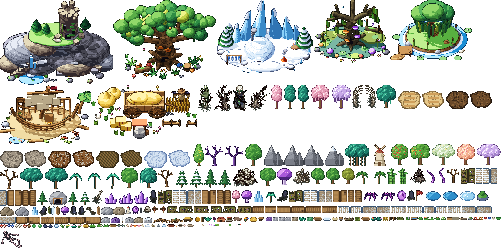 | 1024x513 | used | TerrainLayer | `pixel/terrain/props.png` |
| `ground_terrain_shapes_battlefield` |  | 768x192 | used | TerrainLayer | `pixel/terrain/shapes_battlefield.png` |
| `ground_terrain_shapes_blight` |  | 768x192 | used | TerrainLayer | `pixel/terrain/shapes_blight.png` |
| `ground_terrain_shapes_blight_d1` |  | 768x192 | used | TerrainLayer | `pixel/terrain/shapes_blight_d1.png` |
| `ground_terrain_shapes_castle` | 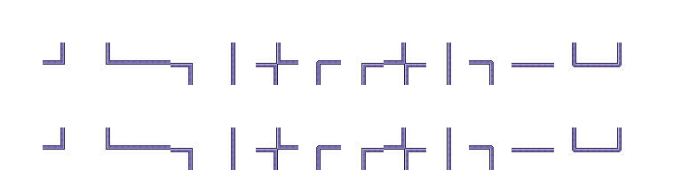 | 768x192 | used | TerrainLayer | `pixel/terrain/shapes_castle.png` |
| `ground_terrain_shapes_coast` | 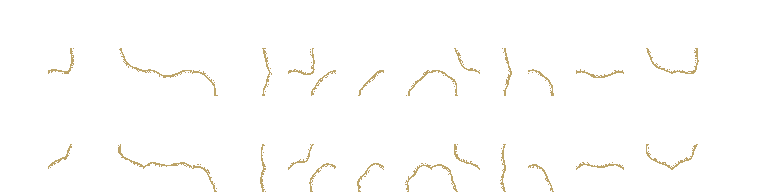 | 768x192 | used | TerrainLayer | `pixel/terrain/shapes_coast.png` |
| `ground_terrain_shapes_fields` |  | 768x192 | used | TerrainLayer | `pixel/terrain/shapes_fields.png` |
| `ground_terrain_shapes_forest` | 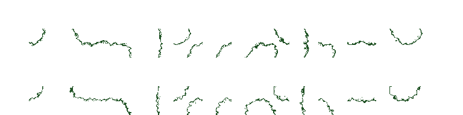 | 768x192 | used | TerrainLayer | `pixel/terrain/shapes_forest.png` |
| `ground_terrain_shapes_forest_d1` |  | 768x192 | used | TerrainLayer | `pixel/terrain/shapes_forest_d1.png` |
| `ground_terrain_shapes_hills` |  | 768x192 | used | TerrainLayer | `pixel/terrain/shapes_hills.png` |
| `ground_terrain_shapes_hills_d1` |  | 768x192 | used | TerrainLayer | `pixel/terrain/shapes_hills_d1.png` |
| `ground_terrain_shapes_hills_d2` |  | 768x192 | used | TerrainLayer | `pixel/terrain/shapes_hills_d2.png` |
| `ground_terrain_shapes_jungle` |  | 768x192 | used | TerrainLayer | `pixel/terrain/shapes_jungle.png` |
| `ground_terrain_shapes_jungle_d1` |  | 768x192 | used | TerrainLayer | `pixel/terrain/shapes_jungle_d1.png` |
| `ground_terrain_shapes_lake` | 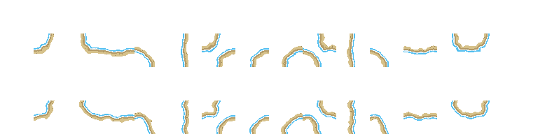 | 768x192 | used | TerrainLayer | `pixel/terrain/shapes_lake.png` |
| `ground_terrain_shapes_lake_d1` |  | 768x192 | used | TerrainLayer | `pixel/terrain/shapes_lake_d1.png` |
| `ground_terrain_shapes_lake_d2` |  | 768x192 | used | TerrainLayer | `pixel/terrain/shapes_lake_d2.png` |
| `ground_terrain_shapes_mist` |  | 768x192 | used | TerrainLayer | `pixel/terrain/shapes_mist.png` |
| `ground_terrain_shapes_orchard` |  | 768x192 | used | TerrainLayer | `pixel/terrain/shapes_orchard.png` |
| `ground_terrain_shapes_plains` | 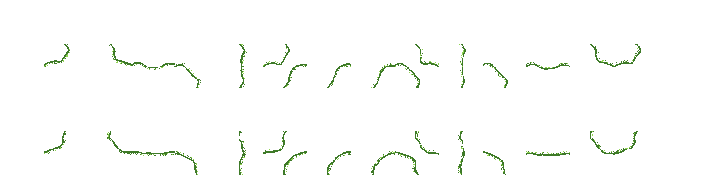 | 768x192 | used | TerrainLayer | `pixel/terrain/shapes_plains.png` |
| `ground_terrain_shapes_swamp` | 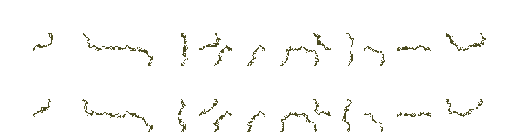 | 768x192 | used | TerrainLayer | `pixel/terrain/shapes_swamp.png` |
| `ground_terrain_shapes_swamp_d1` |  | 768x192 | used | TerrainLayer | `pixel/terrain/shapes_swamp_d1.png` |
| `ground_terrain_shapes_tundra` |  | 768x192 | used | TerrainLayer | `pixel/terrain/shapes_tundra.png` |
| `ground_terrain_shapes_tundra_d1` |  | 768x192 | used | TerrainLayer | `pixel/terrain/shapes_tundra_d1.png` |
| `ground_terrain_shapes_yard` | 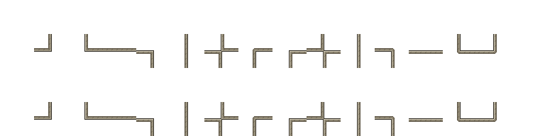 | 768x192 | used | TerrainLayer | `pixel/terrain/shapes_yard.png` |
| `ground_terrain_shore_bog` | 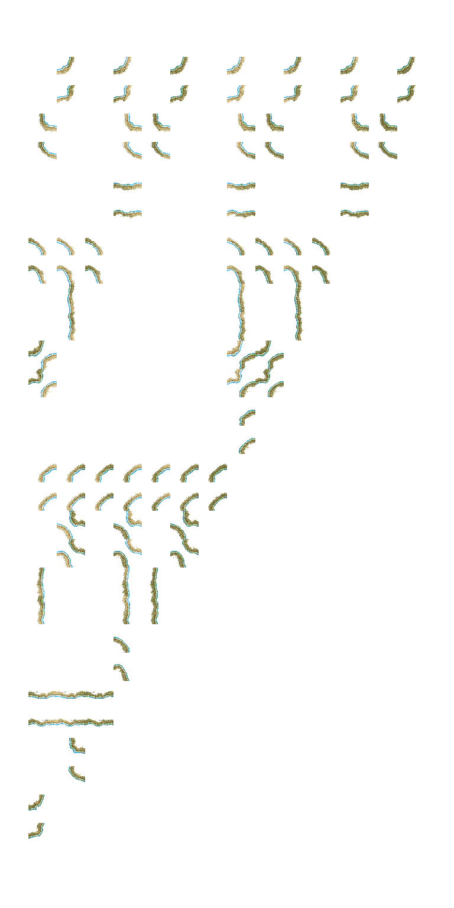 | 768x1536 | used | TerrainLayer | `pixel/terrain/shore_bog.png` |
| `ground_terrain_shore_frost` | 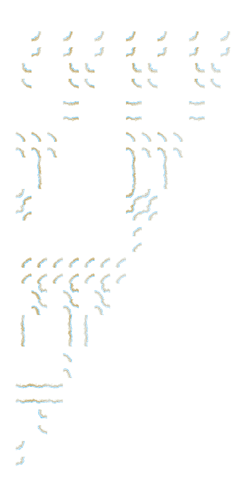 | 768x1536 | used | TerrainLayer | `pixel/terrain/shore_frost.png` |
| `ground_terrain_tex_battlefield` |  | 192x192 | used | TerrainLayer | `pixel/terrain/tex_battlefield.png` |
| `ground_terrain_tex_blight` |  | 192x192 | used | TerrainLayer | `pixel/terrain/tex_blight.png` |
| `ground_terrain_tex_blight_d1` |  | 192x192 | used | TerrainLayer | `pixel/terrain/tex_blight_d1.png` |
| `ground_terrain_tex_castle` | 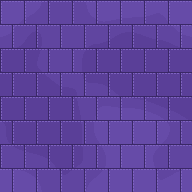 | 192x192 | used | TerrainLayer | `pixel/terrain/tex_castle.png` |
| `ground_terrain_tex_coast` | 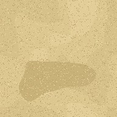 | 192x192 | used | TerrainLayer | `pixel/terrain/tex_coast.png` |
| `ground_terrain_tex_fields` |  | 192x192 | used | TerrainLayer | `pixel/terrain/tex_fields.png` |
| `ground_terrain_tex_forest` | 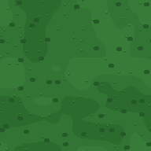 | 192x192 | used | TerrainLayer | `pixel/terrain/tex_forest.png` |
| `ground_terrain_tex_forest_d1` | 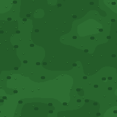 | 192x192 | used | TerrainLayer | `pixel/terrain/tex_forest_d1.png` |
| `ground_terrain_tex_hills` | 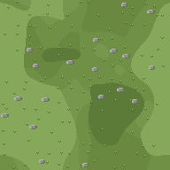 | 192x192 | used | TerrainLayer | `pixel/terrain/tex_hills.png` |
| `ground_terrain_tex_hills_d1` | 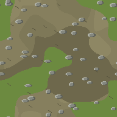 | 192x192 | used | TerrainLayer | `pixel/terrain/tex_hills_d1.png` |
| `ground_terrain_tex_hills_d2` | 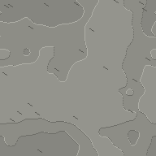 | 192x192 | used | TerrainLayer | `pixel/terrain/tex_hills_d2.png` |
| `ground_terrain_tex_jungle` |  | 192x192 | used | TerrainLayer | `pixel/terrain/tex_jungle.png` |
| `ground_terrain_tex_jungle_d1` |  | 192x192 | used | TerrainLayer | `pixel/terrain/tex_jungle_d1.png` |
| `ground_terrain_tex_lake` | 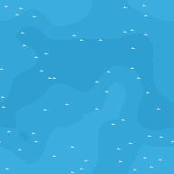 | 192x192 | used | TerrainLayer | `pixel/terrain/tex_lake.png` |
| `ground_terrain_tex_lake_d1` | 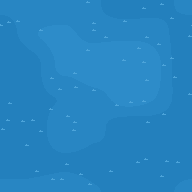 | 192x192 | used | TerrainLayer | `pixel/terrain/tex_lake_d1.png` |
| `ground_terrain_tex_lake_d2` | 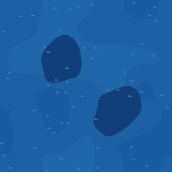 | 192x192 | used | TerrainLayer | `pixel/terrain/tex_lake_d2.png` |
| `ground_terrain_tex_mist` | 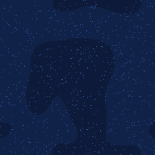 | 192x192 | used | TerrainLayer | `pixel/terrain/tex_mist.png` |
| `ground_terrain_tex_orchard` |  | 192x192 | used | TerrainLayer | `pixel/terrain/tex_orchard.png` |
| `ground_terrain_tex_plains` | 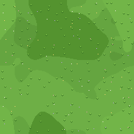 | 192x192 | used | TerrainLayer | `pixel/terrain/tex_plains.png` |
| `ground_terrain_tex_swamp` | 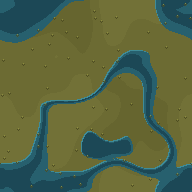 | 192x192 | used | TerrainLayer | `pixel/terrain/tex_swamp.png` |
| `ground_terrain_tex_swamp_d1` | 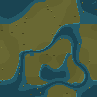 | 192x192 | used | TerrainLayer | `pixel/terrain/tex_swamp_d1.png` |
| `ground_terrain_tex_tundra` | 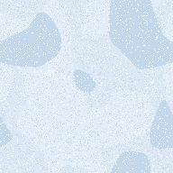 | 192x192 | used | TerrainLayer | `pixel/terrain/tex_tundra.png` |
| `ground_terrain_tex_tundra_d1` | 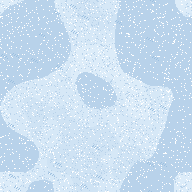 | 192x192 | used | TerrainLayer | `pixel/terrain/tex_tundra_d1.png` |
| `ground_terrain_tex_yard` | 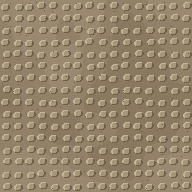 | 192x192 | used | TerrainLayer | `pixel/terrain/tex_yard.png` |
