# Monsters

Generated by `npm run assets:catalog` from the game registries and `public/pixel/`. Do not edit by hand: rename an asset in `scripts/assets/names.json`.

The monster roster art, per biome, plus planned monsters that have no picture yet.

38 assets. Refer to an asset by its **name**.

## coast boss

| Name | Picture | Size | Status | Used by | Source file |
| --- | --- | --- | --- | --- | --- |
| `monster_boss_reef_leviathan` | 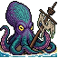 | 64x64 | used | bossReefLeviathan | `pixel/enemies/coast/boss-reef-leviathan.png` |

## coast normal

| Name | Picture | Size | Status | Used by | Source file |
| --- | --- | --- | --- | --- | --- |
| `monster_drowned_sailor` | 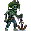 | 64x64 | used | drownedSailor | `pixel/enemies/coast/drowned-sailor.png` |
| `monster_net_gull` | 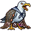 | 65x65 | used | netGull | `pixel/enemies/coast/net-gull.png` |
| `monster_wreck_crab` | 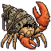 | 64x64 | used | wreckCrab | `pixel/enemies/coast/wreck-crab.png` |

## forest boss

| Name | Picture | Size | Status | Used by | Source file |
| --- | --- | --- | --- | --- | --- |
| `monster_boss_elder_stag` | 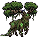 | 65x65 | used | bossElderStag | `pixel/enemies/forest/boss-elder-stag.png` |

## forest normal

| Name | Picture | Size | Status | Used by | Source file |
| --- | --- | --- | --- | --- | --- |
| `monster_bramble_imp` | 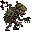 | 64x64 | used | brambleImp | `pixel/enemies/forest/bramble-imp.png` |
| `monster_mossback_wolf` | 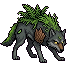 | 67x67 | used | mossbackWolf | `pixel/enemies/forest/mossback-wolf.png` |
| `monster_rotcap_stag` | 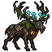 | 64x64 | used | rotcapStag | `pixel/enemies/forest/rotcap-stag.png` |

## jungle normal

| Name | Picture | Size | Status | Used by | Source file |
| --- | --- | --- | --- | --- | --- |
| `monster_eye_horror` |  | 67x67 | used | eyeHorror | `pixel/enemies/jungle/eye-horror.png` |
| `monster_skull_vine` | 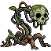 | 65x65 | used | skullVine | `pixel/enemies/jungle/skull-vine.png` |
| `monster_zombie_triceratops` |  | 73x73 | used | zombieTriceratops | `pixel/enemies/jungle/zombie-triceratops.png` |

## lake boss

| Name | Picture | Size | Status | Used by | Source file |
| --- | --- | --- | --- | --- | --- |
| `monster_boss_lake_hydra` | 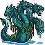 | 65x65 | used | bossLakeHydra | `pixel/enemies/lake/boss-lake-hydra.png` |

## lake normal

| Name | Picture | Size | Status | Used by | Source file |
| --- | --- | --- | --- | --- | --- |
| `monster_moss_snapper` | 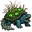 | 64x64 | used | mossSnapper | `pixel/enemies/lake/moss-snapper.png` |
| `monster_reed_nymph` | 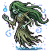 | 64x64 | used | reedNymph | `pixel/enemies/lake/reed-nymph.png` |

## new biome monsters (not wired)

| Name | Picture | Size | Status | Used by | Source file |
| --- | --- | --- | --- | --- | --- |
| `monster_pack_eye_horror` | 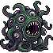 | 67x67 | reuse |  | `pixel/assets_to_assess_and_use/monsters/eye_horror.png` |
| `monster_pack_frost_flame_knight` | 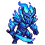 | 64x64 | reuse |  | `pixel/assets_to_assess_and_use/monsters/frost_flame_knight.png` |
| `monster_pack_magma_knight` | 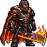 | 66x66 | reuse |  | `pixel/assets_to_assess_and_use/monsters/magma_knight.png` |
| `monster_pack_mecha_triceratops` | 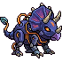 | 70x70 | reuse |  | `pixel/assets_to_assess_and_use/monsters/mecha_triceratops.png` |
| `monster_pack_mushroom_wizard` | 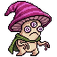 | 64x64 | reuse |  | `pixel/assets_to_assess_and_use/monsters/mushroom_wizard.png` |
| `monster_pack_purple_ogre` | 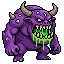 | 64x64 | reuse |  | `pixel/assets_to_assess_and_use/monsters/purple_ogre.png` |
| `monster_pack_reaper_frost_scythe` | 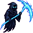 | 65x65 | reuse |  | `pixel/assets_to_assess_and_use/monsters/reaper_frost_scythe.png` |
| `monster_pack_skeleton_cleaver` | 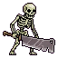 | 64x64 | reuse |  | `pixel/assets_to_assess_and_use/monsters/skeleton_cleaver.png` |
| `monster_pack_skull_vine` |  | 65x65 | reuse |  | `pixel/assets_to_assess_and_use/monsters/skull_vine.png` |
| `monster_pack_toxic_zombie` | 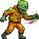 | 65x65 | reuse |  | `pixel/assets_to_assess_and_use/monsters/toxic_zombie.png` |
| `monster_pack_zombie_triceratops` | 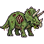 | 73x73 | reuse |  | `pixel/assets_to_assess_and_use/monsters/zombie_triceratops.png` |

## placeholder (stand-in until the real sprite)

| Name | Picture | Size | Status | Used by | Source file |
| --- | --- | --- | --- | --- | --- |
| `monster_placeholder_silhouette` | 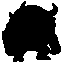 | 64x64 | used | graniteRam, caveGoblinMiner, boulderBeetle, bossHillGiant, pikeLurker, bossHardwoodColossus | `pixel/enemies/placeholder/silhouette.png` |

## plains boss

| Name | Picture | Size | Status | Used by | Source file |
| --- | --- | --- | --- | --- | --- |
| `monster_boss_great_auroch` | 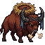 | 64x64 | used | bossGreatAuroch | `pixel/enemies/plains/boss-great-auroch.png` |

## plains normal

| Name | Picture | Size | Status | Used by | Source file |
| --- | --- | --- | --- | --- | --- |
| `monster_burrow_badger` | 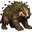 | 65x65 | used | burrowBadger | `pixel/enemies/plains/burrow-badger.png` |
| `monster_dust_strider` | 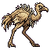 | 64x64 | used | dustStrider | `pixel/enemies/plains/dust-strider.png` |
| `monster_thistle_boar` | 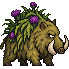 | 69x69 | used | thistleBoar | `pixel/enemies/plains/thistle-boar.png` |

## swamp boss

| Name | Picture | Size | Status | Used by | Source file |
| --- | --- | --- | --- | --- | --- |
| `monster_boss_mire_matriarch` | 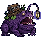 | 68x68 | used | bossMireMatriarch | `pixel/enemies/swamp/boss-mire-matriarch.png` |

## swamp normal

| Name | Picture | Size | Status | Used by | Source file |
| --- | --- | --- | --- | --- | --- |
| `monster_dumpback` | 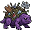 | 64x64 | used | dumpback | `pixel/enemies/swamp/dumpback.png` |
| `monster_garbage_ogre` | 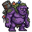 | 64x64 | used | garbageOgre | `pixel/enemies/swamp/garbage-ogre.png` |
| `monster_rot_heron` | 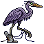 | 64x64 | used | rotHeron | `pixel/enemies/swamp/rot-heron.png` |

## tundra boss

| Name | Picture | Size | Status | Used by | Source file |
| --- | --- | --- | --- | --- | --- |
| `monster_boss_winter_wyrm` | 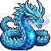 | 64x64 | used | bossWinterWyrm | `pixel/enemies/tundra/boss-winter-wyrm.png` |

## tundra normal

| Name | Picture | Size | Status | Used by | Source file |
| --- | --- | --- | --- | --- | --- |
| `monster_frost_hare` | 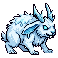 | 64x64 | used | frostHare | `pixel/enemies/tundra/frost-hare.png` |
| `monster_icetusk_calf` | 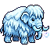 | 64x64 | used | icetuskCalf | `pixel/enemies/tundra/icetusk-calf.png` |
| `monster_rime_wraith` | 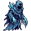 | 64x64 | used | rimeWraith | `pixel/enemies/tundra/rime-wraith.png` |
