# Monsters

Generated by `npm run assets:catalog` from the game registries and `public/pixel/`. Do not edit by hand: rename an asset in `scripts/assets/names.json`.

The monster roster art, per biome, plus planned monsters that have no picture yet.

57 assets. Refer to an asset by its **name**.

## battlefield boss

| Name | Picture | Size | Status | Used by | Source file |
| --- | --- | --- | --- | --- | --- |
| `monster_boss_cinder_warlord` | 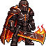 | 66x66 | used | bossCinderWarlord | `pixel/enemies/battlefield/boss-cinder-warlord.png` |

## battlefield normal

| Name | Picture | Size | Status | Used by | Source file |
| --- | --- | --- | --- | --- | --- |
| `monster_bone_cleaver` | 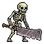 | 64x64 | used | boneCleaver | `pixel/enemies/battlefield/bone-cleaver.png` |
| `monster_frost_flame_knight` | 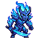 | 64x64 | used | frostFlameKnight | `pixel/enemies/battlefield/frost-flame-knight.png` |
| `monster_frostguard_knight` | 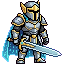 | 64x64 | used | frostguardKnight | `pixel/enemies/battlefield/frostguard-knight.png` |
| `monster_gilded_champion` | 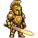 | 64x64 | used | gildedChampion | `pixel/enemies/battlefield/gilded-champion.png` |

## blight boss

| Name | Picture | Size | Status | Used by | Source file |
| --- | --- | --- | --- | --- | --- |
| `monster_boss_eyed_maw` | 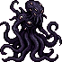 | 69x69 | used | bossEyedMaw | `pixel/enemies/blight/boss-eyed-maw.png` |

## blight normal

| Name | Picture | Size | Status | Used by | Source file |
| --- | --- | --- | --- | --- | --- |
| `monster_gasket_goblin` | 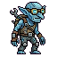 | 64x64 | used | gasketGoblin | `pixel/enemies/blight/gasket-goblin.png` |
| `monster_gloom_cerberus` | 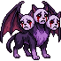 | 69x69 | used | gloomCerberus | `pixel/enemies/blight/gloom-cerberus.png` |
| `monster_mothwing_hexer` | 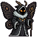 | 64x64 | used | mothwingHexer | `pixel/enemies/blight/mothwing-hexer.png` |
| `monster_sporeback_ogre` | 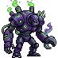 | 73x73 | used | sporebackOgre | `pixel/enemies/blight/sporeback-ogre.png` |

## coast boss

| Name | Picture | Size | Status | Used by | Source file |
| --- | --- | --- | --- | --- | --- |
| `monster_boss_reef_leviathan` | 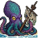 | 64x64 | used | bossReefLeviathan | `pixel/enemies/coast/boss-reef-leviathan.png` |

## coast normal

| Name | Picture | Size | Status | Used by | Source file |
| --- | --- | --- | --- | --- | --- |
| `monster_drowned_sailor` | 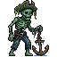 | 64x64 | used | drownedSailor | `pixel/enemies/coast/drowned-sailor.png` |
| `monster_net_gull` | 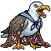 | 65x65 | used | netGull | `pixel/enemies/coast/net-gull.png` |
| `monster_wreck_crab` | 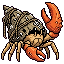 | 64x64 | used | wreckCrab | `pixel/enemies/coast/wreck-crab.png` |

## fields boss

| Name | Picture | Size | Status | Used by | Source file |
| --- | --- | --- | --- | --- | --- |
| `monster_boss_harvest_matron` | 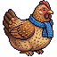 | 64x64 | used | bossHarvestMatron | `pixel/enemies/fields/boss-harvest-matron.png` |

## fields normal

| Name | Picture | Size | Status | Used by | Source file |
| --- | --- | --- | --- | --- | --- |
| `monster_barn_gargoyle` | 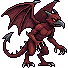 | 68x68 | used | barnGargoyle | `pixel/enemies/fields/barn-gargoyle.png` |
| `monster_bucket_knight` | 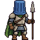 | 68x68 | used | bucketKnight | `pixel/enemies/fields/bucket-knight.png` |
| `monster_hedge_bandit` | 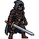 | 65x65 | used | hedgeBandit | `pixel/enemies/fields/hedge-bandit.png` |
| `monster_millstone_golem` | 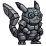 | 66x66 | used | millstoneGolem | `pixel/enemies/fields/millstone-golem.png` |

## forest boss

| Name | Picture | Size | Status | Used by | Source file |
| --- | --- | --- | --- | --- | --- |
| `monster_boss_elder_stag` | 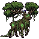 | 65x65 | used | bossElderStag | `pixel/enemies/forest/boss-elder-stag.png` |

## forest normal

| Name | Picture | Size | Status | Used by | Source file |
| --- | --- | --- | --- | --- | --- |
| `monster_bramble_imp` | 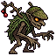 | 64x64 | used | brambleImp | `pixel/enemies/forest/bramble-imp.png` |
| `monster_mossback_wolf` | 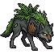 | 67x67 | used | mossbackWolf | `pixel/enemies/forest/mossback-wolf.png` |
| `monster_pinecone_warden` | 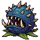 | 66x66 | used | pineconeWarden | `pixel/enemies/forest/pinecone-warden.png` |
| `monster_rotcap_stag` | 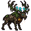 | 64x64 | used | rotcapStag | `pixel/enemies/forest/rotcap-stag.png` |

## hills boss

| Name | Picture | Size | Status | Used by | Source file |
| --- | --- | --- | --- | --- | --- |
| `monster_boss_ironhorn` | 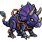 | 70x70 | used | bossIronhorn | `pixel/enemies/hills/boss-ironhorn.png` |

## hills normal

| Name | Picture | Size | Status | Used by | Source file |
| --- | --- | --- | --- | --- | --- |
| `monster_cairn_sentinel` | 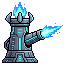 | 66x66 | used | cairnSentinel | `pixel/enemies/hills/cairn-sentinel.png` |
| `monster_mawhorn_brute` | 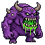 | 64x64 | used | mawhornBrute | `pixel/enemies/hills/mawhorn-brute.png` |
| `monster_quarry_rat_knight` | 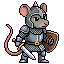 | 64x64 | used | quarryRatKnight | `pixel/enemies/hills/quarry-rat-knight.png` |

## jungle boss

| Name | Picture | Size | Status | Used by | Source file |
| --- | --- | --- | --- | --- | --- |
| `monster_boss_brainstorm` | 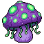 | 64x64 | used | bossBrainstorm | `pixel/enemies/jungle/boss-brainstorm.png` |

## jungle normal

| Name | Picture | Size | Status | Used by | Source file |
| --- | --- | --- | --- | --- | --- |
| `monster_eye_horror` | 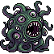 | 67x67 | used | eyeHorror | `pixel/enemies/jungle/eye-horror.png` |
| `monster_skull_vine` | 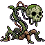 | 65x65 | used | skullVine | `pixel/enemies/jungle/skull-vine.png` |
| `monster_zombie_triceratops` | 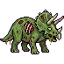 | 73x73 | used | zombieTriceratops | `pixel/enemies/jungle/zombie-triceratops.png` |

## lake boss

| Name | Picture | Size | Status | Used by | Source file |
| --- | --- | --- | --- | --- | --- |
| `monster_boss_lake_hydra` | 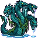 | 65x65 | used | bossLakeHydra | `pixel/enemies/lake/boss-lake-hydra.png` |

## lake normal

| Name | Picture | Size | Status | Used by | Source file |
| --- | --- | --- | --- | --- | --- |
| `monster_moss_snapper` | 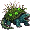 | 64x64 | used | mossSnapper | `pixel/enemies/lake/moss-snapper.png` |
| `monster_reed_nymph` | 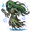 | 64x64 | used | reedNymph | `pixel/enemies/lake/reed-nymph.png` |
| `monster_tidepool_golem` | 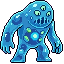 | 64x64 | used | tidepoolGolem | `pixel/enemies/lake/tidepool-golem.png` |

## orchard boss

| Name | Picture | Size | Status | Used by | Source file |
| --- | --- | --- | --- | --- | --- |
| `monster_boss_blossom_reaper` | 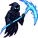 | 65x65 | used | bossBlossomReaper | `pixel/enemies/orchard/boss-blossom-reaper.png` |

## orchard normal

| Name | Picture | Size | Status | Used by | Source file |
| --- | --- | --- | --- | --- | --- |
| `monster_blossom_ronin` | 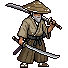 | 68x68 | used | blossomRonin | `pixel/enemies/orchard/blossom-ronin.png` |
| `monster_gray_gleaner` | 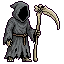 | 64x64 | used | grayGleaner | `pixel/enemies/orchard/gray-gleaner.png` |
| `monster_greenscale_warden` | 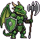 | 68x68 | used | greenscaleWarden | `pixel/enemies/orchard/greenscale-warden.png` |
| `monster_mushroom_wizard` | 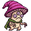 | 64x64 | used | mushroomWizard | `pixel/enemies/orchard/mushroom-wizard.png` |

## placeholder (stand-in until the real sprite)

| Name | Picture | Size | Status | Used by | Source file |
| --- | --- | --- | --- | --- | --- |
| `monster_placeholder_silhouette` |  | 68x68 | used | gravelQuail, stonehornBison, emberSquirrel, graniteRam, caveGoblinMiner, boulderBeetle, bossHillGiant, magmaKnight, magmaCrab, quarryDrake, highlandGnoll, garbageOgre, glacierYeti, tideglassJelly, barnacleBrute, pikeLurker, siltEel, lilypadWarden, vinewhipPanther, mossbackIdol, bossHardwoodColossus, crowMarshal, rootboundGardener, blightedHusk, sporeHound, bannerWraith | `pixel/enemies/placeholder/silhouette.png` |

## plains boss

| Name | Picture | Size | Status | Used by | Source file |
| --- | --- | --- | --- | --- | --- |
| `monster_boss_great_auroch` | 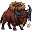 | 64x64 | used | bossGreatAuroch | `pixel/enemies/plains/boss-great-auroch.png` |

## plains normal

| Name | Picture | Size | Status | Used by | Source file |
| --- | --- | --- | --- | --- | --- |
| `monster_burrow_badger` | 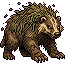 | 65x65 | used | burrowBadger | `pixel/enemies/plains/burrow-badger.png` |
| `monster_dust_strider` | 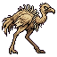 | 64x64 | used | dustStrider | `pixel/enemies/plains/dust-strider.png` |
| `monster_thistle_boar` | 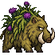 | 69x69 | used | thistleBoar | `pixel/enemies/plains/thistle-boar.png` |

## swamp boss

| Name | Picture | Size | Status | Used by | Source file |
| --- | --- | --- | --- | --- | --- |
| `monster_boss_mire_matriarch` | 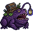 | 68x68 | used | bossMireMatriarch | `pixel/enemies/swamp/boss-mire-matriarch.png` |

## swamp normal

| Name | Picture | Size | Status | Used by | Source file |
| --- | --- | --- | --- | --- | --- |
| `monster_bogfire_wisp` | 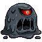 | 70x70 | used | bogfireWisp | `pixel/enemies/swamp/bogfire-wisp.png` |
| `monster_dumpback` | 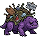 | 64x64 | used | dumpback | `pixel/enemies/swamp/dumpback.png` |
| `monster_rot_heron` | 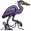 | 64x64 | used | rotHeron | `pixel/enemies/swamp/rot-heron.png` |
| `monster_scrap_golem` | 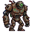 | 64x64 | used | scrapGolem | `pixel/enemies/swamp/scrap-golem.png` |
| `monster_toxic_zombie` |  | 65x65 | used | toxicZombie | `pixel/enemies/swamp/toxic-zombie.png` |

## tundra boss

| Name | Picture | Size | Status | Used by | Source file |
| --- | --- | --- | --- | --- | --- |
| `monster_boss_winter_wyrm` |  | 64x64 | used | bossWinterWyrm | `pixel/enemies/tundra/boss-winter-wyrm.png` |

## tundra normal

| Name | Picture | Size | Status | Used by | Source file |
| --- | --- | --- | --- | --- | --- |
| `monster_frost_hare` |  | 64x64 | used | frostHare | `pixel/enemies/tundra/frost-hare.png` |
| `monster_frost_moth` |  | 64x64 | used | frostMoth | `pixel/enemies/tundra/frost-moth.png` |
| `monster_icetusk_calf` |  | 64x64 | used | icetuskCalf | `pixel/enemies/tundra/icetusk-calf.png` |
| `monster_rime_wraith` |  | 64x64 | used | rimeWraith | `pixel/enemies/tundra/rime-wraith.png` |
