# Portraits

Generated by `npm run assets:catalog` from the game registries and `public/pixel/`. Do not edit by hand: rename an asset in `scripts/assets/names.json`.

The avatar busts for the picker (ui/heroes), the guide and the wireframe early-tester set.

22 assets. Refer to an asset by its **name**.

## avatar portraits

| Name | Picture | Size | Status | Used by | Source file |
| --- | --- | --- | --- | --- | --- |
| `avatar_admin` | 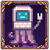 | 64x64 | used | admin | `pixel/ui/heroes/avatar_admin.png` |
| `avatar_admin_hooded` | 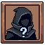 | 64x64 | used | admin_hooded | `pixel/ui/heroes/avatar_admin_hooded.png` |
| `avatar_beta_tester` | 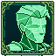 | 64x64 | used | beta_tester | `pixel/ui/heroes/avatar_beta_tester.png` |
| `avatar_blue_plume_knight` |  | 64x64 | used | alchemist | `pixel/ui/heroes/avatar_blue_plume_knight.png` |
| `avatar_chain_knight_woman` | 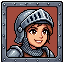 | 64x64 | used | farmer | `pixel/ui/heroes/avatar_chain_knight_woman.png` |
| `avatar_dwarf_knight_orange_eyes` | 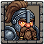 | 64x64 | used | miner | `pixel/ui/heroes/avatar_dwarf_knight_orange_eyes.png` |
| `avatar_gold_lion_knight` | 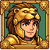 | 64x64 | used | architect | `pixel/ui/heroes/avatar_gold_lion_knight.png` |
| `avatar_green_horned_elf` |  | 64x64 | used | druid | `pixel/ui/heroes/avatar_green_horned_elf.png` |
| `avatar_horned_brute_dark` |  | 64x64 | used | boss_slayer | `pixel/ui/heroes/avatar_horned_brute_dark.png` |
| `avatar_horned_chainmail` |  | 64x64 | used | early_tester | `pixel/ui/heroes/avatar_horned_chainmail.png` |
| `avatar_horned_scarred_woman` | 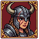 | 64x64 | used | reborn | `pixel/ui/heroes/avatar_horned_scarred_woman.png` |
| `avatar_purple_elf_lady` |  | 64x64 | used | bard | `pixel/ui/heroes/avatar_purple_elf_lady.png` |
| `avatar_red_haired_knight` |  | 64x64 | used | knight | `pixel/ui/heroes/avatar_red_haired_knight.png` |
| `avatar_red_plume_lady` | 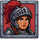 | 64x64 | used | scout | `pixel/ui/heroes/avatar_red_plume_lady.png` |
| `avatar_winged_helm_veteran` |  | 65x65 | used | scholar | `pixel/ui/heroes/avatar_winged_helm_veteran.png` |

## avatar portraits (spare, for later unlocks)

| Name | Picture | Size | Status | Used by | Source file |
| --- | --- | --- | --- | --- | --- |
| `avatar_horned_black_helm` |  | 64x64 | planned | unlockable avatar (gems, achievements), IDL-266 | `pixel/ui/heroes/avatar_horned_black_helm.png` |
| `avatar_horned_fur_beard` | 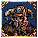 | 64x64 | planned | unlockable avatar (gems, achievements), IDL-266 | `pixel/ui/heroes/avatar_horned_fur_beard.png` |
| `avatar_horned_fur_collar` |  | 64x64 | planned | unlockable avatar (gems, achievements), IDL-266 | `pixel/ui/heroes/avatar_horned_fur_collar.png` |
| `avatar_horned_graybeard` | 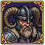 | 64x64 | planned | unlockable avatar (gems, achievements), IDL-266 | `pixel/ui/heroes/avatar_horned_graybeard.png` |
| `avatar_horned_green_veteran` | 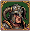 | 64x64 | planned | unlockable avatar (gems, achievements), IDL-266 | `pixel/ui/heroes/avatar_horned_green_veteran.png` |
| `avatar_horned_ram_helm` |  | 64x64 | planned | unlockable avatar (gems, achievements), IDL-266 | `pixel/ui/heroes/avatar_horned_ram_helm.png` |

## tutorial guide

| Name | Picture | Size | Status | Used by | Source file |
| --- | --- | --- | --- | --- | --- |
| `guide_brother_alder_talk` | 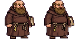 | 134x67 | used | tutorial:guide | `pixel/ui/alder_talk.png` |
