# Portraits

Generated by `npm run assets:catalog` from the game registries and `public/pixel/`. Do not edit by hand: rename an asset in `scripts/assets/names.json`.

The avatar busts for the picker (ui/heroes), the guide and the wireframe early-tester set.

58 assets. Refer to an asset by its **name**.

## avatar portraits

| Name | Picture | Size | Status | Used by | Source file |
| --- | --- | --- | --- | --- | --- |
| `avatar_admin` |  | 64x64 | used | admin | `pixel/ui/heroes/avatar_admin.png` |
| `avatar_admin_hooded` |  | 64x64 | used | admin_hooded | `pixel/ui/heroes/avatar_admin_hooded.png` |
| `avatar_beta_tester` |  | 64x64 | used | beta_tester | `pixel/ui/heroes/avatar_beta_tester.png` |
| `avatar_bloody_helm` | 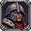 | 64x64 | used | bloody_helm | `pixel/ui/heroes/avatar_bloody_helm.png` |
| `avatar_blue_plume_knight` | 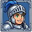 | 64x64 | used | alchemist | `pixel/ui/heroes/avatar_blue_plume_knight.png` |
| `avatar_chain_knight_woman` |  | 64x64 | used | farmer | `pixel/ui/heroes/avatar_chain_knight_woman.png` |
| `avatar_demon_horned` | 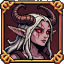 | 64x64 | used | horned_demon | `pixel/ui/heroes/avatar_demon_horned.png` |
| `avatar_dragonborn` | 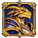 | 64x64 | used | dragonborn | `pixel/ui/heroes/avatar_dragonborn.png` |
| `avatar_dragonkin_blue` | 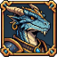 | 64x64 | used | dragonkin | `pixel/ui/heroes/avatar_dragonkin_blue.png` |
| `avatar_druid_stag` | 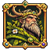 | 64x64 | used | stag_druid | `pixel/ui/heroes/avatar_druid_stag.png` |
| `avatar_dwarf_knight_orange_eyes` |  | 64x64 | used | miner | `pixel/ui/heroes/avatar_dwarf_knight_orange_eyes.png` |
| `avatar_dwarf_lord` | 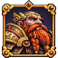 | 64x64 | used | dwarf_lord | `pixel/ui/heroes/avatar_dwarf_lord.png` |
| `avatar_elf_prince` | 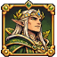 | 64x64 | used | elf_prince | `pixel/ui/heroes/avatar_elf_prince.png` |
| `avatar_elf_queen` | 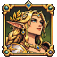 | 64x64 | used | elf_queen | `pixel/ui/heroes/avatar_elf_queen.png` |
| `avatar_gold_lion_knight` |  | 64x64 | used | architect | `pixel/ui/heroes/avatar_gold_lion_knight.png` |
| `avatar_green_horned_elf` | 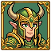 | 64x64 | used | druid | `pixel/ui/heroes/avatar_green_horned_elf.png` |
| `avatar_hooded_archmage` | 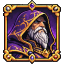 | 64x64 | used | archmage | `pixel/ui/heroes/avatar_hooded_archmage.png` |
| `avatar_horned_brute_dark` | 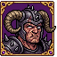 | 64x64 | used | boss_slayer | `pixel/ui/heroes/avatar_horned_brute_dark.png` |
| `avatar_horned_chainmail` | 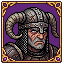 | 64x64 | used | early_tester | `pixel/ui/heroes/avatar_horned_chainmail.png` |
| `avatar_horned_scarred_woman` |  | 64x64 | used | reborn | `pixel/ui/heroes/avatar_horned_scarred_woman.png` |
| `avatar_ice_wraith` | 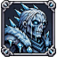 | 64x64 | used | ice_wraith | `pixel/ui/heroes/avatar_ice_wraith.png` |
| `avatar_king` | 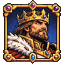 | 64x64 | used | king | `pixel/ui/heroes/avatar_king.png` |
| `avatar_laurel_paladin` | 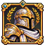 | 64x64 | used | laurel_paladin | `pixel/ui/heroes/avatar_laurel_paladin.png` |
| `avatar_lich_reaper` | 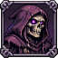 | 64x64 | used | lich_reaper | `pixel/ui/heroes/avatar_lich_reaper.png` |
| `avatar_magma_golem` | 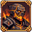 | 64x64 | used | magma_golem | `pixel/ui/heroes/avatar_magma_golem.png` |
| `avatar_orc_warlord` | 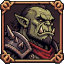 | 64x64 | used | orc_warlord | `pixel/ui/heroes/avatar_orc_warlord.png` |
| `avatar_plague_doctor` | 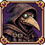 | 64x64 | used | plague_doctor | `pixel/ui/heroes/avatar_plague_doctor.png` |
| `avatar_purple_elf_lady` | 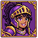 | 64x64 | used | bard | `pixel/ui/heroes/avatar_purple_elf_lady.png` |
| `avatar_red_haired_knight` | 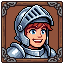 | 64x64 | used | knight | `pixel/ui/heroes/avatar_red_haired_knight.png` |
| `avatar_red_plume_lady` |  | 64x64 | used | scout | `pixel/ui/heroes/avatar_red_plume_lady.png` |
| `avatar_saint` | 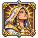 | 64x64 | used | saint | `pixel/ui/heroes/avatar_saint.png` |
| `avatar_shadow_knight` | 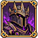 | 64x64 | used | shadow_knight | `pixel/ui/heroes/avatar_shadow_knight.png` |
| `avatar_silver_lion_lord` | 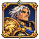 | 64x64 | used | lion_lord | `pixel/ui/heroes/avatar_silver_lion_lord.png` |
| `avatar_skeleton_king` | 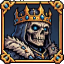 | 64x64 | used | skeleton_king | `pixel/ui/heroes/avatar_skeleton_king.png` |
| `avatar_stone_maiden` | 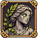 | 64x64 | used | stone_maiden | `pixel/ui/heroes/avatar_stone_maiden.png` |
| `avatar_storm_knight` | 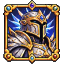 | 64x64 | used | storm_knight | `pixel/ui/heroes/avatar_storm_knight.png` |
| `avatar_treant` | 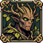 | 64x64 | used | treant | `pixel/ui/heroes/avatar_treant.png` |
| `avatar_valkyrie` | 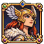 | 64x64 | used | valkyrie | `pixel/ui/heroes/avatar_valkyrie.png` |
| `avatar_void_crystal_knight` | 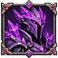 | 64x64 | used | void_crystal_knight | `pixel/ui/heroes/avatar_void_crystal_knight.png` |
| `avatar_void_cultist` | 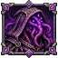 | 64x64 | used | void_cultist | `pixel/ui/heroes/avatar_void_cultist.png` |
| `avatar_void_demon` | 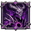 | 64x64 | used | void_demon | `pixel/ui/heroes/avatar_void_demon.png` |
| `avatar_void_elf` | 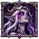 | 64x64 | used | void_elf | `pixel/ui/heroes/avatar_void_elf.png` |
| `avatar_void_eye` | 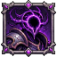 | 64x64 | used | void_eye | `pixel/ui/heroes/avatar_void_eye.png` |
| `avatar_void_hood` | 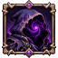 | 64x64 | used | void_hood | `pixel/ui/heroes/avatar_void_hood.png` |
| `avatar_void_king` | 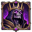 | 64x64 | used | void_king | `pixel/ui/heroes/avatar_void_king.png` |
| `avatar_void_knight` | 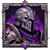 | 64x64 | used | void_knight | `pixel/ui/heroes/avatar_void_knight.png` |
| `avatar_void_lich` | 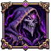 | 64x64 | used | void_lich | `pixel/ui/heroes/avatar_void_lich.png` |
| `avatar_void_orc` | 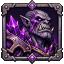 | 64x64 | used | void_orc | `pixel/ui/heroes/avatar_void_orc.png` |
| `avatar_void_queen` | 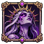 | 64x64 | used | void_queen | `pixel/ui/heroes/avatar_void_queen.png` |
| `avatar_void_zombie` | 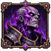 | 64x64 | used | void_zombie | `pixel/ui/heroes/avatar_void_zombie.png` |
| `avatar_winged_helm_veteran` | 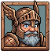 | 65x65 | used | scholar | `pixel/ui/heroes/avatar_winged_helm_veteran.png` |

## avatar portraits (spare, for later unlocks)

| Name | Picture | Size | Status | Used by | Source file |
| --- | --- | --- | --- | --- | --- |
| `avatar_horned_black_helm` | 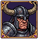 | 64x64 | planned | unlockable avatar (gems, achievements), IDL-266 | `pixel/ui/heroes/avatar_horned_black_helm.png` |
| `avatar_horned_fur_beard` |  | 64x64 | planned | unlockable avatar (gems, achievements), IDL-266 | `pixel/ui/heroes/avatar_horned_fur_beard.png` |
| `avatar_horned_fur_collar` | 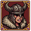 | 64x64 | planned | unlockable avatar (gems, achievements), IDL-266 | `pixel/ui/heroes/avatar_horned_fur_collar.png` |
| `avatar_horned_graybeard` |  | 64x64 | planned | unlockable avatar (gems, achievements), IDL-266 | `pixel/ui/heroes/avatar_horned_graybeard.png` |
| `avatar_horned_green_veteran` |  | 64x64 | planned | unlockable avatar (gems, achievements), IDL-266 | `pixel/ui/heroes/avatar_horned_green_veteran.png` |
| `avatar_horned_ram_helm` | 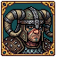 | 64x64 | planned | unlockable avatar (gems, achievements), IDL-266 | `pixel/ui/heroes/avatar_horned_ram_helm.png` |

## tutorial guide

| Name | Picture | Size | Status | Used by | Source file |
| --- | --- | --- | --- | --- | --- |
| `guide_brother_alder_talk` |  | 134x67 | used | tutorial:guide | `pixel/ui/alder_talk.png` |
