# Portraits

Generated by `npm run assets:catalog` from the game registries and `public/pixel/`. Do not edit by hand: rename an asset in `scripts/assets/names.json`.

NPC faces (48px busts): merchant, quest giver, gambler, blacksmith, innkeepers and more. A few stand behind the merchant counter, the rest are ready for quests and dialogue.

32 assets. Refer to an asset by its **name**.

## avatar portraits

| Name | Picture | Size | Status | Used by | Source file |
| --- | --- | --- | --- | --- | --- |
| `avatar_blue_plume_knight` | 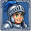 | 64x64 | used | alchemist | `pixel/new_assets/heroes/avatar_blue_plume_knight.png` |
| `avatar_chain_knight_woman` | 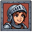 | 64x64 | used | farmer | `pixel/new_assets/heroes/avatar_chain_knight_woman.png` |
| `avatar_dwarf_knight_orange_eyes` | 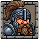 | 64x64 | used | miner | `pixel/new_assets/heroes/avatar_dwarf_knight_orange_eyes.png` |
| `avatar_gold_lion_knight` | 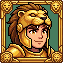 | 64x64 | used | architect | `pixel/new_assets/heroes/avatar_gold_lion_knight.png` |
| `avatar_green_horned_elf` | 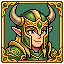 | 64x64 | used | druid | `pixel/new_assets/heroes/avatar_green_horned_elf.png` |
| `avatar_horned_brute_dark` | 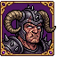 | 64x64 | used | boss_slayer | `pixel/new_assets/heroes/avatar_horned_brute_dark.png` |
| `avatar_horned_chainmail` | 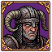 | 64x64 | used | early_tester | `pixel/new_assets/heroes/avatar_horned_chainmail.png` |
| `avatar_horned_scarred_woman` | 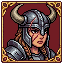 | 64x64 | used | reborn | `pixel/new_assets/heroes/avatar_horned_scarred_woman.png` |
| `avatar_purple_elf_lady` | 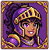 | 64x64 | used | bard | `pixel/new_assets/heroes/avatar_purple_elf_lady.png` |
| `avatar_red_haired_knight` | 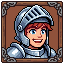 | 64x64 | used | knight | `pixel/new_assets/heroes/avatar_red_haired_knight.png` |
| `avatar_red_plume_lady` | 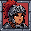 | 64x64 | used | scout | `pixel/new_assets/heroes/avatar_red_plume_lady.png` |
| `avatar_winged_helm_veteran` | 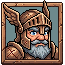 | 65x65 | used | scholar | `pixel/new_assets/heroes/avatar_winged_helm_veteran.png` |

## avatar portraits (spare, for later unlocks)

| Name | Picture | Size | Status | Used by | Source file |
| --- | --- | --- | --- | --- | --- |
| `avatar_horned_black_helm` | 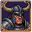 | 64x64 | reuse |  | `pixel/new_assets/heroes/avatar_horned_black_helm.png` |
| `avatar_horned_fur_beard` | 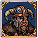 | 64x64 | reuse |  | `pixel/new_assets/heroes/avatar_horned_fur_beard.png` |
| `avatar_horned_fur_collar` | 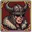 | 64x64 | reuse |  | `pixel/new_assets/heroes/avatar_horned_fur_collar.png` |
| `avatar_horned_graybeard` | 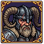 | 64x64 | reuse |  | `pixel/new_assets/heroes/avatar_horned_graybeard.png` |
| `avatar_horned_green_veteran` | 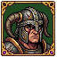 | 64x64 | reuse |  | `pixel/new_assets/heroes/avatar_horned_green_veteran.png` |
| `avatar_horned_ram_helm` | 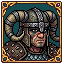 | 64x64 | reuse |  | `pixel/new_assets/heroes/avatar_horned_ram_helm.png` |

## NPC busts 48px

| Name | Picture | Size | Status | Used by | Source file |
| --- | --- | --- | --- | --- | --- |
| `portrait_blacksmith` | 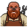 | 48x48 | used | merchant:upgrades | `pixel/portraits/npc_blacksmith.png` |
| `portrait_brawler` | 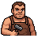 | 48x48 | reuse |  | `pixel/portraits/npc_brawler.png` |
| `portrait_farmer_woman` | 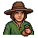 | 48x48 | reuse |  | `pixel/portraits/npc_farmer_woman.png` |
| `portrait_grandma` | 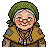 | 48x48 | reuse |  | `pixel/portraits/npc_grandma.png` |
| `portrait_herbalist` | 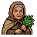 | 48x48 | reuse |  | `pixel/portraits/npc_herbalist.png` |
| `portrait_hermit_sage` | 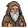 | 48x48 | reuse |  | `pixel/portraits/npc_hermit_sage.png` |
| `portrait_innkeeper_woman` | 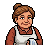 | 48x48 | reuse |  | `pixel/portraits/npc_innkeeper_woman.png` |
| `portrait_jester` | 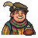 | 48x48 | used | merchant:gambling | `pixel/portraits/npc_jester.png` |
| `portrait_merchant` | 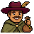 | 48x48 | used | merchant:resources, merchant:goods | `pixel/portraits/npc_merchant.png` |
| `portrait_quest_giver` | 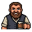 | 48x48 | used | merchant:quests | `pixel/portraits/npc_quest_giver.png` |
| `portrait_scout` | 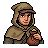 | 48x48 | reuse |  | `pixel/portraits/npc_scout.png` |
| `portrait_tavern_keeper` | 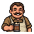 | 48x48 | reuse |  | `pixel/portraits/npc_tavern_keeper.png` |

## tutorial guide

| Name | Picture | Size | Status | Used by | Source file |
| --- | --- | --- | --- | --- | --- |
| `guide_brother_alder` |  | 67x67 | used | tutorial:guide | `pixel/reuse/misc/sprite-fusion-374f7430-0e77-437e-8e6a-a0f4c6ac3332.png` |
| `guide_brother_alder_talk` | 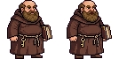 | 134x67 | used | tutorial:guide | `pixel/guide/alder_talk.png` |
