# Potions

Generated by `npm run assets:catalog` from the game registries and `public/pixel/`. Do not edit by hand: rename an asset in `scripts/assets/names.json`.

Consumables in the game and the 48 raw potion icons waiting in the reuse pool.

74 assets. Refer to an asset by its **name**.

## consumable

| Name | Picture | Size | Status | Used by | Source file |
| --- | --- | --- | --- | --- | --- |
| `art_arcane_swirl` |  | 64x64 | unused |  | `pixel/items/consumable/arcane_swirl.png` |
| `art_glass_vial` | 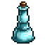 | 64x64 | unused |  | `pixel/items/consumable/glass_vial.png` |
| `art_greater_healing_flask` |  | 64x64 | used | potion_greater | `pixel/items/consumable/greater_healing_flask.png` |
| `art_healing_flask` |  | 64x64 | used | potion_minor | `pixel/items/consumable/healing_flask.png` |
| `art_hourglass_draught` |  | 64x64 | unused |  | `pixel/items/consumable/hourglass_draught.png` |
| `art_junk_amethyst` | 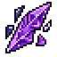 | 64x64 | used | junk_amethyst | `pixel/items/consumable/junk_amethyst.png` |
| `art_junk_bones` | 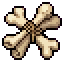 | 64x64 | used | junk_bones | `pixel/items/consumable/junk_bones.png` |
| `art_junk_brush` | 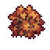 | 64x64 | used | junk_brush | `pixel/items/consumable/junk_brush.png` |
| `art_junk_claw` | 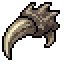 | 64x64 | used | junk_claw | `pixel/items/consumable/junk_claw.png` |
| `art_junk_feather` |  | 64x64 | used | junk_feather | `pixel/items/consumable/junk_feather.png` |
| `art_junk_rose_dust` | 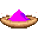 | 64x64 | used | junk_rose_dust | `pixel/items/consumable/junk_rose_dust.png` |
| `art_junk_rubble` | 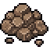 | 64x64 | used | junk_rubble | `pixel/items/consumable/junk_rubble.png` |
| `art_junk_sand` | 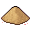 | 64x64 | used | junk_sand | `pixel/items/consumable/junk_sand.png` |
| `art_junk_scrap` | 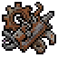 | 64x64 | used | junk_scrap | `pixel/items/consumable/junk_scrap.png` |
| `art_junk_tar` | 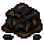 | 64x64 | used | junk_tar | `pixel/items/consumable/junk_tar.png` |
| `art_junk_teal_crystals` | 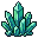 | 64x64 | used | junk_teal_crystals | `pixel/items/consumable/junk_teal_crystals.png` |
| `art_mana_potion` |  | 64x64 | used | potion_mana | `pixel/items/consumable/mana_potion.png` |
| `art_phoenix_elixir` |  | 64x64 | unused |  | `pixel/items/consumable/phoenix_elixir.png` |
| `art_prism_shard` |  | 64x64 | unused |  | `pixel/items/consumable/prism_shard.png` |
| `art_starwater_elixir` |  | 64x64 | unused |  | `pixel/items/consumable/starwater_elixir.png` |
| `art_stoneskin_tonic` |  | 64x64 | unused |  | `pixel/items/consumable/stoneskin_tonic.png` |
| `art_toxin_vial` |  | 64x64 | unused |  | `pixel/items/consumable/toxin_vial.png` |
| `art_venom_flask` |  | 64x64 | unused |  | `pixel/items/consumable/venom_flask.png` |
| `art_vitality_heart` |  | 64x64 | unused |  | `pixel/items/consumable/vitality_heart.png` |
| `item_potion_greater` |  | 40x40 | used | potion_greater | `pixel/icons/item_potion_greater.png` |
| `item_potion_hp` | 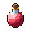 | 40x40 | used | potion_minor | `pixel/icons/item_potion_hp.png` |

## raw pack 32px

| Name | Picture | Size | Status | Used by | Source file |
| --- | --- | --- | --- | --- | --- |
| `potion_pack_01` | 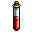 | 32x32 | reuse |  | `pixel/assets_to_assess_and_use/potions/Icon1.png` |
| `potion_pack_02` | 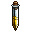 | 32x32 | reuse |  | `pixel/assets_to_assess_and_use/potions/Icon2.png` |
| `potion_pack_03` | 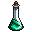 | 32x32 | reuse |  | `pixel/assets_to_assess_and_use/potions/Icon3.png` |
| `potion_pack_04` |  | 32x32 | reuse |  | `pixel/assets_to_assess_and_use/potions/Icon4.png` |
| `potion_pack_05` |  | 32x32 | reuse |  | `pixel/assets_to_assess_and_use/potions/Icon5.png` |
| `potion_pack_06` | 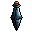 | 32x32 | reuse |  | `pixel/assets_to_assess_and_use/potions/Icon6.png` |
| `potion_pack_07` | 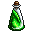 | 32x32 | reuse |  | `pixel/assets_to_assess_and_use/potions/Icon7.png` |
| `potion_pack_08` |  | 32x32 | reuse |  | `pixel/assets_to_assess_and_use/potions/Icon8.png` |
| `potion_pack_09` | 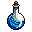 | 32x32 | reuse |  | `pixel/assets_to_assess_and_use/potions/Icon9.png` |
| `potion_pack_10` |  | 32x32 | reuse |  | `pixel/assets_to_assess_and_use/potions/Icon10.png` |
| `potion_pack_11` | 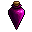 | 32x32 | reuse |  | `pixel/assets_to_assess_and_use/potions/Icon11.png` |
| `potion_pack_12` | 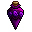 | 32x32 | reuse |  | `pixel/assets_to_assess_and_use/potions/Icon12.png` |
| `potion_pack_13` | 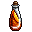 | 32x32 | reuse |  | `pixel/assets_to_assess_and_use/potions/Icon13.png` |
| `potion_pack_14` | 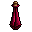 | 32x32 | reuse |  | `pixel/assets_to_assess_and_use/potions/Icon14.png` |
| `potion_pack_15` | 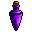 | 32x32 | reuse |  | `pixel/assets_to_assess_and_use/potions/Icon15.png` |
| `potion_pack_16` |  | 32x32 | reuse |  | `pixel/assets_to_assess_and_use/potions/Icon16.png` |
| `potion_pack_17` | 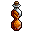 | 32x32 | reuse |  | `pixel/assets_to_assess_and_use/potions/Icon17.png` |
| `potion_pack_18` | 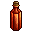 | 32x32 | reuse |  | `pixel/assets_to_assess_and_use/potions/Icon18.png` |
| `potion_pack_19` | 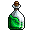 | 32x32 | reuse |  | `pixel/assets_to_assess_and_use/potions/Icon19.png` |
| `potion_pack_20` | 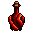 | 32x32 | reuse |  | `pixel/assets_to_assess_and_use/potions/Icon20.png` |
| `potion_pack_21` | 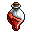 | 32x32 | reuse |  | `pixel/assets_to_assess_and_use/potions/Icon21.png` |
| `potion_pack_22` | 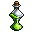 | 32x32 | reuse |  | `pixel/assets_to_assess_and_use/potions/Icon22.png` |
| `potion_pack_23` | 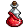 | 32x32 | reuse |  | `pixel/assets_to_assess_and_use/potions/Icon23.png` |
| `potion_pack_24` | 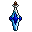 | 32x32 | reuse |  | `pixel/assets_to_assess_and_use/potions/Icon24.png` |
| `potion_pack_25` | 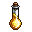 | 32x32 | reuse |  | `pixel/assets_to_assess_and_use/potions/Icon25.png` |
| `potion_pack_26` | 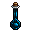 | 32x32 | reuse |  | `pixel/assets_to_assess_and_use/potions/Icon26.png` |
| `potion_pack_27` | 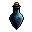 | 32x32 | reuse |  | `pixel/assets_to_assess_and_use/potions/Icon27.png` |
| `potion_pack_28` | 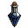 | 32x32 | reuse |  | `pixel/assets_to_assess_and_use/potions/Icon28.png` |
| `potion_pack_29` | 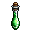 | 32x32 | reuse |  | `pixel/assets_to_assess_and_use/potions/Icon29.png` |
| `potion_pack_30` | 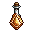 | 32x32 | reuse |  | `pixel/assets_to_assess_and_use/potions/Icon30.png` |
| `potion_pack_31` | 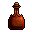 | 32x32 | reuse |  | `pixel/assets_to_assess_and_use/potions/Icon31.png` |
| `potion_pack_32` | 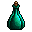 | 32x32 | reuse |  | `pixel/assets_to_assess_and_use/potions/Icon32.png` |
| `potion_pack_33` | 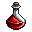 | 32x32 | reuse |  | `pixel/assets_to_assess_and_use/potions/Icon33.png` |
| `potion_pack_34` | 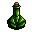 | 32x32 | reuse |  | `pixel/assets_to_assess_and_use/potions/Icon34.png` |
| `potion_pack_35` | 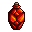 | 32x32 | reuse |  | `pixel/assets_to_assess_and_use/potions/Icon35.png` |
| `potion_pack_36` | 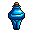 | 32x32 | reuse |  | `pixel/assets_to_assess_and_use/potions/Icon36.png` |
| `potion_pack_37` |  | 32x32 | reuse |  | `pixel/assets_to_assess_and_use/potions/Icon37.png` |
| `potion_pack_38` |  | 32x32 | reuse |  | `pixel/assets_to_assess_and_use/potions/Icon38.png` |
| `potion_pack_39` | 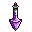 | 32x32 | reuse |  | `pixel/assets_to_assess_and_use/potions/Icon39.png` |
| `potion_pack_40` | 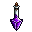 | 32x32 | reuse |  | `pixel/assets_to_assess_and_use/potions/Icon40.png` |
| `potion_pack_41` | 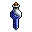 | 32x32 | reuse |  | `pixel/assets_to_assess_and_use/potions/Icon41.png` |
| `potion_pack_42` |  | 32x32 | reuse |  | `pixel/assets_to_assess_and_use/potions/Icon42.png` |
| `potion_pack_43` | 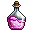 | 32x32 | reuse |  | `pixel/assets_to_assess_and_use/potions/Icon43.png` |
| `potion_pack_44` | 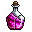 | 32x32 | reuse |  | `pixel/assets_to_assess_and_use/potions/Icon44.png` |
| `potion_pack_45` | 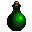 | 32x32 | reuse |  | `pixel/assets_to_assess_and_use/potions/Icon45.png` |
| `potion_pack_46` | 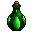 | 32x32 | reuse |  | `pixel/assets_to_assess_and_use/potions/Icon46.png` |
| `potion_pack_47` |  | 32x32 | reuse |  | `pixel/assets_to_assess_and_use/potions/Icon47.png` |
| `potion_pack_48` |  | 32x32 | reuse |  | `pixel/assets_to_assess_and_use/potions/Icon48.png` |
