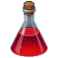
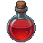
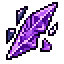
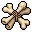
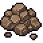
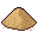
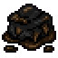
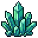

# Potions

Generated by `npm run assets:catalog` from the game registries and `public/pixel/`. Do not edit by hand: rename an asset in `scripts/assets/names.json`.

Consumables in the game and the 48 raw potion icons waiting in the reuse pool.

26 assets. Refer to an asset by its **name**.

## consumable

| Name | Picture | Size | Status | Used by | Source file |
| --- | --- | --- | --- | --- | --- |
| `art_arcane_swirl` |  | 64x64 | unused |  | `pixel/items/consumable/arcane_swirl.png` |
| `art_glass_vial` |  | 64x64 | unused |  | `pixel/items/consumable/glass_vial.png` |
| `art_greater_healing_flask` |  | 64x64 | used | potion_greater | `pixel/items/consumable/greater_healing_flask.png` |
| `art_healing_flask` |  | 64x64 | used | potion_minor | `pixel/items/consumable/healing_flask.png` |
| `art_hourglass_draught` |  | 64x64 | unused |  | `pixel/items/consumable/hourglass_draught.png` |
| `art_junk_amethyst` |  | 64x64 | used | junk_amethyst | `pixel/items/junk/junk_amethyst.png` |
| `art_junk_bones` |  | 64x64 | used | junk_bones | `pixel/items/junk/junk_bones.png` |
| `art_junk_brush` |  | 64x64 | used | junk_brush | `pixel/items/consumable/junk_brush.png` |
| `art_junk_claw` |  | 64x64 | used | junk_claw | `pixel/items/junk/junk_claw.png` |
| `art_junk_feather` |  | 64x64 | used | junk_feather | `pixel/items/junk/junk_feather.png` |
| `art_junk_rose_dust` |  | 64x64 | used | junk_rose_dust | `pixel/items/junk/junk_rose_dust.png` |
| `art_junk_rubble` |  | 64x64 | used | junk_rubble | `pixel/items/junk/junk_rubble.png` |
| `art_junk_sand` |  | 64x64 | used | junk_sand | `pixel/items/junk/junk_sand.png` |
| `art_junk_scrap` |  | 64x64 | used | junk_scrap | `pixel/items/junk/junk_scrap.png` |
| `art_junk_tar` |  | 64x64 | used | junk_tar | `pixel/items/junk/junk_tar.png` |
| `art_junk_teal_crystals` |  | 64x64 | used | junk_teal_crystals | `pixel/items/junk/junk_teal_crystals.png` |
| `art_mana_potion` |  | 64x64 | used | potion_mana | `pixel/items/consumable/mana_potion.png` |
| `art_phoenix_elixir` |  | 64x64 | unused |  | `pixel/items/consumable/phoenix_elixir.png` |
| `art_prism_shard` |  | 64x64 | unused |  | `pixel/items/consumable/prism_shard.png` |
| `art_starwater_elixir` |  | 64x64 | unused |  | `pixel/items/consumable/starwater_elixir.png` |
| `art_stoneskin_tonic` |  | 64x64 | unused |  | `pixel/items/consumable/stoneskin_tonic.png` |
| `art_toxin_vial` |  | 64x64 | unused |  | `pixel/items/consumable/toxin_vial.png` |
| `art_venom_flask` |  | 64x64 | unused |  | `pixel/items/consumable/venom_flask.png` |
| `art_vitality_heart` |  | 64x64 | unused |  | `pixel/items/consumable/vitality_heart.png` |
| `item_potion_greater` |  | 40x40 | used | potion_greater | `pixel/icons/item_potion_greater.png` |
| `item_potion_hp` |  | 40x40 | used | potion_minor | `pixel/icons/item_potion_hp.png` |
