# Potions

Generated by `npm run assets:catalog` from the game registries and `public/pixel/`. Do not edit by hand: rename an asset in `scripts/assets/names.json`.

Consumables in the game and the 48 raw potion icons waiting in the reuse pool.

73 assets. Refer to an asset by its **name**.

## consumable

| Name | Picture | Size | Status | Used by | Source file |
| --- | --- | --- | --- | --- | --- |
| `art_arcane_swirl` |  | 64x64 | used | elixir_arcana | `pixel/items/consumable/arcane_swirl.png` |
| `art_elixir_fortitude` |  | 64x64 | used | elixir_fortitude | `pixel/items/consumable/elixir_fortitude.png` |
| `art_elixir_haste` | 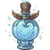 | 64x64 | used | elixir_haste | `pixel/items/consumable/elixir_haste.png` |
| `art_elixir_ironskin` | 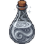 | 64x64 | used | elixir_ironskin | `pixel/items/consumable/elixir_ironskin.png` |
| `art_elixir_keen_eye` | 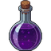 | 64x64 | used | elixir_keen_eye | `pixel/items/consumable/elixir_keen_eye.png` |
| `art_elixir_might` | 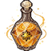 | 64x64 | used | elixir_might | `pixel/items/consumable/elixir_might.png` |
| `art_elixir_warding` | 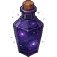 | 64x64 | used | elixir_warding | `pixel/items/consumable/elixir_warding.png` |
| `art_glass_vial` | 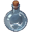 | 64x64 | unused |  | `pixel/items/consumable/glass_vial.png` |
| `art_greater_healing_flask` |  | 64x64 | used | potion_greater | `pixel/items/consumable/greater_healing_flask.png` |
| `art_healing_flask` |  | 64x64 | used | potion_minor | `pixel/items/consumable/healing_flask.png` |
| `art_hourglass_draught` |  | 64x64 | used | elixir_time_shift | `pixel/items/consumable/hourglass_draught.png` |
| `art_junk_amethyst` |  | 64x64 | used | junk_amethyst | `pixel/items/junk/junk_amethyst.png` |
| `art_junk_bacon` | 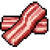 | 64x64 | used | junk_bacon | `pixel/items/junk/junk_bacon.png` |
| `art_junk_beet` | 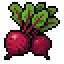 | 64x64 | used | junk_beet | `pixel/items/junk/junk_beet.png` |
| `art_junk_blood` | 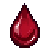 | 64x64 | used | junk_blood | `pixel/items/junk/junk_blood.png` |
| `art_junk_bones` |  | 64x64 | used | junk_bones | `pixel/items/junk/junk_bones.png` |
| `art_junk_brush` | 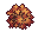 | 64x64 | used | junk_brush | `pixel/items/consumable/junk_brush.png` |
| `art_junk_carrot` |  | 64x64 | used | junk_carrot | `pixel/items/junk/junk_carrot.png` |
| `art_junk_claw` | 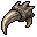 | 64x64 | used | junk_claw | `pixel/items/junk/junk_claw.png` |
| `art_junk_clay` | 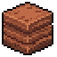 | 64x64 | used | junk_clay | `pixel/items/junk/junk_clay.png` |
| `art_junk_coins` | 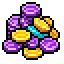 | 64x64 | used | junk_coins | `pixel/items/junk/junk_coins.png` |
| `art_junk_copper_ore` | 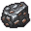 | 64x64 | used | junk_copper_ore | `pixel/items/junk/junk_copper_ore.png` |
| `art_junk_crystal` |  | 64x64 | used | junk_crystal | `pixel/items/junk/junk_crystal.png` |
| `art_junk_dark_potion` | 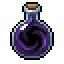 | 64x64 | used | junk_dark_potion | `pixel/items/junk/junk_dark_potion.png` |
| `art_junk_dark_shard` | 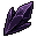 | 64x64 | used | junk_dark_shard | `pixel/items/junk/junk_dark_shard.png` |
| `art_junk_dried_herbs` | 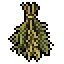 | 64x64 | used | junk_dried_herbs | `pixel/items/junk/junk_dried_herbs.png` |
| `art_junk_ember_coal` | 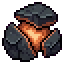 | 64x64 | used | junk_ember_coal | `pixel/items/junk/junk_ember_coal.png` |
| `art_junk_emerald_star` |  | 64x64 | used | junk_emerald_star | `pixel/items/junk/junk_emerald_star.png` |
| `art_junk_feather` |  | 64x64 | used | junk_feather | `pixel/items/junk/junk_feather.png` |
| `art_junk_fire_drop` | 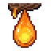 | 64x64 | used | junk_fire_drop | `pixel/items/junk/junk_fire_drop.png` |
| `art_junk_flint` | 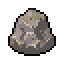 | 64x64 | used | junk_flint | `pixel/items/junk/junk_flint.png` |
| `art_junk_garnet` | 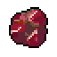 | 64x64 | used | junk_garnet | `pixel/items/junk/junk_garnet.png` |
| `art_junk_geode` | 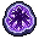 | 64x64 | used | junk_geode | `pixel/items/junk/junk_geode.png` |
| `art_junk_glowberry` | 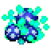 | 64x64 | used | junk_glowberry | `pixel/items/junk/junk_glowberry.png` |
| `art_junk_gold_ore` | 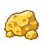 | 64x64 | used | junk_gold_ore | `pixel/items/junk/junk_gold_ore.png` |
| `art_junk_grapes` | 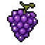 | 64x64 | used | junk_grapes | `pixel/items/junk/junk_grapes.png` |
| `art_junk_heart_gem` |  | 64x64 | used | junk_heart_gem | `pixel/items/junk/junk_heart_gem.png` |
| `art_junk_hollow_log` | 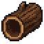 | 64x64 | used | junk_hollow_log | `pixel/items/junk/junk_hollow_log.png` |
| `art_junk_horn` | 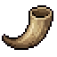 | 64x64 | used | junk_horn | `pixel/items/junk/junk_horn.png` |
| `art_junk_horn_dark` | 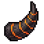 | 64x64 | used | junk_horn_dark | `pixel/items/junk/junk_horn_dark.png` |
| `art_junk_hourglass_sand` | 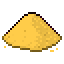 | 64x64 | used | junk_hourglass_sand | `pixel/items/junk/junk_hourglass_sand.png` |
| `art_junk_ichor` | 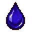 | 64x64 | used | junk_ichor | `pixel/items/junk/junk_ichor.png` |
| `art_junk_iron_ore` | 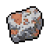 | 64x64 | used | junk_iron_ore | `pixel/items/junk/junk_iron_ore.png` |
| `art_junk_jasper` | 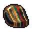 | 64x64 | used | junk_jasper | `pixel/items/junk/junk_jasper.png` |
| `art_junk_jug` | 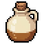 | 64x64 | used | junk_jug | `pixel/items/junk/junk_jug.png` |
| `art_junk_lapis` | 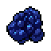 | 64x64 | used | junk_lapis | `pixel/items/junk/junk_lapis.png` |
| `art_junk_malachite` | 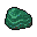 | 64x64 | used | junk_malachite | `pixel/items/junk/junk_malachite.png` |
| `art_junk_moon` |  | 64x64 | used | junk_moon | `pixel/items/junk/junk_moon.png` |
| `art_junk_obsidian` | 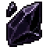 | 64x64 | used | junk_obsidian | `pixel/items/junk/junk_obsidian.png` |
| `art_junk_orange_mushrooms` |  | 64x64 | used | junk_orange_mushrooms | `pixel/items/junk/junk_orange_mushrooms.png` |
| `art_junk_rose_dust` | 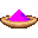 | 64x64 | used | junk_rose_dust | `pixel/items/junk/junk_rose_dust.png` |
| `art_junk_rubble` |  | 64x64 | used | junk_rubble | `pixel/items/junk/junk_rubble.png` |
| `art_junk_ruby` |  | 64x64 | used | junk_ruby | `pixel/items/junk/junk_ruby.png` |
| `art_junk_sand` |  | 64x64 | used | junk_sand | `pixel/items/junk/junk_sand.png` |
| `art_junk_sapphire` | 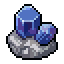 | 64x64 | used | junk_sapphire | `pixel/items/junk/junk_sapphire.png` |
| `art_junk_scrap` | 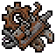 | 64x64 | used | junk_scrap | `pixel/items/junk/junk_scrap.png` |
| `art_junk_silver_ore` |  | 64x64 | used | junk_silver_ore | `pixel/items/junk/junk_silver_ore.png` |
| `art_junk_sticks` | 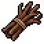 | 64x64 | used | junk_sticks | `pixel/items/junk/junk_sticks.png` |
| `art_junk_tar` |  | 64x64 | used | junk_tar | `pixel/items/junk/junk_tar.png` |
| `art_junk_teal_crystals` |  | 64x64 | used | junk_teal_crystals | `pixel/items/junk/junk_teal_crystals.png` |
| `art_junk_turquoise` | 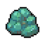 | 64x64 | used | junk_turquoise | `pixel/items/junk/junk_turquoise.png` |
| `art_junk_war_medals` | 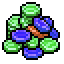 | 64x64 | used | junk_war_medals | `pixel/items/junk/junk_war_medals.png` |
| `art_junk_wheat_sheaf` | 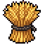 | 64x64 | used | junk_wheat_sheaf | `pixel/items/junk/junk_wheat_sheaf.png` |
| `art_mana_potion` |  | 64x64 | used | potion_mana | `pixel/items/consumable/mana_potion.png` |
| `art_phoenix_elixir` |  | 64x64 | unused |  | `pixel/items/consumable/phoenix_elixir.png` |
| `art_prism_shard` |  | 64x64 | unused |  | `pixel/items/consumable/prism_shard.png` |
| `art_starwater_elixir` |  | 64x64 | unused |  | `pixel/items/consumable/starwater_elixir.png` |
| `art_stoneskin_tonic` |  | 64x64 | unused |  | `pixel/items/consumable/stoneskin_tonic.png` |
| `art_toxin_vial` |  | 64x64 | unused |  | `pixel/items/consumable/toxin_vial.png` |
| `art_venom_flask` |  | 64x64 | unused |  | `pixel/items/consumable/venom_flask.png` |
| `art_vitality_heart` |  | 64x64 | used | potion_regen | `pixel/items/consumable/vitality_heart.png` |
| `item_potion_greater` |  | 40x40 | used | potion_greater | `pixel/icons/item_potion_greater.png` |
| `item_potion_hp` |  | 40x40 | used | potion_minor | `pixel/icons/item_potion_hp.png` |
