# Resources

Generated by `npm run assets:catalog` from the game registries and `public/pixel/`. Do not edit by hand: rename an asset in `scripts/assets/names.json`.

Currencies, materials, farm goods, planned T2/T3 goods and spare resource art.

93 assets. Refer to an asset by its **name**.

## animal

| Name | Picture | Size | Status | Used by | Source file |
| --- | --- | --- | --- | --- | --- |
| `animal_chicken` |  | 40x40 | used | animal:chicken | `pixel/icons/animal_chicken.png` |
| `animal_cow` |  | 40x40 | used | animal:cow | `pixel/icons/animal_cow.png` |
| `animal_deer` |  | 40x40 | used | animal:deer | `pixel/icons/animal_deer.png` |
| `animal_pig` |  | 40x40 | used | animal:pig | `pixel/icons/animal_pig.png` |

## coal

| Name | Picture | Size | Status | Used by | Source file |
| --- | --- | --- | --- | --- | --- |
| `coal` | 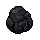 | 40x40 | used | resource:coal | `pixel/icons/coal.png` |

## comp

| Name | Picture | Size | Status | Used by | Source file |
| --- | --- | --- | --- | --- | --- |
| `comp_glass_vial` |  | 40x40 | used |  | `pixel/icons/comp_glass_vial.png` |

## currency

| Name | Picture | Size | Status | Used by | Source file |
| --- | --- | --- | --- | --- | --- |
| `resource_embers` |  | 29x29 | used | embers | `pixel/resources/embers.png` |
| `resource_gems` | 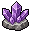 | 32x32 | used | gems | `pixel/resources/gems.png` |
| `resource_gold` |  | 32x32 | used | gold | `pixel/resources/gold.png` |
| `resource_xp` |  | 32x32 | used | xp | `pixel/resources/xp.png` |

## diamond

| Name | Picture | Size | Status | Used by | Source file |
| --- | --- | --- | --- | --- | --- |
| `diamond` |  | 40x40 | used | resource:gems | `pixel/icons/diamond.png` |
| `diamond_shine` | 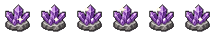 | 240x40 | used | shine:diamond | `pixel/icons/diamond_shine.png` |

## eggs

| Name | Picture | Size | Status | Used by | Source file |
| --- | --- | --- | --- | --- | --- |
| `eggs` | 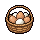 | 40x40 | used | resource:eggs | `pixel/icons/eggs.png` |

## farm

| Name | Picture | Size | Status | Used by | Source file |
| --- | --- | --- | --- | --- | --- |
| `farm_back` | 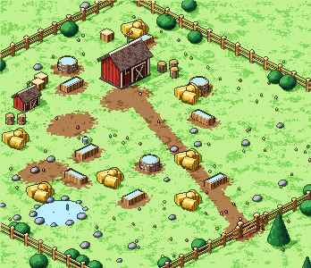 | 348x300 | used |  | `pixel/icons/farm_back.png` |
| `farm_front` | 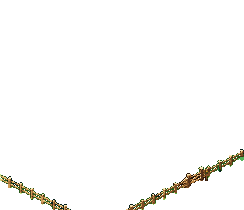 | 348x300 | used |  | `pixel/icons/farm_front.png` |

## food

| Name | Picture | Size | Status | Used by | Source file |
| --- | --- | --- | --- | --- | --- |
| `food` | 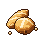 | 40x40 | used | resource:food | `pixel/icons/food.png` |

## gold

| Name | Picture | Size | Status | Used by | Source file |
| --- | --- | --- | --- | --- | --- |
| `gold` | 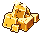 | 40x40 | used | resource:gold | `pixel/icons/gold.png` |
| `gold_shine` | 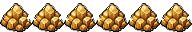 | 240x40 | used | shine:gold | `pixel/icons/gold_shine.png` |

## hide

| Name | Picture | Size | Status | Used by | Source file |
| --- | --- | --- | --- | --- | --- |
| `hide` | 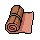 | 40x40 | used | resource:hide | `pixel/icons/hide.png` |

## legacy

| Name | Picture | Size | Status | Used by | Source file |
| --- | --- | --- | --- | --- | --- |
| `legacy` |  | 40x40 | used | resource:embers | `pixel/icons/legacy.png` |
| `legacy_shine` |  | 240x40 | used | shine:legacy | `pixel/icons/legacy_shine.png` |

## meat

| Name | Picture | Size | Status | Used by | Source file |
| --- | --- | --- | --- | --- | --- |
| `meat` | 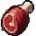 | 40x40 | used | resource:meat | `pixel/icons/meat.png` |

## milk

| Name | Picture | Size | Status | Used by | Source file |
| --- | --- | --- | --- | --- | --- |
| `milk` | 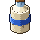 | 40x40 | used | resource:milk | `pixel/icons/milk.png` |

## res

| Name | Picture | Size | Status | Used by | Source file |
| --- | --- | --- | --- | --- | --- |
| `res_crystal` | 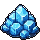 | 40x40 | planned |  | `pixel/icons/res_crystal.png` |
| `res_crystal_shine` | 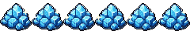 | 240x40 | used | shine:res_crystal | `pixel/icons/res_crystal_shine.png` |
| `res_fish` |  | 40x40 | planned |  | `pixel/icons/res_fish.png` |
| `res_iron` | 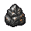 | 40x40 | planned |  | `pixel/icons/res_iron.png` |
| `res_mana` | 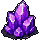 | 40x40 | planned |  | `pixel/icons/res_mana.png` |
| `res_mana_shine` | 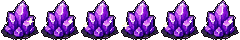 | 240x40 | used | shine:res_mana | `pixel/icons/res_mana_shine.png` |
| `res_mystery` |  | 40x40 | planned |  | `pixel/icons/res_mystery.png` |
| `res_mystery_shine` |  | 240x40 | used | shine:res_mystery | `pixel/icons/res_mystery_shine.png` |
| `res_sapphire` |  | 40x40 | planned |  | `pixel/icons/res_sapphire.png` |
| `res_sapphire_shine` |  | 240x40 | used | shine:res_sapphire | `pixel/icons/res_sapphire_shine.png` |
| `res_shard` | 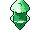 | 40x40 | planned |  | `pixel/icons/res_shard.png` |

## spare

| Name | Picture | Size | Status | Used by | Source file |
| --- | --- | --- | --- | --- | --- |
| `resource_spare_bacon` |  | 32x32 | spare |  | `pixel/resources/_bacon.png` |
| `resource_spare_beet` |  | 32x32 | spare |  | `pixel/resources/_beet.png` |
| `resource_spare_blood` |  | 32x32 | spare |  | `pixel/resources/_blood.png` |
| `resource_spare_bones` |  | 32x32 | spare |  | `pixel/resources/_bones.png` |
| `resource_spare_carrot` |  | 32x32 | spare |  | `pixel/resources/_carrot.png` |
| `resource_spare_clay` | 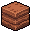 | 32x32 | spare |  | `pixel/resources/_clay.png` |
| `resource_spare_coins` |  | 32x32 | spare |  | `pixel/resources/_coins.png` |
| `resource_spare_copper_ore` | 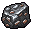 | 32x32 | spare |  | `pixel/resources/_copper-ore.png` |
| `resource_spare_dark_potion` |  | 32x32 | spare |  | `pixel/resources/_dark-potion.png` |
| `resource_spare_dark_shard` |  | 32x32 | spare |  | `pixel/resources/_dark-shard.png` |
| `resource_spare_dried_herbs` | 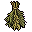 | 32x32 | spare |  | `pixel/resources/_dried-herbs.png` |
| `resource_spare_ember_coal` | 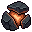 | 32x32 | spare |  | `pixel/resources/_ember-coal.png` |
| `resource_spare_emerald_star` |  | 32x32 | spare |  | `pixel/resources/_emerald-star.png` |
| `resource_spare_feather` |  | 32x32 | spare |  | `pixel/resources/_feather.png` |
| `resource_spare_fire_drop` | 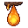 | 32x32 | spare |  | `pixel/resources/_fire-drop.png` |
| `resource_spare_geode` |  | 32x32 | spare |  | `pixel/resources/_geode.png` |
| `resource_spare_glowberry` | 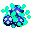 | 32x32 | spare |  | `pixel/resources/_glowberry.png` |
| `resource_spare_grapes` |  | 32x32 | spare |  | `pixel/resources/_grapes.png` |
| `resource_spare_heart_gem` |  | 32x32 | spare |  | `pixel/resources/_heart-gem.png` |
| `resource_spare_hollow_log` | 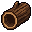 | 32x32 | spare |  | `pixel/resources/_hollow-log.png` |
| `resource_spare_horn` | 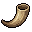 | 32x32 | spare |  | `pixel/resources/_horn.png` |
| `resource_spare_horn_dark` |  | 32x32 | spare |  | `pixel/resources/_horn-dark.png` |
| `resource_spare_jug` |  | 32x32 | spare |  | `pixel/resources/_jug.png` |
| `resource_spare_moon` |  | 32x32 | spare |  | `pixel/resources/_moon.png` |
| `resource_spare_obsidian` |  | 32x32 | spare |  | `pixel/resources/_obsidian.png` |
| `resource_spare_orange_mushrooms` |  | 32x32 | spare |  | `pixel/resources/_orange-mushrooms.png` |
| `resource_spare_rock_pile` | 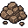 | 32x32 | spare |  | `pixel/resources/_rock-pile.png` |
| `resource_spare_sand` | 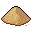 | 32x32 | spare |  | `pixel/resources/_sand.png` |
| `resource_spare_scallion` | 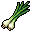 | 32x32 | spare |  | `pixel/resources/_scallion.png` |
| `resource_spare_scrap` | 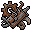 | 32x32 | spare |  | `pixel/resources/_scrap.png` |
| `resource_spare_sticks` | 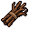 | 32x32 | spare |  | `pixel/resources/_sticks.png` |
| `resource_spare_tar` | 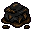 | 32x32 | spare |  | `pixel/resources/_tar.png` |
| `resource_spare_teal_crystals` |  | 32x32 | spare |  | `pixel/resources/_teal-crystals.png` |
| `resource_spare_wheat_sheaf` |  | 32x32 | spare |  | `pixel/resources/_wheat-sheaf.png` |
| `resource_spare_wool` | 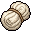 | 32x32 | spare |  | `pixel/resources/_wool.png` |

## stone

| Name | Picture | Size | Status | Used by | Source file |
| --- | --- | --- | --- | --- | --- |
| `stone` |  | 40x40 | used | resource:stone | `pixel/icons/stone.png` |

## t0

| Name | Picture | Size | Status | Used by | Source file |
| --- | --- | --- | --- | --- | --- |
| `resource_coal` | 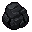 | 32x32 | used | coal | `pixel/resources/coal.png` |
| `resource_fish` |  | 32x32 | used | fish | `pixel/resources/fish.png` |
| `resource_food` |  | 32x32 | used | food | `pixel/resources/food.png` |
| `resource_meat` |  | 32x32 | used | meat | `pixel/resources/meat.png` |
| `resource_stone` | 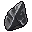 | 32x32 | used | stone | `pixel/resources/stone.png` |
| `resource_wood` | 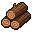 | 32x32 | used | wood | `pixel/resources/wood.png` |

## t1

| Name | Picture | Size | Status | Used by | Source file |
| --- | --- | --- | --- | --- | --- |
| `resource_eggs` | 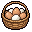 | 32x32 | used | eggs | `pixel/resources/eggs.png` |
| `resource_hide` | 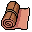 | 32x32 | used | hide | `pixel/resources/hide.png` |
| `resource_milk` |  | 32x32 | used | milk | `pixel/resources/milk.png` |

## t2 fields

| Name | Picture | Size | Status | Used by | Source file |
| --- | --- | --- | --- | --- | --- |
| `resource_cloth` | 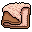 | 32x32 | planned | cloth | `pixel/resources/cloth.png` |

## t2 jungle

| Name | Picture | Size | Status | Used by | Source file |
| --- | --- | --- | --- | --- | --- |
| `resource_hardwood` |  | 32x32 | planned | hardwood | `pixel/resources/hardwood.png` |

## t2 orchard

| Name | Picture | Size | Status | Used by | Source file |
| --- | --- | --- | --- | --- | --- |
| `resource_honey` |  | 32x32 | planned | honey | `pixel/resources/honey.png` |

## t3 battlefield

| Name | Picture | Size | Status | Used by | Source file |
| --- | --- | --- | --- | --- | --- |
| `resource_scrap_steel` |  | 32x32 | planned | scrapSteel | `pixel/resources/scrap-steel.png` |

## t3 blight

| Name | Picture | Size | Status | Used by | Source file |
| --- | --- | --- | --- | --- | --- |
| `resource_corrupted_core` |  | 32x32 | planned | corruptedCore | `pixel/resources/corrupted-core.png` |

## t3 coast

| Name | Picture | Size | Status | Used by | Source file |
| --- | --- | --- | --- | --- | --- |
| `resource_salt` | 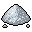 | 32x32 | planned | salt | `pixel/resources/salt.png` |

## t3 fields

| Name | Picture | Size | Status | Used by | Source file |
| --- | --- | --- | --- | --- | --- |
| `resource_dye` |  | 32x32 | planned | dye | `pixel/resources/dye.png` |

## t3 forest

| Name | Picture | Size | Status | Used by | Source file |
| --- | --- | --- | --- | --- | --- |
| `resource_sap` | 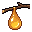 | 32x32 | planned | sap | `pixel/resources/sap.png` |

## t3 hills

| Name | Picture | Size | Status | Used by | Source file |
| --- | --- | --- | --- | --- | --- |
| `resource_iron_ore` |  | 32x32 | planned | ironOre | `pixel/resources/iron-ore.png` |

## t3 lake

| Name | Picture | Size | Status | Used by | Source file |
| --- | --- | --- | --- | --- | --- |
| `resource_pearls` | 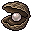 | 32x32 | planned | pearls | `pixel/resources/pearls.png` |

## t3 plains

| Name | Picture | Size | Status | Used by | Source file |
| --- | --- | --- | --- | --- | --- |
| `resource_herbs` |  | 32x32 | planned | herbs | `pixel/resources/herbs.png` |

## t3 swamp

| Name | Picture | Size | Status | Used by | Source file |
| --- | --- | --- | --- | --- | --- |
| `resource_spores` |  | 32x32 | planned | spores | `pixel/resources/spores.png` |

## t3 tundra

| Name | Picture | Size | Status | Used by | Source file |
| --- | --- | --- | --- | --- | --- |
| `resource_frostshard` | 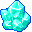 | 32x32 | planned | frostshard | `pixel/resources/frostshard.png` |

## wood

| Name | Picture | Size | Status | Used by | Source file |
| --- | --- | --- | --- | --- | --- |
| `wood` |  | 40x40 | used | resource:wood | `pixel/icons/wood.png` |
