# Equipment sets

Generated by `npm run assets:catalog` from the game registries and `public/pixel/`. Do not edit by hand: rename an asset in `scripts/assets/names.json`.

63 matching sets sliced from three 64 px sheets (knight, samurai, shinobi), one folder per set in __reuse/sets. A set has armor pieces, weapons and accessories (belt, neck, mask), and may use fewer pieces than the sheet row: the grouping is in scripts/assets/equipment-sets.json. Effects come later.

990 assets. Refer to an asset by its **name**.

## knight: Brown Recruit (accessories)

| Name | Picture | Size | Status | Used by | Source file |
| --- | --- | --- | --- | --- | --- |
| `set_brown_recruit_belt` | 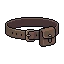 | 64x64 | unused |  | `pixel/__reuse/sets/brown_recruit/belt.png` |
| `set_brown_recruit_misc` | 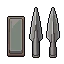 | 64x64 | unused |  | `pixel/__reuse/sets/brown_recruit/misc.png` |
| `set_brown_recruit_neck` | 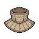 | 64x64 | unused |  | `pixel/__reuse/sets/brown_recruit/neck.png` |

## knight: Brown Recruit (armor)

| Name | Picture | Size | Status | Used by | Source file |
| --- | --- | --- | --- | --- | --- |
| `set_brown_recruit_chest` | 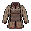 | 64x64 | used | art_hide_jerkin | `pixel/__reuse/sets/brown_recruit/chest.png` |
| `set_brown_recruit_feet` | 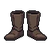 | 64x64 | used | art_leather_boots | `pixel/__reuse/sets/brown_recruit/feet.png` |
| `set_brown_recruit_hands` | 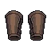 | 64x64 | used | art_hide_gloves | `pixel/__reuse/sets/brown_recruit/hands.png` |
| `set_brown_recruit_head` | 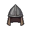 | 64x64 | used | art_leather_cap | `pixel/__reuse/sets/brown_recruit/head.png` |
| `set_brown_recruit_leg_guards` | 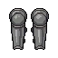 | 64x64 | unused |  | `pixel/__reuse/sets/brown_recruit/leg_guards.png` |
| `set_brown_recruit_legs` | 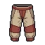 | 64x64 | unused |  | `pixel/__reuse/sets/brown_recruit/legs.png` |
| `set_brown_recruit_shoulder` | 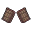 | 64x64 | used | art_hide_pauldrons | `pixel/__reuse/sets/brown_recruit/shoulder.png` |

## knight: Brown Recruit (weapons)

| Name | Picture | Size | Status | Used by | Source file |
| --- | --- | --- | --- | --- | --- |
| `set_brown_recruit_glaive` | 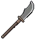 | 64x64 | unused |  | `pixel/__reuse/sets/brown_recruit/glaive.png` |
| `set_brown_recruit_halberd` | 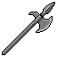 | 64x64 | unused |  | `pixel/__reuse/sets/brown_recruit/halberd.png` |
| `set_brown_recruit_javelins` | 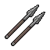 | 64x64 | unused |  | `pixel/__reuse/sets/brown_recruit/javelins.png` |
| `set_brown_recruit_polearm` | 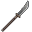 | 64x64 | unused |  | `pixel/__reuse/sets/brown_recruit/polearm.png` |
| `set_brown_recruit_spear` | 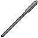 | 64x64 | used | art_iron_spear | `pixel/__reuse/sets/brown_recruit/spear.png` |
| `set_brown_recruit_sword` | 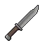 | 64x64 | unused |  | `pixel/__reuse/sets/brown_recruit/sword.png` |

## knight: Crimson Champion (accessories)

| Name | Picture | Size | Status | Used by | Source file |
| --- | --- | --- | --- | --- | --- |
| `set_crimson_champion_belt` | 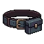 | 64x64 | unused |  | `pixel/__reuse/sets/crimson_champion/belt.png` |
| `set_crimson_champion_misc` | 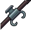 | 64x64 | unused |  | `pixel/__reuse/sets/crimson_champion/misc.png` |
| `set_crimson_champion_neck` | 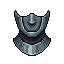 | 64x64 | unused |  | `pixel/__reuse/sets/crimson_champion/neck.png` |

## knight: Crimson Champion (armor)

| Name | Picture | Size | Status | Used by | Source file |
| --- | --- | --- | --- | --- | --- |
| `set_crimson_champion_chest` | 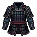 | 64x64 | unused |  | `pixel/__reuse/sets/crimson_champion/chest.png` |
| `set_crimson_champion_feet` | 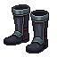 | 64x64 | unused |  | `pixel/__reuse/sets/crimson_champion/feet.png` |
| `set_crimson_champion_hands` | 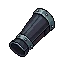 | 64x64 | unused |  | `pixel/__reuse/sets/crimson_champion/hands.png` |
| `set_crimson_champion_head` | 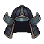 | 64x64 | unused |  | `pixel/__reuse/sets/crimson_champion/head.png` |
| `set_crimson_champion_leg_guards` | 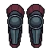 | 64x64 | unused |  | `pixel/__reuse/sets/crimson_champion/leg_guards.png` |
| `set_crimson_champion_legs` | 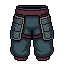 | 64x64 | unused |  | `pixel/__reuse/sets/crimson_champion/legs.png` |
| `set_crimson_champion_shoulder` | 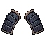 | 64x64 | unused |  | `pixel/__reuse/sets/crimson_champion/shoulder.png` |

## knight: Crimson Champion (weapons)

| Name | Picture | Size | Status | Used by | Source file |
| --- | --- | --- | --- | --- | --- |
| `set_crimson_champion_glaive` | 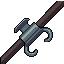 | 64x64 | unused |  | `pixel/__reuse/sets/crimson_champion/glaive.png` |
| `set_crimson_champion_halberd` | 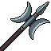 | 64x64 | unused |  | `pixel/__reuse/sets/crimson_champion/halberd.png` |
| `set_crimson_champion_javelins` | 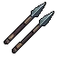 | 64x64 | unused |  | `pixel/__reuse/sets/crimson_champion/javelins.png` |
| `set_crimson_champion_polearm` | 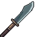 | 64x64 | unused |  | `pixel/__reuse/sets/crimson_champion/polearm.png` |
| `set_crimson_champion_spear` | 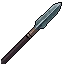 | 64x64 | unused |  | `pixel/__reuse/sets/crimson_champion/spear.png` |
| `set_crimson_champion_sword` | 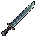 | 64x64 | unused |  | `pixel/__reuse/sets/crimson_champion/sword.png` |

## knight: Crimson Crusader (accessories)

| Name | Picture | Size | Status | Used by | Source file |
| --- | --- | --- | --- | --- | --- |
| `set_crimson_crusader_belt` | 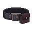 | 64x64 | unused |  | `pixel/__reuse/sets/crimson_crusader/belt.png` |
| `set_crimson_crusader_misc` | 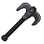 | 64x64 | unused |  | `pixel/__reuse/sets/crimson_crusader/misc.png` |
| `set_crimson_crusader_neck` | 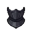 | 64x64 | unused |  | `pixel/__reuse/sets/crimson_crusader/neck.png` |

## knight: Crimson Crusader (armor)

| Name | Picture | Size | Status | Used by | Source file |
| --- | --- | --- | --- | --- | --- |
| `set_crimson_crusader_chest` | 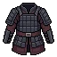 | 64x64 | unused |  | `pixel/__reuse/sets/crimson_crusader/chest.png` |
| `set_crimson_crusader_feet` | 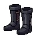 | 64x64 | unused |  | `pixel/__reuse/sets/crimson_crusader/feet.png` |
| `set_crimson_crusader_hands` | 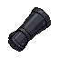 | 64x64 | unused |  | `pixel/__reuse/sets/crimson_crusader/hands.png` |
| `set_crimson_crusader_head` | 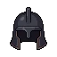 | 64x64 | used | art_obsidian_helm | `pixel/__reuse/sets/crimson_crusader/head.png` |
| `set_crimson_crusader_leg_guards` | 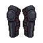 | 64x64 | unused |  | `pixel/__reuse/sets/crimson_crusader/leg_guards.png` |
| `set_crimson_crusader_legs` | 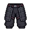 | 64x64 | unused |  | `pixel/__reuse/sets/crimson_crusader/legs.png` |
| `set_crimson_crusader_shoulder` | 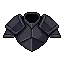 | 64x64 | unused |  | `pixel/__reuse/sets/crimson_crusader/shoulder.png` |

## knight: Crimson Crusader (weapons)

| Name | Picture | Size | Status | Used by | Source file |
| --- | --- | --- | --- | --- | --- |
| `set_crimson_crusader_glaive` | 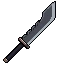 | 64x64 | unused |  | `pixel/__reuse/sets/crimson_crusader/glaive.png` |
| `set_crimson_crusader_halberd` | 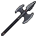 | 64x64 | unused |  | `pixel/__reuse/sets/crimson_crusader/halberd.png` |
| `set_crimson_crusader_javelins` | 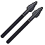 | 64x64 | unused |  | `pixel/__reuse/sets/crimson_crusader/javelins.png` |
| `set_crimson_crusader_polearm` | 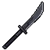 | 64x64 | unused |  | `pixel/__reuse/sets/crimson_crusader/polearm.png` |
| `set_crimson_crusader_spear` | 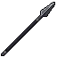 | 64x64 | unused |  | `pixel/__reuse/sets/crimson_crusader/spear.png` |
| `set_crimson_crusader_sword` | 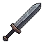 | 64x64 | unused |  | `pixel/__reuse/sets/crimson_crusader/sword.png` |

## knight: Crimson Defender (accessories)

| Name | Picture | Size | Status | Used by | Source file |
| --- | --- | --- | --- | --- | --- |
| `set_crimson_defender_belt` | 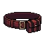 | 64x64 | unused |  | `pixel/__reuse/sets/crimson_defender/belt.png` |
| `set_crimson_defender_misc` | 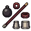 | 64x64 | unused |  | `pixel/__reuse/sets/crimson_defender/misc.png` |

## knight: Crimson Defender (armor)

| Name | Picture | Size | Status | Used by | Source file |
| --- | --- | --- | --- | --- | --- |
| `set_crimson_defender_chest` |  | 64x64 | unused |  | `pixel/__reuse/sets/crimson_defender/chest.png` |
| `set_crimson_defender_feet` |  | 64x64 | unused |  | `pixel/__reuse/sets/crimson_defender/feet.png` |
| `set_crimson_defender_hands` |  | 64x64 | unused |  | `pixel/__reuse/sets/crimson_defender/hands.png` |
| `set_crimson_defender_head` |  | 64x64 | unused |  | `pixel/__reuse/sets/crimson_defender/head.png` |
| `set_crimson_defender_leg_guards` |  | 64x64 | unused |  | `pixel/__reuse/sets/crimson_defender/leg_guards.png` |
| `set_crimson_defender_legs` |  | 64x64 | unused |  | `pixel/__reuse/sets/crimson_defender/legs.png` |
| `set_crimson_defender_shoulder` |  | 64x64 | unused |  | `pixel/__reuse/sets/crimson_defender/shoulder.png` |

## knight: Crimson Defender (weapons)

| Name | Picture | Size | Status | Used by | Source file |
| --- | --- | --- | --- | --- | --- |
| `set_crimson_defender_glaive` |  | 64x64 | unused |  | `pixel/__reuse/sets/crimson_defender/glaive.png` |
| `set_crimson_defender_halberd` |  | 64x64 | unused |  | `pixel/__reuse/sets/crimson_defender/halberd.png` |
| `set_crimson_defender_javelins` |  | 64x64 | unused |  | `pixel/__reuse/sets/crimson_defender/javelins.png` |
| `set_crimson_defender_polearm` |  | 64x64 | unused |  | `pixel/__reuse/sets/crimson_defender/polearm.png` |
| `set_crimson_defender_spear` |  | 64x64 | used | art_bronze_spear | `pixel/__reuse/sets/crimson_defender/spear.png` |
| `set_crimson_defender_sword` |  | 64x64 | unused |  | `pixel/__reuse/sets/crimson_defender/sword.png` |

## knight: Crimson Templar (accessories)

| Name | Picture | Size | Status | Used by | Source file |
| --- | --- | --- | --- | --- | --- |
| `set_crimson_templar_belt` |  | 64x64 | unused |  | `pixel/__reuse/sets/crimson_templar/belt.png` |
| `set_crimson_templar_misc` |  | 64x64 | unused |  | `pixel/__reuse/sets/crimson_templar/misc.png` |
| `set_crimson_templar_neck` |  | 64x64 | unused |  | `pixel/__reuse/sets/crimson_templar/neck.png` |

## knight: Crimson Templar (armor)

| Name | Picture | Size | Status | Used by | Source file |
| --- | --- | --- | --- | --- | --- |
| `set_crimson_templar_chest` |  | 64x64 | unused |  | `pixel/__reuse/sets/crimson_templar/chest.png` |
| `set_crimson_templar_feet` |  | 64x64 | unused |  | `pixel/__reuse/sets/crimson_templar/feet.png` |
| `set_crimson_templar_hands` |  | 64x64 | unused |  | `pixel/__reuse/sets/crimson_templar/hands.png` |
| `set_crimson_templar_head` |  | 64x64 | unused |  | `pixel/__reuse/sets/crimson_templar/head.png` |
| `set_crimson_templar_leg_guards` |  | 64x64 | unused |  | `pixel/__reuse/sets/crimson_templar/leg_guards.png` |
| `set_crimson_templar_legs` |  | 64x64 | unused |  | `pixel/__reuse/sets/crimson_templar/legs.png` |
| `set_crimson_templar_shoulder` |  | 64x64 | unused |  | `pixel/__reuse/sets/crimson_templar/shoulder.png` |

## knight: Crimson Templar (weapons)

| Name | Picture | Size | Status | Used by | Source file |
| --- | --- | --- | --- | --- | --- |
| `set_crimson_templar_glaive` |  | 64x64 | unused |  | `pixel/__reuse/sets/crimson_templar/glaive.png` |
| `set_crimson_templar_halberd` |  | 64x64 | unused |  | `pixel/__reuse/sets/crimson_templar/halberd.png` |
| `set_crimson_templar_javelins` |  | 64x64 | unused |  | `pixel/__reuse/sets/crimson_templar/javelins.png` |
| `set_crimson_templar_polearm` |  | 64x64 | unused |  | `pixel/__reuse/sets/crimson_templar/polearm.png` |
| `set_crimson_templar_spear` |  | 64x64 | unused |  | `pixel/__reuse/sets/crimson_templar/spear.png` |
| `set_crimson_templar_sword` |  | 64x64 | unused |  | `pixel/__reuse/sets/crimson_templar/sword.png` |

## knight: Green Bulwark (accessories)

| Name | Picture | Size | Status | Used by | Source file |
| --- | --- | --- | --- | --- | --- |
| `set_green_bulwark_belt` |  | 64x64 | unused |  | `pixel/__reuse/sets/green_bulwark/belt.png` |
| `set_green_bulwark_misc` |  | 64x64 | unused |  | `pixel/__reuse/sets/green_bulwark/misc.png` |
| `set_green_bulwark_neck` |  | 64x64 | unused |  | `pixel/__reuse/sets/green_bulwark/neck.png` |

## knight: Green Bulwark (armor)

| Name | Picture | Size | Status | Used by | Source file |
| --- | --- | --- | --- | --- | --- |
| `set_green_bulwark_chest` |  | 64x64 | unused |  | `pixel/__reuse/sets/green_bulwark/chest.png` |
| `set_green_bulwark_feet` |  | 64x64 | unused |  | `pixel/__reuse/sets/green_bulwark/feet.png` |
| `set_green_bulwark_hands` |  | 64x64 | unused |  | `pixel/__reuse/sets/green_bulwark/hands.png` |
| `set_green_bulwark_head` |  | 64x64 | unused |  | `pixel/__reuse/sets/green_bulwark/head.png` |
| `set_green_bulwark_leg_guards` |  | 64x64 | unused |  | `pixel/__reuse/sets/green_bulwark/leg_guards.png` |
| `set_green_bulwark_legs` |  | 64x64 | unused |  | `pixel/__reuse/sets/green_bulwark/legs.png` |
| `set_green_bulwark_shoulder` |  | 64x64 | unused |  | `pixel/__reuse/sets/green_bulwark/shoulder.png` |

## knight: Green Bulwark (weapons)

| Name | Picture | Size | Status | Used by | Source file |
| --- | --- | --- | --- | --- | --- |
| `set_green_bulwark_glaive` |  | 64x64 | unused |  | `pixel/__reuse/sets/green_bulwark/glaive.png` |
| `set_green_bulwark_halberd` |  | 64x64 | unused |  | `pixel/__reuse/sets/green_bulwark/halberd.png` |
| `set_green_bulwark_javelins` |  | 64x64 | unused |  | `pixel/__reuse/sets/green_bulwark/javelins.png` |
| `set_green_bulwark_polearm` |  | 64x64 | unused |  | `pixel/__reuse/sets/green_bulwark/polearm.png` |
| `set_green_bulwark_spear` |  | 64x64 | unused |  | `pixel/__reuse/sets/green_bulwark/spear.png` |
| `set_green_bulwark_sword` |  | 64x64 | unused |  | `pixel/__reuse/sets/green_bulwark/sword.png` |

## knight: Iron Squire (accessories)

| Name | Picture | Size | Status | Used by | Source file |
| --- | --- | --- | --- | --- | --- |
| `set_iron_squire_neck` |  | 64x64 | unused |  | `pixel/__reuse/sets/iron_squire/neck.png` |

## knight: Iron Squire (armor)

| Name | Picture | Size | Status | Used by | Source file |
| --- | --- | --- | --- | --- | --- |
| `set_iron_squire_chest` |  | 64x64 | unused |  | `pixel/__reuse/sets/iron_squire/chest.png` |
| `set_iron_squire_head` |  | 64x64 | unused |  | `pixel/__reuse/sets/iron_squire/head.png` |
| `set_iron_squire_legs` |  | 64x64 | unused |  | `pixel/__reuse/sets/iron_squire/legs.png` |

## knight: Silver Captain (accessories)

| Name | Picture | Size | Status | Used by | Source file |
| --- | --- | --- | --- | --- | --- |
| `set_silver_captain_belt` |  | 64x64 | unused |  | `pixel/__reuse/sets/silver_captain/belt.png` |
| `set_silver_captain_misc` |  | 64x64 | unused |  | `pixel/__reuse/sets/silver_captain/misc.png` |
| `set_silver_captain_neck` |  | 64x64 | unused |  | `pixel/__reuse/sets/silver_captain/neck.png` |

## knight: Silver Captain (armor)

| Name | Picture | Size | Status | Used by | Source file |
| --- | --- | --- | --- | --- | --- |
| `set_silver_captain_chest` |  | 64x64 | unused |  | `pixel/__reuse/sets/silver_captain/chest.png` |
| `set_silver_captain_feet` |  | 64x64 | used | art_steel_sabatons | `pixel/__reuse/sets/silver_captain/feet.png` |
| `set_silver_captain_hands` |  | 64x64 | unused |  | `pixel/__reuse/sets/silver_captain/hands.png` |
| `set_silver_captain_head` |  | 64x64 | unused |  | `pixel/__reuse/sets/silver_captain/head.png` |
| `set_silver_captain_leg_guards` |  | 64x64 | used | art_steel_greaves | `pixel/__reuse/sets/silver_captain/leg_guards.png` |
| `set_silver_captain_legs` |  | 64x64 | unused |  | `pixel/__reuse/sets/silver_captain/legs.png` |
| `set_silver_captain_shoulder` |  | 64x64 | unused |  | `pixel/__reuse/sets/silver_captain/shoulder.png` |

## knight: Silver Captain (weapons)

| Name | Picture | Size | Status | Used by | Source file |
| --- | --- | --- | --- | --- | --- |
| `set_silver_captain_glaive` |  | 64x64 | unused |  | `pixel/__reuse/sets/silver_captain/glaive.png` |
| `set_silver_captain_halberd` |  | 64x64 | unused |  | `pixel/__reuse/sets/silver_captain/halberd.png` |
| `set_silver_captain_javelins` |  | 64x64 | unused |  | `pixel/__reuse/sets/silver_captain/javelins.png` |
| `set_silver_captain_polearm` |  | 64x64 | unused |  | `pixel/__reuse/sets/silver_captain/polearm.png` |
| `set_silver_captain_spear` |  | 64x64 | unused |  | `pixel/__reuse/sets/silver_captain/spear.png` |
| `set_silver_captain_sword` |  | 64x64 | unused |  | `pixel/__reuse/sets/silver_captain/sword.png` |

## knight: Silver Herald (accessories)

| Name | Picture | Size | Status | Used by | Source file |
| --- | --- | --- | --- | --- | --- |
| `set_silver_herald_belt` |  | 64x64 | unused |  | `pixel/__reuse/sets/silver_herald/belt.png` |
| `set_silver_herald_misc` |  | 64x64 | used | art_steel_shield | `pixel/__reuse/sets/silver_herald/misc.png` |
| `set_silver_herald_neck` |  | 64x64 | unused |  | `pixel/__reuse/sets/silver_herald/neck.png` |

## knight: Silver Herald (armor)

| Name | Picture | Size | Status | Used by | Source file |
| --- | --- | --- | --- | --- | --- |
| `set_silver_herald_chest` |  | 64x64 | unused |  | `pixel/__reuse/sets/silver_herald/chest.png` |
| `set_silver_herald_feet` |  | 64x64 | unused |  | `pixel/__reuse/sets/silver_herald/feet.png` |
| `set_silver_herald_hands` |  | 64x64 | unused |  | `pixel/__reuse/sets/silver_herald/hands.png` |
| `set_silver_herald_head` |  | 64x64 | unused |  | `pixel/__reuse/sets/silver_herald/head.png` |
| `set_silver_herald_leg_guards` |  | 64x64 | unused |  | `pixel/__reuse/sets/silver_herald/leg_guards.png` |
| `set_silver_herald_legs` |  | 64x64 | unused |  | `pixel/__reuse/sets/silver_herald/legs.png` |
| `set_silver_herald_shoulder` |  | 64x64 | unused |  | `pixel/__reuse/sets/silver_herald/shoulder.png` |

## knight: Silver Herald (weapons)

| Name | Picture | Size | Status | Used by | Source file |
| --- | --- | --- | --- | --- | --- |
| `set_silver_herald_glaive` |  | 64x64 | unused |  | `pixel/__reuse/sets/silver_herald/glaive.png` |
| `set_silver_herald_halberd` |  | 64x64 | unused |  | `pixel/__reuse/sets/silver_herald/halberd.png` |
| `set_silver_herald_javelins` |  | 64x64 | unused |  | `pixel/__reuse/sets/silver_herald/javelins.png` |
| `set_silver_herald_polearm` |  | 64x64 | unused |  | `pixel/__reuse/sets/silver_herald/polearm.png` |
| `set_silver_herald_spear` |  | 64x64 | unused |  | `pixel/__reuse/sets/silver_herald/spear.png` |
| `set_silver_herald_sword` |  | 64x64 | unused |  | `pixel/__reuse/sets/silver_herald/sword.png` |

## knight: Silver Justicar (accessories)

| Name | Picture | Size | Status | Used by | Source file |
| --- | --- | --- | --- | --- | --- |
| `set_silver_justicar_belt` |  | 64x64 | unused |  | `pixel/__reuse/sets/silver_justicar/belt.png` |
| `set_silver_justicar_misc` |  | 64x64 | unused |  | `pixel/__reuse/sets/silver_justicar/misc.png` |
| `set_silver_justicar_neck` |  | 64x64 | unused |  | `pixel/__reuse/sets/silver_justicar/neck.png` |

## knight: Silver Justicar (armor)

| Name | Picture | Size | Status | Used by | Source file |
| --- | --- | --- | --- | --- | --- |
| `set_silver_justicar_chest` |  | 64x64 | used | art_obsidian_cuirass | `pixel/__reuse/sets/silver_justicar/chest.png` |
| `set_silver_justicar_feet` |  | 64x64 | used | art_obsidian_sabatons | `pixel/__reuse/sets/silver_justicar/feet.png` |
| `set_silver_justicar_hands` |  | 64x64 | used | art_obsidian_gauntlets | `pixel/__reuse/sets/silver_justicar/hands.png` |
| `set_silver_justicar_head` |  | 64x64 | unused |  | `pixel/__reuse/sets/silver_justicar/head.png` |
| `set_silver_justicar_leg_guards` |  | 64x64 | used | art_obsidian_greaves | `pixel/__reuse/sets/silver_justicar/leg_guards.png` |
| `set_silver_justicar_legs` |  | 64x64 | unused |  | `pixel/__reuse/sets/silver_justicar/legs.png` |
| `set_silver_justicar_shoulder` |  | 64x64 | unused |  | `pixel/__reuse/sets/silver_justicar/shoulder.png` |

## knight: Silver Justicar (weapons)

| Name | Picture | Size | Status | Used by | Source file |
| --- | --- | --- | --- | --- | --- |
| `set_silver_justicar_glaive` |  | 64x64 | unused |  | `pixel/__reuse/sets/silver_justicar/glaive.png` |
| `set_silver_justicar_halberd` |  | 64x64 | unused |  | `pixel/__reuse/sets/silver_justicar/halberd.png` |
| `set_silver_justicar_javelins` |  | 64x64 | unused |  | `pixel/__reuse/sets/silver_justicar/javelins.png` |
| `set_silver_justicar_polearm` |  | 64x64 | unused |  | `pixel/__reuse/sets/silver_justicar/polearm.png` |
| `set_silver_justicar_spear` |  | 64x64 | unused |  | `pixel/__reuse/sets/silver_justicar/spear.png` |
| `set_silver_justicar_sword` |  | 64x64 | unused |  | `pixel/__reuse/sets/silver_justicar/sword.png` |

## knight: Steel Castellan (accessories)

| Name | Picture | Size | Status | Used by | Source file |
| --- | --- | --- | --- | --- | --- |
| `set_steel_castellan_belt` |  | 64x64 | unused |  | `pixel/__reuse/sets/steel_castellan/belt.png` |
| `set_steel_castellan_misc` |  | 64x64 | unused |  | `pixel/__reuse/sets/steel_castellan/misc.png` |
| `set_steel_castellan_neck` |  | 64x64 | unused |  | `pixel/__reuse/sets/steel_castellan/neck.png` |

## knight: Steel Castellan (armor)

| Name | Picture | Size | Status | Used by | Source file |
| --- | --- | --- | --- | --- | --- |
| `set_steel_castellan_chest` |  | 64x64 | unused |  | `pixel/__reuse/sets/steel_castellan/chest.png` |
| `set_steel_castellan_feet` |  | 64x64 | unused |  | `pixel/__reuse/sets/steel_castellan/feet.png` |
| `set_steel_castellan_hands` |  | 64x64 | unused |  | `pixel/__reuse/sets/steel_castellan/hands.png` |
| `set_steel_castellan_head` |  | 64x64 | unused |  | `pixel/__reuse/sets/steel_castellan/head.png` |
| `set_steel_castellan_leg_guards` |  | 64x64 | unused |  | `pixel/__reuse/sets/steel_castellan/leg_guards.png` |
| `set_steel_castellan_legs` |  | 64x64 | unused |  | `pixel/__reuse/sets/steel_castellan/legs.png` |
| `set_steel_castellan_shoulder` |  | 64x64 | unused |  | `pixel/__reuse/sets/steel_castellan/shoulder.png` |

## knight: Steel Castellan (weapons)

| Name | Picture | Size | Status | Used by | Source file |
| --- | --- | --- | --- | --- | --- |
| `set_steel_castellan_glaive` |  | 64x64 | unused |  | `pixel/__reuse/sets/steel_castellan/glaive.png` |
| `set_steel_castellan_halberd` |  | 64x64 | unused |  | `pixel/__reuse/sets/steel_castellan/halberd.png` |
| `set_steel_castellan_javelins` |  | 64x64 | unused |  | `pixel/__reuse/sets/steel_castellan/javelins.png` |
| `set_steel_castellan_polearm` |  | 64x64 | unused |  | `pixel/__reuse/sets/steel_castellan/polearm.png` |
| `set_steel_castellan_spear` |  | 64x64 | unused |  | `pixel/__reuse/sets/steel_castellan/spear.png` |
| `set_steel_castellan_sword` |  | 64x64 | unused |  | `pixel/__reuse/sets/steel_castellan/sword.png` |

## knight: Steel Guard (accessories)

| Name | Picture | Size | Status | Used by | Source file |
| --- | --- | --- | --- | --- | --- |
| `set_steel_guard_belt` |  | 64x64 | unused |  | `pixel/__reuse/sets/steel_guard/belt.png` |
| `set_steel_guard_misc` |  | 64x64 | unused |  | `pixel/__reuse/sets/steel_guard/misc.png` |
| `set_steel_guard_neck` |  | 64x64 | used | art_steel_gorget | `pixel/__reuse/sets/steel_guard/neck.png` |

## knight: Steel Guard (armor)

| Name | Picture | Size | Status | Used by | Source file |
| --- | --- | --- | --- | --- | --- |
| `set_steel_guard_chest` |  | 64x64 | unused |  | `pixel/__reuse/sets/steel_guard/chest.png` |
| `set_steel_guard_feet` |  | 64x64 | unused |  | `pixel/__reuse/sets/steel_guard/feet.png` |
| `set_steel_guard_hands` |  | 64x64 | unused |  | `pixel/__reuse/sets/steel_guard/hands.png` |
| `set_steel_guard_head` |  | 64x64 | unused |  | `pixel/__reuse/sets/steel_guard/head.png` |
| `set_steel_guard_leg_guards` |  | 64x64 | unused |  | `pixel/__reuse/sets/steel_guard/leg_guards.png` |
| `set_steel_guard_legs` |  | 64x64 | unused |  | `pixel/__reuse/sets/steel_guard/legs.png` |
| `set_steel_guard_shoulder` |  | 64x64 | used | art_iron_spaulders | `pixel/__reuse/sets/steel_guard/shoulder.png` |

## knight: Steel Guard (weapons)

| Name | Picture | Size | Status | Used by | Source file |
| --- | --- | --- | --- | --- | --- |
| `set_steel_guard_glaive` |  | 64x64 | unused |  | `pixel/__reuse/sets/steel_guard/glaive.png` |
| `set_steel_guard_halberd` |  | 64x64 | unused |  | `pixel/__reuse/sets/steel_guard/halberd.png` |
| `set_steel_guard_javelins` |  | 64x64 | unused |  | `pixel/__reuse/sets/steel_guard/javelins.png` |
| `set_steel_guard_polearm` |  | 64x64 | unused |  | `pixel/__reuse/sets/steel_guard/polearm.png` |
| `set_steel_guard_spear` |  | 64x64 | used | art_steel_spear | `pixel/__reuse/sets/steel_guard/spear.png` |
| `set_steel_guard_sword` |  | 64x64 | used | art_iron_sword | `pixel/__reuse/sets/steel_guard/sword.png` |

## knight: Steel Lancer (accessories)

| Name | Picture | Size | Status | Used by | Source file |
| --- | --- | --- | --- | --- | --- |
| `set_steel_lancer_belt` |  | 64x64 | unused |  | `pixel/__reuse/sets/steel_lancer/belt.png` |
| `set_steel_lancer_misc` |  | 64x64 | unused |  | `pixel/__reuse/sets/steel_lancer/misc.png` |
| `set_steel_lancer_neck` |  | 64x64 | unused |  | `pixel/__reuse/sets/steel_lancer/neck.png` |

## knight: Steel Lancer (armor)

| Name | Picture | Size | Status | Used by | Source file |
| --- | --- | --- | --- | --- | --- |
| `set_steel_lancer_chest` |  | 64x64 | unused |  | `pixel/__reuse/sets/steel_lancer/chest.png` |
| `set_steel_lancer_feet` |  | 64x64 | unused |  | `pixel/__reuse/sets/steel_lancer/feet.png` |
| `set_steel_lancer_hands` |  | 64x64 | unused |  | `pixel/__reuse/sets/steel_lancer/hands.png` |
| `set_steel_lancer_head` |  | 64x64 | unused |  | `pixel/__reuse/sets/steel_lancer/head.png` |
| `set_steel_lancer_leg_guards` |  | 64x64 | unused |  | `pixel/__reuse/sets/steel_lancer/leg_guards.png` |
| `set_steel_lancer_legs` |  | 64x64 | unused |  | `pixel/__reuse/sets/steel_lancer/legs.png` |
| `set_steel_lancer_shoulder` |  | 64x64 | unused |  | `pixel/__reuse/sets/steel_lancer/shoulder.png` |

## knight: Steel Lancer (weapons)

| Name | Picture | Size | Status | Used by | Source file |
| --- | --- | --- | --- | --- | --- |
| `set_steel_lancer_glaive` |  | 64x64 | unused |  | `pixel/__reuse/sets/steel_lancer/glaive.png` |
| `set_steel_lancer_halberd` |  | 64x64 | unused |  | `pixel/__reuse/sets/steel_lancer/halberd.png` |
| `set_steel_lancer_javelins` |  | 64x64 | unused |  | `pixel/__reuse/sets/steel_lancer/javelins.png` |
| `set_steel_lancer_polearm` |  | 64x64 | unused |  | `pixel/__reuse/sets/steel_lancer/polearm.png` |
| `set_steel_lancer_spear` |  | 64x64 | unused |  | `pixel/__reuse/sets/steel_lancer/spear.png` |
| `set_steel_lancer_sword` |  | 64x64 | unused |  | `pixel/__reuse/sets/steel_lancer/sword.png` |

## knight: Steel Legionnaire (accessories)

| Name | Picture | Size | Status | Used by | Source file |
| --- | --- | --- | --- | --- | --- |
| `set_steel_legionnaire_belt` |  | 64x64 | unused |  | `pixel/__reuse/sets/steel_legionnaire/belt.png` |
| `set_steel_legionnaire_misc` |  | 64x64 | unused |  | `pixel/__reuse/sets/steel_legionnaire/misc.png` |
| `set_steel_legionnaire_neck` |  | 64x64 | unused |  | `pixel/__reuse/sets/steel_legionnaire/neck.png` |

## knight: Steel Legionnaire (armor)

| Name | Picture | Size | Status | Used by | Source file |
| --- | --- | --- | --- | --- | --- |
| `set_steel_legionnaire_chest` |  | 64x64 | unused |  | `pixel/__reuse/sets/steel_legionnaire/chest.png` |
| `set_steel_legionnaire_feet` |  | 64x64 | unused |  | `pixel/__reuse/sets/steel_legionnaire/feet.png` |
| `set_steel_legionnaire_hands` |  | 64x64 | unused |  | `pixel/__reuse/sets/steel_legionnaire/hands.png` |
| `set_steel_legionnaire_head` |  | 64x64 | unused |  | `pixel/__reuse/sets/steel_legionnaire/head.png` |
| `set_steel_legionnaire_leg_guards` |  | 64x64 | unused |  | `pixel/__reuse/sets/steel_legionnaire/leg_guards.png` |
| `set_steel_legionnaire_legs` |  | 64x64 | unused |  | `pixel/__reuse/sets/steel_legionnaire/legs.png` |
| `set_steel_legionnaire_shoulder` |  | 64x64 | unused |  | `pixel/__reuse/sets/steel_legionnaire/shoulder.png` |

## knight: Steel Legionnaire (weapons)

| Name | Picture | Size | Status | Used by | Source file |
| --- | --- | --- | --- | --- | --- |
| `set_steel_legionnaire_glaive` |  | 64x64 | unused |  | `pixel/__reuse/sets/steel_legionnaire/glaive.png` |
| `set_steel_legionnaire_halberd` |  | 64x64 | unused |  | `pixel/__reuse/sets/steel_legionnaire/halberd.png` |
| `set_steel_legionnaire_javelins` |  | 64x64 | unused |  | `pixel/__reuse/sets/steel_legionnaire/javelins.png` |
| `set_steel_legionnaire_polearm` |  | 64x64 | unused |  | `pixel/__reuse/sets/steel_legionnaire/polearm.png` |
| `set_steel_legionnaire_spear` |  | 64x64 | unused |  | `pixel/__reuse/sets/steel_legionnaire/spear.png` |
| `set_steel_legionnaire_sword` |  | 64x64 | unused |  | `pixel/__reuse/sets/steel_legionnaire/sword.png` |

## knight: Steel Marshal (accessories)

| Name | Picture | Size | Status | Used by | Source file |
| --- | --- | --- | --- | --- | --- |
| `set_steel_marshal_belt` |  | 64x64 | unused |  | `pixel/__reuse/sets/steel_marshal/belt.png` |
| `set_steel_marshal_misc` |  | 64x64 | unused |  | `pixel/__reuse/sets/steel_marshal/misc.png` |
| `set_steel_marshal_neck` |  | 64x64 | unused |  | `pixel/__reuse/sets/steel_marshal/neck.png` |

## knight: Steel Marshal (armor)

| Name | Picture | Size | Status | Used by | Source file |
| --- | --- | --- | --- | --- | --- |
| `set_steel_marshal_chest` |  | 64x64 | unused |  | `pixel/__reuse/sets/steel_marshal/chest.png` |
| `set_steel_marshal_feet` |  | 64x64 | unused |  | `pixel/__reuse/sets/steel_marshal/feet.png` |
| `set_steel_marshal_hands` |  | 64x64 | unused |  | `pixel/__reuse/sets/steel_marshal/hands.png` |
| `set_steel_marshal_head` |  | 64x64 | unused |  | `pixel/__reuse/sets/steel_marshal/head.png` |
| `set_steel_marshal_leg_guards` |  | 64x64 | unused |  | `pixel/__reuse/sets/steel_marshal/leg_guards.png` |
| `set_steel_marshal_legs` |  | 64x64 | unused |  | `pixel/__reuse/sets/steel_marshal/legs.png` |
| `set_steel_marshal_shoulder` |  | 64x64 | unused |  | `pixel/__reuse/sets/steel_marshal/shoulder.png` |

## knight: Steel Marshal (weapons)

| Name | Picture | Size | Status | Used by | Source file |
| --- | --- | --- | --- | --- | --- |
| `set_steel_marshal_glaive` |  | 64x64 | unused |  | `pixel/__reuse/sets/steel_marshal/glaive.png` |
| `set_steel_marshal_halberd` |  | 64x64 | unused |  | `pixel/__reuse/sets/steel_marshal/halberd.png` |
| `set_steel_marshal_javelins` |  | 64x64 | unused |  | `pixel/__reuse/sets/steel_marshal/javelins.png` |
| `set_steel_marshal_polearm` |  | 64x64 | unused |  | `pixel/__reuse/sets/steel_marshal/polearm.png` |
| `set_steel_marshal_spear` |  | 64x64 | unused |  | `pixel/__reuse/sets/steel_marshal/spear.png` |
| `set_steel_marshal_sword` |  | 64x64 | unused |  | `pixel/__reuse/sets/steel_marshal/sword.png` |

## knight: Steel Sentinel (accessories)

| Name | Picture | Size | Status | Used by | Source file |
| --- | --- | --- | --- | --- | --- |
| `set_steel_sentinel_belt` |  | 64x64 | unused |  | `pixel/__reuse/sets/steel_sentinel/belt.png` |
| `set_steel_sentinel_misc` |  | 64x64 | unused |  | `pixel/__reuse/sets/steel_sentinel/misc.png` |
| `set_steel_sentinel_neck` |  | 64x64 | unused |  | `pixel/__reuse/sets/steel_sentinel/neck.png` |

## knight: Steel Sentinel (armor)

| Name | Picture | Size | Status | Used by | Source file |
| --- | --- | --- | --- | --- | --- |
| `set_steel_sentinel_chest` |  | 64x64 | unused |  | `pixel/__reuse/sets/steel_sentinel/chest.png` |
| `set_steel_sentinel_feet` |  | 64x64 | unused |  | `pixel/__reuse/sets/steel_sentinel/feet.png` |
| `set_steel_sentinel_hands` |  | 64x64 | used | art_iron_gauntlets | `pixel/__reuse/sets/steel_sentinel/hands.png` |
| `set_steel_sentinel_head` |  | 64x64 | unused |  | `pixel/__reuse/sets/steel_sentinel/head.png` |
| `set_steel_sentinel_leg_guards` |  | 64x64 | unused |  | `pixel/__reuse/sets/steel_sentinel/leg_guards.png` |
| `set_steel_sentinel_legs` |  | 64x64 | unused |  | `pixel/__reuse/sets/steel_sentinel/legs.png` |
| `set_steel_sentinel_shoulder` |  | 64x64 | unused |  | `pixel/__reuse/sets/steel_sentinel/shoulder.png` |

## knight: Steel Sentinel (weapons)

| Name | Picture | Size | Status | Used by | Source file |
| --- | --- | --- | --- | --- | --- |
| `set_steel_sentinel_glaive` |  | 64x64 | unused |  | `pixel/__reuse/sets/steel_sentinel/glaive.png` |
| `set_steel_sentinel_halberd` |  | 64x64 | unused |  | `pixel/__reuse/sets/steel_sentinel/halberd.png` |
| `set_steel_sentinel_javelins` |  | 64x64 | unused |  | `pixel/__reuse/sets/steel_sentinel/javelins.png` |
| `set_steel_sentinel_polearm` |  | 64x64 | unused |  | `pixel/__reuse/sets/steel_sentinel/polearm.png` |
| `set_steel_sentinel_spear` |  | 64x64 | unused |  | `pixel/__reuse/sets/steel_sentinel/spear.png` |
| `set_steel_sentinel_sword` |  | 64x64 | used | art_obsidian_blade | `pixel/__reuse/sets/steel_sentinel/sword.png` |

## knight: Steel Vanguard (accessories)

| Name | Picture | Size | Status | Used by | Source file |
| --- | --- | --- | --- | --- | --- |
| `set_steel_vanguard_belt` |  | 64x64 | unused |  | `pixel/__reuse/sets/steel_vanguard/belt.png` |
| `set_steel_vanguard_misc` |  | 64x64 | unused |  | `pixel/__reuse/sets/steel_vanguard/misc.png` |
| `set_steel_vanguard_neck` |  | 64x64 | unused |  | `pixel/__reuse/sets/steel_vanguard/neck.png` |

## knight: Steel Vanguard (armor)

| Name | Picture | Size | Status | Used by | Source file |
| --- | --- | --- | --- | --- | --- |
| `set_steel_vanguard_chest` |  | 64x64 | used | art_iron_mail | `pixel/__reuse/sets/steel_vanguard/chest.png` |
| `set_steel_vanguard_feet` |  | 64x64 | unused |  | `pixel/__reuse/sets/steel_vanguard/feet.png` |
| `set_steel_vanguard_hands` |  | 64x64 | unused |  | `pixel/__reuse/sets/steel_vanguard/hands.png` |
| `set_steel_vanguard_head` |  | 64x64 | used | art_iron_cap | `pixel/__reuse/sets/steel_vanguard/head.png` |
| `set_steel_vanguard_leg_guards` |  | 64x64 | unused |  | `pixel/__reuse/sets/steel_vanguard/leg_guards.png` |
| `set_steel_vanguard_legs` |  | 64x64 | unused |  | `pixel/__reuse/sets/steel_vanguard/legs.png` |
| `set_steel_vanguard_shoulder` |  | 64x64 | unused |  | `pixel/__reuse/sets/steel_vanguard/shoulder.png` |

## knight: Steel Vanguard (weapons)

| Name | Picture | Size | Status | Used by | Source file |
| --- | --- | --- | --- | --- | --- |
| `set_steel_vanguard_glaive` |  | 64x64 | unused |  | `pixel/__reuse/sets/steel_vanguard/glaive.png` |
| `set_steel_vanguard_halberd` |  | 64x64 | unused |  | `pixel/__reuse/sets/steel_vanguard/halberd.png` |
| `set_steel_vanguard_javelins` |  | 64x64 | unused |  | `pixel/__reuse/sets/steel_vanguard/javelins.png` |
| `set_steel_vanguard_polearm` |  | 64x64 | unused |  | `pixel/__reuse/sets/steel_vanguard/polearm.png` |
| `set_steel_vanguard_spear` |  | 64x64 | unused |  | `pixel/__reuse/sets/steel_vanguard/spear.png` |
| `set_steel_vanguard_sword` |  | 64x64 | unused |  | `pixel/__reuse/sets/steel_vanguard/sword.png` |

## knight: Steel Warden (accessories)

| Name | Picture | Size | Status | Used by | Source file |
| --- | --- | --- | --- | --- | --- |
| `set_steel_warden_belt` |  | 64x64 | unused |  | `pixel/__reuse/sets/steel_warden/belt.png` |
| `set_steel_warden_misc` |  | 64x64 | unused |  | `pixel/__reuse/sets/steel_warden/misc.png` |
| `set_steel_warden_neck` |  | 64x64 | unused |  | `pixel/__reuse/sets/steel_warden/neck.png` |

## knight: Steel Warden (armor)

| Name | Picture | Size | Status | Used by | Source file |
| --- | --- | --- | --- | --- | --- |
| `set_steel_warden_chest` |  | 64x64 | unused |  | `pixel/__reuse/sets/steel_warden/chest.png` |
| `set_steel_warden_feet` |  | 64x64 | unused |  | `pixel/__reuse/sets/steel_warden/feet.png` |
| `set_steel_warden_hands` |  | 64x64 | unused |  | `pixel/__reuse/sets/steel_warden/hands.png` |
| `set_steel_warden_head` |  | 64x64 | unused |  | `pixel/__reuse/sets/steel_warden/head.png` |
| `set_steel_warden_leg_guards` |  | 64x64 | unused |  | `pixel/__reuse/sets/steel_warden/leg_guards.png` |
| `set_steel_warden_legs` |  | 64x64 | unused |  | `pixel/__reuse/sets/steel_warden/legs.png` |
| `set_steel_warden_shoulder` |  | 64x64 | unused |  | `pixel/__reuse/sets/steel_warden/shoulder.png` |

## knight: Steel Warden (weapons)

| Name | Picture | Size | Status | Used by | Source file |
| --- | --- | --- | --- | --- | --- |
| `set_steel_warden_glaive` |  | 64x64 | unused |  | `pixel/__reuse/sets/steel_warden/glaive.png` |
| `set_steel_warden_halberd` |  | 64x64 | used | art_iron_axe | `pixel/__reuse/sets/steel_warden/halberd.png` |
| `set_steel_warden_javelins` |  | 64x64 | unused |  | `pixel/__reuse/sets/steel_warden/javelins.png` |
| `set_steel_warden_polearm` |  | 64x64 | unused |  | `pixel/__reuse/sets/steel_warden/polearm.png` |
| `set_steel_warden_spear` |  | 64x64 | unused |  | `pixel/__reuse/sets/steel_warden/spear.png` |
| `set_steel_warden_sword` |  | 64x64 | used | art_iron_dagger | `pixel/__reuse/sets/steel_warden/sword.png` |

## knight: Tan Banneret (accessories)

| Name | Picture | Size | Status | Used by | Source file |
| --- | --- | --- | --- | --- | --- |
| `set_tan_banneret_belt` |  | 64x64 | unused |  | `pixel/__reuse/sets/tan_banneret/belt.png` |
| `set_tan_banneret_misc` |  | 64x64 | unused |  | `pixel/__reuse/sets/tan_banneret/misc.png` |

## knight: Tan Banneret (armor)

| Name | Picture | Size | Status | Used by | Source file |
| --- | --- | --- | --- | --- | --- |
| `set_tan_banneret_chest` |  | 64x64 | unused |  | `pixel/__reuse/sets/tan_banneret/chest.png` |
| `set_tan_banneret_feet` |  | 64x64 | unused |  | `pixel/__reuse/sets/tan_banneret/feet.png` |
| `set_tan_banneret_hands` |  | 64x64 | unused |  | `pixel/__reuse/sets/tan_banneret/hands.png` |
| `set_tan_banneret_head` |  | 64x64 | unused |  | `pixel/__reuse/sets/tan_banneret/head.png` |
| `set_tan_banneret_leg_guards` |  | 64x64 | unused |  | `pixel/__reuse/sets/tan_banneret/leg_guards.png` |
| `set_tan_banneret_legs` |  | 64x64 | unused |  | `pixel/__reuse/sets/tan_banneret/legs.png` |
| `set_tan_banneret_shoulder` |  | 64x64 | unused |  | `pixel/__reuse/sets/tan_banneret/shoulder.png` |

## knight: Tan Banneret (weapons)

| Name | Picture | Size | Status | Used by | Source file |
| --- | --- | --- | --- | --- | --- |
| `set_tan_banneret_glaive` |  | 64x64 | unused |  | `pixel/__reuse/sets/tan_banneret/glaive.png` |
| `set_tan_banneret_halberd` |  | 64x64 | unused |  | `pixel/__reuse/sets/tan_banneret/halberd.png` |
| `set_tan_banneret_javelins` |  | 64x64 | unused |  | `pixel/__reuse/sets/tan_banneret/javelins.png` |
| `set_tan_banneret_polearm` |  | 64x64 | unused |  | `pixel/__reuse/sets/tan_banneret/polearm.png` |
| `set_tan_banneret_spear` |  | 64x64 | unused |  | `pixel/__reuse/sets/tan_banneret/spear.png` |
| `set_tan_banneret_sword` |  | 64x64 | unused |  | `pixel/__reuse/sets/tan_banneret/sword.png` |

## knight: Tan Dragoon (accessories)

| Name | Picture | Size | Status | Used by | Source file |
| --- | --- | --- | --- | --- | --- |
| `set_tan_dragoon_belt` |  | 64x64 | unused |  | `pixel/__reuse/sets/tan_dragoon/belt.png` |
| `set_tan_dragoon_misc` |  | 64x64 | unused |  | `pixel/__reuse/sets/tan_dragoon/misc.png` |
| `set_tan_dragoon_neck` |  | 64x64 | unused |  | `pixel/__reuse/sets/tan_dragoon/neck.png` |

## knight: Tan Dragoon (armor)

| Name | Picture | Size | Status | Used by | Source file |
| --- | --- | --- | --- | --- | --- |
| `set_tan_dragoon_chest` |  | 64x64 | unused |  | `pixel/__reuse/sets/tan_dragoon/chest.png` |
| `set_tan_dragoon_feet` |  | 64x64 | unused |  | `pixel/__reuse/sets/tan_dragoon/feet.png` |
| `set_tan_dragoon_hands` |  | 64x64 | unused |  | `pixel/__reuse/sets/tan_dragoon/hands.png` |
| `set_tan_dragoon_head` |  | 64x64 | unused |  | `pixel/__reuse/sets/tan_dragoon/head.png` |
| `set_tan_dragoon_leg_guards` |  | 64x64 | unused |  | `pixel/__reuse/sets/tan_dragoon/leg_guards.png` |
| `set_tan_dragoon_legs` |  | 64x64 | unused |  | `pixel/__reuse/sets/tan_dragoon/legs.png` |
| `set_tan_dragoon_shoulder` |  | 64x64 | unused |  | `pixel/__reuse/sets/tan_dragoon/shoulder.png` |

## knight: Tan Dragoon (weapons)

| Name | Picture | Size | Status | Used by | Source file |
| --- | --- | --- | --- | --- | --- |
| `set_tan_dragoon_glaive` |  | 64x64 | unused |  | `pixel/__reuse/sets/tan_dragoon/glaive.png` |
| `set_tan_dragoon_halberd` |  | 64x64 | unused |  | `pixel/__reuse/sets/tan_dragoon/halberd.png` |
| `set_tan_dragoon_javelins` |  | 64x64 | unused |  | `pixel/__reuse/sets/tan_dragoon/javelins.png` |
| `set_tan_dragoon_polearm` |  | 64x64 | unused |  | `pixel/__reuse/sets/tan_dragoon/polearm.png` |
| `set_tan_dragoon_spear` |  | 64x64 | unused |  | `pixel/__reuse/sets/tan_dragoon/spear.png` |
| `set_tan_dragoon_sword` |  | 64x64 | unused |  | `pixel/__reuse/sets/tan_dragoon/sword.png` |

## knight: Teal Paladin (accessories)

| Name | Picture | Size | Status | Used by | Source file |
| --- | --- | --- | --- | --- | --- |
| `set_teal_paladin_belt` |  | 64x64 | unused |  | `pixel/__reuse/sets/teal_paladin/belt.png` |
| `set_teal_paladin_misc` |  | 64x64 | used | art_wooden_shield | `pixel/__reuse/sets/teal_paladin/misc.png` |
| `set_teal_paladin_neck` |  | 64x64 | unused |  | `pixel/__reuse/sets/teal_paladin/neck.png` |

## knight: Teal Paladin (armor)

| Name | Picture | Size | Status | Used by | Source file |
| --- | --- | --- | --- | --- | --- |
| `set_teal_paladin_chest` |  | 64x64 | unused |  | `pixel/__reuse/sets/teal_paladin/chest.png` |
| `set_teal_paladin_feet` |  | 64x64 | unused |  | `pixel/__reuse/sets/teal_paladin/feet.png` |
| `set_teal_paladin_hands` |  | 64x64 | unused |  | `pixel/__reuse/sets/teal_paladin/hands.png` |
| `set_teal_paladin_head` |  | 64x64 | unused |  | `pixel/__reuse/sets/teal_paladin/head.png` |
| `set_teal_paladin_leg_guards` |  | 64x64 | unused |  | `pixel/__reuse/sets/teal_paladin/leg_guards.png` |
| `set_teal_paladin_legs` |  | 64x64 | unused |  | `pixel/__reuse/sets/teal_paladin/legs.png` |
| `set_teal_paladin_shoulder` |  | 64x64 | unused |  | `pixel/__reuse/sets/teal_paladin/shoulder.png` |

## knight: Teal Paladin (weapons)

| Name | Picture | Size | Status | Used by | Source file |
| --- | --- | --- | --- | --- | --- |
| `set_teal_paladin_glaive` |  | 64x64 | unused |  | `pixel/__reuse/sets/teal_paladin/glaive.png` |
| `set_teal_paladin_halberd` |  | 64x64 | unused |  | `pixel/__reuse/sets/teal_paladin/halberd.png` |
| `set_teal_paladin_javelins` |  | 64x64 | unused |  | `pixel/__reuse/sets/teal_paladin/javelins.png` |
| `set_teal_paladin_polearm` |  | 64x64 | unused |  | `pixel/__reuse/sets/teal_paladin/polearm.png` |
| `set_teal_paladin_spear` |  | 64x64 | unused |  | `pixel/__reuse/sets/teal_paladin/spear.png` |
| `set_teal_paladin_sword` |  | 64x64 | unused |  | `pixel/__reuse/sets/teal_paladin/sword.png` |

## samurai: Brown Ronin (accessories)

| Name | Picture | Size | Status | Used by | Source file |
| --- | --- | --- | --- | --- | --- |
| `set_brown_ronin_mask` |  | 64x64 | unused |  | `pixel/__reuse/sets/brown_ronin/mask.png` |

## samurai: Brown Ronin (armor)

| Name | Picture | Size | Status | Used by | Source file |
| --- | --- | --- | --- | --- | --- |
| `set_brown_ronin_chest` |  | 64x64 | unused |  | `pixel/__reuse/sets/brown_ronin/chest.png` |
| `set_brown_ronin_feet` |  | 64x64 | unused |  | `pixel/__reuse/sets/brown_ronin/feet.png` |
| `set_brown_ronin_hands` |  | 64x64 | unused |  | `pixel/__reuse/sets/brown_ronin/hands.png` |
| `set_brown_ronin_head` |  | 64x64 | unused |  | `pixel/__reuse/sets/brown_ronin/head.png` |
| `set_brown_ronin_leg_guards` |  | 64x64 | unused |  | `pixel/__reuse/sets/brown_ronin/leg_guards.png` |
| `set_brown_ronin_legs` |  | 64x64 | unused |  | `pixel/__reuse/sets/brown_ronin/legs.png` |
| `set_brown_ronin_shoulder` |  | 64x64 | unused |  | `pixel/__reuse/sets/brown_ronin/shoulder.png` |

## samurai: Brown Ronin (weapons)

| Name | Picture | Size | Status | Used by | Source file |
| --- | --- | --- | --- | --- | --- |
| `set_brown_ronin_bow` |  | 64x64 | used | art_twig_bow | `pixel/__reuse/sets/brown_ronin/bow.png` |
| `set_brown_ronin_club` |  | 64x64 | unused |  | `pixel/__reuse/sets/brown_ronin/club.png` |
| `set_brown_ronin_dagger` |  | 64x64 | unused |  | `pixel/__reuse/sets/brown_ronin/dagger.png` |
| `set_brown_ronin_fan` |  | 64x64 | unused |  | `pixel/__reuse/sets/brown_ronin/fan.png` |
| `set_brown_ronin_polearm` |  | 64x64 | unused |  | `pixel/__reuse/sets/brown_ronin/polearm.png` |
| `set_brown_ronin_spear` |  | 64x64 | unused |  | `pixel/__reuse/sets/brown_ronin/spear.png` |
| `set_brown_ronin_sword` |  | 64x64 | unused |  | `pixel/__reuse/sets/brown_ronin/sword.png` |
| `set_brown_ronin_sword_short` |  | 64x64 | unused |  | `pixel/__reuse/sets/brown_ronin/sword_short.png` |

## samurai: Crimson Kitsune (accessories)

| Name | Picture | Size | Status | Used by | Source file |
| --- | --- | --- | --- | --- | --- |
| `set_crimson_kitsune_mask` |  | 64x64 | unused |  | `pixel/__reuse/sets/crimson_kitsune/mask.png` |

## samurai: Crimson Kitsune (armor)

| Name | Picture | Size | Status | Used by | Source file |
| --- | --- | --- | --- | --- | --- |
| `set_crimson_kitsune_chest` |  | 64x64 | unused |  | `pixel/__reuse/sets/crimson_kitsune/chest.png` |
| `set_crimson_kitsune_feet` |  | 64x64 | unused |  | `pixel/__reuse/sets/crimson_kitsune/feet.png` |
| `set_crimson_kitsune_hands` |  | 64x64 | unused |  | `pixel/__reuse/sets/crimson_kitsune/hands.png` |
| `set_crimson_kitsune_head` |  | 64x64 | unused |  | `pixel/__reuse/sets/crimson_kitsune/head.png` |
| `set_crimson_kitsune_leg_guards` |  | 64x64 | unused |  | `pixel/__reuse/sets/crimson_kitsune/leg_guards.png` |
| `set_crimson_kitsune_legs` |  | 64x64 | unused |  | `pixel/__reuse/sets/crimson_kitsune/legs.png` |
| `set_crimson_kitsune_shoulder` |  | 64x64 | unused |  | `pixel/__reuse/sets/crimson_kitsune/shoulder.png` |

## samurai: Crimson Kitsune (weapons)

| Name | Picture | Size | Status | Used by | Source file |
| --- | --- | --- | --- | --- | --- |
| `set_crimson_kitsune_bow` |  | 64x64 | unused |  | `pixel/__reuse/sets/crimson_kitsune/bow.png` |
| `set_crimson_kitsune_club` |  | 64x64 | unused |  | `pixel/__reuse/sets/crimson_kitsune/club.png` |
| `set_crimson_kitsune_dagger` |  | 64x64 | unused |  | `pixel/__reuse/sets/crimson_kitsune/dagger.png` |
| `set_crimson_kitsune_fan` |  | 64x64 | unused |  | `pixel/__reuse/sets/crimson_kitsune/fan.png` |
| `set_crimson_kitsune_polearm` |  | 64x64 | unused |  | `pixel/__reuse/sets/crimson_kitsune/polearm.png` |
| `set_crimson_kitsune_spear` |  | 64x64 | unused |  | `pixel/__reuse/sets/crimson_kitsune/spear.png` |
| `set_crimson_kitsune_sword` |  | 64x64 | unused |  | `pixel/__reuse/sets/crimson_kitsune/sword.png` |
| `set_crimson_kitsune_sword_short` |  | 64x64 | unused |  | `pixel/__reuse/sets/crimson_kitsune/sword_short.png` |

## samurai: Crimson Taisho (accessories)

| Name | Picture | Size | Status | Used by | Source file |
| --- | --- | --- | --- | --- | --- |
| `set_crimson_taisho_mask` |  | 64x64 | unused |  | `pixel/__reuse/sets/crimson_taisho/mask.png` |

## samurai: Crimson Taisho (armor)

| Name | Picture | Size | Status | Used by | Source file |
| --- | --- | --- | --- | --- | --- |
| `set_crimson_taisho_chest` |  | 64x64 | unused |  | `pixel/__reuse/sets/crimson_taisho/chest.png` |
| `set_crimson_taisho_feet` |  | 64x64 | unused |  | `pixel/__reuse/sets/crimson_taisho/feet.png` |
| `set_crimson_taisho_hands` |  | 64x64 | unused |  | `pixel/__reuse/sets/crimson_taisho/hands.png` |
| `set_crimson_taisho_head` |  | 64x64 | unused |  | `pixel/__reuse/sets/crimson_taisho/head.png` |
| `set_crimson_taisho_leg_guards` |  | 64x64 | unused |  | `pixel/__reuse/sets/crimson_taisho/leg_guards.png` |
| `set_crimson_taisho_legs` |  | 64x64 | unused |  | `pixel/__reuse/sets/crimson_taisho/legs.png` |
| `set_crimson_taisho_shoulder` |  | 64x64 | unused |  | `pixel/__reuse/sets/crimson_taisho/shoulder.png` |

## samurai: Crimson Taisho (weapons)

| Name | Picture | Size | Status | Used by | Source file |
| --- | --- | --- | --- | --- | --- |
| `set_crimson_taisho_bow` |  | 64x64 | unused |  | `pixel/__reuse/sets/crimson_taisho/bow.png` |
| `set_crimson_taisho_club` |  | 64x64 | unused |  | `pixel/__reuse/sets/crimson_taisho/club.png` |
| `set_crimson_taisho_dagger` |  | 64x64 | unused |  | `pixel/__reuse/sets/crimson_taisho/dagger.png` |
| `set_crimson_taisho_fan` |  | 64x64 | unused |  | `pixel/__reuse/sets/crimson_taisho/fan.png` |
| `set_crimson_taisho_polearm` |  | 64x64 | unused |  | `pixel/__reuse/sets/crimson_taisho/polearm.png` |
| `set_crimson_taisho_spear` |  | 64x64 | unused |  | `pixel/__reuse/sets/crimson_taisho/spear.png` |
| `set_crimson_taisho_sword` |  | 64x64 | unused |  | `pixel/__reuse/sets/crimson_taisho/sword.png` |
| `set_crimson_taisho_sword_short` |  | 64x64 | unused |  | `pixel/__reuse/sets/crimson_taisho/sword_short.png` |

## samurai: Crimson Tenku (accessories)

| Name | Picture | Size | Status | Used by | Source file |
| --- | --- | --- | --- | --- | --- |
| `set_crimson_tenku_mask` |  | 64x64 | unused |  | `pixel/__reuse/sets/crimson_tenku/mask.png` |

## samurai: Crimson Tenku (armor)

| Name | Picture | Size | Status | Used by | Source file |
| --- | --- | --- | --- | --- | --- |
| `set_crimson_tenku_chest` |  | 64x64 | unused |  | `pixel/__reuse/sets/crimson_tenku/chest.png` |
| `set_crimson_tenku_feet` |  | 64x64 | unused |  | `pixel/__reuse/sets/crimson_tenku/feet.png` |
| `set_crimson_tenku_hands` |  | 64x64 | unused |  | `pixel/__reuse/sets/crimson_tenku/hands.png` |
| `set_crimson_tenku_head` |  | 64x64 | unused |  | `pixel/__reuse/sets/crimson_tenku/head.png` |
| `set_crimson_tenku_leg_guards` |  | 64x64 | unused |  | `pixel/__reuse/sets/crimson_tenku/leg_guards.png` |
| `set_crimson_tenku_legs` |  | 64x64 | unused |  | `pixel/__reuse/sets/crimson_tenku/legs.png` |
| `set_crimson_tenku_shoulder` |  | 64x64 | unused |  | `pixel/__reuse/sets/crimson_tenku/shoulder.png` |

## samurai: Crimson Tenku (weapons)

| Name | Picture | Size | Status | Used by | Source file |
| --- | --- | --- | --- | --- | --- |
| `set_crimson_tenku_bow` |  | 64x64 | unused |  | `pixel/__reuse/sets/crimson_tenku/bow.png` |
| `set_crimson_tenku_club` |  | 64x64 | used | art_obsidian_maul | `pixel/__reuse/sets/crimson_tenku/club.png` |
| `set_crimson_tenku_dagger` |  | 64x64 | unused |  | `pixel/__reuse/sets/crimson_tenku/dagger.png` |
| `set_crimson_tenku_fan` |  | 64x64 | unused |  | `pixel/__reuse/sets/crimson_tenku/fan.png` |
| `set_crimson_tenku_polearm` |  | 64x64 | unused |  | `pixel/__reuse/sets/crimson_tenku/polearm.png` |
| `set_crimson_tenku_spear` |  | 64x64 | unused |  | `pixel/__reuse/sets/crimson_tenku/spear.png` |
| `set_crimson_tenku_sword` |  | 64x64 | unused |  | `pixel/__reuse/sets/crimson_tenku/sword.png` |
| `set_crimson_tenku_sword_short` |  | 64x64 | unused |  | `pixel/__reuse/sets/crimson_tenku/sword_short.png` |

## samurai: Crimson Tora (accessories)

| Name | Picture | Size | Status | Used by | Source file |
| --- | --- | --- | --- | --- | --- |
| `set_crimson_tora_mask` |  | 64x64 | unused |  | `pixel/__reuse/sets/crimson_tora/mask.png` |

## samurai: Crimson Tora (armor)

| Name | Picture | Size | Status | Used by | Source file |
| --- | --- | --- | --- | --- | --- |
| `set_crimson_tora_chest` |  | 64x64 | unused |  | `pixel/__reuse/sets/crimson_tora/chest.png` |
| `set_crimson_tora_feet` |  | 64x64 | unused |  | `pixel/__reuse/sets/crimson_tora/feet.png` |
| `set_crimson_tora_hands` |  | 64x64 | unused |  | `pixel/__reuse/sets/crimson_tora/hands.png` |
| `set_crimson_tora_head` |  | 64x64 | unused |  | `pixel/__reuse/sets/crimson_tora/head.png` |
| `set_crimson_tora_leg_guards` |  | 64x64 | unused |  | `pixel/__reuse/sets/crimson_tora/leg_guards.png` |
| `set_crimson_tora_legs` |  | 64x64 | unused |  | `pixel/__reuse/sets/crimson_tora/legs.png` |
| `set_crimson_tora_shoulder` |  | 64x64 | unused |  | `pixel/__reuse/sets/crimson_tora/shoulder.png` |

## samurai: Crimson Tora (weapons)

| Name | Picture | Size | Status | Used by | Source file |
| --- | --- | --- | --- | --- | --- |
| `set_crimson_tora_bow` |  | 64x64 | unused |  | `pixel/__reuse/sets/crimson_tora/bow.png` |
| `set_crimson_tora_club` |  | 64x64 | unused |  | `pixel/__reuse/sets/crimson_tora/club.png` |
| `set_crimson_tora_dagger` |  | 64x64 | unused |  | `pixel/__reuse/sets/crimson_tora/dagger.png` |
| `set_crimson_tora_fan` |  | 64x64 | unused |  | `pixel/__reuse/sets/crimson_tora/fan.png` |
| `set_crimson_tora_polearm` |  | 64x64 | unused |  | `pixel/__reuse/sets/crimson_tora/polearm.png` |
| `set_crimson_tora_spear` |  | 64x64 | unused |  | `pixel/__reuse/sets/crimson_tora/spear.png` |
| `set_crimson_tora_sword` |  | 64x64 | unused |  | `pixel/__reuse/sets/crimson_tora/sword.png` |
| `set_crimson_tora_sword_short` |  | 64x64 | unused |  | `pixel/__reuse/sets/crimson_tora/sword_short.png` |

## samurai: Navy Kage (accessories)

| Name | Picture | Size | Status | Used by | Source file |
| --- | --- | --- | --- | --- | --- |
| `set_navy_kage_mask` |  | 64x64 | unused |  | `pixel/__reuse/sets/navy_kage/mask.png` |

## samurai: Navy Kage (armor)

| Name | Picture | Size | Status | Used by | Source file |
| --- | --- | --- | --- | --- | --- |
| `set_navy_kage_chest` |  | 64x64 | unused |  | `pixel/__reuse/sets/navy_kage/chest.png` |
| `set_navy_kage_feet` |  | 64x64 | unused |  | `pixel/__reuse/sets/navy_kage/feet.png` |
| `set_navy_kage_hands` |  | 64x64 | unused |  | `pixel/__reuse/sets/navy_kage/hands.png` |
| `set_navy_kage_head` |  | 64x64 | unused |  | `pixel/__reuse/sets/navy_kage/head.png` |
| `set_navy_kage_leg_guards` |  | 64x64 | unused |  | `pixel/__reuse/sets/navy_kage/leg_guards.png` |
| `set_navy_kage_legs` |  | 64x64 | unused |  | `pixel/__reuse/sets/navy_kage/legs.png` |
| `set_navy_kage_shoulder` |  | 64x64 | unused |  | `pixel/__reuse/sets/navy_kage/shoulder.png` |

## samurai: Navy Kage (weapons)

| Name | Picture | Size | Status | Used by | Source file |
| --- | --- | --- | --- | --- | --- |
| `set_navy_kage_bow` |  | 64x64 | unused |  | `pixel/__reuse/sets/navy_kage/bow.png` |
| `set_navy_kage_club` |  | 64x64 | unused |  | `pixel/__reuse/sets/navy_kage/club.png` |
| `set_navy_kage_dagger` |  | 64x64 | unused |  | `pixel/__reuse/sets/navy_kage/dagger.png` |
| `set_navy_kage_fan` |  | 64x64 | unused |  | `pixel/__reuse/sets/navy_kage/fan.png` |
| `set_navy_kage_polearm` |  | 64x64 | unused |  | `pixel/__reuse/sets/navy_kage/polearm.png` |
| `set_navy_kage_spear` |  | 64x64 | unused |  | `pixel/__reuse/sets/navy_kage/spear.png` |
| `set_navy_kage_sword` |  | 64x64 | unused |  | `pixel/__reuse/sets/navy_kage/sword.png` |
| `set_navy_kage_sword_short` |  | 64x64 | unused |  | `pixel/__reuse/sets/navy_kage/sword_short.png` |

## samurai: Pink Ame (accessories)

| Name | Picture | Size | Status | Used by | Source file |
| --- | --- | --- | --- | --- | --- |
| `set_pink_ame_mask` |  | 64x64 | unused |  | `pixel/__reuse/sets/pink_ame/mask.png` |

## samurai: Pink Ame (armor)

| Name | Picture | Size | Status | Used by | Source file |
| --- | --- | --- | --- | --- | --- |
| `set_pink_ame_chest` |  | 64x64 | unused |  | `pixel/__reuse/sets/pink_ame/chest.png` |
| `set_pink_ame_feet` |  | 64x64 | unused |  | `pixel/__reuse/sets/pink_ame/feet.png` |
| `set_pink_ame_hands` |  | 64x64 | unused |  | `pixel/__reuse/sets/pink_ame/hands.png` |
| `set_pink_ame_head` |  | 64x64 | unused |  | `pixel/__reuse/sets/pink_ame/head.png` |
| `set_pink_ame_leg_guards` |  | 64x64 | unused |  | `pixel/__reuse/sets/pink_ame/leg_guards.png` |
| `set_pink_ame_legs` |  | 64x64 | unused |  | `pixel/__reuse/sets/pink_ame/legs.png` |
| `set_pink_ame_shoulder` |  | 64x64 | unused |  | `pixel/__reuse/sets/pink_ame/shoulder.png` |

## samurai: Pink Ame (weapons)

| Name | Picture | Size | Status | Used by | Source file |
| --- | --- | --- | --- | --- | --- |
| `set_pink_ame_bow` |  | 64x64 | unused |  | `pixel/__reuse/sets/pink_ame/bow.png` |
| `set_pink_ame_club` |  | 64x64 | unused |  | `pixel/__reuse/sets/pink_ame/club.png` |
| `set_pink_ame_dagger` |  | 64x64 | unused |  | `pixel/__reuse/sets/pink_ame/dagger.png` |
| `set_pink_ame_fan` |  | 64x64 | unused |  | `pixel/__reuse/sets/pink_ame/fan.png` |
| `set_pink_ame_polearm` |  | 64x64 | unused |  | `pixel/__reuse/sets/pink_ame/polearm.png` |
| `set_pink_ame_spear` |  | 64x64 | unused |  | `pixel/__reuse/sets/pink_ame/spear.png` |
| `set_pink_ame_sword` |  | 64x64 | unused |  | `pixel/__reuse/sets/pink_ame/sword.png` |
| `set_pink_ame_sword_short` |  | 64x64 | unused |  | `pixel/__reuse/sets/pink_ame/sword_short.png` |

## samurai: Silver Karasu (accessories)

| Name | Picture | Size | Status | Used by | Source file |
| --- | --- | --- | --- | --- | --- |
| `set_silver_karasu_mask` |  | 64x64 | unused |  | `pixel/__reuse/sets/silver_karasu/mask.png` |

## samurai: Silver Karasu (armor)

| Name | Picture | Size | Status | Used by | Source file |
| --- | --- | --- | --- | --- | --- |
| `set_silver_karasu_chest` |  | 64x64 | unused |  | `pixel/__reuse/sets/silver_karasu/chest.png` |
| `set_silver_karasu_feet` |  | 64x64 | unused |  | `pixel/__reuse/sets/silver_karasu/feet.png` |
| `set_silver_karasu_hands` |  | 64x64 | unused |  | `pixel/__reuse/sets/silver_karasu/hands.png` |
| `set_silver_karasu_head` |  | 64x64 | unused |  | `pixel/__reuse/sets/silver_karasu/head.png` |
| `set_silver_karasu_leg_guards` |  | 64x64 | unused |  | `pixel/__reuse/sets/silver_karasu/leg_guards.png` |
| `set_silver_karasu_legs` |  | 64x64 | unused |  | `pixel/__reuse/sets/silver_karasu/legs.png` |
| `set_silver_karasu_shoulder` |  | 64x64 | unused |  | `pixel/__reuse/sets/silver_karasu/shoulder.png` |

## samurai: Silver Karasu (weapons)

| Name | Picture | Size | Status | Used by | Source file |
| --- | --- | --- | --- | --- | --- |
| `set_silver_karasu_bow` |  | 64x64 | unused |  | `pixel/__reuse/sets/silver_karasu/bow.png` |
| `set_silver_karasu_club` |  | 64x64 | unused |  | `pixel/__reuse/sets/silver_karasu/club.png` |
| `set_silver_karasu_dagger` |  | 64x64 | unused |  | `pixel/__reuse/sets/silver_karasu/dagger.png` |
| `set_silver_karasu_fan` |  | 64x64 | unused |  | `pixel/__reuse/sets/silver_karasu/fan.png` |
| `set_silver_karasu_polearm` |  | 64x64 | unused |  | `pixel/__reuse/sets/silver_karasu/polearm.png` |
| `set_silver_karasu_spear` |  | 64x64 | unused |  | `pixel/__reuse/sets/silver_karasu/spear.png` |
| `set_silver_karasu_sword` |  | 64x64 | unused |  | `pixel/__reuse/sets/silver_karasu/sword.png` |
| `set_silver_karasu_sword_short` |  | 64x64 | unused |  | `pixel/__reuse/sets/silver_karasu/sword_short.png` |

## samurai: Silver Yari Guard (accessories)

| Name | Picture | Size | Status | Used by | Source file |
| --- | --- | --- | --- | --- | --- |
| `set_silver_yari_guard_mask` |  | 64x64 | unused |  | `pixel/__reuse/sets/silver_yari_guard/mask.png` |

## samurai: Silver Yari Guard (armor)

| Name | Picture | Size | Status | Used by | Source file |
| --- | --- | --- | --- | --- | --- |
| `set_silver_yari_guard_chest` |  | 64x64 | unused |  | `pixel/__reuse/sets/silver_yari_guard/chest.png` |
| `set_silver_yari_guard_feet` |  | 64x64 | unused |  | `pixel/__reuse/sets/silver_yari_guard/feet.png` |
| `set_silver_yari_guard_hands` |  | 64x64 | unused |  | `pixel/__reuse/sets/silver_yari_guard/hands.png` |
| `set_silver_yari_guard_head` |  | 64x64 | unused |  | `pixel/__reuse/sets/silver_yari_guard/head.png` |
| `set_silver_yari_guard_leg_guards` |  | 64x64 | unused |  | `pixel/__reuse/sets/silver_yari_guard/leg_guards.png` |
| `set_silver_yari_guard_legs` |  | 64x64 | unused |  | `pixel/__reuse/sets/silver_yari_guard/legs.png` |
| `set_silver_yari_guard_shoulder` |  | 64x64 | unused |  | `pixel/__reuse/sets/silver_yari_guard/shoulder.png` |

## samurai: Silver Yari Guard (weapons)

| Name | Picture | Size | Status | Used by | Source file |
| --- | --- | --- | --- | --- | --- |
| `set_silver_yari_guard_bow` |  | 64x64 | unused |  | `pixel/__reuse/sets/silver_yari_guard/bow.png` |
| `set_silver_yari_guard_club` |  | 64x64 | unused |  | `pixel/__reuse/sets/silver_yari_guard/club.png` |
| `set_silver_yari_guard_dagger` |  | 64x64 | unused |  | `pixel/__reuse/sets/silver_yari_guard/dagger.png` |
| `set_silver_yari_guard_fan` |  | 64x64 | unused |  | `pixel/__reuse/sets/silver_yari_guard/fan.png` |
| `set_silver_yari_guard_polearm` |  | 64x64 | unused |  | `pixel/__reuse/sets/silver_yari_guard/polearm.png` |
| `set_silver_yari_guard_spear` |  | 64x64 | unused |  | `pixel/__reuse/sets/silver_yari_guard/spear.png` |
| `set_silver_yari_guard_sword` |  | 64x64 | unused |  | `pixel/__reuse/sets/silver_yari_guard/sword.png` |
| `set_silver_yari_guard_sword_short` |  | 64x64 | unused |  | `pixel/__reuse/sets/silver_yari_guard/sword_short.png` |

## samurai: Steel Ashigaru (accessories)

| Name | Picture | Size | Status | Used by | Source file |
| --- | --- | --- | --- | --- | --- |
| `set_steel_ashigaru_mask` |  | 64x64 | unused |  | `pixel/__reuse/sets/steel_ashigaru/mask.png` |

## samurai: Steel Ashigaru (armor)

| Name | Picture | Size | Status | Used by | Source file |
| --- | --- | --- | --- | --- | --- |
| `set_steel_ashigaru_chest` |  | 64x64 | unused |  | `pixel/__reuse/sets/steel_ashigaru/chest.png` |
| `set_steel_ashigaru_feet` |  | 64x64 | unused |  | `pixel/__reuse/sets/steel_ashigaru/feet.png` |
| `set_steel_ashigaru_hands` |  | 64x64 | unused |  | `pixel/__reuse/sets/steel_ashigaru/hands.png` |
| `set_steel_ashigaru_head` |  | 64x64 | unused |  | `pixel/__reuse/sets/steel_ashigaru/head.png` |
| `set_steel_ashigaru_leg_guards` |  | 64x64 | unused |  | `pixel/__reuse/sets/steel_ashigaru/leg_guards.png` |
| `set_steel_ashigaru_legs` |  | 64x64 | unused |  | `pixel/__reuse/sets/steel_ashigaru/legs.png` |
| `set_steel_ashigaru_shoulder` |  | 64x64 | unused |  | `pixel/__reuse/sets/steel_ashigaru/shoulder.png` |

## samurai: Steel Ashigaru (weapons)

| Name | Picture | Size | Status | Used by | Source file |
| --- | --- | --- | --- | --- | --- |
| `set_steel_ashigaru_bow` |  | 64x64 | used | art_hunting_bow | `pixel/__reuse/sets/steel_ashigaru/bow.png` |
| `set_steel_ashigaru_club` |  | 64x64 | used | art_wooden_club | `pixel/__reuse/sets/steel_ashigaru/club.png` |
| `set_steel_ashigaru_dagger` |  | 64x64 | used | art_bone_knife | `pixel/__reuse/sets/steel_ashigaru/dagger.png` |
| `set_steel_ashigaru_fan` |  | 64x64 | unused |  | `pixel/__reuse/sets/steel_ashigaru/fan.png` |
| `set_steel_ashigaru_polearm` |  | 64x64 | unused |  | `pixel/__reuse/sets/steel_ashigaru/polearm.png` |
| `set_steel_ashigaru_spear` |  | 64x64 | unused |  | `pixel/__reuse/sets/steel_ashigaru/spear.png` |
| `set_steel_ashigaru_sword` |  | 64x64 | unused |  | `pixel/__reuse/sets/steel_ashigaru/sword.png` |
| `set_steel_ashigaru_sword_short` |  | 64x64 | unused |  | `pixel/__reuse/sets/steel_ashigaru/sword_short.png` |

## samurai: Steel Bushi (accessories)

| Name | Picture | Size | Status | Used by | Source file |
| --- | --- | --- | --- | --- | --- |
| `set_steel_bushi_mask` |  | 64x64 | unused |  | `pixel/__reuse/sets/steel_bushi/mask.png` |

## samurai: Steel Bushi (armor)

| Name | Picture | Size | Status | Used by | Source file |
| --- | --- | --- | --- | --- | --- |
| `set_steel_bushi_chest` |  | 64x64 | unused |  | `pixel/__reuse/sets/steel_bushi/chest.png` |
| `set_steel_bushi_feet` |  | 64x64 | unused |  | `pixel/__reuse/sets/steel_bushi/feet.png` |
| `set_steel_bushi_hands` |  | 64x64 | unused |  | `pixel/__reuse/sets/steel_bushi/hands.png` |
| `set_steel_bushi_head` |  | 64x64 | unused |  | `pixel/__reuse/sets/steel_bushi/head.png` |
| `set_steel_bushi_leg_guards` |  | 64x64 | unused |  | `pixel/__reuse/sets/steel_bushi/leg_guards.png` |
| `set_steel_bushi_legs` |  | 64x64 | unused |  | `pixel/__reuse/sets/steel_bushi/legs.png` |
| `set_steel_bushi_shoulder` |  | 64x64 | unused |  | `pixel/__reuse/sets/steel_bushi/shoulder.png` |

## samurai: Steel Bushi (weapons)

| Name | Picture | Size | Status | Used by | Source file |
| --- | --- | --- | --- | --- | --- |
| `set_steel_bushi_bow` |  | 64x64 | used | art_recurve_bow | `pixel/__reuse/sets/steel_bushi/bow.png` |
| `set_steel_bushi_club` |  | 64x64 | unused |  | `pixel/__reuse/sets/steel_bushi/club.png` |
| `set_steel_bushi_dagger` |  | 64x64 | used | art_steel_dagger | `pixel/__reuse/sets/steel_bushi/dagger.png` |
| `set_steel_bushi_fan` |  | 64x64 | unused |  | `pixel/__reuse/sets/steel_bushi/fan.png` |
| `set_steel_bushi_polearm` |  | 64x64 | unused |  | `pixel/__reuse/sets/steel_bushi/polearm.png` |
| `set_steel_bushi_spear` |  | 64x64 | unused |  | `pixel/__reuse/sets/steel_bushi/spear.png` |
| `set_steel_bushi_sword` |  | 64x64 | unused |  | `pixel/__reuse/sets/steel_bushi/sword.png` |
| `set_steel_bushi_sword_short` |  | 64x64 | unused |  | `pixel/__reuse/sets/steel_bushi/sword_short.png` |

## samurai: Steel Daimyo (accessories)

| Name | Picture | Size | Status | Used by | Source file |
| --- | --- | --- | --- | --- | --- |
| `set_steel_daimyo_mask` |  | 64x64 | unused |  | `pixel/__reuse/sets/steel_daimyo/mask.png` |

## samurai: Steel Daimyo (armor)

| Name | Picture | Size | Status | Used by | Source file |
| --- | --- | --- | --- | --- | --- |
| `set_steel_daimyo_chest` |  | 64x64 | unused |  | `pixel/__reuse/sets/steel_daimyo/chest.png` |
| `set_steel_daimyo_feet` |  | 64x64 | unused |  | `pixel/__reuse/sets/steel_daimyo/feet.png` |
| `set_steel_daimyo_hands` |  | 64x64 | unused |  | `pixel/__reuse/sets/steel_daimyo/hands.png` |
| `set_steel_daimyo_head` |  | 64x64 | unused |  | `pixel/__reuse/sets/steel_daimyo/head.png` |
| `set_steel_daimyo_leg_guards` |  | 64x64 | unused |  | `pixel/__reuse/sets/steel_daimyo/leg_guards.png` |
| `set_steel_daimyo_legs` |  | 64x64 | unused |  | `pixel/__reuse/sets/steel_daimyo/legs.png` |
| `set_steel_daimyo_shoulder` |  | 64x64 | unused |  | `pixel/__reuse/sets/steel_daimyo/shoulder.png` |

## samurai: Steel Daimyo (weapons)

| Name | Picture | Size | Status | Used by | Source file |
| --- | --- | --- | --- | --- | --- |
| `set_steel_daimyo_bow` |  | 64x64 | unused |  | `pixel/__reuse/sets/steel_daimyo/bow.png` |
| `set_steel_daimyo_club` |  | 64x64 | unused |  | `pixel/__reuse/sets/steel_daimyo/club.png` |
| `set_steel_daimyo_dagger` |  | 64x64 | unused |  | `pixel/__reuse/sets/steel_daimyo/dagger.png` |
| `set_steel_daimyo_fan` |  | 64x64 | unused |  | `pixel/__reuse/sets/steel_daimyo/fan.png` |
| `set_steel_daimyo_polearm` |  | 64x64 | unused |  | `pixel/__reuse/sets/steel_daimyo/polearm.png` |
| `set_steel_daimyo_spear` |  | 64x64 | unused |  | `pixel/__reuse/sets/steel_daimyo/spear.png` |
| `set_steel_daimyo_sword` |  | 64x64 | unused |  | `pixel/__reuse/sets/steel_daimyo/sword.png` |
| `set_steel_daimyo_sword_short` |  | 64x64 | unused |  | `pixel/__reuse/sets/steel_daimyo/sword_short.png` |

## samurai: Steel Fujin (accessories)

| Name | Picture | Size | Status | Used by | Source file |
| --- | --- | --- | --- | --- | --- |
| `set_steel_fujin_mask` |  | 64x64 | unused |  | `pixel/__reuse/sets/steel_fujin/mask.png` |

## samurai: Steel Fujin (armor)

| Name | Picture | Size | Status | Used by | Source file |
| --- | --- | --- | --- | --- | --- |
| `set_steel_fujin_chest` |  | 64x64 | unused |  | `pixel/__reuse/sets/steel_fujin/chest.png` |
| `set_steel_fujin_feet` |  | 64x64 | unused |  | `pixel/__reuse/sets/steel_fujin/feet.png` |
| `set_steel_fujin_hands` |  | 64x64 | unused |  | `pixel/__reuse/sets/steel_fujin/hands.png` |
| `set_steel_fujin_head` |  | 64x64 | unused |  | `pixel/__reuse/sets/steel_fujin/head.png` |
| `set_steel_fujin_leg_guards` |  | 64x64 | unused |  | `pixel/__reuse/sets/steel_fujin/leg_guards.png` |
| `set_steel_fujin_legs` |  | 64x64 | unused |  | `pixel/__reuse/sets/steel_fujin/legs.png` |
| `set_steel_fujin_shoulder` |  | 64x64 | unused |  | `pixel/__reuse/sets/steel_fujin/shoulder.png` |

## samurai: Steel Fujin (weapons)

| Name | Picture | Size | Status | Used by | Source file |
| --- | --- | --- | --- | --- | --- |
| `set_steel_fujin_bow` |  | 64x64 | unused |  | `pixel/__reuse/sets/steel_fujin/bow.png` |
| `set_steel_fujin_club` |  | 64x64 | unused |  | `pixel/__reuse/sets/steel_fujin/club.png` |
| `set_steel_fujin_dagger` |  | 64x64 | unused |  | `pixel/__reuse/sets/steel_fujin/dagger.png` |
| `set_steel_fujin_fan` |  | 64x64 | unused |  | `pixel/__reuse/sets/steel_fujin/fan.png` |
| `set_steel_fujin_polearm` |  | 64x64 | unused |  | `pixel/__reuse/sets/steel_fujin/polearm.png` |
| `set_steel_fujin_spear` |  | 64x64 | unused |  | `pixel/__reuse/sets/steel_fujin/spear.png` |
| `set_steel_fujin_sword` |  | 64x64 | unused |  | `pixel/__reuse/sets/steel_fujin/sword.png` |
| `set_steel_fujin_sword_short` |  | 64x64 | unused |  | `pixel/__reuse/sets/steel_fujin/sword_short.png` |

## samurai: Steel Hatamoto (accessories)

| Name | Picture | Size | Status | Used by | Source file |
| --- | --- | --- | --- | --- | --- |
| `set_steel_hatamoto_mask` |  | 64x64 | unused |  | `pixel/__reuse/sets/steel_hatamoto/mask.png` |

## samurai: Steel Hatamoto (armor)

| Name | Picture | Size | Status | Used by | Source file |
| --- | --- | --- | --- | --- | --- |
| `set_steel_hatamoto_chest` |  | 64x64 | unused |  | `pixel/__reuse/sets/steel_hatamoto/chest.png` |
| `set_steel_hatamoto_feet` |  | 64x64 | unused |  | `pixel/__reuse/sets/steel_hatamoto/feet.png` |
| `set_steel_hatamoto_hands` |  | 64x64 | unused |  | `pixel/__reuse/sets/steel_hatamoto/hands.png` |
| `set_steel_hatamoto_head` |  | 64x64 | unused |  | `pixel/__reuse/sets/steel_hatamoto/head.png` |
| `set_steel_hatamoto_leg_guards` |  | 64x64 | unused |  | `pixel/__reuse/sets/steel_hatamoto/leg_guards.png` |
| `set_steel_hatamoto_legs` |  | 64x64 | unused |  | `pixel/__reuse/sets/steel_hatamoto/legs.png` |
| `set_steel_hatamoto_shoulder` |  | 64x64 | unused |  | `pixel/__reuse/sets/steel_hatamoto/shoulder.png` |

## samurai: Steel Hatamoto (weapons)

| Name | Picture | Size | Status | Used by | Source file |
| --- | --- | --- | --- | --- | --- |
| `set_steel_hatamoto_bow` |  | 64x64 | used | art_obsidian_longbow | `pixel/__reuse/sets/steel_hatamoto/bow.png` |
| `set_steel_hatamoto_club` |  | 64x64 | used | art_steel_mace | `pixel/__reuse/sets/steel_hatamoto/club.png` |
| `set_steel_hatamoto_dagger` |  | 64x64 | unused |  | `pixel/__reuse/sets/steel_hatamoto/dagger.png` |
| `set_steel_hatamoto_fan` |  | 64x64 | unused |  | `pixel/__reuse/sets/steel_hatamoto/fan.png` |
| `set_steel_hatamoto_polearm` |  | 64x64 | unused |  | `pixel/__reuse/sets/steel_hatamoto/polearm.png` |
| `set_steel_hatamoto_spear` |  | 64x64 | unused |  | `pixel/__reuse/sets/steel_hatamoto/spear.png` |
| `set_steel_hatamoto_sword` |  | 64x64 | unused |  | `pixel/__reuse/sets/steel_hatamoto/sword.png` |
| `set_steel_hatamoto_sword_short` |  | 64x64 | unused |  | `pixel/__reuse/sets/steel_hatamoto/sword_short.png` |

## samurai: Steel Kensei (accessories)

| Name | Picture | Size | Status | Used by | Source file |
| --- | --- | --- | --- | --- | --- |
| `set_steel_kensei_mask` |  | 64x64 | unused |  | `pixel/__reuse/sets/steel_kensei/mask.png` |

## samurai: Steel Kensei (armor)

| Name | Picture | Size | Status | Used by | Source file |
| --- | --- | --- | --- | --- | --- |
| `set_steel_kensei_chest` |  | 64x64 | unused |  | `pixel/__reuse/sets/steel_kensei/chest.png` |
| `set_steel_kensei_feet` |  | 64x64 | unused |  | `pixel/__reuse/sets/steel_kensei/feet.png` |
| `set_steel_kensei_hands` |  | 64x64 | unused |  | `pixel/__reuse/sets/steel_kensei/hands.png` |
| `set_steel_kensei_head` |  | 64x64 | unused |  | `pixel/__reuse/sets/steel_kensei/head.png` |
| `set_steel_kensei_leg_guards` |  | 64x64 | unused |  | `pixel/__reuse/sets/steel_kensei/leg_guards.png` |
| `set_steel_kensei_legs` |  | 64x64 | unused |  | `pixel/__reuse/sets/steel_kensei/legs.png` |
| `set_steel_kensei_shoulder` |  | 64x64 | unused |  | `pixel/__reuse/sets/steel_kensei/shoulder.png` |

## samurai: Steel Kensei (weapons)

| Name | Picture | Size | Status | Used by | Source file |
| --- | --- | --- | --- | --- | --- |
| `set_steel_kensei_bow` |  | 64x64 | used | art_yew_bow | `pixel/__reuse/sets/steel_kensei/bow.png` |
| `set_steel_kensei_club` |  | 64x64 | unused |  | `pixel/__reuse/sets/steel_kensei/club.png` |
| `set_steel_kensei_dagger` |  | 64x64 | unused |  | `pixel/__reuse/sets/steel_kensei/dagger.png` |
| `set_steel_kensei_fan` |  | 64x64 | unused |  | `pixel/__reuse/sets/steel_kensei/fan.png` |
| `set_steel_kensei_polearm` |  | 64x64 | unused |  | `pixel/__reuse/sets/steel_kensei/polearm.png` |
| `set_steel_kensei_spear` |  | 64x64 | unused |  | `pixel/__reuse/sets/steel_kensei/spear.png` |
| `set_steel_kensei_sword` |  | 64x64 | unused |  | `pixel/__reuse/sets/steel_kensei/sword.png` |
| `set_steel_kensei_sword_short` |  | 64x64 | unused |  | `pixel/__reuse/sets/steel_kensei/sword_short.png` |

## samurai: Steel Oni Hunter (accessories)

| Name | Picture | Size | Status | Used by | Source file |
| --- | --- | --- | --- | --- | --- |
| `set_steel_oni_hunter_mask` |  | 64x64 | unused |  | `pixel/__reuse/sets/steel_oni_hunter/mask.png` |

## samurai: Steel Oni Hunter (armor)

| Name | Picture | Size | Status | Used by | Source file |
| --- | --- | --- | --- | --- | --- |
| `set_steel_oni_hunter_chest` |  | 64x64 | unused |  | `pixel/__reuse/sets/steel_oni_hunter/chest.png` |
| `set_steel_oni_hunter_feet` |  | 64x64 | unused |  | `pixel/__reuse/sets/steel_oni_hunter/feet.png` |
| `set_steel_oni_hunter_hands` |  | 64x64 | unused |  | `pixel/__reuse/sets/steel_oni_hunter/hands.png` |
| `set_steel_oni_hunter_head` |  | 64x64 | unused |  | `pixel/__reuse/sets/steel_oni_hunter/head.png` |
| `set_steel_oni_hunter_leg_guards` |  | 64x64 | unused |  | `pixel/__reuse/sets/steel_oni_hunter/leg_guards.png` |
| `set_steel_oni_hunter_legs` |  | 64x64 | unused |  | `pixel/__reuse/sets/steel_oni_hunter/legs.png` |
| `set_steel_oni_hunter_shoulder` |  | 64x64 | unused |  | `pixel/__reuse/sets/steel_oni_hunter/shoulder.png` |

## samurai: Steel Oni Hunter (weapons)

| Name | Picture | Size | Status | Used by | Source file |
| --- | --- | --- | --- | --- | --- |
| `set_steel_oni_hunter_bow` |  | 64x64 | unused |  | `pixel/__reuse/sets/steel_oni_hunter/bow.png` |
| `set_steel_oni_hunter_club` |  | 64x64 | unused |  | `pixel/__reuse/sets/steel_oni_hunter/club.png` |
| `set_steel_oni_hunter_dagger` |  | 64x64 | unused |  | `pixel/__reuse/sets/steel_oni_hunter/dagger.png` |
| `set_steel_oni_hunter_fan` |  | 64x64 | unused |  | `pixel/__reuse/sets/steel_oni_hunter/fan.png` |
| `set_steel_oni_hunter_polearm` |  | 64x64 | unused |  | `pixel/__reuse/sets/steel_oni_hunter/polearm.png` |
| `set_steel_oni_hunter_spear` |  | 64x64 | unused |  | `pixel/__reuse/sets/steel_oni_hunter/spear.png` |
| `set_steel_oni_hunter_sword` |  | 64x64 | unused |  | `pixel/__reuse/sets/steel_oni_hunter/sword.png` |
| `set_steel_oni_hunter_sword_short` |  | 64x64 | unused |  | `pixel/__reuse/sets/steel_oni_hunter/sword_short.png` |

## samurai: Steel Raijin (accessories)

| Name | Picture | Size | Status | Used by | Source file |
| --- | --- | --- | --- | --- | --- |
| `set_steel_raijin_mask` |  | 64x64 | unused |  | `pixel/__reuse/sets/steel_raijin/mask.png` |

## samurai: Steel Raijin (armor)

| Name | Picture | Size | Status | Used by | Source file |
| --- | --- | --- | --- | --- | --- |
| `set_steel_raijin_chest` |  | 64x64 | unused |  | `pixel/__reuse/sets/steel_raijin/chest.png` |
| `set_steel_raijin_feet` |  | 64x64 | unused |  | `pixel/__reuse/sets/steel_raijin/feet.png` |
| `set_steel_raijin_hands` |  | 64x64 | unused |  | `pixel/__reuse/sets/steel_raijin/hands.png` |
| `set_steel_raijin_head` |  | 64x64 | unused |  | `pixel/__reuse/sets/steel_raijin/head.png` |
| `set_steel_raijin_leg_guards` |  | 64x64 | unused |  | `pixel/__reuse/sets/steel_raijin/leg_guards.png` |
| `set_steel_raijin_legs` |  | 64x64 | unused |  | `pixel/__reuse/sets/steel_raijin/legs.png` |
| `set_steel_raijin_shoulder` |  | 64x64 | unused |  | `pixel/__reuse/sets/steel_raijin/shoulder.png` |

## samurai: Steel Raijin (weapons)

| Name | Picture | Size | Status | Used by | Source file |
| --- | --- | --- | --- | --- | --- |
| `set_steel_raijin_bow` |  | 64x64 | unused |  | `pixel/__reuse/sets/steel_raijin/bow.png` |
| `set_steel_raijin_club` |  | 64x64 | unused |  | `pixel/__reuse/sets/steel_raijin/club.png` |
| `set_steel_raijin_dagger` |  | 64x64 | unused |  | `pixel/__reuse/sets/steel_raijin/dagger.png` |
| `set_steel_raijin_fan` |  | 64x64 | unused |  | `pixel/__reuse/sets/steel_raijin/fan.png` |
| `set_steel_raijin_polearm` |  | 64x64 | unused |  | `pixel/__reuse/sets/steel_raijin/polearm.png` |
| `set_steel_raijin_spear` |  | 64x64 | unused |  | `pixel/__reuse/sets/steel_raijin/spear.png` |
| `set_steel_raijin_sword` |  | 64x64 | unused |  | `pixel/__reuse/sets/steel_raijin/sword.png` |
| `set_steel_raijin_sword_short` |  | 64x64 | unused |  | `pixel/__reuse/sets/steel_raijin/sword_short.png` |

## samurai: Steel Ryujin (accessories)

| Name | Picture | Size | Status | Used by | Source file |
| --- | --- | --- | --- | --- | --- |
| `set_steel_ryujin_mask` |  | 64x64 | unused |  | `pixel/__reuse/sets/steel_ryujin/mask.png` |

## samurai: Steel Ryujin (armor)

| Name | Picture | Size | Status | Used by | Source file |
| --- | --- | --- | --- | --- | --- |
| `set_steel_ryujin_chest` |  | 64x64 | unused |  | `pixel/__reuse/sets/steel_ryujin/chest.png` |
| `set_steel_ryujin_feet` |  | 64x64 | unused |  | `pixel/__reuse/sets/steel_ryujin/feet.png` |
| `set_steel_ryujin_hands` |  | 64x64 | unused |  | `pixel/__reuse/sets/steel_ryujin/hands.png` |
| `set_steel_ryujin_head` |  | 64x64 | unused |  | `pixel/__reuse/sets/steel_ryujin/head.png` |
| `set_steel_ryujin_leg_guards` |  | 64x64 | unused |  | `pixel/__reuse/sets/steel_ryujin/leg_guards.png` |
| `set_steel_ryujin_legs` |  | 64x64 | unused |  | `pixel/__reuse/sets/steel_ryujin/legs.png` |
| `set_steel_ryujin_shoulder` |  | 64x64 | unused |  | `pixel/__reuse/sets/steel_ryujin/shoulder.png` |

## samurai: Steel Ryujin (weapons)

| Name | Picture | Size | Status | Used by | Source file |
| --- | --- | --- | --- | --- | --- |
| `set_steel_ryujin_bow` |  | 64x64 | unused |  | `pixel/__reuse/sets/steel_ryujin/bow.png` |
| `set_steel_ryujin_club` |  | 64x64 | unused |  | `pixel/__reuse/sets/steel_ryujin/club.png` |
| `set_steel_ryujin_dagger` |  | 64x64 | unused |  | `pixel/__reuse/sets/steel_ryujin/dagger.png` |
| `set_steel_ryujin_fan` |  | 64x64 | unused |  | `pixel/__reuse/sets/steel_ryujin/fan.png` |
| `set_steel_ryujin_polearm` |  | 64x64 | unused |  | `pixel/__reuse/sets/steel_ryujin/polearm.png` |
| `set_steel_ryujin_spear` |  | 64x64 | unused |  | `pixel/__reuse/sets/steel_ryujin/spear.png` |
| `set_steel_ryujin_sword` |  | 64x64 | unused |  | `pixel/__reuse/sets/steel_ryujin/sword.png` |
| `set_steel_ryujin_sword_short` |  | 64x64 | unused |  | `pixel/__reuse/sets/steel_ryujin/sword_short.png` |

## samurai: Steel Shogun (accessories)

| Name | Picture | Size | Status | Used by | Source file |
| --- | --- | --- | --- | --- | --- |
| `set_steel_shogun_mask` |  | 64x64 | unused |  | `pixel/__reuse/sets/steel_shogun/mask.png` |

## samurai: Steel Shogun (armor)

| Name | Picture | Size | Status | Used by | Source file |
| --- | --- | --- | --- | --- | --- |
| `set_steel_shogun_chest` |  | 64x64 | unused |  | `pixel/__reuse/sets/steel_shogun/chest.png` |
| `set_steel_shogun_feet` |  | 64x64 | unused |  | `pixel/__reuse/sets/steel_shogun/feet.png` |
| `set_steel_shogun_hands` |  | 64x64 | unused |  | `pixel/__reuse/sets/steel_shogun/hands.png` |
| `set_steel_shogun_head` |  | 64x64 | unused |  | `pixel/__reuse/sets/steel_shogun/head.png` |
| `set_steel_shogun_leg_guards` |  | 64x64 | unused |  | `pixel/__reuse/sets/steel_shogun/leg_guards.png` |
| `set_steel_shogun_legs` |  | 64x64 | unused |  | `pixel/__reuse/sets/steel_shogun/legs.png` |
| `set_steel_shogun_shoulder` |  | 64x64 | unused |  | `pixel/__reuse/sets/steel_shogun/shoulder.png` |

## samurai: Steel Shogun (weapons)

| Name | Picture | Size | Status | Used by | Source file |
| --- | --- | --- | --- | --- | --- |
| `set_steel_shogun_bow` |  | 64x64 | unused |  | `pixel/__reuse/sets/steel_shogun/bow.png` |
| `set_steel_shogun_club` |  | 64x64 | unused |  | `pixel/__reuse/sets/steel_shogun/club.png` |
| `set_steel_shogun_dagger` |  | 64x64 | unused |  | `pixel/__reuse/sets/steel_shogun/dagger.png` |
| `set_steel_shogun_fan` |  | 64x64 | unused |  | `pixel/__reuse/sets/steel_shogun/fan.png` |
| `set_steel_shogun_polearm` |  | 64x64 | unused |  | `pixel/__reuse/sets/steel_shogun/polearm.png` |
| `set_steel_shogun_spear` |  | 64x64 | unused |  | `pixel/__reuse/sets/steel_shogun/spear.png` |
| `set_steel_shogun_sword` |  | 64x64 | unused |  | `pixel/__reuse/sets/steel_shogun/sword.png` |
| `set_steel_shogun_sword_short` |  | 64x64 | unused |  | `pixel/__reuse/sets/steel_shogun/sword_short.png` |

## samurai: Tan Hotaru (accessories)

| Name | Picture | Size | Status | Used by | Source file |
| --- | --- | --- | --- | --- | --- |
| `set_tan_hotaru_mask` |  | 64x64 | unused |  | `pixel/__reuse/sets/tan_hotaru/mask.png` |

## samurai: Tan Hotaru (armor)

| Name | Picture | Size | Status | Used by | Source file |
| --- | --- | --- | --- | --- | --- |
| `set_tan_hotaru_chest` |  | 64x64 | unused |  | `pixel/__reuse/sets/tan_hotaru/chest.png` |
| `set_tan_hotaru_feet` |  | 64x64 | unused |  | `pixel/__reuse/sets/tan_hotaru/feet.png` |
| `set_tan_hotaru_hands` |  | 64x64 | unused |  | `pixel/__reuse/sets/tan_hotaru/hands.png` |
| `set_tan_hotaru_head` |  | 64x64 | unused |  | `pixel/__reuse/sets/tan_hotaru/head.png` |
| `set_tan_hotaru_leg_guards` |  | 64x64 | unused |  | `pixel/__reuse/sets/tan_hotaru/leg_guards.png` |
| `set_tan_hotaru_legs` |  | 64x64 | unused |  | `pixel/__reuse/sets/tan_hotaru/legs.png` |
| `set_tan_hotaru_shoulder` |  | 64x64 | unused |  | `pixel/__reuse/sets/tan_hotaru/shoulder.png` |

## samurai: Tan Hotaru (weapons)

| Name | Picture | Size | Status | Used by | Source file |
| --- | --- | --- | --- | --- | --- |
| `set_tan_hotaru_club` |  | 64x64 | unused |  | `pixel/__reuse/sets/tan_hotaru/club.png` |
| `set_tan_hotaru_fan` |  | 64x64 | unused |  | `pixel/__reuse/sets/tan_hotaru/fan.png` |
| `set_tan_hotaru_sword` |  | 64x64 | unused |  | `pixel/__reuse/sets/tan_hotaru/sword.png` |
| `set_tan_hotaru_sword_short` |  | 64x64 | unused |  | `pixel/__reuse/sets/tan_hotaru/sword_short.png` |

## samurai: White Okami (accessories)

| Name | Picture | Size | Status | Used by | Source file |
| --- | --- | --- | --- | --- | --- |
| `set_white_okami_mask` |  | 64x64 | unused |  | `pixel/__reuse/sets/white_okami/mask.png` |

## samurai: White Okami (armor)

| Name | Picture | Size | Status | Used by | Source file |
| --- | --- | --- | --- | --- | --- |
| `set_white_okami_chest` |  | 64x64 | unused |  | `pixel/__reuse/sets/white_okami/chest.png` |
| `set_white_okami_feet` |  | 64x64 | unused |  | `pixel/__reuse/sets/white_okami/feet.png` |
| `set_white_okami_hands` |  | 64x64 | unused |  | `pixel/__reuse/sets/white_okami/hands.png` |
| `set_white_okami_head` |  | 64x64 | unused |  | `pixel/__reuse/sets/white_okami/head.png` |
| `set_white_okami_leg_guards` |  | 64x64 | unused |  | `pixel/__reuse/sets/white_okami/leg_guards.png` |
| `set_white_okami_legs` |  | 64x64 | unused |  | `pixel/__reuse/sets/white_okami/legs.png` |
| `set_white_okami_shoulder` |  | 64x64 | unused |  | `pixel/__reuse/sets/white_okami/shoulder.png` |

## samurai: White Okami (weapons)

| Name | Picture | Size | Status | Used by | Source file |
| --- | --- | --- | --- | --- | --- |
| `set_white_okami_bow` |  | 64x64 | unused |  | `pixel/__reuse/sets/white_okami/bow.png` |
| `set_white_okami_club` |  | 64x64 | unused |  | `pixel/__reuse/sets/white_okami/club.png` |
| `set_white_okami_dagger` |  | 64x64 | unused |  | `pixel/__reuse/sets/white_okami/dagger.png` |
| `set_white_okami_fan` |  | 64x64 | unused |  | `pixel/__reuse/sets/white_okami/fan.png` |
| `set_white_okami_polearm` |  | 64x64 | unused |  | `pixel/__reuse/sets/white_okami/polearm.png` |
| `set_white_okami_spear` |  | 64x64 | unused |  | `pixel/__reuse/sets/white_okami/spear.png` |
| `set_white_okami_sword` |  | 64x64 | unused |  | `pixel/__reuse/sets/white_okami/sword.png` |
| `set_white_okami_sword_short` |  | 64x64 | unused |  | `pixel/__reuse/sets/white_okami/sword_short.png` |

## shinobi: Blue Crane (accessories)

| Name | Picture | Size | Status | Used by | Source file |
| --- | --- | --- | --- | --- | --- |
| `set_blue_crane_belt` |  | 64x64 | unused |  | `pixel/__reuse/sets/blue_crane/belt.png` |
| `set_blue_crane_gourd` |  | 64x64 | unused |  | `pixel/__reuse/sets/blue_crane/gourd.png` |
| `set_blue_crane_mask` |  | 64x64 | unused |  | `pixel/__reuse/sets/blue_crane/mask.png` |

## shinobi: Blue Crane (armor)

| Name | Picture | Size | Status | Used by | Source file |
| --- | --- | --- | --- | --- | --- |
| `set_blue_crane_chest` |  | 64x64 | unused |  | `pixel/__reuse/sets/blue_crane/chest.png` |
| `set_blue_crane_feet` |  | 64x64 | unused |  | `pixel/__reuse/sets/blue_crane/feet.png` |
| `set_blue_crane_hands` |  | 64x64 | unused |  | `pixel/__reuse/sets/blue_crane/hands.png` |
| `set_blue_crane_head` |  | 64x64 | unused |  | `pixel/__reuse/sets/blue_crane/head.png` |
| `set_blue_crane_leg_guards` |  | 64x64 | unused |  | `pixel/__reuse/sets/blue_crane/leg_guards.png` |
| `set_blue_crane_legs` |  | 64x64 | unused |  | `pixel/__reuse/sets/blue_crane/legs.png` |
| `set_blue_crane_shoulder` |  | 64x64 | unused |  | `pixel/__reuse/sets/blue_crane/shoulder.png` |

## shinobi: Blue Crane (weapons)

| Name | Picture | Size | Status | Used by | Source file |
| --- | --- | --- | --- | --- | --- |
| `set_blue_crane_baton` |  | 64x64 | unused |  | `pixel/__reuse/sets/blue_crane/baton.png` |
| `set_blue_crane_knuckles` |  | 64x64 | unused |  | `pixel/__reuse/sets/blue_crane/knuckles.png` |
| `set_blue_crane_kunai` |  | 64x64 | unused |  | `pixel/__reuse/sets/blue_crane/kunai.png` |
| `set_blue_crane_nunchaku` |  | 64x64 | unused |  | `pixel/__reuse/sets/blue_crane/nunchaku.png` |
| `set_blue_crane_staff` |  | 64x64 | unused |  | `pixel/__reuse/sets/blue_crane/staff.png` |
| `set_blue_crane_tonfa` |  | 64x64 | unused |  | `pixel/__reuse/sets/blue_crane/tonfa.png` |

## shinobi: Brown Genin (accessories)

| Name | Picture | Size | Status | Used by | Source file |
| --- | --- | --- | --- | --- | --- |
| `set_brown_genin_belt` |  | 64x64 | unused |  | `pixel/__reuse/sets/brown_genin/belt.png` |
| `set_brown_genin_gourd` |  | 64x64 | unused |  | `pixel/__reuse/sets/brown_genin/gourd.png` |
| `set_brown_genin_mask` |  | 64x64 | unused |  | `pixel/__reuse/sets/brown_genin/mask.png` |

## shinobi: Brown Genin (armor)

| Name | Picture | Size | Status | Used by | Source file |
| --- | --- | --- | --- | --- | --- |
| `set_brown_genin_chest` |  | 64x64 | unused |  | `pixel/__reuse/sets/brown_genin/chest.png` |
| `set_brown_genin_feet` |  | 64x64 | unused |  | `pixel/__reuse/sets/brown_genin/feet.png` |
| `set_brown_genin_hands` |  | 64x64 | used | art_rag_wraps | `pixel/__reuse/sets/brown_genin/hands.png` |
| `set_brown_genin_head` |  | 64x64 | used | art_cloth_hat | `pixel/__reuse/sets/brown_genin/head.png` |
| `set_brown_genin_leg_guards` |  | 64x64 | unused |  | `pixel/__reuse/sets/brown_genin/leg_guards.png` |
| `set_brown_genin_legs` |  | 64x64 | unused |  | `pixel/__reuse/sets/brown_genin/legs.png` |
| `set_brown_genin_shoulder` |  | 64x64 | unused |  | `pixel/__reuse/sets/brown_genin/shoulder.png` |

## shinobi: Brown Genin (weapons)

| Name | Picture | Size | Status | Used by | Source file |
| --- | --- | --- | --- | --- | --- |
| `set_brown_genin_baton` |  | 64x64 | unused |  | `pixel/__reuse/sets/brown_genin/baton.png` |
| `set_brown_genin_knuckles` |  | 64x64 | unused |  | `pixel/__reuse/sets/brown_genin/knuckles.png` |
| `set_brown_genin_kunai` |  | 64x64 | unused |  | `pixel/__reuse/sets/brown_genin/kunai.png` |
| `set_brown_genin_nunchaku` |  | 64x64 | unused |  | `pixel/__reuse/sets/brown_genin/nunchaku.png` |
| `set_brown_genin_staff` |  | 64x64 | used | art_walking_stick | `pixel/__reuse/sets/brown_genin/staff.png` |
| `set_brown_genin_tonfa` |  | 64x64 | unused |  | `pixel/__reuse/sets/brown_genin/tonfa.png` |

## shinobi: Brown Heron (accessories)

| Name | Picture | Size | Status | Used by | Source file |
| --- | --- | --- | --- | --- | --- |
| `set_brown_heron_belt` |  | 64x64 | unused |  | `pixel/__reuse/sets/brown_heron/belt.png` |
| `set_brown_heron_gourd` |  | 64x64 | unused |  | `pixel/__reuse/sets/brown_heron/gourd.png` |
| `set_brown_heron_mask` |  | 64x64 | unused |  | `pixel/__reuse/sets/brown_heron/mask.png` |

## shinobi: Brown Heron (armor)

| Name | Picture | Size | Status | Used by | Source file |
| --- | --- | --- | --- | --- | --- |
| `set_brown_heron_chest` |  | 64x64 | used | art_leather_vest | `pixel/__reuse/sets/brown_heron/chest.png` |
| `set_brown_heron_feet` |  | 64x64 | unused |  | `pixel/__reuse/sets/brown_heron/feet.png` |
| `set_brown_heron_hands` |  | 64x64 | used | art_leather_gloves | `pixel/__reuse/sets/brown_heron/hands.png` |
| `set_brown_heron_head` |  | 64x64 | used | art_hide_cap | `pixel/__reuse/sets/brown_heron/head.png` |
| `set_brown_heron_leg_guards` |  | 64x64 | unused |  | `pixel/__reuse/sets/brown_heron/leg_guards.png` |
| `set_brown_heron_legs` |  | 64x64 | used | art_leather_leggings | `pixel/__reuse/sets/brown_heron/legs.png` |
| `set_brown_heron_shoulder` |  | 64x64 | unused |  | `pixel/__reuse/sets/brown_heron/shoulder.png` |

## shinobi: Brown Heron (weapons)

| Name | Picture | Size | Status | Used by | Source file |
| --- | --- | --- | --- | --- | --- |
| `set_brown_heron_baton` |  | 64x64 | unused |  | `pixel/__reuse/sets/brown_heron/baton.png` |
| `set_brown_heron_knuckles` |  | 64x64 | unused |  | `pixel/__reuse/sets/brown_heron/knuckles.png` |
| `set_brown_heron_kunai` |  | 64x64 | unused |  | `pixel/__reuse/sets/brown_heron/kunai.png` |
| `set_brown_heron_nunchaku` |  | 64x64 | unused |  | `pixel/__reuse/sets/brown_heron/nunchaku.png` |
| `set_brown_heron_staff` |  | 64x64 | unused |  | `pixel/__reuse/sets/brown_heron/staff.png` |
| `set_brown_heron_tonfa` |  | 64x64 | unused |  | `pixel/__reuse/sets/brown_heron/tonfa.png` |

## shinobi: Crimson Shadow (accessories)

| Name | Picture | Size | Status | Used by | Source file |
| --- | --- | --- | --- | --- | --- |
| `set_crimson_shadow_belt` |  | 64x64 | unused |  | `pixel/__reuse/sets/crimson_shadow/belt.png` |
| `set_crimson_shadow_gourd` |  | 64x64 | unused |  | `pixel/__reuse/sets/crimson_shadow/gourd.png` |
| `set_crimson_shadow_mask` |  | 64x64 | unused |  | `pixel/__reuse/sets/crimson_shadow/mask.png` |

## shinobi: Crimson Shadow (armor)

| Name | Picture | Size | Status | Used by | Source file |
| --- | --- | --- | --- | --- | --- |
| `set_crimson_shadow_chest` |  | 64x64 | unused |  | `pixel/__reuse/sets/crimson_shadow/chest.png` |
| `set_crimson_shadow_feet` |  | 64x64 | unused |  | `pixel/__reuse/sets/crimson_shadow/feet.png` |
| `set_crimson_shadow_hands` |  | 64x64 | unused |  | `pixel/__reuse/sets/crimson_shadow/hands.png` |
| `set_crimson_shadow_head` |  | 64x64 | unused |  | `pixel/__reuse/sets/crimson_shadow/head.png` |
| `set_crimson_shadow_leg_guards` |  | 64x64 | unused |  | `pixel/__reuse/sets/crimson_shadow/leg_guards.png` |
| `set_crimson_shadow_legs` |  | 64x64 | unused |  | `pixel/__reuse/sets/crimson_shadow/legs.png` |
| `set_crimson_shadow_shoulder` |  | 64x64 | unused |  | `pixel/__reuse/sets/crimson_shadow/shoulder.png` |

## shinobi: Crimson Shadow (weapons)

| Name | Picture | Size | Status | Used by | Source file |
| --- | --- | --- | --- | --- | --- |
| `set_crimson_shadow_baton` |  | 64x64 | unused |  | `pixel/__reuse/sets/crimson_shadow/baton.png` |
| `set_crimson_shadow_knuckles` |  | 64x64 | unused |  | `pixel/__reuse/sets/crimson_shadow/knuckles.png` |
| `set_crimson_shadow_kunai` |  | 64x64 | unused |  | `pixel/__reuse/sets/crimson_shadow/kunai.png` |
| `set_crimson_shadow_nunchaku` |  | 64x64 | unused |  | `pixel/__reuse/sets/crimson_shadow/nunchaku.png` |
| `set_crimson_shadow_staff` |  | 64x64 | used | art_iron_shod_staff | `pixel/__reuse/sets/crimson_shadow/staff.png` |
| `set_crimson_shadow_tonfa` |  | 64x64 | unused |  | `pixel/__reuse/sets/crimson_shadow/tonfa.png` |

## shinobi: Green Lotus (accessories)

| Name | Picture | Size | Status | Used by | Source file |
| --- | --- | --- | --- | --- | --- |
| `set_green_lotus_belt` |  | 64x64 | unused |  | `pixel/__reuse/sets/green_lotus/belt.png` |
| `set_green_lotus_gourd` |  | 64x64 | unused |  | `pixel/__reuse/sets/green_lotus/gourd.png` |
| `set_green_lotus_mask` |  | 64x64 | unused |  | `pixel/__reuse/sets/green_lotus/mask.png` |

## shinobi: Green Lotus (armor)

| Name | Picture | Size | Status | Used by | Source file |
| --- | --- | --- | --- | --- | --- |
| `set_green_lotus_chest` |  | 64x64 | unused |  | `pixel/__reuse/sets/green_lotus/chest.png` |
| `set_green_lotus_feet` |  | 64x64 | unused |  | `pixel/__reuse/sets/green_lotus/feet.png` |
| `set_green_lotus_hands` |  | 64x64 | unused |  | `pixel/__reuse/sets/green_lotus/hands.png` |
| `set_green_lotus_head` |  | 64x64 | unused |  | `pixel/__reuse/sets/green_lotus/head.png` |
| `set_green_lotus_leg_guards` |  | 64x64 | unused |  | `pixel/__reuse/sets/green_lotus/leg_guards.png` |
| `set_green_lotus_legs` |  | 64x64 | unused |  | `pixel/__reuse/sets/green_lotus/legs.png` |
| `set_green_lotus_shoulder` |  | 64x64 | unused |  | `pixel/__reuse/sets/green_lotus/shoulder.png` |

## shinobi: Green Lotus (weapons)

| Name | Picture | Size | Status | Used by | Source file |
| --- | --- | --- | --- | --- | --- |
| `set_green_lotus_baton` |  | 64x64 | unused |  | `pixel/__reuse/sets/green_lotus/baton.png` |
| `set_green_lotus_knuckles` |  | 64x64 | unused |  | `pixel/__reuse/sets/green_lotus/knuckles.png` |
| `set_green_lotus_kunai` |  | 64x64 | unused |  | `pixel/__reuse/sets/green_lotus/kunai.png` |
| `set_green_lotus_nunchaku` |  | 64x64 | unused |  | `pixel/__reuse/sets/green_lotus/nunchaku.png` |
| `set_green_lotus_staff` |  | 64x64 | unused |  | `pixel/__reuse/sets/green_lotus/staff.png` |
| `set_green_lotus_tonfa` |  | 64x64 | unused |  | `pixel/__reuse/sets/green_lotus/tonfa.png` |

## shinobi: Iron Jonin (accessories)

| Name | Picture | Size | Status | Used by | Source file |
| --- | --- | --- | --- | --- | --- |
| `set_iron_jonin_belt` |  | 64x64 | unused |  | `pixel/__reuse/sets/iron_jonin/belt.png` |
| `set_iron_jonin_gourd` |  | 64x64 | unused |  | `pixel/__reuse/sets/iron_jonin/gourd.png` |
| `set_iron_jonin_mask` |  | 64x64 | unused |  | `pixel/__reuse/sets/iron_jonin/mask.png` |

## shinobi: Iron Jonin (armor)

| Name | Picture | Size | Status | Used by | Source file |
| --- | --- | --- | --- | --- | --- |
| `set_iron_jonin_chest` |  | 64x64 | unused |  | `pixel/__reuse/sets/iron_jonin/chest.png` |
| `set_iron_jonin_feet` |  | 64x64 | unused |  | `pixel/__reuse/sets/iron_jonin/feet.png` |
| `set_iron_jonin_hands` |  | 64x64 | unused |  | `pixel/__reuse/sets/iron_jonin/hands.png` |
| `set_iron_jonin_head` |  | 64x64 | unused |  | `pixel/__reuse/sets/iron_jonin/head.png` |
| `set_iron_jonin_leg_guards` |  | 64x64 | unused |  | `pixel/__reuse/sets/iron_jonin/leg_guards.png` |
| `set_iron_jonin_legs` |  | 64x64 | unused |  | `pixel/__reuse/sets/iron_jonin/legs.png` |
| `set_iron_jonin_shoulder` |  | 64x64 | used | art_patched_mantle | `pixel/__reuse/sets/iron_jonin/shoulder.png` |

## shinobi: Iron Jonin (weapons)

| Name | Picture | Size | Status | Used by | Source file |
| --- | --- | --- | --- | --- | --- |
| `set_iron_jonin_baton` |  | 64x64 | unused |  | `pixel/__reuse/sets/iron_jonin/baton.png` |
| `set_iron_jonin_knuckles` |  | 64x64 | unused |  | `pixel/__reuse/sets/iron_jonin/knuckles.png` |
| `set_iron_jonin_kunai` |  | 64x64 | unused |  | `pixel/__reuse/sets/iron_jonin/kunai.png` |
| `set_iron_jonin_nunchaku` |  | 64x64 | unused |  | `pixel/__reuse/sets/iron_jonin/nunchaku.png` |
| `set_iron_jonin_staff` |  | 64x64 | used | art_oak_staff | `pixel/__reuse/sets/iron_jonin/staff.png` |
| `set_iron_jonin_tonfa` |  | 64x64 | unused |  | `pixel/__reuse/sets/iron_jonin/tonfa.png` |

## shinobi: Navy Sparrow (accessories)

| Name | Picture | Size | Status | Used by | Source file |
| --- | --- | --- | --- | --- | --- |
| `set_navy_sparrow_belt` |  | 64x64 | unused |  | `pixel/__reuse/sets/navy_sparrow/belt.png` |
| `set_navy_sparrow_gourd` |  | 64x64 | unused |  | `pixel/__reuse/sets/navy_sparrow/gourd.png` |
| `set_navy_sparrow_mask` |  | 64x64 | unused |  | `pixel/__reuse/sets/navy_sparrow/mask.png` |

## shinobi: Navy Sparrow (armor)

| Name | Picture | Size | Status | Used by | Source file |
| --- | --- | --- | --- | --- | --- |
| `set_navy_sparrow_chest` |  | 64x64 | unused |  | `pixel/__reuse/sets/navy_sparrow/chest.png` |
| `set_navy_sparrow_feet` |  | 64x64 | unused |  | `pixel/__reuse/sets/navy_sparrow/feet.png` |
| `set_navy_sparrow_hands` |  | 64x64 | unused |  | `pixel/__reuse/sets/navy_sparrow/hands.png` |
| `set_navy_sparrow_head` |  | 64x64 | unused |  | `pixel/__reuse/sets/navy_sparrow/head.png` |
| `set_navy_sparrow_leg_guards` |  | 64x64 | unused |  | `pixel/__reuse/sets/navy_sparrow/leg_guards.png` |
| `set_navy_sparrow_legs` |  | 64x64 | unused |  | `pixel/__reuse/sets/navy_sparrow/legs.png` |
| `set_navy_sparrow_shoulder` |  | 64x64 | unused |  | `pixel/__reuse/sets/navy_sparrow/shoulder.png` |

## shinobi: Navy Sparrow (weapons)

| Name | Picture | Size | Status | Used by | Source file |
| --- | --- | --- | --- | --- | --- |
| `set_navy_sparrow_baton` |  | 64x64 | unused |  | `pixel/__reuse/sets/navy_sparrow/baton.png` |
| `set_navy_sparrow_knuckles` |  | 64x64 | unused |  | `pixel/__reuse/sets/navy_sparrow/knuckles.png` |
| `set_navy_sparrow_kunai` |  | 64x64 | unused |  | `pixel/__reuse/sets/navy_sparrow/kunai.png` |
| `set_navy_sparrow_nunchaku` |  | 64x64 | unused |  | `pixel/__reuse/sets/navy_sparrow/nunchaku.png` |
| `set_navy_sparrow_staff` |  | 64x64 | unused |  | `pixel/__reuse/sets/navy_sparrow/staff.png` |
| `set_navy_sparrow_tonfa` |  | 64x64 | unused |  | `pixel/__reuse/sets/navy_sparrow/tonfa.png` |

## shinobi: Orange Viper (accessories)

| Name | Picture | Size | Status | Used by | Source file |
| --- | --- | --- | --- | --- | --- |
| `set_orange_viper_belt` |  | 64x64 | unused |  | `pixel/__reuse/sets/orange_viper/belt.png` |
| `set_orange_viper_gourd` |  | 64x64 | unused |  | `pixel/__reuse/sets/orange_viper/gourd.png` |
| `set_orange_viper_mask` |  | 64x64 | unused |  | `pixel/__reuse/sets/orange_viper/mask.png` |

## shinobi: Orange Viper (armor)

| Name | Picture | Size | Status | Used by | Source file |
| --- | --- | --- | --- | --- | --- |
| `set_orange_viper_chest` |  | 64x64 | unused |  | `pixel/__reuse/sets/orange_viper/chest.png` |
| `set_orange_viper_feet` |  | 64x64 | unused |  | `pixel/__reuse/sets/orange_viper/feet.png` |
| `set_orange_viper_hands` |  | 64x64 | unused |  | `pixel/__reuse/sets/orange_viper/hands.png` |
| `set_orange_viper_head` |  | 64x64 | unused |  | `pixel/__reuse/sets/orange_viper/head.png` |
| `set_orange_viper_leg_guards` |  | 64x64 | unused |  | `pixel/__reuse/sets/orange_viper/leg_guards.png` |
| `set_orange_viper_legs` |  | 64x64 | unused |  | `pixel/__reuse/sets/orange_viper/legs.png` |
| `set_orange_viper_shoulder` |  | 64x64 | unused |  | `pixel/__reuse/sets/orange_viper/shoulder.png` |

## shinobi: Orange Viper (weapons)

| Name | Picture | Size | Status | Used by | Source file |
| --- | --- | --- | --- | --- | --- |
| `set_orange_viper_baton` |  | 64x64 | unused |  | `pixel/__reuse/sets/orange_viper/baton.png` |
| `set_orange_viper_knuckles` |  | 64x64 | unused |  | `pixel/__reuse/sets/orange_viper/knuckles.png` |
| `set_orange_viper_kunai` |  | 64x64 | unused |  | `pixel/__reuse/sets/orange_viper/kunai.png` |
| `set_orange_viper_nunchaku` |  | 64x64 | unused |  | `pixel/__reuse/sets/orange_viper/nunchaku.png` |
| `set_orange_viper_staff` |  | 64x64 | unused |  | `pixel/__reuse/sets/orange_viper/staff.png` |
| `set_orange_viper_tonfa` |  | 64x64 | unused |  | `pixel/__reuse/sets/orange_viper/tonfa.png` |

## shinobi: Pink Tiger (accessories)

| Name | Picture | Size | Status | Used by | Source file |
| --- | --- | --- | --- | --- | --- |
| `set_pink_tiger_belt` |  | 64x64 | unused |  | `pixel/__reuse/sets/pink_tiger/belt.png` |
| `set_pink_tiger_gourd` |  | 64x64 | unused |  | `pixel/__reuse/sets/pink_tiger/gourd.png` |
| `set_pink_tiger_mask` |  | 64x64 | unused |  | `pixel/__reuse/sets/pink_tiger/mask.png` |

## shinobi: Pink Tiger (armor)

| Name | Picture | Size | Status | Used by | Source file |
| --- | --- | --- | --- | --- | --- |
| `set_pink_tiger_chest` |  | 64x64 | unused |  | `pixel/__reuse/sets/pink_tiger/chest.png` |
| `set_pink_tiger_feet` |  | 64x64 | unused |  | `pixel/__reuse/sets/pink_tiger/feet.png` |
| `set_pink_tiger_hands` |  | 64x64 | unused |  | `pixel/__reuse/sets/pink_tiger/hands.png` |
| `set_pink_tiger_head` |  | 64x64 | unused |  | `pixel/__reuse/sets/pink_tiger/head.png` |
| `set_pink_tiger_leg_guards` |  | 64x64 | unused |  | `pixel/__reuse/sets/pink_tiger/leg_guards.png` |
| `set_pink_tiger_legs` |  | 64x64 | unused |  | `pixel/__reuse/sets/pink_tiger/legs.png` |
| `set_pink_tiger_shoulder` |  | 64x64 | unused |  | `pixel/__reuse/sets/pink_tiger/shoulder.png` |

## shinobi: Pink Tiger (weapons)

| Name | Picture | Size | Status | Used by | Source file |
| --- | --- | --- | --- | --- | --- |
| `set_pink_tiger_baton` |  | 64x64 | unused |  | `pixel/__reuse/sets/pink_tiger/baton.png` |
| `set_pink_tiger_knuckles` |  | 64x64 | unused |  | `pixel/__reuse/sets/pink_tiger/knuckles.png` |
| `set_pink_tiger_kunai` |  | 64x64 | unused |  | `pixel/__reuse/sets/pink_tiger/kunai.png` |
| `set_pink_tiger_nunchaku` |  | 64x64 | unused |  | `pixel/__reuse/sets/pink_tiger/nunchaku.png` |
| `set_pink_tiger_staff` |  | 64x64 | unused |  | `pixel/__reuse/sets/pink_tiger/staff.png` |
| `set_pink_tiger_tonfa` |  | 64x64 | unused |  | `pixel/__reuse/sets/pink_tiger/tonfa.png` |

## shinobi: Red Moth (accessories)

| Name | Picture | Size | Status | Used by | Source file |
| --- | --- | --- | --- | --- | --- |
| `set_red_moth_belt` |  | 64x64 | unused |  | `pixel/__reuse/sets/red_moth/belt.png` |
| `set_red_moth_gourd` |  | 64x64 | unused |  | `pixel/__reuse/sets/red_moth/gourd.png` |
| `set_red_moth_mask` |  | 64x64 | unused |  | `pixel/__reuse/sets/red_moth/mask.png` |

## shinobi: Red Moth (armor)

| Name | Picture | Size | Status | Used by | Source file |
| --- | --- | --- | --- | --- | --- |
| `set_red_moth_chest` |  | 64x64 | unused |  | `pixel/__reuse/sets/red_moth/chest.png` |
| `set_red_moth_feet` |  | 64x64 | unused |  | `pixel/__reuse/sets/red_moth/feet.png` |
| `set_red_moth_hands` |  | 64x64 | unused |  | `pixel/__reuse/sets/red_moth/hands.png` |
| `set_red_moth_head` |  | 64x64 | unused |  | `pixel/__reuse/sets/red_moth/head.png` |
| `set_red_moth_leg_guards` |  | 64x64 | unused |  | `pixel/__reuse/sets/red_moth/leg_guards.png` |
| `set_red_moth_legs` |  | 64x64 | unused |  | `pixel/__reuse/sets/red_moth/legs.png` |
| `set_red_moth_shoulder` |  | 64x64 | unused |  | `pixel/__reuse/sets/red_moth/shoulder.png` |

## shinobi: Red Moth (weapons)

| Name | Picture | Size | Status | Used by | Source file |
| --- | --- | --- | --- | --- | --- |
| `set_red_moth_baton` |  | 64x64 | unused |  | `pixel/__reuse/sets/red_moth/baton.png` |
| `set_red_moth_knuckles` |  | 64x64 | unused |  | `pixel/__reuse/sets/red_moth/knuckles.png` |
| `set_red_moth_kunai` |  | 64x64 | unused |  | `pixel/__reuse/sets/red_moth/kunai.png` |
| `set_red_moth_nunchaku` |  | 64x64 | unused |  | `pixel/__reuse/sets/red_moth/nunchaku.png` |
| `set_red_moth_staff` |  | 64x64 | unused |  | `pixel/__reuse/sets/red_moth/staff.png` |
| `set_red_moth_tonfa` |  | 64x64 | unused |  | `pixel/__reuse/sets/red_moth/tonfa.png` |

## shinobi: Silver Cicada (accessories)

| Name | Picture | Size | Status | Used by | Source file |
| --- | --- | --- | --- | --- | --- |
| `set_silver_cicada_belt` |  | 64x64 | unused |  | `pixel/__reuse/sets/silver_cicada/belt.png` |
| `set_silver_cicada_gourd` |  | 64x64 | unused |  | `pixel/__reuse/sets/silver_cicada/gourd.png` |
| `set_silver_cicada_mask` |  | 64x64 | unused |  | `pixel/__reuse/sets/silver_cicada/mask.png` |

## shinobi: Silver Cicada (armor)

| Name | Picture | Size | Status | Used by | Source file |
| --- | --- | --- | --- | --- | --- |
| `set_silver_cicada_chest` |  | 64x64 | unused |  | `pixel/__reuse/sets/silver_cicada/chest.png` |
| `set_silver_cicada_feet` |  | 64x64 | unused |  | `pixel/__reuse/sets/silver_cicada/feet.png` |
| `set_silver_cicada_hands` |  | 64x64 | unused |  | `pixel/__reuse/sets/silver_cicada/hands.png` |
| `set_silver_cicada_head` |  | 64x64 | unused |  | `pixel/__reuse/sets/silver_cicada/head.png` |
| `set_silver_cicada_leg_guards` |  | 64x64 | unused |  | `pixel/__reuse/sets/silver_cicada/leg_guards.png` |
| `set_silver_cicada_legs` |  | 64x64 | unused |  | `pixel/__reuse/sets/silver_cicada/legs.png` |
| `set_silver_cicada_shoulder` |  | 64x64 | unused |  | `pixel/__reuse/sets/silver_cicada/shoulder.png` |

## shinobi: Silver Cicada (weapons)

| Name | Picture | Size | Status | Used by | Source file |
| --- | --- | --- | --- | --- | --- |
| `set_silver_cicada_baton` |  | 64x64 | unused |  | `pixel/__reuse/sets/silver_cicada/baton.png` |
| `set_silver_cicada_knuckles` |  | 64x64 | unused |  | `pixel/__reuse/sets/silver_cicada/knuckles.png` |
| `set_silver_cicada_kunai` |  | 64x64 | unused |  | `pixel/__reuse/sets/silver_cicada/kunai.png` |
| `set_silver_cicada_nunchaku` |  | 64x64 | unused |  | `pixel/__reuse/sets/silver_cicada/nunchaku.png` |
| `set_silver_cicada_staff` |  | 64x64 | unused |  | `pixel/__reuse/sets/silver_cicada/staff.png` |
| `set_silver_cicada_tonfa` |  | 64x64 | unused |  | `pixel/__reuse/sets/silver_cicada/tonfa.png` |

## shinobi: Silver Monk (accessories)

| Name | Picture | Size | Status | Used by | Source file |
| --- | --- | --- | --- | --- | --- |
| `set_silver_monk_belt` |  | 64x64 | unused |  | `pixel/__reuse/sets/silver_monk/belt.png` |
| `set_silver_monk_gourd` |  | 64x64 | unused |  | `pixel/__reuse/sets/silver_monk/gourd.png` |
| `set_silver_monk_mask` |  | 64x64 | unused |  | `pixel/__reuse/sets/silver_monk/mask.png` |

## shinobi: Silver Monk (armor)

| Name | Picture | Size | Status | Used by | Source file |
| --- | --- | --- | --- | --- | --- |
| `set_silver_monk_chest` |  | 64x64 | unused |  | `pixel/__reuse/sets/silver_monk/chest.png` |
| `set_silver_monk_feet` |  | 64x64 | unused |  | `pixel/__reuse/sets/silver_monk/feet.png` |
| `set_silver_monk_hands` |  | 64x64 | unused |  | `pixel/__reuse/sets/silver_monk/hands.png` |
| `set_silver_monk_head` |  | 64x64 | used | art_rag_hood | `pixel/__reuse/sets/silver_monk/head.png` |
| `set_silver_monk_leg_guards` |  | 64x64 | unused |  | `pixel/__reuse/sets/silver_monk/leg_guards.png` |
| `set_silver_monk_legs` |  | 64x64 | unused |  | `pixel/__reuse/sets/silver_monk/legs.png` |
| `set_silver_monk_shoulder` |  | 64x64 | unused |  | `pixel/__reuse/sets/silver_monk/shoulder.png` |

## shinobi: Silver Monk (weapons)

| Name | Picture | Size | Status | Used by | Source file |
| --- | --- | --- | --- | --- | --- |
| `set_silver_monk_baton` |  | 64x64 | unused |  | `pixel/__reuse/sets/silver_monk/baton.png` |
| `set_silver_monk_knuckles` |  | 64x64 | unused |  | `pixel/__reuse/sets/silver_monk/knuckles.png` |
| `set_silver_monk_kunai` |  | 64x64 | unused |  | `pixel/__reuse/sets/silver_monk/kunai.png` |
| `set_silver_monk_nunchaku` |  | 64x64 | unused |  | `pixel/__reuse/sets/silver_monk/nunchaku.png` |
| `set_silver_monk_staff` |  | 64x64 | unused |  | `pixel/__reuse/sets/silver_monk/staff.png` |
| `set_silver_monk_tonfa` |  | 64x64 | unused |  | `pixel/__reuse/sets/silver_monk/tonfa.png` |

## shinobi: Silver Wanderer (accessories)

| Name | Picture | Size | Status | Used by | Source file |
| --- | --- | --- | --- | --- | --- |
| `set_silver_wanderer_belt` |  | 64x64 | unused |  | `pixel/__reuse/sets/silver_wanderer/belt.png` |
| `set_silver_wanderer_gourd` |  | 64x64 | unused |  | `pixel/__reuse/sets/silver_wanderer/gourd.png` |
| `set_silver_wanderer_mask` |  | 64x64 | unused |  | `pixel/__reuse/sets/silver_wanderer/mask.png` |

## shinobi: Silver Wanderer (armor)

| Name | Picture | Size | Status | Used by | Source file |
| --- | --- | --- | --- | --- | --- |
| `set_silver_wanderer_chest` |  | 64x64 | used | art_cloth_robe | `pixel/__reuse/sets/silver_wanderer/chest.png` |
| `set_silver_wanderer_feet` |  | 64x64 | unused |  | `pixel/__reuse/sets/silver_wanderer/feet.png` |
| `set_silver_wanderer_hands` |  | 64x64 | unused |  | `pixel/__reuse/sets/silver_wanderer/hands.png` |
| `set_silver_wanderer_head` |  | 64x64 | unused |  | `pixel/__reuse/sets/silver_wanderer/head.png` |
| `set_silver_wanderer_leg_guards` |  | 64x64 | unused |  | `pixel/__reuse/sets/silver_wanderer/leg_guards.png` |
| `set_silver_wanderer_legs` |  | 64x64 | unused |  | `pixel/__reuse/sets/silver_wanderer/legs.png` |
| `set_silver_wanderer_shoulder` |  | 64x64 | unused |  | `pixel/__reuse/sets/silver_wanderer/shoulder.png` |

## shinobi: Silver Wanderer (weapons)

| Name | Picture | Size | Status | Used by | Source file |
| --- | --- | --- | --- | --- | --- |
| `set_silver_wanderer_baton` |  | 64x64 | unused |  | `pixel/__reuse/sets/silver_wanderer/baton.png` |
| `set_silver_wanderer_knuckles` |  | 64x64 | unused |  | `pixel/__reuse/sets/silver_wanderer/knuckles.png` |
| `set_silver_wanderer_kunai` |  | 64x64 | unused |  | `pixel/__reuse/sets/silver_wanderer/kunai.png` |
| `set_silver_wanderer_nunchaku` |  | 64x64 | unused |  | `pixel/__reuse/sets/silver_wanderer/nunchaku.png` |
| `set_silver_wanderer_staff` |  | 64x64 | used | art_hide_bound_staff | `pixel/__reuse/sets/silver_wanderer/staff.png` |
| `set_silver_wanderer_tonfa` |  | 64x64 | unused |  | `pixel/__reuse/sets/silver_wanderer/tonfa.png` |

## shinobi: Steel Bamboo (accessories)

| Name | Picture | Size | Status | Used by | Source file |
| --- | --- | --- | --- | --- | --- |
| `set_steel_bamboo_belt` |  | 64x64 | unused |  | `pixel/__reuse/sets/steel_bamboo/belt.png` |
| `set_steel_bamboo_gourd` |  | 64x64 | unused |  | `pixel/__reuse/sets/steel_bamboo/gourd.png` |
| `set_steel_bamboo_mask` |  | 64x64 | unused |  | `pixel/__reuse/sets/steel_bamboo/mask.png` |

## shinobi: Steel Bamboo (armor)

| Name | Picture | Size | Status | Used by | Source file |
| --- | --- | --- | --- | --- | --- |
| `set_steel_bamboo_chest` |  | 64x64 | unused |  | `pixel/__reuse/sets/steel_bamboo/chest.png` |
| `set_steel_bamboo_feet` |  | 64x64 | unused |  | `pixel/__reuse/sets/steel_bamboo/feet.png` |
| `set_steel_bamboo_hands` |  | 64x64 | unused |  | `pixel/__reuse/sets/steel_bamboo/hands.png` |
| `set_steel_bamboo_head` |  | 64x64 | unused |  | `pixel/__reuse/sets/steel_bamboo/head.png` |
| `set_steel_bamboo_leg_guards` |  | 64x64 | unused |  | `pixel/__reuse/sets/steel_bamboo/leg_guards.png` |
| `set_steel_bamboo_legs` |  | 64x64 | unused |  | `pixel/__reuse/sets/steel_bamboo/legs.png` |
| `set_steel_bamboo_shoulder` |  | 64x64 | unused |  | `pixel/__reuse/sets/steel_bamboo/shoulder.png` |

## shinobi: Steel Bamboo (weapons)

| Name | Picture | Size | Status | Used by | Source file |
| --- | --- | --- | --- | --- | --- |
| `set_steel_bamboo_baton` |  | 64x64 | unused |  | `pixel/__reuse/sets/steel_bamboo/baton.png` |
| `set_steel_bamboo_knuckles` |  | 64x64 | unused |  | `pixel/__reuse/sets/steel_bamboo/knuckles.png` |
| `set_steel_bamboo_kunai` |  | 64x64 | unused |  | `pixel/__reuse/sets/steel_bamboo/kunai.png` |
| `set_steel_bamboo_nunchaku` |  | 64x64 | unused |  | `pixel/__reuse/sets/steel_bamboo/nunchaku.png` |
| `set_steel_bamboo_staff` |  | 64x64 | unused |  | `pixel/__reuse/sets/steel_bamboo/staff.png` |
| `set_steel_bamboo_tonfa` |  | 64x64 | unused |  | `pixel/__reuse/sets/steel_bamboo/tonfa.png` |

## shinobi: Steel Drifter (accessories)

| Name | Picture | Size | Status | Used by | Source file |
| --- | --- | --- | --- | --- | --- |
| `set_steel_drifter_belt` |  | 64x64 | unused |  | `pixel/__reuse/sets/steel_drifter/belt.png` |
| `set_steel_drifter_gourd` |  | 64x64 | unused |  | `pixel/__reuse/sets/steel_drifter/gourd.png` |
| `set_steel_drifter_mask` |  | 64x64 | unused |  | `pixel/__reuse/sets/steel_drifter/mask.png` |

## shinobi: Steel Drifter (armor)

| Name | Picture | Size | Status | Used by | Source file |
| --- | --- | --- | --- | --- | --- |
| `set_steel_drifter_chest` |  | 64x64 | unused |  | `pixel/__reuse/sets/steel_drifter/chest.png` |
| `set_steel_drifter_feet` |  | 64x64 | unused |  | `pixel/__reuse/sets/steel_drifter/feet.png` |
| `set_steel_drifter_hands` |  | 64x64 | unused |  | `pixel/__reuse/sets/steel_drifter/hands.png` |
| `set_steel_drifter_head` |  | 64x64 | unused |  | `pixel/__reuse/sets/steel_drifter/head.png` |
| `set_steel_drifter_leg_guards` |  | 64x64 | unused |  | `pixel/__reuse/sets/steel_drifter/leg_guards.png` |
| `set_steel_drifter_legs` |  | 64x64 | unused |  | `pixel/__reuse/sets/steel_drifter/legs.png` |
| `set_steel_drifter_shoulder` |  | 64x64 | unused |  | `pixel/__reuse/sets/steel_drifter/shoulder.png` |

## shinobi: Steel Drifter (weapons)

| Name | Picture | Size | Status | Used by | Source file |
| --- | --- | --- | --- | --- | --- |
| `set_steel_drifter_baton` |  | 64x64 | unused |  | `pixel/__reuse/sets/steel_drifter/baton.png` |
| `set_steel_drifter_knuckles` |  | 64x64 | unused |  | `pixel/__reuse/sets/steel_drifter/knuckles.png` |
| `set_steel_drifter_kunai` |  | 64x64 | unused |  | `pixel/__reuse/sets/steel_drifter/kunai.png` |
| `set_steel_drifter_nunchaku` |  | 64x64 | unused |  | `pixel/__reuse/sets/steel_drifter/nunchaku.png` |
| `set_steel_drifter_staff` |  | 64x64 | unused |  | `pixel/__reuse/sets/steel_drifter/staff.png` |
| `set_steel_drifter_tonfa` |  | 64x64 | unused |  | `pixel/__reuse/sets/steel_drifter/tonfa.png` |

## shinobi: Steel Fox (accessories)

| Name | Picture | Size | Status | Used by | Source file |
| --- | --- | --- | --- | --- | --- |
| `set_steel_fox_belt` |  | 64x64 | unused |  | `pixel/__reuse/sets/steel_fox/belt.png` |
| `set_steel_fox_gourd` |  | 64x64 | unused |  | `pixel/__reuse/sets/steel_fox/gourd.png` |
| `set_steel_fox_mask` |  | 64x64 | unused |  | `pixel/__reuse/sets/steel_fox/mask.png` |

## shinobi: Steel Fox (armor)

| Name | Picture | Size | Status | Used by | Source file |
| --- | --- | --- | --- | --- | --- |
| `set_steel_fox_chest` |  | 64x64 | unused |  | `pixel/__reuse/sets/steel_fox/chest.png` |
| `set_steel_fox_feet` |  | 64x64 | unused |  | `pixel/__reuse/sets/steel_fox/feet.png` |
| `set_steel_fox_hands` |  | 64x64 | unused |  | `pixel/__reuse/sets/steel_fox/hands.png` |
| `set_steel_fox_head` |  | 64x64 | unused |  | `pixel/__reuse/sets/steel_fox/head.png` |
| `set_steel_fox_leg_guards` |  | 64x64 | unused |  | `pixel/__reuse/sets/steel_fox/leg_guards.png` |
| `set_steel_fox_legs` |  | 64x64 | unused |  | `pixel/__reuse/sets/steel_fox/legs.png` |
| `set_steel_fox_shoulder` |  | 64x64 | unused |  | `pixel/__reuse/sets/steel_fox/shoulder.png` |

## shinobi: Steel Fox (weapons)

| Name | Picture | Size | Status | Used by | Source file |
| --- | --- | --- | --- | --- | --- |
| `set_steel_fox_baton` |  | 64x64 | unused |  | `pixel/__reuse/sets/steel_fox/baton.png` |
| `set_steel_fox_knuckles` |  | 64x64 | unused |  | `pixel/__reuse/sets/steel_fox/knuckles.png` |
| `set_steel_fox_kunai` |  | 64x64 | unused |  | `pixel/__reuse/sets/steel_fox/kunai.png` |
| `set_steel_fox_nunchaku` |  | 64x64 | unused |  | `pixel/__reuse/sets/steel_fox/nunchaku.png` |
| `set_steel_fox_staff` |  | 64x64 | unused |  | `pixel/__reuse/sets/steel_fox/staff.png` |
| `set_steel_fox_tonfa` |  | 64x64 | unused |  | `pixel/__reuse/sets/steel_fox/tonfa.png` |

## shinobi: Steel Mist (accessories)

| Name | Picture | Size | Status | Used by | Source file |
| --- | --- | --- | --- | --- | --- |
| `set_steel_mist_belt` |  | 64x64 | unused |  | `pixel/__reuse/sets/steel_mist/belt.png` |
| `set_steel_mist_gourd` |  | 64x64 | unused |  | `pixel/__reuse/sets/steel_mist/gourd.png` |
| `set_steel_mist_mask` |  | 64x64 | unused |  | `pixel/__reuse/sets/steel_mist/mask.png` |

## shinobi: Steel Mist (armor)

| Name | Picture | Size | Status | Used by | Source file |
| --- | --- | --- | --- | --- | --- |
| `set_steel_mist_chest` |  | 64x64 | unused |  | `pixel/__reuse/sets/steel_mist/chest.png` |
| `set_steel_mist_feet` |  | 64x64 | unused |  | `pixel/__reuse/sets/steel_mist/feet.png` |
| `set_steel_mist_hands` |  | 64x64 | unused |  | `pixel/__reuse/sets/steel_mist/hands.png` |
| `set_steel_mist_head` |  | 64x64 | unused |  | `pixel/__reuse/sets/steel_mist/head.png` |
| `set_steel_mist_leg_guards` |  | 64x64 | unused |  | `pixel/__reuse/sets/steel_mist/leg_guards.png` |
| `set_steel_mist_legs` |  | 64x64 | unused |  | `pixel/__reuse/sets/steel_mist/legs.png` |
| `set_steel_mist_shoulder` |  | 64x64 | unused |  | `pixel/__reuse/sets/steel_mist/shoulder.png` |

## shinobi: Steel Mist (weapons)

| Name | Picture | Size | Status | Used by | Source file |
| --- | --- | --- | --- | --- | --- |
| `set_steel_mist_baton` |  | 64x64 | unused |  | `pixel/__reuse/sets/steel_mist/baton.png` |
| `set_steel_mist_knuckles` |  | 64x64 | unused |  | `pixel/__reuse/sets/steel_mist/knuckles.png` |
| `set_steel_mist_kunai` |  | 64x64 | unused |  | `pixel/__reuse/sets/steel_mist/kunai.png` |
| `set_steel_mist_nunchaku` |  | 64x64 | unused |  | `pixel/__reuse/sets/steel_mist/nunchaku.png` |
| `set_steel_mist_staff` |  | 64x64 | used | art_obsidian_staff | `pixel/__reuse/sets/steel_mist/staff.png` |
| `set_steel_mist_tonfa` |  | 64x64 | unused |  | `pixel/__reuse/sets/steel_mist/tonfa.png` |

## shinobi: Steel Raven (accessories)

| Name | Picture | Size | Status | Used by | Source file |
| --- | --- | --- | --- | --- | --- |
| `set_steel_raven_belt` |  | 64x64 | unused |  | `pixel/__reuse/sets/steel_raven/belt.png` |
| `set_steel_raven_gourd` |  | 64x64 | unused |  | `pixel/__reuse/sets/steel_raven/gourd.png` |
| `set_steel_raven_mask` |  | 64x64 | unused |  | `pixel/__reuse/sets/steel_raven/mask.png` |

## shinobi: Steel Raven (armor)

| Name | Picture | Size | Status | Used by | Source file |
| --- | --- | --- | --- | --- | --- |
| `set_steel_raven_chest` |  | 64x64 | unused |  | `pixel/__reuse/sets/steel_raven/chest.png` |
| `set_steel_raven_feet` |  | 64x64 | unused |  | `pixel/__reuse/sets/steel_raven/feet.png` |
| `set_steel_raven_hands` |  | 64x64 | unused |  | `pixel/__reuse/sets/steel_raven/hands.png` |
| `set_steel_raven_head` |  | 64x64 | unused |  | `pixel/__reuse/sets/steel_raven/head.png` |
| `set_steel_raven_leg_guards` |  | 64x64 | unused |  | `pixel/__reuse/sets/steel_raven/leg_guards.png` |
| `set_steel_raven_legs` |  | 64x64 | unused |  | `pixel/__reuse/sets/steel_raven/legs.png` |
| `set_steel_raven_shoulder` |  | 64x64 | unused |  | `pixel/__reuse/sets/steel_raven/shoulder.png` |

## shinobi: Steel Raven (weapons)

| Name | Picture | Size | Status | Used by | Source file |
| --- | --- | --- | --- | --- | --- |
| `set_steel_raven_baton` |  | 64x64 | unused |  | `pixel/__reuse/sets/steel_raven/baton.png` |
| `set_steel_raven_knuckles` |  | 64x64 | unused |  | `pixel/__reuse/sets/steel_raven/knuckles.png` |
| `set_steel_raven_kunai` |  | 64x64 | unused |  | `pixel/__reuse/sets/steel_raven/kunai.png` |
| `set_steel_raven_nunchaku` |  | 64x64 | unused |  | `pixel/__reuse/sets/steel_raven/nunchaku.png` |
| `set_steel_raven_staff` |  | 64x64 | unused |  | `pixel/__reuse/sets/steel_raven/staff.png` |
| `set_steel_raven_tonfa` |  | 64x64 | unused |  | `pixel/__reuse/sets/steel_raven/tonfa.png` |

## shinobi: Steel Scout (accessories)

| Name | Picture | Size | Status | Used by | Source file |
| --- | --- | --- | --- | --- | --- |
| `set_steel_scout_belt` |  | 64x64 | unused |  | `pixel/__reuse/sets/steel_scout/belt.png` |
| `set_steel_scout_gourd` |  | 64x64 | unused |  | `pixel/__reuse/sets/steel_scout/gourd.png` |
| `set_steel_scout_mask` |  | 64x64 | unused |  | `pixel/__reuse/sets/steel_scout/mask.png` |

## shinobi: Steel Scout (armor)

| Name | Picture | Size | Status | Used by | Source file |
| --- | --- | --- | --- | --- | --- |
| `set_steel_scout_chest` |  | 64x64 | unused |  | `pixel/__reuse/sets/steel_scout/chest.png` |
| `set_steel_scout_feet` |  | 64x64 | unused |  | `pixel/__reuse/sets/steel_scout/feet.png` |
| `set_steel_scout_hands` |  | 64x64 | unused |  | `pixel/__reuse/sets/steel_scout/hands.png` |
| `set_steel_scout_head` |  | 64x64 | unused |  | `pixel/__reuse/sets/steel_scout/head.png` |
| `set_steel_scout_leg_guards` |  | 64x64 | unused |  | `pixel/__reuse/sets/steel_scout/leg_guards.png` |
| `set_steel_scout_legs` |  | 64x64 | unused |  | `pixel/__reuse/sets/steel_scout/legs.png` |
| `set_steel_scout_shoulder` |  | 64x64 | unused |  | `pixel/__reuse/sets/steel_scout/shoulder.png` |

## shinobi: Steel Scout (weapons)

| Name | Picture | Size | Status | Used by | Source file |
| --- | --- | --- | --- | --- | --- |
| `set_steel_scout_baton` |  | 64x64 | unused |  | `pixel/__reuse/sets/steel_scout/baton.png` |
| `set_steel_scout_knuckles` |  | 64x64 | unused |  | `pixel/__reuse/sets/steel_scout/knuckles.png` |
| `set_steel_scout_kunai` |  | 64x64 | unused |  | `pixel/__reuse/sets/steel_scout/kunai.png` |
| `set_steel_scout_nunchaku` |  | 64x64 | unused |  | `pixel/__reuse/sets/steel_scout/nunchaku.png` |
| `set_steel_scout_staff` |  | 64x64 | unused |  | `pixel/__reuse/sets/steel_scout/staff.png` |
| `set_steel_scout_tonfa` |  | 64x64 | unused |  | `pixel/__reuse/sets/steel_scout/tonfa.png` |

## shinobi: Tan Chunin (accessories)

| Name | Picture | Size | Status | Used by | Source file |
| --- | --- | --- | --- | --- | --- |
| `set_tan_chunin_belt` |  | 64x64 | unused |  | `pixel/__reuse/sets/tan_chunin/belt.png` |
| `set_tan_chunin_gourd` |  | 64x64 | unused |  | `pixel/__reuse/sets/tan_chunin/gourd.png` |
| `set_tan_chunin_mask` |  | 64x64 | unused |  | `pixel/__reuse/sets/tan_chunin/mask.png` |

## shinobi: Tan Chunin (armor)

| Name | Picture | Size | Status | Used by | Source file |
| --- | --- | --- | --- | --- | --- |
| `set_tan_chunin_chest` |  | 64x64 | used | art_rag_tunic | `pixel/__reuse/sets/tan_chunin/chest.png` |
| `set_tan_chunin_feet` |  | 64x64 | used | art_cloth_slippers | `pixel/__reuse/sets/tan_chunin/feet.png` |
| `set_tan_chunin_hands` |  | 64x64 | used | art_cloth_gloves | `pixel/__reuse/sets/tan_chunin/hands.png` |
| `set_tan_chunin_head` |  | 64x64 | unused |  | `pixel/__reuse/sets/tan_chunin/head.png` |
| `set_tan_chunin_leg_guards` |  | 64x64 | unused |  | `pixel/__reuse/sets/tan_chunin/leg_guards.png` |
| `set_tan_chunin_legs` |  | 64x64 | used | art_cloth_trousers | `pixel/__reuse/sets/tan_chunin/legs.png` |
| `set_tan_chunin_shoulder` |  | 64x64 | unused |  | `pixel/__reuse/sets/tan_chunin/shoulder.png` |

## shinobi: Tan Chunin (weapons)

| Name | Picture | Size | Status | Used by | Source file |
| --- | --- | --- | --- | --- | --- |
| `set_tan_chunin_baton` |  | 64x64 | unused |  | `pixel/__reuse/sets/tan_chunin/baton.png` |
| `set_tan_chunin_knuckles` |  | 64x64 | unused |  | `pixel/__reuse/sets/tan_chunin/knuckles.png` |
| `set_tan_chunin_kunai` |  | 64x64 | unused |  | `pixel/__reuse/sets/tan_chunin/kunai.png` |
| `set_tan_chunin_nunchaku` |  | 64x64 | unused |  | `pixel/__reuse/sets/tan_chunin/nunchaku.png` |
| `set_tan_chunin_staff` |  | 64x64 | used | art_wooden_staff | `pixel/__reuse/sets/tan_chunin/staff.png` |
| `set_tan_chunin_tonfa` |  | 64x64 | unused |  | `pixel/__reuse/sets/tan_chunin/tonfa.png` |

## shinobi: White Willow (accessories)

| Name | Picture | Size | Status | Used by | Source file |
| --- | --- | --- | --- | --- | --- |
| `set_white_willow_belt` |  | 64x64 | unused |  | `pixel/__reuse/sets/white_willow/belt.png` |
| `set_white_willow_gourd` |  | 64x64 | unused |  | `pixel/__reuse/sets/white_willow/gourd.png` |
| `set_white_willow_mask` |  | 64x64 | unused |  | `pixel/__reuse/sets/white_willow/mask.png` |

## shinobi: White Willow (armor)

| Name | Picture | Size | Status | Used by | Source file |
| --- | --- | --- | --- | --- | --- |
| `set_white_willow_chest` |  | 64x64 | unused |  | `pixel/__reuse/sets/white_willow/chest.png` |
| `set_white_willow_feet` |  | 64x64 | unused |  | `pixel/__reuse/sets/white_willow/feet.png` |
| `set_white_willow_hands` |  | 64x64 | unused |  | `pixel/__reuse/sets/white_willow/hands.png` |
| `set_white_willow_head` |  | 64x64 | unused |  | `pixel/__reuse/sets/white_willow/head.png` |
| `set_white_willow_leg_guards` |  | 64x64 | unused |  | `pixel/__reuse/sets/white_willow/leg_guards.png` |
| `set_white_willow_legs` |  | 64x64 | unused |  | `pixel/__reuse/sets/white_willow/legs.png` |
| `set_white_willow_shoulder` |  | 64x64 | unused |  | `pixel/__reuse/sets/white_willow/shoulder.png` |

## shinobi: White Willow (weapons)

| Name | Picture | Size | Status | Used by | Source file |
| --- | --- | --- | --- | --- | --- |
| `set_white_willow_baton` |  | 64x64 | unused |  | `pixel/__reuse/sets/white_willow/baton.png` |
| `set_white_willow_knuckles` |  | 64x64 | unused |  | `pixel/__reuse/sets/white_willow/knuckles.png` |
| `set_white_willow_kunai` |  | 64x64 | unused |  | `pixel/__reuse/sets/white_willow/kunai.png` |
| `set_white_willow_nunchaku` |  | 64x64 | unused |  | `pixel/__reuse/sets/white_willow/nunchaku.png` |
| `set_white_willow_staff` |  | 64x64 | unused |  | `pixel/__reuse/sets/white_willow/staff.png` |
| `set_white_willow_tonfa` |  | 64x64 | unused |  | `pixel/__reuse/sets/white_willow/tonfa.png` |
