# UI

Generated by `npm run assets:catalog` from the game registries and `public/pixel/`. Do not edit by hand: rename an asset in `scripts/assets/names.json`.

Menu icons, equipment slot icons, banners, bars, frames, effects.

102 assets. Refer to an asset by its **name**.

## achievement badges (not wired)

| Name | Picture | Size | Status | Used by | Source file |
| --- | --- | --- | --- | --- | --- |
| `badge_castle_10_gold` |  | 64x64 | reuse |  | `pixel/new_assets/achievements/badge_castle_10_gold.png` |
| `badge_castle_10_gold_alt` | 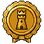 | 64x64 | reuse |  | `pixel/new_assets/achievements/badge_castle_10_gold_alt.png` |
| `badge_chest_bronze` | 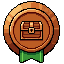 | 64x64 | reuse |  | `pixel/new_assets/achievements/badge_chest_bronze.png` |
| `badge_early_tester_special` | 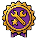 | 64x64 | reuse |  | `pixel/new_assets/achievements/badge_early_tester_special.png` |
| `badge_early_tester_special_alt` |  | 64x64 | reuse |  | `pixel/new_assets/achievements/badge_early_tester_special_alt.png` |
| `badge_early_tester_wireframe` |  | 64x64 | reuse |  | `pixel/new_assets/achievements/badge_early_tester_wireframe.png` |
| `badge_first_rebirth_fire` | 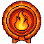 | 64x64 | reuse |  | `pixel/new_assets/achievements/badge_first_rebirth_fire.png` |
| `badge_first_rebirth_fire_alt` | 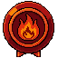 | 64x64 | reuse |  | `pixel/new_assets/achievements/badge_first_rebirth_fire_alt.png` |
| `badge_golden_monster_gold` |  | 64x64 | reuse |  | `pixel/new_assets/achievements/badge_golden_monster_gold.png` |
| `badge_great_auroch_boss` | 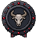 | 64x64 | reuse |  | `pixel/new_assets/achievements/badge_great_auroch_boss.png` |
| `badge_hammer_bronze` |  | 64x64 | reuse |  | `pixel/new_assets/achievements/badge_hammer_bronze.png` |
| `badge_map_flag_bronze` | 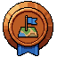 | 64x64 | reuse |  | `pixel/new_assets/achievements/badge_map_flag_bronze.png` |
| `badge_potion_bronze` | 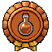 | 64x64 | reuse |  | `pixel/new_assets/achievements/badge_potion_bronze.png` |
| `badge_scroll_check_silver` |  | 64x64 | reuse |  | `pixel/new_assets/achievements/badge_scroll_check_silver.png` |
| `badge_shield_silver` | 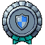 | 64x64 | reuse |  | `pixel/new_assets/achievements/badge_shield_silver.png` |
| `badge_skull_bronze` | 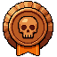 | 64x64 | reuse |  | `pixel/new_assets/achievements/badge_skull_bronze.png` |
| `badge_star_bronze` |  | 64x64 | reuse |  | `pixel/new_assets/achievements/badge_star_bronze.png` |
| `badge_star_silver` |  | 64x64 | reuse |  | `pixel/new_assets/achievements/badge_star_silver.png` |
| `badge_sword_shield_bronze` | 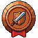 | 64x64 | reuse |  | `pixel/new_assets/achievements/badge_sword_shield_bronze.png` |
| `badge_sword_silver` | 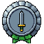 | 64x64 | reuse |  | `pixel/new_assets/achievements/badge_sword_silver.png` |
| `badge_tower_silver` | 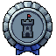 | 64x64 | reuse |  | `pixel/new_assets/achievements/badge_tower_silver.png` |
| `badge_winged_boot_bronze` | 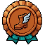 | 64x64 | reuse |  | `pixel/new_assets/achievements/badge_winged_boot_bronze.png` |

## bonus

| Name | Picture | Size | Status | Used by | Source file |
| --- | --- | --- | --- | --- | --- |
| `bonus_bee` |  | 56x26 | used | src/components/game/AmbientLife.tsx | `pixel/icons/bonus_bee.png` |
| `bonus_butterfly` |  | 56x28 | used | src/components/game/AmbientLife.tsx | `pixel/icons/bonus_butterfly.png` |
| `bonus_chest` | 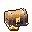 | 32x32 | unused |  | `pixel/icons/bonus_chest.png` |
| `bonus_crab` | 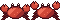 | 60x20 | used | src/components/game/AmbientLife.tsx | `pixel/icons/bonus_crab.png` |
| `bonus_fish` |  | 64x22 | used | src/components/game/AmbientLife.tsx | `pixel/icons/bonus_fish.png` |
| `bonus_frog` | 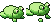 | 52x22 | used | src/components/game/AmbientLife.tsx | `pixel/icons/bonus_frog.png` |
| `bonus_goat` | 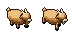 | 72x32 | used | src/components/game/AmbientLife.tsx | `pixel/icons/bonus_goat.png` |
| `bonus_ladybug` |  | 48x22 | used | src/components/game/AmbientLife.tsx | `pixel/icons/bonus_ladybug.png` |
| `bonus_rabbit` |  | 68x34 | used | src/components/game/AmbientLife.tsx | `pixel/icons/bonus_rabbit.png` |
| `bonus_wolf` | 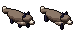 | 76x30 | used | src/components/game/AmbientLife.tsx | `pixel/icons/bonus_wolf.png` |

## chest

| Name | Picture | Size | Status | Used by | Source file |
| --- | --- | --- | --- | --- | --- |
| `chest_map` | 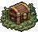 | 48x40 | unused |  | `pixel/icons/chest_map.png` |
| `chest_map_anim` | 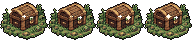 | 192x40 | used | src/components/game/Tile.tsx | `pixel/icons/chest_map_anim.png` |

## crafting

| Name | Picture | Size | Status | Used by | Source file |
| --- | --- | --- | --- | --- | --- |
| `crafting_blacksmith` | 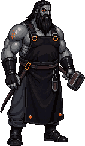 | 142x242 | used | hero:crafting-tab | `pixel/new_assets/crafting/blacksmith.png` |

## effects

| Name | Picture | Size | Status | Used by | Source file |
| --- | --- | --- | --- | --- | --- |
| `fx_dead` | 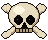 | 48x40 | used |  | `fx/dead.png` |
| `fx_slash_fire` | 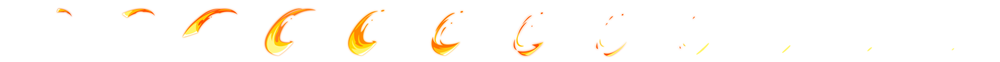 | 2880x180 | used |  | `fx/slash/fire.png` |
| `fx_slash_lightning` |  | 2880x180 | used |  | `fx/slash/lightning.png` |
| `fx_slash_poison` | 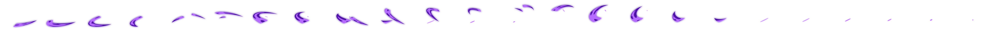 | 5760x180 | used |  | `fx/slash/poison.png` |
| `fx_slash_ultimate` | 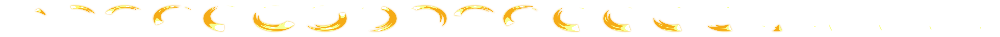 | 4800x180 | used |  | `fx/slash/ultimate.png` |
| `fx_slash_water` | 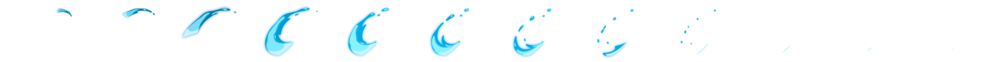 | 2880x180 | used |  | `fx/slash/water.png` |
| `fx_slash_wind` |  | 4320x180 | used |  | `fx/slash/wind.png` |

## equip

| Name | Picture | Size | Status | Used by | Source file |
| --- | --- | --- | --- | --- | --- |
| `equip_belt` | 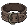 | 40x40 | used | slot:belt | `pixel/icons/equip_belt.png` |
| `equip_cape` |  | 40x40 | used | slot:cape | `pixel/icons/equip_cape.png` |
| `equip_charm` |  | 40x40 | used | slot:charm | `pixel/icons/equip_charm.png` |
| `equip_chest` | 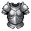 | 40x40 | used | slot:chest | `pixel/icons/equip_chest.png` |
| `equip_feet` | 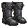 | 40x40 | used | slot:feet | `pixel/icons/equip_feet.png` |
| `equip_hands` | 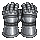 | 40x40 | used | slot:hands | `pixel/icons/equip_hands.png` |
| `equip_head` | 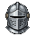 | 40x40 | used | slot:head | `pixel/icons/equip_head.png` |
| `equip_legs` | 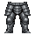 | 40x40 | used | slot:legs | `pixel/icons/equip_legs.png` |
| `equip_mainHand` | 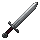 | 40x40 | used | slot:mainHand | `pixel/icons/equip_mainHand.png` |
| `equip_neck` | 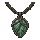 | 40x40 | used | slot:neck | `pixel/icons/equip_neck.png` |
| `equip_offHand` | 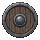 | 40x40 | used | slot:offHand | `pixel/icons/equip_offHand.png` |
| `equip_ring` | 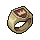 | 40x40 | used | slot:ring1, slot:ring2 | `pixel/icons/equip_ring.png` |
| `equip_shoulder` | 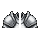 | 40x40 | used | slot:shoulder | `pixel/icons/equip_shoulder.png` |

## frames and bars

| Name | Picture | Size | Status | Used by | Source file |
| --- | --- | --- | --- | --- | --- |
| `ui_banner_left` |  | 22x28 | used |  | `pixel/ui/banner_left.png` |
| `ui_banner_mid` |  | 8x28 | used |  | `pixel/ui/banner_mid.png` |
| `ui_banner_right` |  | 22x28 | used |  | `pixel/ui/banner_right.png` |
| `ui_bar_fill` |  | 8x6 | used |  | `pixel/ui/bar_fill.png` |
| `ui_bar_frame` |  | 16x14 | used |  | `pixel/ui/bar_frame.png` |
| `ui_frame_modal` |  | 36x36 | used |  | `pixel/ui/frame_modal.png` |
| `ui_frame_panel` |  | 12x12 | used |  | `pixel/ui/frame_panel.png` |
| `ui_frame_tip` |  | 12x12 | used |  | `pixel/ui/frame_tip.png` |
| `ui_header_divider` |  | 9x56 | used |  | `pixel/ui/header_divider.png` |
| `ui_header_edge` |  | 64x10 | used |  | `pixel/ui/header_edge.png` |
| `ui_header_xp_fill` |  | 2x4 | used |  | `pixel/ui/header_xp_fill.png` |
| `ui_header_xp_frame` |  | 80x10 | used |  | `pixel/ui/header_xp_frame.png` |
| `ui_range_corner` |  | 20x20 | used |  | `pixel/ui/range_corner.png` |
| `ui_range_tint` |  | 16x16 | used |  | `pixel/ui/range_tint.png` |
| `ui_slot_frame` |  | 48x48 | used |  | `pixel/ui/slot_frame.png` |
| `ui_slot_frame_active` |  | 48x48 | used |  | `pixel/ui/slot_frame_active.png` |
| `ui_slot_frame_s` | 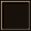 | 40x40 | used |  | `pixel/ui/slot_frame_s.png` |
| `ui_slot_frame_s_active` | 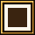 | 40x40 | used |  | `pixel/ui/slot_frame_s_active.png` |
| `ui_spark_sheet` |  | 66x11 | used |  | `pixel/ui/spark_sheet.png` |
| `ui_torch` |  | 30x16 | used |  | `pixel/ui/torch.png` |

## hero

| Name | Picture | Size | Status | Used by | Source file |
| --- | --- | --- | --- | --- | --- |
| `hero_mage` |  | 56x80 | used | src/config/playerClasses.ts | `pixel/icons/hero_mage.png` |
| `hero_paladin` |  | 56x80 | used | src/config/playerClasses.ts | `pixel/icons/hero_paladin.png` |
| `hero_ranger` |  | 56x80 | used | src/config/playerClasses.ts | `pixel/icons/hero_ranger.png` |
| `hero_warrior` |  | 56x80 | used | src/config/playerClasses.ts | `pixel/icons/hero_warrior.png` |

## level

| Name | Picture | Size | Status | Used by | Source file |
| --- | --- | --- | --- | --- | --- |
| `level_orb` |  | 24x24 | unused |  | `pixel/icons/level_orb.png` |
| `level_orb_shine` |  | 144x24 | used | src/app/globals.css | `pixel/icons/level_orb_shine.png` |

## menu

| Name | Picture | Size | Status | Used by | Source file |
| --- | --- | --- | --- | --- | --- |
| `menu_achievements` | 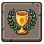 | 64x64 | used | src/components/game/hud/HudDock.tsx, src/components/game/merchant/MerchantPlaceholders.tsx, src/components/game/overlays/GameWindows.tsx | `pixel/icons/menu_achievements.png` |
| `menu_bag_scroll` | 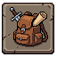 | 64x64 | used | src/components/game/hero/HeroWindow.tsx, src/components/game/hero/recipeUi.ts, src/components/game/hud/HudTopBar.tsx | `pixel/icons/menu_bag_scroll.png` |
| `menu_character` |  | 40x40 | used | src/components/game/AvatarDialog.tsx, src/components/game/ClassPickerDialog.tsx | `pixel/icons/menu_character.png` |
| `menu_crafting` | 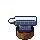 | 64x64 | unused |  | `pixel/icons/menu_crafting.png` |
| `menu_equipment` | 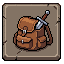 | 64x64 | unused |  | `pixel/icons/menu_equipment.png` |
| `menu_farm` | 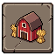 | 64x64 | used | src/components/game/hud/HudDock.tsx, src/components/game/overlays/GameWindows.tsx | `pixel/icons/menu_farm.png` |
| `menu_gems_pouch` | 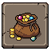 | 64x64 | used | src/components/game/hud/HudDock.tsx, src/components/game/merchant/MerchantPlaceholders.tsx | `pixel/icons/menu_gems_pouch.png` |
| `menu_glossary` | 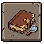 | 64x64 | unused |  | `pixel/icons/menu_glossary.png` |
| `menu_legacy` | 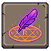 | 64x64 | used | src/components/game/hud/HudDock.tsx, src/components/game/overlays/RebirthDialog.tsx | `pixel/icons/menu_legacy.png` |
| `menu_main` | 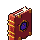 | 40x40 | unused |  | `pixel/icons/menu_main.png` |
| `menu_merchant` |  | 64x64 | used | src/components/game/hud/HudDock.tsx | `pixel/icons/menu_merchant.png` |
| `menu_settings` |  | 64x64 | used | src/components/game/overlays/SettingsDialog.tsx | `pixel/icons/menu_settings.png` |
| `menu_stats` |  | 40x40 | unused |  | `pixel/icons/menu_stats.png` |

## skull

| Name | Picture | Size | Status | Used by | Source file |
| --- | --- | --- | --- | --- | --- |
| `skull` |  | 40x40 | used | src/components/game/overlays/CombatWidget.tsx | `pixel/icons/skull.png` |

## unknown

| Name | Picture | Size | Status | Used by | Source file |
| --- | --- | --- | --- | --- | --- |
| `unknown` |  | 11x14 | used | src/components/game/Tile.tsx, src/lib/cloudClient.ts, src/lib/offline/achievements.ts | `pixel/icons/unknown.png` |

## wireframe early-tester set (sources of the early tester portrait and badge; pets not wired)

| Name | Picture | Size | Status | Used by | Source file |
| --- | --- | --- | --- | --- | --- |
| `avatar_wireframe_hero` |  | 64x64 | planned |  | `pixel/new_assets/wireframe/avatar_wireframe_hero.png` |
| `badge_star_wireframe` |  | 64x64 | planned |  | `pixel/new_assets/wireframe/badge_star_wireframe.png` |
| `pet_fox` |  | 64x64 | planned |  | `pixel/new_assets/wireframe/pet_fox.png` |
| `pet_owl` |  | 64x64 | planned |  | `pixel/new_assets/wireframe/pet_owl.png` |
| `pet_rabbit` |  | 64x64 | planned |  | `pixel/new_assets/wireframe/pet_rabbit.png` |

## xp

| Name | Picture | Size | Status | Used by | Source file |
| --- | --- | --- | --- | --- | --- |
| `xp` |  | 40x40 | used | resource:xp | `pixel/icons/xp.png` |
