# Unsorted cuts

Generated by `npm run assets:catalog` from the game registries and `public/pixel/`. Do not edit by hand: rename an asset in `scripts/assets/names.json`.

Loose cuts in public/pixel/__reuse, not classified yet.

238 assets. Refer to an asset by its **name**.

## crafting

| Name | Picture | Size | Status | Used by | Source file |
| --- | --- | --- | --- | --- | --- |
| `reuse_crafting_amethyst_clust` | 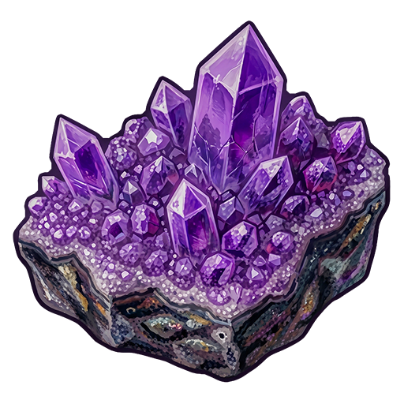 | 512x512 | planned | IDL-358: painted ore and gem tiers (full size, for the ore and gem windows to come) | `pixel/__reuse/crafting/amethyst_clust.png` |
| `reuse_crafting_crystal_gold` | 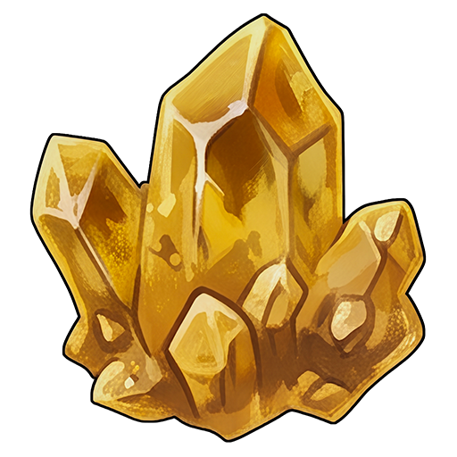 | 512x512 | planned | IDL-358: painted ore and gem tiers (full size, for the ore and gem windows to come) | `pixel/__reuse/crafting/crystal_gold.png` |
| `reuse_crafting_crystal_green` | 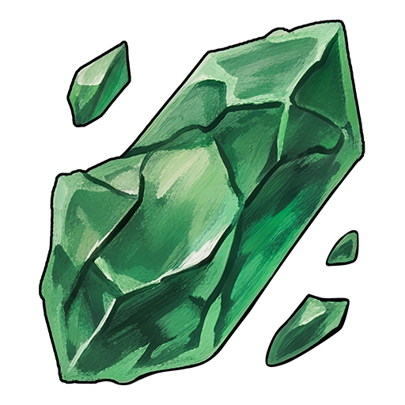 | 512x512 | planned | IDL-358: painted ore and gem tiers (full size, for the ore and gem windows to come) | `pixel/__reuse/crafting/crystal_green.png` |
| `reuse_crafting_crystal_ice` | 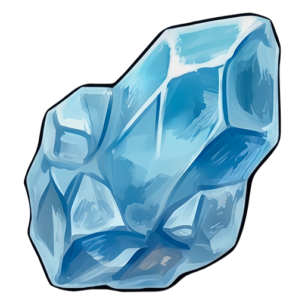 | 512x512 | planned | IDL-358: painted ore and gem tiers (full size, for the ore and gem windows to come) | `pixel/__reuse/crafting/crystal_ice.png` |
| `reuse_crafting_gem_blue_hex` | 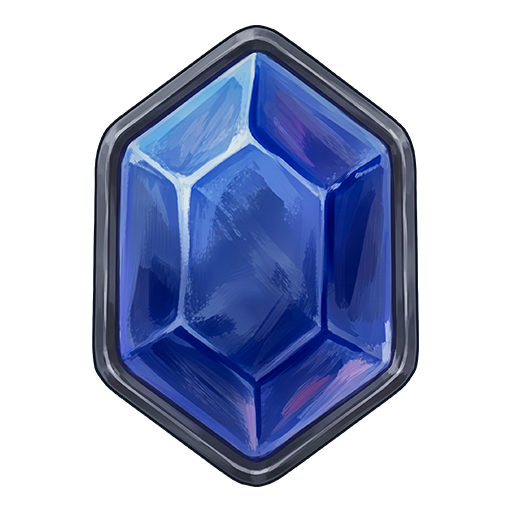 | 512x512 | planned | IDL-358: painted ore and gem tiers (full size, for the ore and gem windows to come) | `pixel/__reuse/crafting/gem_blue_hex.png` |
| `reuse_crafting_gem_red_round` | 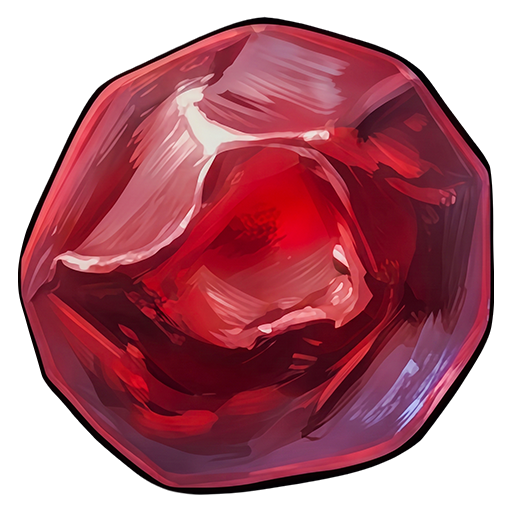 | 512x512 | planned | IDL-358: painted ore and gem tiers (full size, for the ore and gem windows to come) | `pixel/__reuse/crafting/gem_red_round.png` |
| `reuse_crafting_geode_red` | 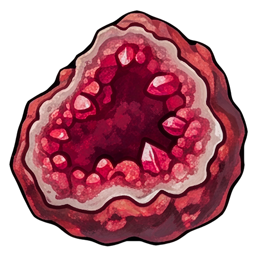 | 512x512 | planned | IDL-358: painted ore and gem tiers (full size, for the ore and gem windows to come) | `pixel/__reuse/crafting/geode_red.png` |
| `reuse_crafting_ingot_copper` | 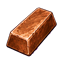 | 64x64 | used | comp_copper_ingot (40 px copy) | `pixel/__reuse/crafting/ingot_copper.png` |
| `reuse_crafting_ingot_gold` | 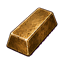 | 64x64 | used | comp_gold_ingot (40 px copy) | `pixel/__reuse/crafting/ingot_gold.png` |
| `reuse_crafting_ingot_iron` | 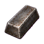 | 64x64 | used | comp_iron_ingot (40 px copy), comp_steel_ingot and comp_silver_ingot (recolours) | `pixel/__reuse/crafting/ingot_iron.png` |
| `reuse_crafting_nail_iron` |  | 64x64 | used | comp_iron_nails (40 px copy), comp_steel_rivets, comp_silver_rivets, comp_gold_studs (recolours) | `pixel/__reuse/crafting/nail_iron.png` |
| `reuse_crafting_nails_copper` |  | 64x64 | used | comp_copper_nails (40 px copy) | `pixel/__reuse/crafting/nails_copper.png` |
| `reuse_crafting_ore_blue_vein` | 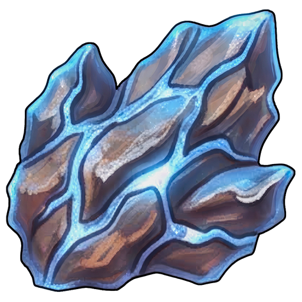 | 512x512 | planned | IDL-358: painted ore and gem tiers (full size, for the ore and gem windows to come) | `pixel/__reuse/crafting/ore_blue_vein.png` |
| `reuse_crafting_ore_dark_ember` | 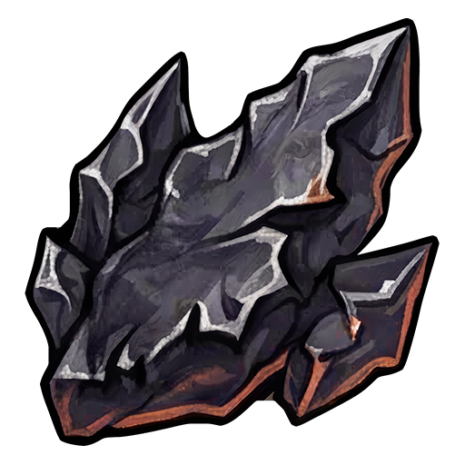 | 512x512 | planned | IDL-358: painted ore and gem tiers (full size, for the ore and gem windows to come) | `pixel/__reuse/crafting/ore_dark_ember.png` |
| `reuse_crafting_ore_silver` | 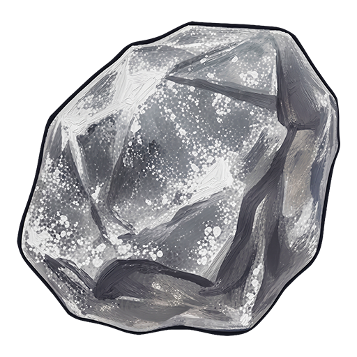 | 512x512 | planned | IDL-358: painted ore and gem tiers (full size, for the ore and gem windows to come) | `pixel/__reuse/crafting/ore_silver.png` |
| `reuse_crafting_potion_galaxy` | 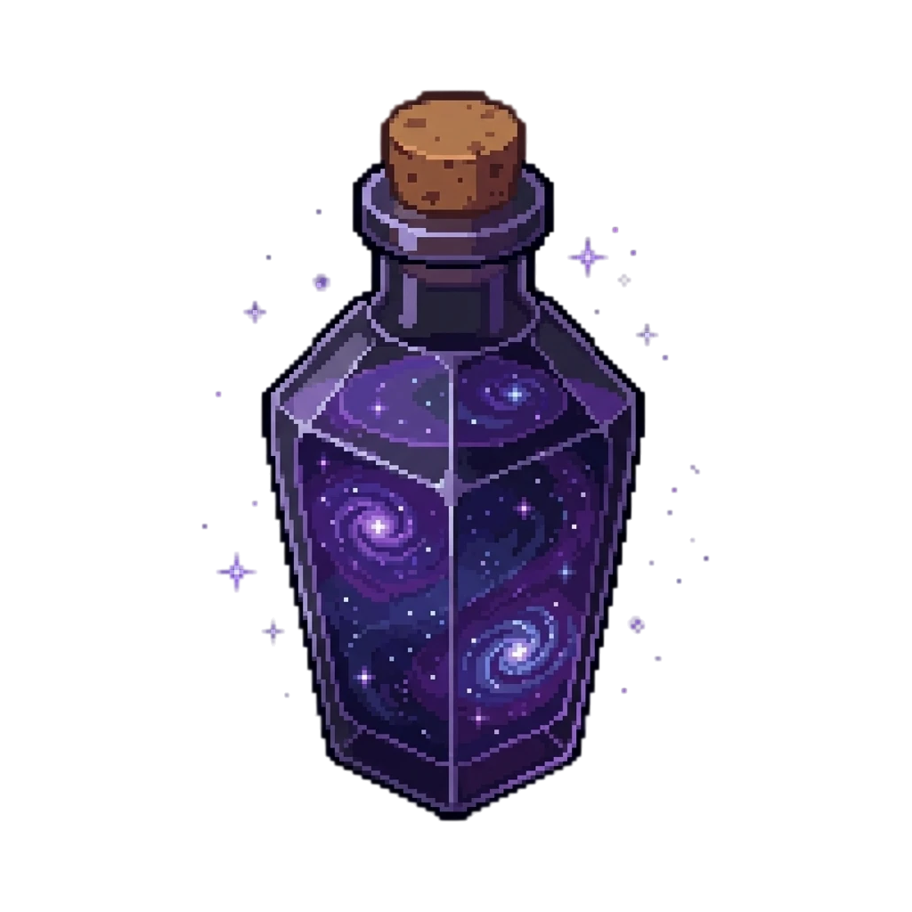 | 1024x1024 | used | art_elixir_warding (64 px copy) | `pixel/__reuse/crafting/potion_galaxy.png` |
| `reuse_crafting_potion_gold_sta` |  | 1024x1024 | used | art_elixir_might (64 px copy) | `pixel/__reuse/crafting/potion_gold_star.png` |
| `reuse_crafting_potion_green_sw` |  | 1024x1024 | used | art_elixir_fortitude (64 px copy) | `pixel/__reuse/crafting/potion_green_swirl.png` |
| `reuse_crafting_potion_grey_swi` | 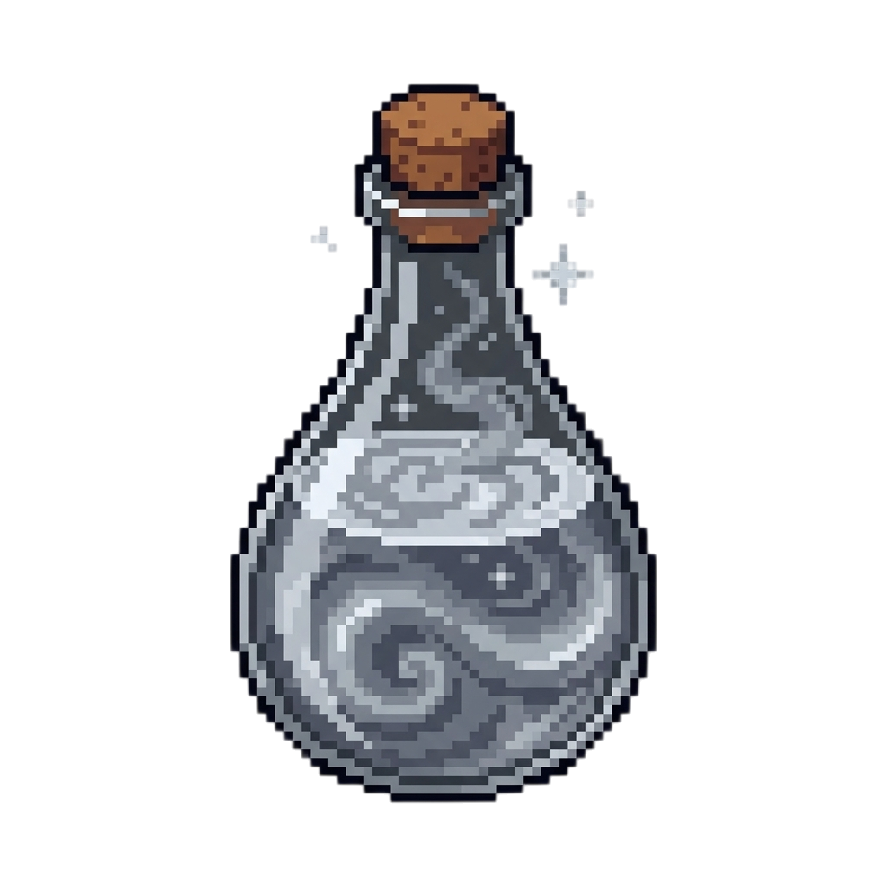 | 1024x1024 | used | art_elixir_ironskin (64 px copy) | `pixel/__reuse/crafting/potion_grey_swirl.png` |
| `reuse_crafting_potion_purple` | 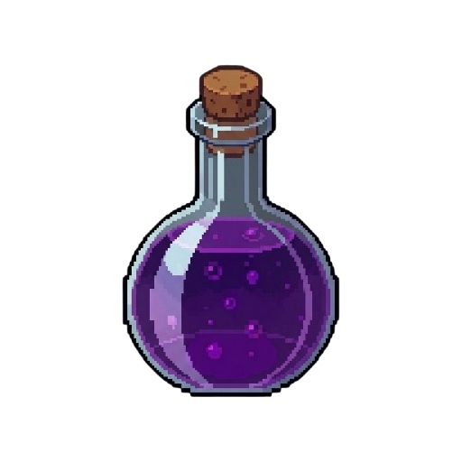 | 512x512 | used | art_elixir_keen_eye (64 px copy) | `pixel/__reuse/crafting/potion_purple.png` |
| `reuse_crafting_potion_winged_b` | 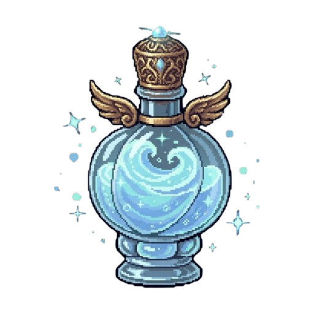 | 512x512 | used | art_elixir_haste (64 px copy) | `pixel/__reuse/crafting/potion_winged_blue.png` |
| `reuse_crafting_rock_amethyst` | 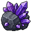 | 64x64 | planned | IDL-376: candidate extra sprite for the epic rock tier (an amethyst rock next to the white Crystal one) | `pixel/__reuse/crafting/rock_amethyst.png` |
| `reuse_crafting_rock_grey_pale` | 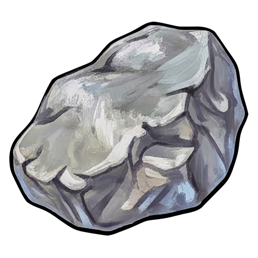 | 512x512 | planned | IDL-358: painted ore and gem tiers (full size, for the ore and gem windows to come) | `pixel/__reuse/crafting/rock_grey_pale.png` |
| `reuse_crafting_rock_lava_spher` | 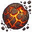 | 64x64 | planned | IDL-376: candidate extra sprite for the legendary rock tier (rocks/rock_legendary is the lava rock today) | `pixel/__reuse/crafting/rock_lava_sphere.png` |

## crystals_32

| Name | Picture | Size | Status | Used by | Source file |
| --- | --- | --- | --- | --- | --- |
| `reuse_crystals_32_amber_clus_b` | 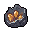 | 32x32 | unused |  | `pixel/__reuse/crystals_32/amber_clus_b.png` |
| `reuse_crystals_32_amber_cluster` | 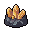 | 32x32 | unused |  | `pixel/__reuse/crystals_32/amber_cluster.png` |
| `reuse_crystals_32_amethyst_bed` | 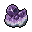 | 32x32 | unused |  | `pixel/__reuse/crystals_32/amethyst_bed.png` |
| `reuse_crystals_32_amethyst_geode` |  | 32x32 | unused |  | `pixel/__reuse/crystals_32/amethyst_geode.png` |
| `reuse_crystals_32_bismuth` |  | 32x32 | unused |  | `pixel/__reuse/crystals_32/bismuth.png` |
| `reuse_crystals_32_blue_vein_a` | 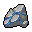 | 32x32 | unused |  | `pixel/__reuse/crystals_32/blue_vein_a.png` |
| `reuse_crystals_32_blue_vein_b` |  | 32x32 | unused |  | `pixel/__reuse/crystals_32/blue_vein_b.png` |
| `reuse_crystals_32_copper_green` |  | 32x32 | unused |  | `pixel/__reuse/crystals_32/copper_green.png` |
| `reuse_crystals_32_coral_tan_a` |  | 32x32 | unused |  | `pixel/__reuse/crystals_32/coral_tan_a.png` |
| `reuse_crystals_32_coral_tan_b` |  | 32x32 | unused |  | `pixel/__reuse/crystals_32/coral_tan_b.png` |
| `reuse_crystals_32_coral_white_a` |  | 32x32 | unused |  | `pixel/__reuse/crystals_32/coral_white_a.png` |
| `reuse_crystals_32_coral_white_b` |  | 32x32 | unused |  | `pixel/__reuse/crystals_32/coral_white_b.png` |
| `reuse_crystals_32_coral_white_c` |  | 32x32 | unused |  | `pixel/__reuse/crystals_32/coral_white_c.png` |
| `reuse_crystals_32_emerald_bed` | 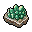 | 32x32 | unused |  | `pixel/__reuse/crystals_32/emerald_bed.png` |
| `reuse_crystals_32_emerald_clus_a` | 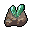 | 32x32 | unused |  | `pixel/__reuse/crystals_32/emerald_clus_a.png` |
| `reuse_crystals_32_emerald_clus_b` | 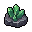 | 32x32 | unused |  | `pixel/__reuse/crystals_32/emerald_clus_b.png` |
| `reuse_crystals_32_emerald_clus_c` |  | 32x32 | unused |  | `pixel/__reuse/crystals_32/emerald_clus_c.png` |
| `reuse_crystals_32_emerald_cut` |  | 32x32 | used | comp_cut_emerald, comp_cut_turquoise (recolour) | `pixel/__reuse/crystals_32/emerald_cut.png` |
| `reuse_crystals_32_emerald_oval` |  | 32x32 | used | comp_cut_malachite (recolour) | `pixel/__reuse/crystals_32/emerald_oval.png` |
| `reuse_crystals_32_emerald_round` |  | 32x32 | used | comp_cut_geode (recolour) | `pixel/__reuse/crystals_32/emerald_round.png` |
| `reuse_crystals_32_emerald_tear` |  | 32x32 | used | comp_cut_crystal (recolour) | `pixel/__reuse/crystals_32/emerald_tear.png` |
| `reuse_crystals_32_fungus_tan` |  | 32x32 | unused |  | `pixel/__reuse/crystals_32/fungus_tan.png` |
| `reuse_crystals_32_gold_nuggets` |  | 32x32 | unused |  | `pixel/__reuse/crystals_32/gold_nuggets.png` |
| `reuse_crystals_32_grass_a` |  | 32x32 | unused |  | `pixel/__reuse/crystals_32/grass_a.png` |
| `reuse_crystals_32_grass_b` |  | 32x32 | unused |  | `pixel/__reuse/crystals_32/grass_b.png` |
| `reuse_crystals_32_mossy_gold` | 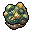 | 32x32 | unused |  | `pixel/__reuse/crystals_32/mossy_gold.png` |
| `reuse_crystals_32_pyrite_cluster` | 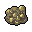 | 32x32 | unused |  | `pixel/__reuse/crystals_32/pyrite_cluster.png` |
| `reuse_crystals_32_ruby_cluster_a` | 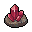 | 32x32 | unused |  | `pixel/__reuse/crystals_32/ruby_cluster_a.png` |
| `reuse_crystals_32_ruby_cluster_b` | 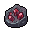 | 32x32 | unused |  | `pixel/__reuse/crystals_32/ruby_cluster_b.png` |
| `reuse_crystals_32_ruby_cluster_c` |  | 32x32 | unused |  | `pixel/__reuse/crystals_32/ruby_cluster_c.png` |
| `reuse_crystals_32_ruby_cut` |  | 32x32 | used | comp_cut_ruby, comp_cut_amethyst (recolour) | `pixel/__reuse/crystals_32/ruby_cut.png` |
| `reuse_crystals_32_ruby_oval` |  | 32x32 | used | comp_cut_jasper (recolour), comp_cut_garnet (recolour) | `pixel/__reuse/crystals_32/ruby_oval.png` |
| `reuse_crystals_32_ruby_round` |  | 32x32 | used | comp_cut_moon (recolour), comp_cut_lapis (recolour) | `pixel/__reuse/crystals_32/ruby_round.png` |
| `reuse_crystals_32_ruby_tear` |  | 32x32 | used | comp_cut_heart (recolour), comp_cut_sapphire (recolour) | `pixel/__reuse/crystals_32/ruby_tear.png` |
| `reuse_crystals_32_sandstone_a` | 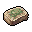 | 32x32 | unused |  | `pixel/__reuse/crystals_32/sandstone_a.png` |
| `reuse_crystals_32_sandstone_b` | 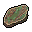 | 32x32 | unused |  | `pixel/__reuse/crystals_32/sandstone_b.png` |
| `reuse_crystals_32_slate_green_a` | 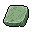 | 32x32 | unused |  | `pixel/__reuse/crystals_32/slate_green_a.png` |
| `reuse_crystals_32_slate_green_b` | 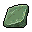 | 32x32 | unused |  | `pixel/__reuse/crystals_32/slate_green_b.png` |
| `reuse_crystals_32_spire_amber` |  | 32x32 | unused |  | `pixel/__reuse/crystals_32/spire_amber.png` |
| `reuse_crystals_32_spire_blue` |  | 32x32 | unused |  | `pixel/__reuse/crystals_32/spire_blue.png` |
| `reuse_crystals_32_spire_green` | 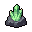 | 32x32 | unused |  | `pixel/__reuse/crystals_32/spire_green.png` |
| `reuse_crystals_32_spire_opal` |  | 32x32 | unused |  | `pixel/__reuse/crystals_32/spire_opal.png` |
| `reuse_crystals_32_spire_pink` |  | 32x32 | unused |  | `pixel/__reuse/crystals_32/spire_pink.png` |
| `reuse_crystals_32_spire_purple` |  | 32x32 | unused |  | `pixel/__reuse/crystals_32/spire_purple.png` |
| `reuse_crystals_32_spire_tourmal` |  | 32x32 | unused |  | `pixel/__reuse/crystals_32/spire_tourmal.png` |
| `reuse_crystals_32_spire_white` |  | 32x32 | unused |  | `pixel/__reuse/crystals_32/spire_white.png` |
| `reuse_crystals_32_stone_green` | 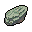 | 32x32 | unused |  | `pixel/__reuse/crystals_32/stone_green.png` |
| `reuse_crystals_32_turquoise_rock` | 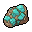 | 32x32 | unused |  | `pixel/__reuse/crystals_32/turquoise_rock.png` |

## gems_32

| Name | Picture | Size | Status | Used by | Source file |
| --- | --- | --- | --- | --- | --- |
| `reuse_gems_32_agate_slice` |  | 32x32 | unused |  | `pixel/__reuse/gems_32/agate_slice.png` |
| `reuse_gems_32_amber_crystal` |  | 32x32 | unused |  | `pixel/__reuse/gems_32/amber_crystal.png` |
| `reuse_gems_32_amber_fossil` |  | 32x32 | unused |  | `pixel/__reuse/gems_32/amber_fossil.png` |
| `reuse_gems_32_amethyst` |  | 32x32 | unused |  | `pixel/__reuse/gems_32/amethyst.png` |
| `reuse_gems_32_amethyst_geode` |  | 32x32 | unused |  | `pixel/__reuse/gems_32/amethyst_geode.png` |
| `reuse_gems_32_aquamarine` |  | 32x32 | unused |  | `pixel/__reuse/gems_32/aquamarine.png` |
| `reuse_gems_32_bloodstone` |  | 32x32 | unused |  | `pixel/__reuse/gems_32/bloodstone.png` |
| `reuse_gems_32_carnelian` |  | 32x32 | unused |  | `pixel/__reuse/gems_32/carnelian.png` |
| `reuse_gems_32_charoite` |  | 32x32 | unused |  | `pixel/__reuse/gems_32/charoite.png` |
| `reuse_gems_32_chrysocolla` | 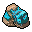 | 32x32 | unused |  | `pixel/__reuse/gems_32/chrysocolla.png` |
| `reuse_gems_32_citrine` |  | 32x32 | unused |  | `pixel/__reuse/gems_32/citrine.png` |
| `reuse_gems_32_diamond_raw` | 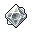 | 32x32 | unused |  | `pixel/__reuse/gems_32/diamond_raw.png` |
| `reuse_gems_32_emerald` |  | 32x32 | unused |  | `pixel/__reuse/gems_32/emerald.png` |
| `reuse_gems_32_emerald_rock` |  | 32x32 | unused |  | `pixel/__reuse/gems_32/emerald_rock.png` |
| `reuse_gems_32_emerald_stone` | 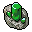 | 32x32 | unused |  | `pixel/__reuse/gems_32/emerald_stone.png` |
| `reuse_gems_32_fire_amber` | 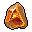 | 32x32 | unused |  | `pixel/__reuse/gems_32/fire_amber.png` |
| `reuse_gems_32_fire_opal` |  | 32x32 | unused |  | `pixel/__reuse/gems_32/fire_opal.png` |
| `reuse_gems_32_fluorite` |  | 32x32 | unused |  | `pixel/__reuse/gems_32/fluorite.png` |
| `reuse_gems_32_garnet_dark` |  | 32x32 | used | art_junk_garnet | `pixel/__reuse/gems_32/garnet_dark.png` |
| `reuse_gems_32_garnet_red` |  | 32x32 | unused |  | `pixel/__reuse/gems_32/garnet_red.png` |
| `reuse_gems_32_geode_ice_a` |  | 32x32 | unused |  | `pixel/__reuse/gems_32/geode_ice_a.png` |
| `reuse_gems_32_geode_ice_b` |  | 32x32 | unused |  | `pixel/__reuse/gems_32/geode_ice_b.png` |
| `reuse_gems_32_gold_vein_rock` |  | 32x32 | unused |  | `pixel/__reuse/gems_32/gold_vein_rock.png` |
| `reuse_gems_32_kyanite` |  | 32x32 | unused |  | `pixel/__reuse/gems_32/kyanite.png` |
| `reuse_gems_32_labradorite` |  | 32x32 | unused |  | `pixel/__reuse/gems_32/labradorite.png` |
| `reuse_gems_32_labradorite_b` | 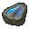 | 32x32 | unused |  | `pixel/__reuse/gems_32/labradorite_b.png` |
| `reuse_gems_32_lapis_cluster` |  | 32x32 | used | art_junk_lapis | `pixel/__reuse/gems_32/lapis_cluster.png` |
| `reuse_gems_32_larimar` |  | 32x32 | unused |  | `pixel/__reuse/gems_32/larimar.png` |
| `reuse_gems_32_malachite_teal` | 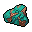 | 32x32 | unused |  | `pixel/__reuse/gems_32/malachite_teal.png` |
| `reuse_gems_32_metal_cube` |  | 32x32 | unused |  | `pixel/__reuse/gems_32/metal_cube.png` |
| `reuse_gems_32_moonstone` |  | 32x32 | unused |  | `pixel/__reuse/gems_32/moonstone.png` |
| `reuse_gems_32_obsidian` |  | 32x32 | unused |  | `pixel/__reuse/gems_32/obsidian.png` |
| `reuse_gems_32_peridot_rock` | 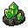 | 32x32 | unused |  | `pixel/__reuse/gems_32/peridot_rock.png` |
| `reuse_gems_32_pink_crystal` |  | 32x32 | unused |  | `pixel/__reuse/gems_32/pink_crystal.png` |
| `reuse_gems_32_pink_gem_rock` |  | 32x32 | unused |  | `pixel/__reuse/gems_32/pink_gem_rock.png` |
| `reuse_gems_32_quartz_clear` |  | 32x32 | unused |  | `pixel/__reuse/gems_32/quartz_clear.png` |
| `reuse_gems_32_rhodochrosite` |  | 32x32 | unused |  | `pixel/__reuse/gems_32/rhodochrosite.png` |
| `reuse_gems_32_rhodonite` |  | 32x32 | unused |  | `pixel/__reuse/gems_32/rhodonite.png` |
| `reuse_gems_32_rose_quartz` |  | 32x32 | unused |  | `pixel/__reuse/gems_32/rose_quartz.png` |
| `reuse_gems_32_rose_rock` | 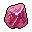 | 32x32 | unused |  | `pixel/__reuse/gems_32/rose_rock.png` |
| `reuse_gems_32_ruby_cluster` |  | 32x32 | used | art_junk_ruby | `pixel/__reuse/gems_32/ruby_cluster.png` |
| `reuse_gems_32_ruby_on_rock` |  | 32x32 | unused |  | `pixel/__reuse/gems_32/ruby_on_rock.png` |
| `reuse_gems_32_sapphire_cryst` |  | 32x32 | unused |  | `pixel/__reuse/gems_32/sapphire_cryst.png` |
| `reuse_gems_32_sapphire_rock` | 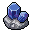 | 32x32 | used | art_junk_sapphire | `pixel/__reuse/gems_32/sapphire_rock.png` |
| `reuse_gems_32_sugilite` |  | 32x32 | unused |  | `pixel/__reuse/gems_32/sugilite.png` |
| `reuse_gems_32_tiger_eye` |  | 32x32 | unused |  | `pixel/__reuse/gems_32/tiger_eye.png` |
| `reuse_gems_32_topaz` |  | 32x32 | unused |  | `pixel/__reuse/gems_32/topaz.png` |
| `reuse_gems_32_tourmaline_grn` |  | 32x32 | unused |  | `pixel/__reuse/gems_32/tourmaline_grn.png` |
| `reuse_gems_32_tourmaline_wm` |  | 32x32 | unused |  | `pixel/__reuse/gems_32/tourmaline_wm.png` |
| `reuse_gems_32_yellow_crystal` |  | 32x32 | unused |  | `pixel/__reuse/gems_32/yellow_crystal.png` |

## header

| Name | Picture | Size | Status | Used by | Source file |
| --- | --- | --- | --- | --- | --- |
| `reuse_header_coin_bag` |  | 64x64 | unused |  | `pixel/__reuse/header/coin_bag.png` |
| `reuse_header_key` |  | 64x64 | unused |  | `pixel/__reuse/header/key.png` |
| `reuse_header_red_potion` | 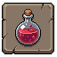 | 64x64 | unused |  | `pixel/__reuse/header/red_potion.png` |
| `reuse_header_rune_book` |  | 64x64 | unused |  | `pixel/__reuse/header/rune_book.png` |
| `reuse_header_sword` |  | 64x64 | unused |  | `pixel/__reuse/header/sword.png` |
| `reuse_header_teal_shield` |  | 64x64 | unused |  | `pixel/__reuse/header/teal_shield.png` |

## pixel/pets (not named by the code)

| Name | Picture | Size | Status | Used by | Source file |
| --- | --- | --- | --- | --- | --- |
| `loose_pets_brown_cute_pet_cat` |  | 512x64 | unused |  | `pixel/pets/brown-cute-pet-cat-walking-6a21-spritesheet.png` |
| `loose_pets_cute_pet_hamster_w` |  | 512x64 | unused |  | `pixel/pets/cute-pet-hamster-walking-bb8b-spritesheet.png` |
| `loose_pets_dachshund_jumping_` |  | 512x64 | unused |  | `pixel/pets/dachshund-jumping-and-walking-running-forward-620e-spritesheet.png` |
| `loose_pets_sprite_32x32px_6f_` |  | 96x64 | unused |  | `pixel/pets/sprite-32x32px-6f-sheet.png` |
| `pet_special_kaczkawu_dog_reserved` |  | 84x84 | used | code | `pixel/pets/kaczkawu_dog.png` |

## rocks_32

| Name | Picture | Size | Status | Used by | Source file |
| --- | --- | --- | --- | --- | --- |
| `reuse_rocks_32_blue_grey_rock` | 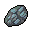 | 32x32 | unused |  | `pixel/__reuse/rocks_32/blue_grey_rock.png` |
| `reuse_rocks_32_blue_rock` | 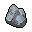 | 32x32 | unused |  | `pixel/__reuse/rocks_32/blue_rock.png` |
| `reuse_rocks_32_coal_1` |  | 32x32 | unused |  | `pixel/__reuse/rocks_32/coal_1.png` |
| `reuse_rocks_32_coal_2` |  | 32x32 | used | comp_obsidian_edge (recolour) | `pixel/__reuse/rocks_32/coal_2.png` |
| `reuse_rocks_32_coal_3` |  | 32x32 | unused |  | `pixel/__reuse/rocks_32/coal_3.png` |
| `reuse_rocks_32_coal_4` |  | 32x32 | unused |  | `pixel/__reuse/rocks_32/coal_4.png` |
| `reuse_rocks_32_coal_5` |  | 32x32 | unused |  | `pixel/__reuse/rocks_32/coal_5.png` |
| `reuse_rocks_32_coal_6` |  | 32x32 | unused |  | `pixel/__reuse/rocks_32/coal_6.png` |
| `reuse_rocks_32_coal_7` |  | 32x32 | unused |  | `pixel/__reuse/rocks_32/coal_7.png` |
| `reuse_rocks_32_coal_8` |  | 32x32 | unused |  | `pixel/__reuse/rocks_32/coal_8.png` |
| `reuse_rocks_32_copper_rock_1` |  | 32x32 | unused |  | `pixel/__reuse/rocks_32/copper_rock_1.png` |
| `reuse_rocks_32_copper_rock_2` |  | 32x32 | unused |  | `pixel/__reuse/rocks_32/copper_rock_2.png` |
| `reuse_rocks_32_copper_rock_3` |  | 32x32 | unused |  | `pixel/__reuse/rocks_32/copper_rock_3.png` |
| `reuse_rocks_32_copper_rock_4` |  | 32x32 | unused |  | `pixel/__reuse/rocks_32/copper_rock_4.png` |
| `reuse_rocks_32_copper_rock_5` |  | 32x32 | unused |  | `pixel/__reuse/rocks_32/copper_rock_5.png` |
| `reuse_rocks_32_copper_rock_6` |  | 32x32 | unused |  | `pixel/__reuse/rocks_32/copper_rock_6.png` |
| `reuse_rocks_32_copper_rock_7` |  | 32x32 | unused |  | `pixel/__reuse/rocks_32/copper_rock_7.png` |
| `reuse_rocks_32_copper_rock_8` |  | 32x32 | unused |  | `pixel/__reuse/rocks_32/copper_rock_8.png` |
| `reuse_rocks_32_copper_speck_a` |  | 32x32 | unused |  | `pixel/__reuse/rocks_32/copper_speck_a.png` |
| `reuse_rocks_32_copper_speck_b` |  | 32x32 | used | art_junk_iron_ore | `pixel/__reuse/rocks_32/copper_speck_b.png` |
| `reuse_rocks_32_dark_rock` |  | 32x32 | unused |  | `pixel/__reuse/rocks_32/dark_rock.png` |
| `reuse_rocks_32_dirt_rock_1` |  | 32x32 | unused |  | `pixel/__reuse/rocks_32/dirt_rock_1.png` |
| `reuse_rocks_32_dirt_rock_2` |  | 32x32 | unused |  | `pixel/__reuse/rocks_32/dirt_rock_2.png` |
| `reuse_rocks_32_dirt_rock_3` |  | 32x32 | unused |  | `pixel/__reuse/rocks_32/dirt_rock_3.png` |
| `reuse_rocks_32_dirt_rock_4` |  | 32x32 | unused |  | `pixel/__reuse/rocks_32/dirt_rock_4.png` |
| `reuse_rocks_32_dirt_rock_5` |  | 32x32 | unused |  | `pixel/__reuse/rocks_32/dirt_rock_5.png` |
| `reuse_rocks_32_dirt_rock_6` |  | 32x32 | unused |  | `pixel/__reuse/rocks_32/dirt_rock_6.png` |
| `reuse_rocks_32_dirt_rock_7` |  | 32x32 | unused |  | `pixel/__reuse/rocks_32/dirt_rock_7.png` |
| `reuse_rocks_32_dirt_rock_8` |  | 32x32 | unused |  | `pixel/__reuse/rocks_32/dirt_rock_8.png` |
| `reuse_rocks_32_green_grey_rock` |  | 32x32 | unused |  | `pixel/__reuse/rocks_32/green_grey_rock.png` |
| `reuse_rocks_32_grey_rock_1` |  | 32x32 | unused |  | `pixel/__reuse/rocks_32/grey_rock_1.png` |
| `reuse_rocks_32_grey_rock_2` |  | 32x32 | unused |  | `pixel/__reuse/rocks_32/grey_rock_2.png` |
| `reuse_rocks_32_grey_rock_3` |  | 32x32 | unused |  | `pixel/__reuse/rocks_32/grey_rock_3.png` |
| `reuse_rocks_32_grey_rock_4` |  | 32x32 | unused |  | `pixel/__reuse/rocks_32/grey_rock_4.png` |
| `reuse_rocks_32_grey_rock_5` |  | 32x32 | unused |  | `pixel/__reuse/rocks_32/grey_rock_5.png` |
| `reuse_rocks_32_grey_rock_6` |  | 32x32 | used | art_junk_flint | `pixel/__reuse/rocks_32/grey_rock_6.png` |
| `reuse_rocks_32_grey_rock_7` |  | 32x32 | unused |  | `pixel/__reuse/rocks_32/grey_rock_7.png` |
| `reuse_rocks_32_grey_rock_8` |  | 32x32 | unused |  | `pixel/__reuse/rocks_32/grey_rock_8.png` |
| `reuse_rocks_32_malachite_a` |  | 32x32 | unused |  | `pixel/__reuse/rocks_32/malachite_a.png` |
| `reuse_rocks_32_malachite_b` |  | 32x32 | used | art_junk_malachite | `pixel/__reuse/rocks_32/malachite_b.png` |
| `reuse_rocks_32_malachite_c` |  | 32x32 | unused |  | `pixel/__reuse/rocks_32/malachite_c.png` |
| `reuse_rocks_32_malachite_d` |  | 32x32 | unused |  | `pixel/__reuse/rocks_32/malachite_d.png` |
| `reuse_rocks_32_sand_rock` |  | 32x32 | used | comp_gem_grit | `pixel/__reuse/rocks_32/sand_rock.png` |
| `reuse_rocks_32_slate_a` |  | 32x32 | unused |  | `pixel/__reuse/rocks_32/slate_a.png` |
| `reuse_rocks_32_slate_b` |  | 32x32 | unused |  | `pixel/__reuse/rocks_32/slate_b.png` |
| `reuse_rocks_32_speckle_rock` |  | 32x32 | unused |  | `pixel/__reuse/rocks_32/speckle_rock.png` |
| `reuse_rocks_32_turquoise_a` |  | 32x32 | unused |  | `pixel/__reuse/rocks_32/turquoise_a.png` |
| `reuse_rocks_32_turquoise_b` |  | 32x32 | used | art_junk_turquoise | `pixel/__reuse/rocks_32/turquoise_b.png` |

## skills

| Name | Picture | Size | Status | Used by | Source file |
| --- | --- | --- | --- | --- | --- |
| `reuse_skills_chain_orbs` |  | 32x32 | unused |  | `pixel/__reuse/skills/chain_orbs.png` |
| `reuse_skills_comet` |  | 32x32 | unused |  | `pixel/__reuse/skills/comet.png` |
| `reuse_skills_evil_eye` |  | 32x32 | unused |  | `pixel/__reuse/skills/evil_eye.png` |
| `reuse_skills_flame_hand` |  | 32x32 | unused |  | `pixel/__reuse/skills/flame_hand.png` |
| `reuse_skills_green_swirl` |  | 32x32 | unused |  | `pixel/__reuse/skills/green_swirl.png` |
| `reuse_skills_jade_spire` |  | 32x32 | unused |  | `pixel/__reuse/skills/jade_spire.png` |
| `reuse_skills_starburst` |  | 32x32 | unused |  | `pixel/__reuse/skills/starburst.png` |
| `reuse_skills_void_meteor` |  | 32x32 | unused |  | `pixel/__reuse/skills/void_meteor.png` |
| `reuse_skills_whirlwind` |  | 32x32 | unused |  | `pixel/__reuse/skills/whirlwind.png` |

## stones_32

| Name | Picture | Size | Status | Used by | Source file |
| --- | --- | --- | --- | --- | --- |
| `reuse_stones_32_copper_chunk_a` |  | 32x32 | unused |  | `pixel/__reuse/stones_32/copper_chunk_a.png` |
| `reuse_stones_32_copper_chunk_b` |  | 32x32 | unused |  | `pixel/__reuse/stones_32/copper_chunk_b.png` |
| `reuse_stones_32_cotton_clump_a` |  | 32x32 | used | comp_cloth_bolt | `pixel/__reuse/stones_32/cotton_clump_a.png` |
| `reuse_stones_32_cotton_clump_b` |  | 32x32 | unused |  | `pixel/__reuse/stones_32/cotton_clump_b.png` |
| `reuse_stones_32_crystal_dome` |  | 32x32 | unused |  | `pixel/__reuse/stones_32/crystal_dome.png` |
| `reuse_stones_32_dome_stone_a` |  | 32x32 | unused |  | `pixel/__reuse/stones_32/dome_stone_a.png` |
| `reuse_stones_32_dome_stone_b` |  | 32x32 | unused |  | `pixel/__reuse/stones_32/dome_stone_b.png` |
| `reuse_stones_32_flower_stone_a` |  | 32x32 | unused |  | `pixel/__reuse/stones_32/flower_stone_a.png` |
| `reuse_stones_32_flower_stone_b` |  | 32x32 | unused |  | `pixel/__reuse/stones_32/flower_stone_b.png` |
| `reuse_stones_32_granite_grey` |  | 32x32 | unused |  | `pixel/__reuse/stones_32/granite_grey.png` |
| `reuse_stones_32_jasper_1` |  | 32x32 | unused |  | `pixel/__reuse/stones_32/jasper_1.png` |
| `reuse_stones_32_jasper_2` |  | 32x32 | unused |  | `pixel/__reuse/stones_32/jasper_2.png` |
| `reuse_stones_32_jasper_3` |  | 32x32 | used | art_junk_jasper | `pixel/__reuse/stones_32/jasper_3.png` |
| `reuse_stones_32_jasper_4` |  | 32x32 | unused |  | `pixel/__reuse/stones_32/jasper_4.png` |
| `reuse_stones_32_jasper_5` |  | 32x32 | unused |  | `pixel/__reuse/stones_32/jasper_5.png` |
| `reuse_stones_32_jasper_6` |  | 32x32 | unused |  | `pixel/__reuse/stones_32/jasper_6.png` |
| `reuse_stones_32_jasper_7` |  | 32x32 | unused |  | `pixel/__reuse/stones_32/jasper_7.png` |
| `reuse_stones_32_jasper_8` |  | 32x32 | unused |  | `pixel/__reuse/stones_32/jasper_8.png` |
| `reuse_stones_32_lava_rock_1` |  | 32x32 | unused |  | `pixel/__reuse/stones_32/lava_rock_1.png` |
| `reuse_stones_32_lava_rock_2` |  | 32x32 | unused |  | `pixel/__reuse/stones_32/lava_rock_2.png` |
| `reuse_stones_32_lava_rock_3` |  | 32x32 | unused |  | `pixel/__reuse/stones_32/lava_rock_3.png` |
| `reuse_stones_32_lava_rock_4` |  | 32x32 | unused |  | `pixel/__reuse/stones_32/lava_rock_4.png` |
| `reuse_stones_32_lava_rock_5` |  | 32x32 | unused |  | `pixel/__reuse/stones_32/lava_rock_5.png` |
| `reuse_stones_32_layer_rock_1` |  | 32x32 | used | comp_stone_block | `pixel/__reuse/stones_32/layer_rock_1.png` |
| `reuse_stones_32_layer_rock_2` |  | 32x32 | unused |  | `pixel/__reuse/stones_32/layer_rock_2.png` |
| `reuse_stones_32_layer_rock_3` |  | 32x32 | unused |  | `pixel/__reuse/stones_32/layer_rock_3.png` |
| `reuse_stones_32_layer_rock_4` |  | 32x32 | unused |  | `pixel/__reuse/stones_32/layer_rock_4.png` |
| `reuse_stones_32_mushroom_rock_a` |  | 32x32 | unused |  | `pixel/__reuse/stones_32/mushroom_rock_a.png` |
| `reuse_stones_32_mushroom_rock_b` |  | 32x32 | unused |  | `pixel/__reuse/stones_32/mushroom_rock_b.png` |
| `reuse_stones_32_mushroom_rock_c` |  | 32x32 | unused |  | `pixel/__reuse/stones_32/mushroom_rock_c.png` |
| `reuse_stones_32_opal_black_a` |  | 32x32 | unused |  | `pixel/__reuse/stones_32/opal_black_a.png` |
| `reuse_stones_32_opal_black_b` |  | 32x32 | unused |  | `pixel/__reuse/stones_32/opal_black_b.png` |
| `reuse_stones_32_opal_rock` |  | 32x32 | unused |  | `pixel/__reuse/stones_32/opal_rock.png` |
| `reuse_stones_32_pearl_1` |  | 32x32 | unused |  | `pixel/__reuse/stones_32/pearl_1.png` |
| `reuse_stones_32_pearl_2` |  | 32x32 | unused |  | `pixel/__reuse/stones_32/pearl_2.png` |
| `reuse_stones_32_pearl_3` |  | 32x32 | unused |  | `pixel/__reuse/stones_32/pearl_3.png` |
| `reuse_stones_32_pearl_4` |  | 32x32 | unused |  | `pixel/__reuse/stones_32/pearl_4.png` |
| `reuse_stones_32_pearl_5` |  | 32x32 | unused |  | `pixel/__reuse/stones_32/pearl_5.png` |
| `reuse_stones_32_pearl_cluster` |  | 32x32 | unused |  | `pixel/__reuse/stones_32/pearl_cluster.png` |
| `reuse_stones_32_pebble_grey` |  | 32x32 | unused |  | `pixel/__reuse/stones_32/pebble_grey.png` |
| `reuse_stones_32_pitted_rock_1` |  | 32x32 | unused |  | `pixel/__reuse/stones_32/pitted_rock_1.png` |
| `reuse_stones_32_pitted_rock_2` |  | 32x32 | unused |  | `pixel/__reuse/stones_32/pitted_rock_2.png` |
| `reuse_stones_32_pitted_rock_3` |  | 32x32 | unused |  | `pixel/__reuse/stones_32/pitted_rock_3.png` |
| `reuse_stones_32_pitted_rock_4` |  | 32x32 | unused |  | `pixel/__reuse/stones_32/pitted_rock_4.png` |
| `reuse_stones_32_pyrite_clump_a` |  | 32x32 | unused |  | `pixel/__reuse/stones_32/pyrite_clump_a.png` |
| `reuse_stones_32_pyrite_clump_b` |  | 32x32 | unused |  | `pixel/__reuse/stones_32/pyrite_clump_b.png` |
| `reuse_stones_32_succulent_a` |  | 32x32 | unused |  | `pixel/__reuse/stones_32/succulent_a.png` |
| `reuse_stones_32_succulent_b` |  | 32x32 | unused |  | `pixel/__reuse/stones_32/succulent_b.png` |
