# Unsorted cuts

Generated by `npm run assets:catalog` from the game registries and `public/pixel/`. Do not edit by hand: rename an asset in `scripts/assets/names.json`.

Loose cuts in public/pixel/__reuse, not classified yet.

47 assets. Refer to an asset by its **name**.

## drops

| Name | Picture | Size | Status | Used by | Source file |
| --- | --- | --- | --- | --- | --- |
| `reuse_drops_fang` |  | 143x143 | unused |  | `pixel/__reuse/drops/fang.png` |

## food

| Name | Picture | Size | Status | Used by | Source file |
| --- | --- | --- | --- | --- | --- |
| `reuse_food_honey_jar` | 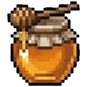 | 148x148 | unused |  | `pixel/__reuse/food/honey_jar.png` |

## header

| Name | Picture | Size | Status | Used by | Source file |
| --- | --- | --- | --- | --- | --- |
| `reuse_header_coin_bag` |  | 64x64 | unused |  | `pixel/__reuse/header/coin_bag.png` |
| `reuse_header_crossed_swords` |  | 64x64 | unused |  | `pixel/__reuse/header/crossed_swords.png` |
| `reuse_header_key` |  | 64x64 | unused |  | `pixel/__reuse/header/key.png` |
| `reuse_header_red_potion` |  | 64x64 | unused |  | `pixel/__reuse/header/red_potion.png` |
| `reuse_header_rune_book` |  | 64x64 | unused |  | `pixel/__reuse/header/rune_book.png` |
| `reuse_header_sword` | 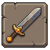 | 64x64 | unused |  | `pixel/__reuse/header/sword.png` |
| `reuse_header_teal_shield` |  | 64x64 | unused |  | `pixel/__reuse/header/teal_shield.png` |

## legendary

| Name | Picture | Size | Status | Used by | Source file |
| --- | --- | --- | --- | --- | --- |
| `reuse_legendary_sf_b4884690_b36` |  | 65x65 | unused |  | `pixel/__reuse/legendary/sprite-fusion-b4884690-b36e-4e90-a605-d65e49a32a54.png` |

## pixel/pets (not named by the code)

| Name | Picture | Size | Status | Used by | Source file |
| --- | --- | --- | --- | --- | --- |
| `loose_pets_brown_cute_pet_cat` |  | 512x64 | unused |  | `pixel/pets/brown-cute-pet-cat-walking-6a21-spritesheet.png` |
| `loose_pets_cute_pet_hamster_w` |  | 512x64 | unused |  | `pixel/pets/cute-pet-hamster-walking-bb8b-spritesheet.png` |
| `loose_pets_dachshund_jumping_` |  | 512x64 | unused |  | `pixel/pets/dachshund-jumping-and-walking-running-forward-620e-spritesheet.png` |
| `loose_pets_sprite_32x32px_6f_` |  | 96x64 | unused |  | `pixel/pets/sprite-32x32px-6f-sheet.png` |
| `pet_special_kaczkawu_dog_reserved` |  | 84x84 | used | code | `pixel/pets/kaczkawu_dog.png` |

## potions

| Name | Picture | Size | Status | Used by | Source file |
| --- | --- | --- | --- | --- | --- |
| `reuse_potions_pink_potion` |  | 64x64 | unused |  | `pixel/__reuse/potions/pink_potion.png` |

## skills

| Name | Picture | Size | Status | Used by | Source file |
| --- | --- | --- | --- | --- | --- |
| `reuse_skills_chain_orbs` | 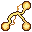 | 32x32 | unused |  | `pixel/__reuse/skills/chain_orbs.png` |
| `reuse_skills_comet` |  | 32x32 | unused |  | `pixel/__reuse/skills/comet.png` |
| `reuse_skills_evil_eye` |  | 32x32 | unused |  | `pixel/__reuse/skills/evil_eye.png` |
| `reuse_skills_flame_hand` | 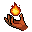 | 32x32 | unused |  | `pixel/__reuse/skills/flame_hand.png` |
| `reuse_skills_green_swirl` |  | 32x32 | unused |  | `pixel/__reuse/skills/green_swirl.png` |
| `reuse_skills_jade_spire` | 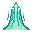 | 32x32 | unused |  | `pixel/__reuse/skills/jade_spire.png` |
| `reuse_skills_starburst` |  | 32x32 | unused |  | `pixel/__reuse/skills/starburst.png` |
| `reuse_skills_void_meteor` |  | 32x32 | unused |  | `pixel/__reuse/skills/void_meteor.png` |
| `reuse_skills_whirlwind` |  | 32x32 | unused |  | `pixel/__reuse/skills/whirlwind.png` |

## tools

| Name | Picture | Size | Status | Used by | Source file |
| --- | --- | --- | --- | --- | --- |
| `reuse_tools_arrows` |  | 153x153 | unused |  | `pixel/__reuse/tools/arrows.png` |
| `reuse_tools_bear_trap` |  | 158x158 | unused |  | `pixel/__reuse/tools/bear_trap.png` |
| `reuse_tools_bow` |  | 158x158 | unused |  | `pixel/__reuse/tools/bow.png` |
| `reuse_tools_crucible` | 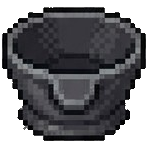 | 148x148 | unused |  | `pixel/__reuse/tools/crucible.png` |
| `reuse_tools_hammer` | 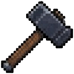 | 153x153 | unused |  | `pixel/__reuse/tools/hammer.png` |
| `reuse_tools_hand_axe` | 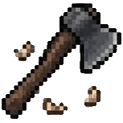 | 153x153 | unused |  | `pixel/__reuse/tools/hand_axe.png` |
| `reuse_tools_hourglass` | 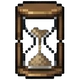 | 158x158 | unused |  | `pixel/__reuse/tools/hourglass.png` |
| `reuse_tools_iron_sword` |  | 153x153 | unused |  | `pixel/__reuse/tools/iron_sword.png` |
| `reuse_tools_shackles` | 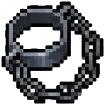 | 148x148 | unused |  | `pixel/__reuse/tools/shackles.png` |
| `reuse_tools_torch` | 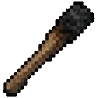 | 143x143 | unused |  | `pixel/__reuse/tools/torch.png` |

## valuables

| Name | Picture | Size | Status | Used by | Source file |
| --- | --- | --- | --- | --- | --- |
| `reuse_valuables_crystal_ball` |  | 153x153 | unused |  | `pixel/__reuse/valuables/crystal_ball.png` |
| `reuse_valuables_dagger` | 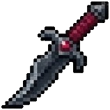 | 158x158 | unused |  | `pixel/__reuse/valuables/dagger.png` |
| `reuse_valuables_goblet` | 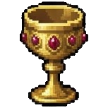 | 153x153 | unused |  | `pixel/__reuse/valuables/goblet.png` |
| `reuse_valuables_gold_amulet` |  | 162x162 | unused |  | `pixel/__reuse/valuables/gold_amulet.png` |
| `reuse_valuables_gold_ring` | 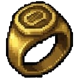 | 132x132 | unused |  | `pixel/__reuse/valuables/gold_ring.png` |
| `reuse_valuables_golden_egg` |  | 139x139 | unused |  | `pixel/__reuse/valuables/golden_egg.png` |
| `reuse_valuables_phoenix_feather` | 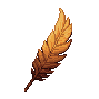 | 99x99 | unused |  | `pixel/__reuse/valuables/phoenix_feather.png` |
| `reuse_valuables_rune_stone` | 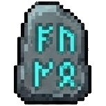 | 153x153 | unused |  | `pixel/__reuse/valuables/rune_stone.png` |
| `reuse_valuables_sealed_scroll` |  | 144x144 | unused |  | `pixel/__reuse/valuables/sealed_scroll.png` |
| `reuse_valuables_silver_key` |  | 147x147 | unused |  | `pixel/__reuse/valuables/silver_key.png` |
| `reuse_valuables_silver_medal` | 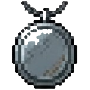 | 148x148 | unused |  | `pixel/__reuse/valuables/silver_medal.png` |
| `reuse_valuables_spellbook` |  | 158x158 | unused |  | `pixel/__reuse/valuables/spellbook.png` |
