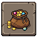
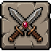
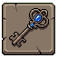
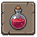
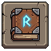
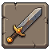
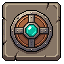

# Unsorted cuts

Generated by `npm run assets:catalog` from the game registries and `public/pixel/`. Do not edit by hand: rename an asset in `scripts/assets/names.json`.

Loose cuts in public/pixel/reuse, not classified yet.

13 assets. Refer to an asset by its **name**.

## header

| Name | Picture | Size | Status | Used by | Source file |
| --- | --- | --- | --- | --- | --- |
| `reuse_header_coin_bag` |  | 64x64 | reuse |  | `pixel/reuse/header/coin_bag.png` |
| `reuse_header_crossed_swords` |  | 64x64 | reuse |  | `pixel/reuse/header/crossed_swords.png` |
| `reuse_header_key` |  | 64x64 | reuse |  | `pixel/reuse/header/key.png` |
| `reuse_header_red_potion` |  | 64x64 | reuse |  | `pixel/reuse/header/red_potion.png` |
| `reuse_header_rune_book` |  | 64x64 | reuse |  | `pixel/reuse/header/rune_book.png` |
| `reuse_header_sword` |  | 64x64 | reuse |  | `pixel/reuse/header/sword.png` |
| `reuse_header_teal_shield` |  | 64x64 | reuse |  | `pixel/reuse/header/teal_shield.png` |

## legendary

| Name | Picture | Size | Status | Used by | Source file |
| --- | --- | --- | --- | --- | --- |
| `reuse_legendary_sf_b4884690_b36` |  | 65x65 | reuse |  | `pixel/reuse/legendary/sprite-fusion-b4884690-b36e-4e90-a605-d65e49a32a54.png` |

## misc

| Name | Picture | Size | Status | Used by | Source file |
| --- | --- | --- | --- | --- | --- |
| `reuse_misc_lll` |  | 64x64 | reuse |  | `pixel/reuse/misc/lll.png` |
| `reuse_misc_sf_34b0833d_e74` |  | 64x64 | reuse |  | `pixel/reuse/misc/sprite-fusion-34b0833d-e747-4265-8899-64340626e0a7.png` |
| `reuse_misc_sf_644e75bb_39e` |  | 32x32 | reuse |  | `pixel/reuse/misc/sprite-fusion-644e75bb-39ed-495c-a46d-fddde92cee29.png` |
| `reuse_misc_sf_c7a3d0d7_d40` |  | 64x64 | reuse |  | `pixel/reuse/misc/sprite-fusion-c7a3d0d7-d409-4f79-8f3c-6b5775dbe6cb.png` |
| `reuse_misc_th` |  | 69x69 | reuse |  | `pixel/reuse/misc/th.png` |
