# Unsorted cuts

Generated by `npm run assets:catalog` from the game registries and `public/pixel/`. Do not edit by hand: rename an asset in `scripts/assets/names.json`.

Loose cuts in public/pixel/reuse, not classified yet.

125 assets. Refer to an asset by its **name**.

## drops

| Name | Picture | Size | Status | Used by | Source file |
| --- | --- | --- | --- | --- | --- |
| `reuse_drops_beetle` | 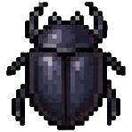 | 148x148 | reuse |  | `pixel/reuse/drops/beetle.png` |
| `reuse_drops_black_feather` | 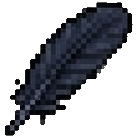 | 138x138 | reuse |  | `pixel/reuse/drops/black_feather.png` |
| `reuse_drops_dark_spine` | 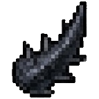 | 143x143 | reuse |  | `pixel/reuse/drops/dark_spine.png` |
| `reuse_drops_fang` | 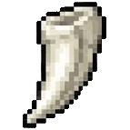 | 143x143 | reuse |  | `pixel/reuse/drops/fang.png` |
| `reuse_drops_fur_pelt` | 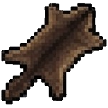 | 153x153 | reuse |  | `pixel/reuse/drops/fur_pelt.png` |
| `reuse_drops_goblin_ear` | 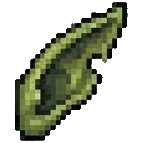 | 143x143 | reuse |  | `pixel/reuse/drops/goblin_ear.png` |
| `reuse_drops_lizard_hide` | 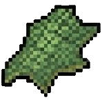 | 148x148 | reuse |  | `pixel/reuse/drops/lizard_hide.png` |
| `reuse_drops_thread_spool` | 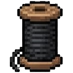 | 148x148 | reuse |  | `pixel/reuse/drops/thread_spool.png` |
| `reuse_drops_wool` | 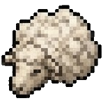 | 148x148 | reuse |  | `pixel/reuse/drops/wool.png` |

## food

| Name | Picture | Size | Status | Used by | Source file |
| --- | --- | --- | --- | --- | --- |
| `reuse_food_apple` | 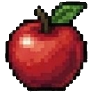 | 134x134 | reuse |  | `pixel/reuse/food/apple.png` |
| `reuse_food_cheese_bread` | 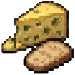 | 153x153 | reuse |  | `pixel/reuse/food/cheese_bread.png` |
| `reuse_food_cheese_wheel` | 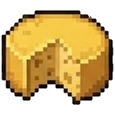 | 143x143 | reuse |  | `pixel/reuse/food/cheese_wheel.png` |
| `reuse_food_drumstick` | 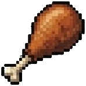 | 148x148 | reuse |  | `pixel/reuse/food/drumstick.png` |
| `reuse_food_honey_jar` | 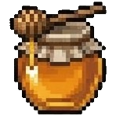 | 148x148 | reuse |  | `pixel/reuse/food/honey_jar.png` |

## gems

| Name | Picture | Size | Status | Used by | Source file |
| --- | --- | --- | --- | --- | --- |
| `reuse_gems_amethyst` | 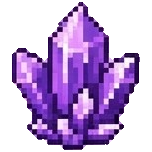 | 152x152 | reuse |  | `pixel/reuse/gems/amethyst.png` |
| `reuse_gems_diamond` | 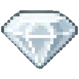 | 131x131 | reuse |  | `pixel/reuse/gems/diamond.png` |
| `reuse_gems_emerald` | 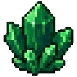 | 153x153 | reuse |  | `pixel/reuse/gems/emerald.png` |
| `reuse_gems_ruby` | 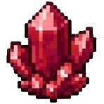 | 148x148 | reuse |  | `pixel/reuse/gems/ruby.png` |
| `reuse_gems_sapphire` | 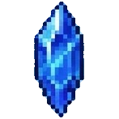 | 147x147 | reuse |  | `pixel/reuse/gems/sapphire.png` |
| `reuse_gems_topaz` | 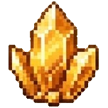 | 152x152 | reuse |  | `pixel/reuse/gems/topaz.png` |

## glassware

| Name | Picture | Size | Status | Used by | Source file |
| --- | --- | --- | --- | --- | --- |
| `reuse_glassware_cracked_flask` | 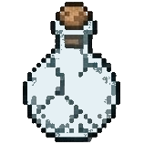 | 158x158 | reuse |  | `pixel/reuse/glassware/cracked_flask.png` |
| `reuse_glassware_empty_flask` | 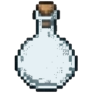 | 158x158 | reuse |  | `pixel/reuse/glassware/empty_flask.png` |
| `reuse_glassware_glass_jar` | 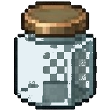 | 158x158 | reuse |  | `pixel/reuse/glassware/glass_jar.png` |
| `reuse_glassware_mushroom_jar` | 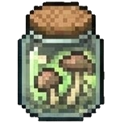 | 153x153 | reuse |  | `pixel/reuse/glassware/mushroom_jar.png` |
| `reuse_glassware_rope_bottle` | 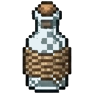 | 158x158 | reuse |  | `pixel/reuse/glassware/rope_bottle.png` |
| `reuse_glassware_test_tube` | 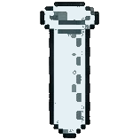 | 158x158 | reuse |  | `pixel/reuse/glassware/test_tube.png` |

## header

| Name | Picture | Size | Status | Used by | Source file |
| --- | --- | --- | --- | --- | --- |
| `reuse_header_coin_bag` |  | 64x64 | reuse |  | `pixel/reuse/header/coin_bag.png` |
| `reuse_header_crossed_swords` |  | 64x64 | reuse |  | `pixel/reuse/header/crossed_swords.png` |
| `reuse_header_key` |  | 64x64 | reuse |  | `pixel/reuse/header/key.png` |
| `reuse_header_red_potion` |  | 64x64 | reuse |  | `pixel/reuse/header/red_potion.png` |
| `reuse_header_rune_book` |  | 64x64 | reuse |  | `pixel/reuse/header/rune_book.png` |
| `reuse_header_sword` |  | 64x64 | reuse |  | `pixel/reuse/header/sword.png` |
| `reuse_header_teal_shield` |  | 64x64 | reuse |  | `pixel/reuse/header/teal_shield.png` |

## junk

| Name | Picture | Size | Status | Used by | Source file |
| --- | --- | --- | --- | --- | --- |
| `reuse_junk_animal_skull` | 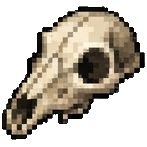 | 147x147 | reuse |  | `pixel/reuse/junk/animal_skull.png` |
| `reuse_junk_bandage` | 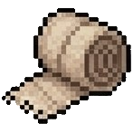 | 147x147 | reuse |  | `pixel/reuse/junk/bandage.png` |
| `reuse_junk_barrel` | 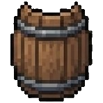 | 148x148 | reuse |  | `pixel/reuse/junk/barrel.png` |
| `reuse_junk_bone_awl` | 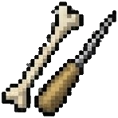 | 148x148 | reuse |  | `pixel/reuse/junk/bone_awl.png` |
| `reuse_junk_broken_sword` | 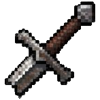 | 147x147 | reuse |  | `pixel/reuse/junk/broken_sword.png` |
| `reuse_junk_burlap` | 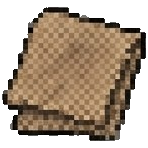 | 148x148 | reuse |  | `pixel/reuse/junk/burlap.png` |
| `reuse_junk_candle` | 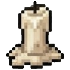 | 117x117 | reuse |  | `pixel/reuse/junk/candle.png` |
| `reuse_junk_chain_tangle` | 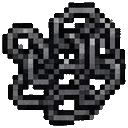 | 128x128 | reuse |  | `pixel/reuse/junk/chain_tangle.png` |
| `reuse_junk_clay_pot` | 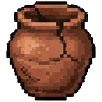 | 147x147 | reuse |  | `pixel/reuse/junk/clay_pot.png` |
| `reuse_junk_clay_pot_big` | 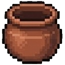 | 133x133 | reuse |  | `pixel/reuse/junk/clay_pot_big.png` |
| `reuse_junk_cog_wheel` | 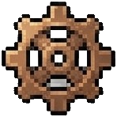 | 148x148 | reuse |  | `pixel/reuse/junk/cog_wheel.png` |
| `reuse_junk_glass_bottle` | 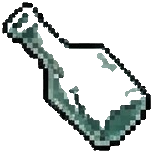 | 153x153 | reuse |  | `pixel/reuse/junk/glass_bottle.png` |
| `reuse_junk_horseshoe` | 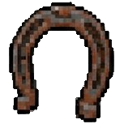 | 153x153 | reuse |  | `pixel/reuse/junk/horseshoe.png` |
| `reuse_junk_nails` | 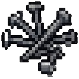 | 133x133 | reuse |  | `pixel/reuse/junk/nails.png` |
| `reuse_junk_old_boot` | 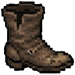 | 149x149 | reuse |  | `pixel/reuse/junk/old_boot.png` |
| `reuse_junk_old_key` | 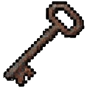 | 148x148 | reuse |  | `pixel/reuse/junk/old_key.png` |
| `reuse_junk_parchment` | 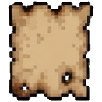 | 148x148 | reuse |  | `pixel/reuse/junk/parchment.png` |
| `reuse_junk_strapped_crate` | 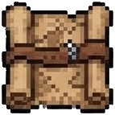 | 143x143 | reuse |  | `pixel/reuse/junk/strapped_crate.png` |
| `reuse_junk_tankard` | 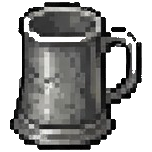 | 152x152 | reuse |  | `pixel/reuse/junk/tankard.png` |
| `reuse_junk_voodoo_doll` | 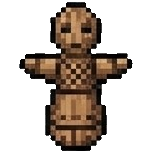 | 153x153 | reuse |  | `pixel/reuse/junk/voodoo_doll.png` |
| `reuse_junk_wagon_wheel` | 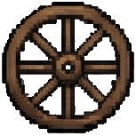 | 153x153 | reuse |  | `pixel/reuse/junk/wagon_wheel.png` |
| `reuse_junk_wire_coil` | 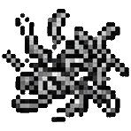 | 148x148 | reuse |  | `pixel/reuse/junk/wire_coil.png` |
| `reuse_junk_yarn_ball` | 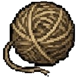 | 129x129 | reuse |  | `pixel/reuse/junk/yarn_ball.png` |

## legendary

| Name | Picture | Size | Status | Used by | Source file |
| --- | --- | --- | --- | --- | --- |
| `reuse_legendary_sf_b4884690_b36` |  | 65x65 | reuse |  | `pixel/reuse/legendary/sprite-fusion-b4884690-b36e-4e90-a605-d65e49a32a54.png` |

## materials

| Name | Picture | Size | Status | Used by | Source file |
| --- | --- | --- | --- | --- | --- |
| `reuse_materials_ash_bowl` | 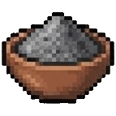 | 143x143 | reuse |  | `pixel/reuse/materials/ash_bowl.png` |
| `reuse_materials_blue_powder` |  | 132x132 | reuse |  | `pixel/reuse/materials/blue_powder.png` |
| `reuse_materials_cloth_bolt` |  | 153x153 | reuse |  | `pixel/reuse/materials/cloth_bolt.png` |
| `reuse_materials_dust_bottle` |  | 148x148 | reuse |  | `pixel/reuse/materials/dust_bottle.png` |
| `reuse_materials_gold_ingot` |  | 153x153 | reuse |  | `pixel/reuse/materials/gold_ingot.png` |
| `reuse_materials_gold_thread` |  | 148x148 | reuse |  | `pixel/reuse/materials/gold_thread.png` |
| `reuse_materials_herb_bundle` |  | 143x143 | reuse |  | `pixel/reuse/materials/herb_bundle.png` |
| `reuse_materials_hot_ingot` |  | 148x148 | reuse |  | `pixel/reuse/materials/hot_ingot.png` |
| `reuse_materials_iron_ingot` |  | 153x153 | reuse |  | `pixel/reuse/materials/iron_ingot.png` |
| `reuse_materials_leather_roll` |  | 158x158 | reuse |  | `pixel/reuse/materials/leather_roll.png` |
| `reuse_materials_logs` |  | 153x153 | reuse |  | `pixel/reuse/materials/logs.png` |
| `reuse_materials_plank` |  | 148x148 | reuse |  | `pixel/reuse/materials/plank.png` |
| `reuse_materials_raw_hide` |  | 158x158 | reuse |  | `pixel/reuse/materials/raw_hide.png` |
| `reuse_materials_rope_coil` |  | 148x148 | reuse |  | `pixel/reuse/materials/rope_coil.png` |
| `reuse_materials_sawdust` |  | 143x143 | reuse |  | `pixel/reuse/materials/sawdust.png` |
| `reuse_materials_stone_block` |  | 138x138 | reuse |  | `pixel/reuse/materials/stone_block.png` |
| `reuse_materials_yellow_powder` |  | 148x148 | reuse |  | `pixel/reuse/materials/yellow_powder.png` |

## misc

| Name | Picture | Size | Status | Used by | Source file |
| --- | --- | --- | --- | --- | --- |
| `reuse_misc_lll` |  | 64x64 | reuse |  | `pixel/reuse/misc/lll.png` |
| `reuse_misc_sf_34b0833d_e74` |  | 64x64 | reuse |  | `pixel/reuse/misc/sprite-fusion-34b0833d-e747-4265-8899-64340626e0a7.png` |
| `reuse_misc_sf_644e75bb_39e` |  | 32x32 | reuse |  | `pixel/reuse/misc/sprite-fusion-644e75bb-39ed-495c-a46d-fddde92cee29.png` |
| `reuse_misc_sf_c7a3d0d7_d40` |  | 64x64 | reuse |  | `pixel/reuse/misc/sprite-fusion-c7a3d0d7-d409-4f79-8f3c-6b5775dbe6cb.png` |
| `reuse_misc_th` |  | 69x69 | reuse |  | `pixel/reuse/misc/th.png` |

## ores

| Name | Picture | Size | Status | Used by | Source file |
| --- | --- | --- | --- | --- | --- |
| `reuse_ores_coal` |  | 138x138 | reuse |  | `pixel/reuse/ores/coal.png` |
| `reuse_ores_copper_ore` |  | 143x143 | reuse |  | `pixel/reuse/ores/copper_ore.png` |
| `reuse_ores_dark_ore` |  | 147x147 | reuse |  | `pixel/reuse/ores/dark_ore.png` |
| `reuse_ores_gold_ore` |  | 148x148 | reuse |  | `pixel/reuse/ores/gold_ore.png` |
| `reuse_ores_iron_ore` |  | 138x138 | reuse |  | `pixel/reuse/ores/iron_ore.png` |
| `reuse_ores_silver_ore` |  | 133x133 | reuse |  | `pixel/reuse/ores/silver_ore.png` |

## pets

| Name | Picture | Size | Status | Used by | Source file |
| --- | --- | --- | --- | --- | --- |
| `pet_special_kaczkawu_dog_reserved` |  | 84x84 | reuse |  | `pixel/reuse/pets/kaczkawu_dog.png` |
| `reuse_pets_cat_black_white` |  | 64x64 | reuse |  | `pixel/reuse/pets/cat_black_white.png` |
| `reuse_pets_pet_silhouette` |  | 64x64 | reuse |  | `pixel/reuse/pets/pet_silhouette.png` |

## potions

| Name | Picture | Size | Status | Used by | Source file |
| --- | --- | --- | --- | --- | --- |
| `reuse_potions_blue_elixir` |  | 148x148 | reuse |  | `pixel/reuse/potions/blue_elixir.png` |
| `reuse_potions_green_potion` |  | 148x148 | reuse |  | `pixel/reuse/potions/green_potion.png` |
| `reuse_potions_oil_bottle` |  | 153x153 | reuse |  | `pixel/reuse/potions/oil_bottle.png` |
| `reuse_potions_ointment_tin` |  | 143x143 | reuse |  | `pixel/reuse/potions/ointment_tin.png` |
| `reuse_potions_orange_vial` |  | 143x143 | reuse |  | `pixel/reuse/potions/orange_vial.png` |
| `reuse_potions_pink_potion` |  | 64x64 | reuse |  | `pixel/reuse/potions/pink_potion.png` |
| `reuse_potions_purple_potion` |  | 158x158 | reuse |  | `pixel/reuse/potions/purple_potion.png` |
| `reuse_potions_red_elixir` |  | 148x148 | reuse |  | `pixel/reuse/potions/red_elixir.png` |
| `reuse_potions_red_potion` |  | 148x148 | reuse |  | `pixel/reuse/potions/red_potion.png` |

## tools

| Name | Picture | Size | Status | Used by | Source file |
| --- | --- | --- | --- | --- | --- |
| `reuse_tools_arrows` |  | 153x153 | reuse |  | `pixel/reuse/tools/arrows.png` |
| `reuse_tools_bear_trap` |  | 158x158 | reuse |  | `pixel/reuse/tools/bear_trap.png` |
| `reuse_tools_bow` |  | 158x158 | reuse |  | `pixel/reuse/tools/bow.png` |
| `reuse_tools_crucible` |  | 148x148 | reuse |  | `pixel/reuse/tools/crucible.png` |
| `reuse_tools_hammer` |  | 153x153 | reuse |  | `pixel/reuse/tools/hammer.png` |
| `reuse_tools_hand_axe` |  | 153x153 | reuse |  | `pixel/reuse/tools/hand_axe.png` |
| `reuse_tools_hourglass` |  | 158x158 | reuse |  | `pixel/reuse/tools/hourglass.png` |
| `reuse_tools_iron_sword` |  | 153x153 | reuse |  | `pixel/reuse/tools/iron_sword.png` |
| `reuse_tools_lantern` |  | 153x153 | reuse |  | `pixel/reuse/tools/lantern.png` |
| `reuse_tools_mortar` |  | 148x148 | reuse |  | `pixel/reuse/tools/mortar.png` |
| `reuse_tools_pickaxe` |  | 148x148 | reuse |  | `pixel/reuse/tools/pickaxe.png` |
| `reuse_tools_rope` |  | 148x148 | reuse |  | `pixel/reuse/tools/rope.png` |
| `reuse_tools_shackles` |  | 148x148 | reuse |  | `pixel/reuse/tools/shackles.png` |
| `reuse_tools_torch` |  | 143x143 | reuse |  | `pixel/reuse/tools/torch.png` |

## valuables

| Name | Picture | Size | Status | Used by | Source file |
| --- | --- | --- | --- | --- | --- |
| `reuse_valuables_coin_pouch` |  | 143x143 | reuse |  | `pixel/reuse/valuables/coin_pouch.png` |
| `reuse_valuables_crystal_ball` |  | 153x153 | reuse |  | `pixel/reuse/valuables/crystal_ball.png` |
| `reuse_valuables_dagger` |  | 158x158 | reuse |  | `pixel/reuse/valuables/dagger.png` |
| `reuse_valuables_goblet` |  | 153x153 | reuse |  | `pixel/reuse/valuables/goblet.png` |
| `reuse_valuables_gold_amulet` |  | 162x162 | reuse |  | `pixel/reuse/valuables/gold_amulet.png` |
| `reuse_valuables_gold_ring` |  | 132x132 | reuse |  | `pixel/reuse/valuables/gold_ring.png` |
| `reuse_valuables_golden_egg` |  | 139x139 | reuse |  | `pixel/reuse/valuables/golden_egg.png` |
| `reuse_valuables_phoenix_feather` |  | 99x99 | reuse |  | `pixel/reuse/valuables/phoenix_feather.png` |
| `reuse_valuables_rune_stone` |  | 153x153 | reuse |  | `pixel/reuse/valuables/rune_stone.png` |
| `reuse_valuables_sealed_scroll` |  | 144x144 | reuse |  | `pixel/reuse/valuables/sealed_scroll.png` |
| `reuse_valuables_silver_key` |  | 147x147 | reuse |  | `pixel/reuse/valuables/silver_key.png` |
| `reuse_valuables_silver_medal` |  | 148x148 | reuse |  | `pixel/reuse/valuables/silver_medal.png` |
| `reuse_valuables_spellbook` |  | 158x158 | reuse |  | `pixel/reuse/valuables/spellbook.png` |
| `reuse_valuables_treasure_chest` |  | 153x153 | reuse |  | `pixel/reuse/valuables/treasure_chest.png` |
