# Weapons

Generated by `npm run assets:catalog` from the game registries and `public/pixel/`. Do not edit by hand: rename an asset in `scripts/assets/names.json`.

Main-hand and off-hand icons (swords, axes, bows, staves, shields, tomes ...), by grade.

197 assets. Refer to an asset by its **name**.

## mainHand/axe

| Name | Picture | Size | Status | Used by | Source file |
| --- | --- | --- | --- | --- | --- |
| `art_reapers_crescent` |  | 64x64 | planned | reapers_crescent | `pixel/items/legendary/reapers_crescent.png` |
| `art_tidecaller_axe` |  | 64x64 | planned | tidecaller_axe | `pixel/items/legendary/tidecaller_axe.png` |
| `item_battle_axe` |  | 40x40 | planned | battle_axe | `pixel/icons/item_battle_axe.png` |

## mainHand/axe G1

| Name | Picture | Size | Status | Used by | Source file |
| --- | --- | --- | --- | --- | --- |
| `item_hatchet` |  | 40x40 | used | hatchet | `pixel/icons/item_hatchet.png` |

## mainHand/axe G2

| Name | Picture | Size | Status | Used by | Source file |
| --- | --- | --- | --- | --- | --- |
| `item_bronze_axe` |  | 40x40 | used | bronze_axe | `pixel/icons/item_bronze_axe.png` |

## mainHand/axe G3

| Name | Picture | Size | Status | Used by | Source file |
| --- | --- | --- | --- | --- | --- |
| `item_iron_axe` |  | 40x40 | used | iron_axe | `pixel/icons/item_iron_axe.png` |

## mainHand/axe G4

| Name | Picture | Size | Status | Used by | Source file |
| --- | --- | --- | --- | --- | --- |
| `art_ph_mainHand_axe_g4` |  | 64x64 | placeholder |  | `pixel/items/mainHand/axe/ph_g4.png` |

## mainHand/axe G5

| Name | Picture | Size | Status | Used by | Source file |
| --- | --- | --- | --- | --- | --- |
| `art_ph_mainHand_axe_g5` |  | 64x64 | placeholder |  | `pixel/items/mainHand/axe/ph_g5.png` |

## mainHand/axe G6

| Name | Picture | Size | Status | Used by | Source file |
| --- | --- | --- | --- | --- | --- |
| `art_ph_mainHand_axe_g6` |  | 64x64 | placeholder |  | `pixel/items/mainHand/axe/ph_g6.png` |

## mainHand/axe G7

| Name | Picture | Size | Status | Used by | Source file |
| --- | --- | --- | --- | --- | --- |
| `art_ph_mainHand_axe_g7` |  | 64x64 | placeholder |  | `pixel/items/mainHand/axe/ph_g7.png` |

## mainHand/axe G8

| Name | Picture | Size | Status | Used by | Source file |
| --- | --- | --- | --- | --- | --- |
| `art_ph_mainHand_axe_g8` |  | 64x64 | placeholder |  | `pixel/items/mainHand/axe/ph_g8.png` |

## mainHand/axe G9

| Name | Picture | Size | Status | Used by | Source file |
| --- | --- | --- | --- | --- | --- |
| `art_ph_mainHand_axe_g9` |  | 64x64 | placeholder |  | `pixel/items/mainHand/axe/ph_g9.png` |

## mainHand/axe S1

| Name | Picture | Size | Status | Used by | Source file |
| --- | --- | --- | --- | --- | --- |
| `art_ph_mainHand_axe_s1` |  | 64x64 | placeholder |  | `pixel/items/mainHand/axe/ph_s1.png` |

## mainHand/axe S2

| Name | Picture | Size | Status | Used by | Source file |
| --- | --- | --- | --- | --- | --- |
| `art_ph_mainHand_axe_s2` |  | 64x64 | placeholder |  | `pixel/items/mainHand/axe/ph_s2.png` |

## mainHand/axe S3

| Name | Picture | Size | Status | Used by | Source file |
| --- | --- | --- | --- | --- | --- |
| `art_ph_mainHand_axe_s3` |  | 64x64 | placeholder |  | `pixel/items/mainHand/axe/ph_s3.png` |

## mainHand/bow

| Name | Picture | Size | Status | Used by | Source file |
| --- | --- | --- | --- | --- | --- |
| `art_cinderflight_bow` |  | 64x64 | planned | cinderflight_bow | `pixel/items/legendary/cinderflight_bow.png` |
| `item_hunting_bow` |  | 40x40 | used | hunting_bow | `pixel/icons/item_hunting_bow.png` |
| `item_obsidian_longbow` |  | 40x40 | used | obsidian_longbow | `pixel/icons/item_obsidian_longbow.png` |
| `item_recurve_bow` |  | 40x40 | planned | recurve_bow | `pixel/icons/item_recurve_bow.png` |
| `item_starfall_bow` |  | 40x40 | used | starfall_bow | `pixel/icons/item_starfall_bow.png` |

## mainHand/bow G1

| Name | Picture | Size | Status | Used by | Source file |
| --- | --- | --- | --- | --- | --- |
| `item_twig_bow` |  | 40x40 | used | twig_bow | `pixel/icons/item_twig_bow.png` |

## mainHand/bow G2

| Name | Picture | Size | Status | Used by | Source file |
| --- | --- | --- | --- | --- | --- |
| `art_ph_mainHand_bow_g2` |  | 64x64 | placeholder |  | `pixel/items/mainHand/bow/ph_g2.png` |

## mainHand/bow G3

| Name | Picture | Size | Status | Used by | Source file |
| --- | --- | --- | --- | --- | --- |
| `item_yew_bow` |  | 40x40 | used | yew_bow | `pixel/icons/item_yew_bow.png` |

## mainHand/bow G4

| Name | Picture | Size | Status | Used by | Source file |
| --- | --- | --- | --- | --- | --- |
| `art_ph_mainHand_bow_g4` |  | 64x64 | placeholder |  | `pixel/items/mainHand/bow/ph_g4.png` |

## mainHand/bow G5

| Name | Picture | Size | Status | Used by | Source file |
| --- | --- | --- | --- | --- | --- |
| `art_ph_mainHand_bow_g5` |  | 64x64 | placeholder |  | `pixel/items/mainHand/bow/ph_g5.png` |

## mainHand/bow G6

| Name | Picture | Size | Status | Used by | Source file |
| --- | --- | --- | --- | --- | --- |
| `art_ph_mainHand_bow_g6` |  | 64x64 | placeholder |  | `pixel/items/mainHand/bow/ph_g6.png` |

## mainHand/bow G7

| Name | Picture | Size | Status | Used by | Source file |
| --- | --- | --- | --- | --- | --- |
| `art_ph_mainHand_bow_g7` |  | 64x64 | placeholder |  | `pixel/items/mainHand/bow/ph_g7.png` |

## mainHand/bow G8

| Name | Picture | Size | Status | Used by | Source file |
| --- | --- | --- | --- | --- | --- |
| `art_ph_mainHand_bow_g8` |  | 64x64 | placeholder |  | `pixel/items/mainHand/bow/ph_g8.png` |

## mainHand/bow G9

| Name | Picture | Size | Status | Used by | Source file |
| --- | --- | --- | --- | --- | --- |
| `art_ph_mainHand_bow_g9` |  | 64x64 | placeholder |  | `pixel/items/mainHand/bow/ph_g9.png` |

## mainHand/bow S1

| Name | Picture | Size | Status | Used by | Source file |
| --- | --- | --- | --- | --- | --- |
| `art_ph_mainHand_bow_s1` |  | 64x64 | placeholder |  | `pixel/items/mainHand/bow/ph_s1.png` |

## mainHand/bow S2

| Name | Picture | Size | Status | Used by | Source file |
| --- | --- | --- | --- | --- | --- |
| `art_ph_mainHand_bow_s2` |  | 64x64 | placeholder |  | `pixel/items/mainHand/bow/ph_s2.png` |

## mainHand/bow S3

| Name | Picture | Size | Status | Used by | Source file |
| --- | --- | --- | --- | --- | --- |
| `art_ph_mainHand_bow_s3` |  | 64x64 | placeholder |  | `pixel/items/mainHand/bow/ph_s3.png` |

## mainHand/crossbow

| Name | Picture | Size | Status | Used by | Source file |
| --- | --- | --- | --- | --- | --- |
| `item_obsidian_crossbow` |  | 40x40 | used | obsidian_crossbow | `pixel/icons/item_obsidian_crossbow.png` |

## mainHand/crossbow G1

| Name | Picture | Size | Status | Used by | Source file |
| --- | --- | --- | --- | --- | --- |
| `item_wooden_crossbow` |  | 40x40 | used | wooden_crossbow | `pixel/icons/item_wooden_crossbow.png` |

## mainHand/crossbow G2

| Name | Picture | Size | Status | Used by | Source file |
| --- | --- | --- | --- | --- | --- |
| `item_bronze_crossbow` |  | 40x40 | used | bronze_crossbow | `pixel/icons/item_bronze_crossbow.png` |

## mainHand/crossbow G3

| Name | Picture | Size | Status | Used by | Source file |
| --- | --- | --- | --- | --- | --- |
| `item_iron_crossbow` | 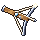 | 40x40 | used | iron_crossbow | `pixel/icons/item_iron_crossbow.png` |

## mainHand/crossbow G4

| Name | Picture | Size | Status | Used by | Source file |
| --- | --- | --- | --- | --- | --- |
| `art_ph_mainHand_crossbow_g4` |  | 64x64 | placeholder |  | `pixel/items/mainHand/crossbow/ph_g4.png` |

## mainHand/crossbow G5

| Name | Picture | Size | Status | Used by | Source file |
| --- | --- | --- | --- | --- | --- |
| `art_ph_mainHand_crossbow_g5` |  | 64x64 | placeholder |  | `pixel/items/mainHand/crossbow/ph_g5.png` |

## mainHand/crossbow G6

| Name | Picture | Size | Status | Used by | Source file |
| --- | --- | --- | --- | --- | --- |
| `art_ph_mainHand_crossbow_g6` |  | 64x64 | placeholder |  | `pixel/items/mainHand/crossbow/ph_g6.png` |

## mainHand/crossbow G7

| Name | Picture | Size | Status | Used by | Source file |
| --- | --- | --- | --- | --- | --- |
| `art_ph_mainHand_crossbow_g7` |  | 64x64 | placeholder |  | `pixel/items/mainHand/crossbow/ph_g7.png` |

## mainHand/crossbow G8

| Name | Picture | Size | Status | Used by | Source file |
| --- | --- | --- | --- | --- | --- |
| `art_ph_mainHand_crossbow_g8` |  | 64x64 | placeholder |  | `pixel/items/mainHand/crossbow/ph_g8.png` |

## mainHand/crossbow G9

| Name | Picture | Size | Status | Used by | Source file |
| --- | --- | --- | --- | --- | --- |
| `art_ph_mainHand_crossbow_g9` |  | 64x64 | placeholder |  | `pixel/items/mainHand/crossbow/ph_g9.png` |

## mainHand/crossbow S1

| Name | Picture | Size | Status | Used by | Source file |
| --- | --- | --- | --- | --- | --- |
| `art_ph_mainHand_crossbow_s1` |  | 64x64 | placeholder |  | `pixel/items/mainHand/crossbow/ph_s1.png` |

## mainHand/crossbow S2

| Name | Picture | Size | Status | Used by | Source file |
| --- | --- | --- | --- | --- | --- |
| `art_ph_mainHand_crossbow_s2` |  | 64x64 | placeholder |  | `pixel/items/mainHand/crossbow/ph_s2.png` |

## mainHand/crossbow S3

| Name | Picture | Size | Status | Used by | Source file |
| --- | --- | --- | --- | --- | --- |
| `art_ph_mainHand_crossbow_s3` |  | 64x64 | placeholder |  | `pixel/items/mainHand/crossbow/ph_s3.png` |

## mainHand/dagger

| Name | Picture | Size | Status | Used by | Source file |
| --- | --- | --- | --- | --- | --- |
| `item_obsidian_kris` | 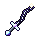 | 40x40 | used | obsidian_kris | `pixel/icons/item_obsidian_kris.png` |
| `item_steel_dagger` |  | 40x40 | planned | steel_dagger | `pixel/icons/item_steel_dagger.png` |

## mainHand/dagger G1

| Name | Picture | Size | Status | Used by | Source file |
| --- | --- | --- | --- | --- | --- |
| `item_bone_knife` | 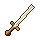 | 40x40 | used | bone_knife | `pixel/icons/item_bone_knife.png` |

## mainHand/dagger G2

| Name | Picture | Size | Status | Used by | Source file |
| --- | --- | --- | --- | --- | --- |
| `item_bronze_dirk` | 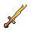 | 40x40 | used | bronze_dirk | `pixel/icons/item_bronze_dirk.png` |

## mainHand/dagger G3

| Name | Picture | Size | Status | Used by | Source file |
| --- | --- | --- | --- | --- | --- |
| `item_iron_dagger` | 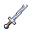 | 40x40 | used | iron_dagger | `pixel/icons/item_iron_dagger.png` |

## mainHand/dagger G4

| Name | Picture | Size | Status | Used by | Source file |
| --- | --- | --- | --- | --- | --- |
| `art_ph_mainHand_dagger_g4` |  | 64x64 | placeholder |  | `pixel/items/mainHand/dagger/ph_g4.png` |

## mainHand/dagger G5

| Name | Picture | Size | Status | Used by | Source file |
| --- | --- | --- | --- | --- | --- |
| `art_ph_mainHand_dagger_g5` |  | 64x64 | placeholder |  | `pixel/items/mainHand/dagger/ph_g5.png` |

## mainHand/dagger G6

| Name | Picture | Size | Status | Used by | Source file |
| --- | --- | --- | --- | --- | --- |
| `art_ph_mainHand_dagger_g6` |  | 64x64 | placeholder |  | `pixel/items/mainHand/dagger/ph_g6.png` |

## mainHand/dagger G7

| Name | Picture | Size | Status | Used by | Source file |
| --- | --- | --- | --- | --- | --- |
| `art_ph_mainHand_dagger_g7` |  | 64x64 | placeholder |  | `pixel/items/mainHand/dagger/ph_g7.png` |

## mainHand/dagger G8

| Name | Picture | Size | Status | Used by | Source file |
| --- | --- | --- | --- | --- | --- |
| `art_ph_mainHand_dagger_g8` |  | 64x64 | placeholder |  | `pixel/items/mainHand/dagger/ph_g8.png` |

## mainHand/dagger G9

| Name | Picture | Size | Status | Used by | Source file |
| --- | --- | --- | --- | --- | --- |
| `art_ph_mainHand_dagger_g9` |  | 64x64 | placeholder |  | `pixel/items/mainHand/dagger/ph_g9.png` |

## mainHand/dagger S1

| Name | Picture | Size | Status | Used by | Source file |
| --- | --- | --- | --- | --- | --- |
| `art_ph_mainHand_dagger_s1` |  | 64x64 | placeholder |  | `pixel/items/mainHand/dagger/ph_s1.png` |

## mainHand/dagger S2

| Name | Picture | Size | Status | Used by | Source file |
| --- | --- | --- | --- | --- | --- |
| `art_ph_mainHand_dagger_s2` |  | 64x64 | placeholder |  | `pixel/items/mainHand/dagger/ph_s2.png` |

## mainHand/dagger S3

| Name | Picture | Size | Status | Used by | Source file |
| --- | --- | --- | --- | --- | --- |
| `art_ph_mainHand_dagger_s3` |  | 64x64 | placeholder |  | `pixel/items/mainHand/dagger/ph_s3.png` |

## mainHand/mace

| Name | Picture | Size | Status | Used by | Source file |
| --- | --- | --- | --- | --- | --- |
| `item_steel_mace` |  | 40x40 | planned | steel_mace | `pixel/icons/item_steel_mace.png` |
| `item_wooden_club` |  | 40x40 | used | wooden_club | `pixel/icons/item_wooden_club.png` |

## mainHand/mace G1

| Name | Picture | Size | Status | Used by | Source file |
| --- | --- | --- | --- | --- | --- |
| `art_gnarled_club` |  | 64x64 | used | gnarled_club | `pixel/items/mainHand/mace/gnarled_club.png` |
| `art_knotted_cudgel` |  | 64x64 | used | knotted_cudgel | `pixel/items/mainHand/mace/knotted_cudgel.png` |
| `art_ph_mainHand_mace_g1` |  | 64x64 | placeholder |  | `pixel/items/mainHand/mace/ph_g1.png` |

## mainHand/mace G2

| Name | Picture | Size | Status | Used by | Source file |
| --- | --- | --- | --- | --- | --- |
| `art_bronze_mace` | 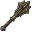 | 64x64 | used | bronze_mace | `pixel/items/mainHand/mace/bronze_mace.png` |
| `art_verdigris_mace` |  | 64x64 | used | verdigris_mace | `pixel/items/mainHand/mace/verdigris_mace.png` |

## mainHand/mace G3

| Name | Picture | Size | Status | Used by | Source file |
| --- | --- | --- | --- | --- | --- |
| `art_iron_mace` | 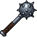 | 64x64 | used | iron_mace | `pixel/items/mainHand/mace/iron_mace.png` |
| `art_iron_morningstar` |  | 64x64 | used | iron_morningstar | `pixel/items/mainHand/mace/iron_morningstar.png` |
| `art_spiked_mace` |  | 64x64 | used | spiked_mace | `pixel/items/mainHand/mace/spiked_mace.png` |

## mainHand/mace G4

| Name | Picture | Size | Status | Used by | Source file |
| --- | --- | --- | --- | --- | --- |
| `art_ph_mainHand_mace_g4` |  | 64x64 | placeholder |  | `pixel/items/mainHand/mace/ph_g4.png` |

## mainHand/mace G5

| Name | Picture | Size | Status | Used by | Source file |
| --- | --- | --- | --- | --- | --- |
| `art_ph_mainHand_mace_g5` |  | 64x64 | placeholder |  | `pixel/items/mainHand/mace/ph_g5.png` |
| `art_sunburst_mace` |  | 64x64 | used | sunburst_mace | `pixel/items/mainHand/mace/sunburst_mace.png` |

## mainHand/mace G6

| Name | Picture | Size | Status | Used by | Source file |
| --- | --- | --- | --- | --- | --- |
| `art_deathgrin_mace` |  | 64x64 | used | deathgrin_mace | `pixel/items/mainHand/mace/deathgrin_mace.png` |
| `art_ph_mainHand_mace_g6` |  | 64x64 | placeholder |  | `pixel/items/mainHand/mace/ph_g6.png` |

## mainHand/mace G7

| Name | Picture | Size | Status | Used by | Source file |
| --- | --- | --- | --- | --- | --- |
| `art_frostcrystal_mace` |  | 64x64 | planned | frostcrystal_mace | `pixel/items/mainHand/mace/frostcrystal_mace.png` |
| `art_magma_flail` |  | 64x64 | planned | magma_flail | `pixel/items/mainHand/mace/magma_flail.png` |
| `art_ph_mainHand_mace_g7` |  | 64x64 | placeholder |  | `pixel/items/mainHand/mace/ph_g7.png` |

## mainHand/mace G8

| Name | Picture | Size | Status | Used by | Source file |
| --- | --- | --- | --- | --- | --- |
| `art_ph_mainHand_mace_g8` |  | 64x64 | placeholder |  | `pixel/items/mainHand/mace/ph_g8.png` |

## mainHand/mace G9

| Name | Picture | Size | Status | Used by | Source file |
| --- | --- | --- | --- | --- | --- |
| `art_ph_mainHand_mace_g9` |  | 64x64 | placeholder |  | `pixel/items/mainHand/mace/ph_g9.png` |

## mainHand/mace S1

| Name | Picture | Size | Status | Used by | Source file |
| --- | --- | --- | --- | --- | --- |
| `art_ph_mainHand_mace_s1` |  | 64x64 | placeholder |  | `pixel/items/mainHand/mace/ph_s1.png` |

## mainHand/mace S2

| Name | Picture | Size | Status | Used by | Source file |
| --- | --- | --- | --- | --- | --- |
| `art_ph_mainHand_mace_s2` |  | 64x64 | placeholder |  | `pixel/items/mainHand/mace/ph_s2.png` |

## mainHand/mace S3

| Name | Picture | Size | Status | Used by | Source file |
| --- | --- | --- | --- | --- | --- |
| `art_ph_mainHand_mace_s3` |  | 64x64 | placeholder |  | `pixel/items/mainHand/mace/ph_s3.png` |

## mainHand/maul

| Name | Picture | Size | Status | Used by | Source file |
| --- | --- | --- | --- | --- | --- |
| `art_runeforged_titanhammer` |  | 64x64 | planned | runeforged_titanhammer | `pixel/items/legendary/runeforged_titanhammer.png` |
| `item_obsidian_maul` |  | 40x40 | used | obsidian_maul | `pixel/icons/item_obsidian_maul.png` |
| `item_titan_maul` |  | 40x40 | used | titan_maul | `pixel/icons/item_titan_maul.png` |

## mainHand/maul G1

| Name | Picture | Size | Status | Used by | Source file |
| --- | --- | --- | --- | --- | --- |
| `art_log_maul` | 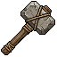 | 64x64 | used | log_maul | `pixel/items/mainHand/maul/log_maul.png` |
| `art_stone_hammer` |  | 64x64 | used | stone_hammer | `pixel/items/mainHand/maul/stone_hammer.png` |

## mainHand/maul G2

| Name | Picture | Size | Status | Used by | Source file |
| --- | --- | --- | --- | --- | --- |
| `item_bronze_hammer` |  | 40x40 | used | bronze_hammer | `pixel/icons/item_bronze_hammer.png` |

## mainHand/maul G3

| Name | Picture | Size | Status | Used by | Source file |
| --- | --- | --- | --- | --- | --- |
| `art_iron_maul` | 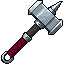 | 64x64 | used | iron_maul | `pixel/items/mainHand/maul/iron_maul.png` |
| `art_iron_warhammer` |  | 64x64 | used | iron_warhammer | `pixel/items/mainHand/maul/iron_warhammer.png` |

## mainHand/maul G4

| Name | Picture | Size | Status | Used by | Source file |
| --- | --- | --- | --- | --- | --- |
| `art_ph_mainHand_maul_g4` |  | 64x64 | placeholder |  | `pixel/items/mainHand/maul/ph_g4.png` |

## mainHand/maul G5

| Name | Picture | Size | Status | Used by | Source file |
| --- | --- | --- | --- | --- | --- |
| `art_ph_mainHand_maul_g5` |  | 64x64 | placeholder |  | `pixel/items/mainHand/maul/ph_g5.png` |
| `art_runed_warhammer` |  | 64x64 | used | runed_warhammer | `pixel/items/mainHand/maul/runed_warhammer.png` |

## mainHand/maul G6

| Name | Picture | Size | Status | Used by | Source file |
| --- | --- | --- | --- | --- | --- |
| `art_ph_mainHand_maul_g6` |  | 64x64 | placeholder |  | `pixel/items/mainHand/maul/ph_g6.png` |

## mainHand/maul G7

| Name | Picture | Size | Status | Used by | Source file |
| --- | --- | --- | --- | --- | --- |
| `art_ph_mainHand_maul_g7` |  | 64x64 | placeholder |  | `pixel/items/mainHand/maul/ph_g7.png` |

## mainHand/maul G8

| Name | Picture | Size | Status | Used by | Source file |
| --- | --- | --- | --- | --- | --- |
| `art_ph_mainHand_maul_g8` |  | 64x64 | placeholder |  | `pixel/items/mainHand/maul/ph_g8.png` |

## mainHand/maul G9

| Name | Picture | Size | Status | Used by | Source file |
| --- | --- | --- | --- | --- | --- |
| `art_ph_mainHand_maul_g9` |  | 64x64 | placeholder |  | `pixel/items/mainHand/maul/ph_g9.png` |

## mainHand/maul S1

| Name | Picture | Size | Status | Used by | Source file |
| --- | --- | --- | --- | --- | --- |
| `art_ph_mainHand_maul_s1` |  | 64x64 | placeholder |  | `pixel/items/mainHand/maul/ph_s1.png` |

## mainHand/maul S2

| Name | Picture | Size | Status | Used by | Source file |
| --- | --- | --- | --- | --- | --- |
| `art_ph_mainHand_maul_s2` |  | 64x64 | placeholder |  | `pixel/items/mainHand/maul/ph_s2.png` |

## mainHand/maul S3

| Name | Picture | Size | Status | Used by | Source file |
| --- | --- | --- | --- | --- | --- |
| `art_ph_mainHand_maul_s3` |  | 64x64 | placeholder |  | `pixel/items/mainHand/maul/ph_s3.png` |

## mainHand/spear

| Name | Picture | Size | Status | Used by | Source file |
| --- | --- | --- | --- | --- | --- |
| `art_cindercrescent_glaive` |  | 64x64 | planned | cindercrescent_glaive | `pixel/items/legendary/cindercrescent_glaive.png` |
| `art_dawnbringer_trident` |  | 64x64 | planned | dawnbringer_trident | `pixel/items/legendary/dawnbringer_trident.png` |
| `art_stormtrident` |  | 64x64 | planned | stormtrident | `pixel/items/legendary/stormtrident.png` |
| `item_steel_spear` |  | 40x40 | planned | steel_spear | `pixel/icons/item_steel_spear.png` |

## mainHand/spear G1

| Name | Picture | Size | Status | Used by | Source file |
| --- | --- | --- | --- | --- | --- |
| `item_sharpened_stick` | 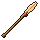 | 40x40 | used | sharpened_stick | `pixel/icons/item_sharpened_stick.png` |

## mainHand/spear G2

| Name | Picture | Size | Status | Used by | Source file |
| --- | --- | --- | --- | --- | --- |
| `item_bronze_spear` |  | 40x40 | used | bronze_spear | `pixel/icons/item_bronze_spear.png` |

## mainHand/spear G3

| Name | Picture | Size | Status | Used by | Source file |
| --- | --- | --- | --- | --- | --- |
| `item_iron_spear` |  | 40x40 | used | iron_spear | `pixel/icons/item_iron_spear.png` |

## mainHand/spear G4

| Name | Picture | Size | Status | Used by | Source file |
| --- | --- | --- | --- | --- | --- |
| `art_ph_mainHand_spear_g4` |  | 64x64 | placeholder |  | `pixel/items/mainHand/spear/ph_g4.png` |

## mainHand/spear G5

| Name | Picture | Size | Status | Used by | Source file |
| --- | --- | --- | --- | --- | --- |
| `art_ph_mainHand_spear_g5` |  | 64x64 | placeholder |  | `pixel/items/mainHand/spear/ph_g5.png` |

## mainHand/spear G6

| Name | Picture | Size | Status | Used by | Source file |
| --- | --- | --- | --- | --- | --- |
| `art_ph_mainHand_spear_g6` |  | 64x64 | placeholder |  | `pixel/items/mainHand/spear/ph_g6.png` |

## mainHand/spear G7

| Name | Picture | Size | Status | Used by | Source file |
| --- | --- | --- | --- | --- | --- |
| `art_ph_mainHand_spear_g7` |  | 64x64 | placeholder |  | `pixel/items/mainHand/spear/ph_g7.png` |

## mainHand/spear G8

| Name | Picture | Size | Status | Used by | Source file |
| --- | --- | --- | --- | --- | --- |
| `art_ph_mainHand_spear_g8` |  | 64x64 | placeholder |  | `pixel/items/mainHand/spear/ph_g8.png` |

## mainHand/spear G9

| Name | Picture | Size | Status | Used by | Source file |
| --- | --- | --- | --- | --- | --- |
| `art_ph_mainHand_spear_g9` |  | 64x64 | placeholder |  | `pixel/items/mainHand/spear/ph_g9.png` |

## mainHand/spear S1

| Name | Picture | Size | Status | Used by | Source file |
| --- | --- | --- | --- | --- | --- |
| `art_ph_mainHand_spear_s1` |  | 64x64 | placeholder |  | `pixel/items/mainHand/spear/ph_s1.png` |

## mainHand/spear S2

| Name | Picture | Size | Status | Used by | Source file |
| --- | --- | --- | --- | --- | --- |
| `art_ph_mainHand_spear_s2` |  | 64x64 | placeholder |  | `pixel/items/mainHand/spear/ph_s2.png` |

## mainHand/spear S3

| Name | Picture | Size | Status | Used by | Source file |
| --- | --- | --- | --- | --- | --- |
| `art_ph_mainHand_spear_s3` |  | 64x64 | placeholder |  | `pixel/items/mainHand/spear/ph_s3.png` |

## mainHand/staff

| Name | Picture | Size | Status | Used by | Source file |
| --- | --- | --- | --- | --- | --- |
| `art_amethyst_spire` |  | 64x64 | planned | amethyst_spire | `pixel/items/legendary/amethyst_spire.png` |
| `item_oak_staff` |  | 40x40 | planned | oak_staff | `pixel/icons/item_oak_staff.png` |
| `item_obsidian_staff` |  | 40x40 | used | obsidian_staff | `pixel/icons/item_obsidian_staff.png` |

## mainHand/staff G1

| Name | Picture | Size | Status | Used by | Source file |
| --- | --- | --- | --- | --- | --- |
| `item_walking_stick` |  | 40x40 | used | walking_stick | `pixel/icons/item_walking_stick.png` |

## mainHand/staff G2

| Name | Picture | Size | Status | Used by | Source file |
| --- | --- | --- | --- | --- | --- |
| `item_hide_bound_staff` |  | 40x40 | used | hide_bound_staff | `pixel/icons/item_hide_bound_staff.png` |

## mainHand/staff G3

| Name | Picture | Size | Status | Used by | Source file |
| --- | --- | --- | --- | --- | --- |
| `item_iron_shod_staff` |  | 40x40 | used | iron_shod_staff | `pixel/icons/item_iron_shod_staff.png` |

## mainHand/staff G4

| Name | Picture | Size | Status | Used by | Source file |
| --- | --- | --- | --- | --- | --- |
| `art_ph_mainHand_staff_g4` |  | 64x64 | placeholder |  | `pixel/items/mainHand/staff/ph_g4.png` |

## mainHand/staff G5

| Name | Picture | Size | Status | Used by | Source file |
| --- | --- | --- | --- | --- | --- |
| `art_ph_mainHand_staff_g5` |  | 64x64 | placeholder |  | `pixel/items/mainHand/staff/ph_g5.png` |

## mainHand/staff G6

| Name | Picture | Size | Status | Used by | Source file |
| --- | --- | --- | --- | --- | --- |
| `art_ph_mainHand_staff_g6` |  | 64x64 | placeholder |  | `pixel/items/mainHand/staff/ph_g6.png` |

## mainHand/staff G7

| Name | Picture | Size | Status | Used by | Source file |
| --- | --- | --- | --- | --- | --- |
| `art_ph_mainHand_staff_g7` |  | 64x64 | placeholder |  | `pixel/items/mainHand/staff/ph_g7.png` |

## mainHand/staff G8

| Name | Picture | Size | Status | Used by | Source file |
| --- | --- | --- | --- | --- | --- |
| `art_ph_mainHand_staff_g8` |  | 64x64 | placeholder |  | `pixel/items/mainHand/staff/ph_g8.png` |

## mainHand/staff G9

| Name | Picture | Size | Status | Used by | Source file |
| --- | --- | --- | --- | --- | --- |
| `art_ph_mainHand_staff_g9` |  | 64x64 | placeholder |  | `pixel/items/mainHand/staff/ph_g9.png` |

## mainHand/staff S1

| Name | Picture | Size | Status | Used by | Source file |
| --- | --- | --- | --- | --- | --- |
| `art_ph_mainHand_staff_s1` |  | 64x64 | placeholder |  | `pixel/items/mainHand/staff/ph_s1.png` |

## mainHand/staff S2

| Name | Picture | Size | Status | Used by | Source file |
| --- | --- | --- | --- | --- | --- |
| `art_ph_mainHand_staff_s2` |  | 64x64 | placeholder |  | `pixel/items/mainHand/staff/ph_s2.png` |

## mainHand/staff S3

| Name | Picture | Size | Status | Used by | Source file |
| --- | --- | --- | --- | --- | --- |
| `art_ph_mainHand_staff_s3` |  | 64x64 | placeholder |  | `pixel/items/mainHand/staff/ph_s3.png` |

## mainHand/sword

| Name | Picture | Size | Status | Used by | Source file |
| --- | --- | --- | --- | --- | --- |
| `art_nightfall_edge` |  | 64x64 | planned | nightfall_edge | `pixel/items/legendary/nightfall_edge.png` |
| `art_voidrune_blade` |  | 64x64 | planned | voidrune_blade | `pixel/items/legendary/voidrune_blade.png` |
| `item_emberbrand` | 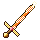 | 40x40 | used | emberbrand | `pixel/icons/item_emberbrand.png` |
| `item_iron_sword` | 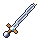 | 40x40 | used | iron_sword | `pixel/icons/item_iron_sword.png` |
| `item_obsidian_blade` | 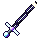 | 40x40 | used | obsidian_blade | `pixel/icons/item_obsidian_blade.png` |
| `item_wooden_sword` | 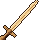 | 40x40 | planned | wooden_sword | `pixel/icons/item_wooden_sword.png` |

## mainHand/sword G1

| Name | Picture | Size | Status | Used by | Source file |
| --- | --- | --- | --- | --- | --- |
| `art_old_rusted_blade` |  | 64x64 | used | old_rusted_blade | `pixel/items/mainHand/sword/old_rusted_blade.png` |
| `art_rusty_broadsword` |  | 64x64 | used | rusty_broadsword | `pixel/items/mainHand/sword/rusty_broadsword.png` |
| `art_rusty_shortsword` | 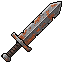 | 64x64 | used | rusty_shortsword | `pixel/items/mainHand/sword/rusty_shortsword.png` |

## mainHand/sword G2

| Name | Picture | Size | Status | Used by | Source file |
| --- | --- | --- | --- | --- | --- |
| `art_bronze_sword` | 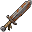 | 64x64 | used | bronze_sword | `pixel/items/mainHand/sword/bronze_sword.png` |

## mainHand/sword G3

| Name | Picture | Size | Status | Used by | Source file |
| --- | --- | --- | --- | --- | --- |
| `art_arming_sword` |  | 64x64 | used | arming_sword | `pixel/items/mainHand/sword/arming_sword.png` |
| `art_notched_broadsword` |  | 64x64 | used | notched_broadsword | `pixel/items/mainHand/sword/notched_broadsword.png` |
| `art_ph_mainHand_sword_g3` |  | 64x64 | placeholder |  | `pixel/items/mainHand/sword/ph_g3.png` |

## mainHand/sword G4

| Name | Picture | Size | Status | Used by | Source file |
| --- | --- | --- | --- | --- | --- |
| `art_blue_pommel_longsword` |  | 64x64 | used | blue_pommel_longsword | `pixel/items/mainHand/sword/blue_pommel_longsword.png` |
| `art_silver_scimitar` |  | 64x64 | used | silver_scimitar | `pixel/items/mainHand/sword/silver_scimitar.png` |

## mainHand/sword G5

| Name | Picture | Size | Status | Used by | Source file |
| --- | --- | --- | --- | --- | --- |
| `art_gilded_longsword` |  | 64x64 | used | gilded_longsword | `pixel/items/mainHand/sword/gilded_longsword.png` |

## mainHand/sword G6

| Name | Picture | Size | Status | Used by | Source file |
| --- | --- | --- | --- | --- | --- |
| `art_voidiron_blade` |  | 64x64 | used | voidiron_blade | `pixel/items/mainHand/sword/voidiron_blade.png` |

## mainHand/sword G7

| Name | Picture | Size | Status | Used by | Source file |
| --- | --- | --- | --- | --- | --- |
| `art_cinderfang_sword` |  | 64x64 | planned | cinderfang_sword | `pixel/items/mainHand/sword/cinderfang_sword.png` |
| `art_frostbrand` |  | 64x64 | planned | frostbrand | `pixel/items/mainHand/sword/frostbrand.png` |
| `art_runed_jade_blade` |  | 64x64 | planned | runed_jade_blade | `pixel/items/mainHand/sword/runed_jade_blade.png` |

## mainHand/sword G8

| Name | Picture | Size | Status | Used by | Source file |
| --- | --- | --- | --- | --- | --- |
| `art_seraph_blade` |  | 64x64 | planned | seraph_blade | `pixel/items/mainHand/sword/seraph_blade.png` |

## mainHand/wand

| Name | Picture | Size | Status | Used by | Source file |
| --- | --- | --- | --- | --- | --- |
| `art_frostbloom_fan` |  | 64x64 | planned | frostbloom_fan | `pixel/items/legendary/frostbloom_fan.png` |
| `item_apprentice_wand` |  | 40x40 | planned | apprentice_wand | `pixel/icons/item_apprentice_wand.png` |

## mainHand/wand G1

| Name | Picture | Size | Status | Used by | Source file |
| --- | --- | --- | --- | --- | --- |
| `item_twig_wand` |  | 40x40 | used | twig_wand | `pixel/icons/item_twig_wand.png` |

## mainHand/wand G2

| Name | Picture | Size | Status | Used by | Source file |
| --- | --- | --- | --- | --- | --- |
| `item_bronze_wand` |  | 40x40 | used | bronze_wand | `pixel/icons/item_bronze_wand.png` |

## mainHand/wand G3

| Name | Picture | Size | Status | Used by | Source file |
| --- | --- | --- | --- | --- | --- |
| `item_iron_wand` |  | 40x40 | used | iron_wand | `pixel/icons/item_iron_wand.png` |

## mainHand/wand G4

| Name | Picture | Size | Status | Used by | Source file |
| --- | --- | --- | --- | --- | --- |
| `art_ph_mainHand_wand_g4` |  | 64x64 | placeholder |  | `pixel/items/mainHand/wand/ph_g4.png` |

## mainHand/wand G5

| Name | Picture | Size | Status | Used by | Source file |
| --- | --- | --- | --- | --- | --- |
| `art_ph_mainHand_wand_g5` |  | 64x64 | placeholder |  | `pixel/items/mainHand/wand/ph_g5.png` |

## mainHand/wand G6

| Name | Picture | Size | Status | Used by | Source file |
| --- | --- | --- | --- | --- | --- |
| `art_ph_mainHand_wand_g6` |  | 64x64 | placeholder |  | `pixel/items/mainHand/wand/ph_g6.png` |

## mainHand/wand G7

| Name | Picture | Size | Status | Used by | Source file |
| --- | --- | --- | --- | --- | --- |
| `art_ph_mainHand_wand_g7` |  | 64x64 | placeholder |  | `pixel/items/mainHand/wand/ph_g7.png` |

## mainHand/wand G8

| Name | Picture | Size | Status | Used by | Source file |
| --- | --- | --- | --- | --- | --- |
| `art_ph_mainHand_wand_g8` |  | 64x64 | placeholder |  | `pixel/items/mainHand/wand/ph_g8.png` |

## mainHand/wand G9

| Name | Picture | Size | Status | Used by | Source file |
| --- | --- | --- | --- | --- | --- |
| `art_ph_mainHand_wand_g9` |  | 64x64 | placeholder |  | `pixel/items/mainHand/wand/ph_g9.png` |

## mainHand/wand S1

| Name | Picture | Size | Status | Used by | Source file |
| --- | --- | --- | --- | --- | --- |
| `art_ph_mainHand_wand_s1` |  | 64x64 | placeholder |  | `pixel/items/mainHand/wand/ph_s1.png` |

## mainHand/wand S2

| Name | Picture | Size | Status | Used by | Source file |
| --- | --- | --- | --- | --- | --- |
| `art_ph_mainHand_wand_s2` |  | 64x64 | placeholder |  | `pixel/items/mainHand/wand/ph_s2.png` |

## mainHand/wand S3

| Name | Picture | Size | Status | Used by | Source file |
| --- | --- | --- | --- | --- | --- |
| `art_ph_mainHand_wand_s3` |  | 64x64 | placeholder |  | `pixel/items/mainHand/wand/ph_s3.png` |

## offHand/shield

| Name | Picture | Size | Status | Used by | Source file |
| --- | --- | --- | --- | --- | --- |
| `item_obsidian_aegis` |  | 40x40 | used | obsidian_aegis | `pixel/icons/item_obsidian_aegis.png` |
| `item_steel_shield` |  | 40x40 | planned | steel_shield | `pixel/icons/item_steel_shield.png` |
| `item_wooden_shield` |  | 40x40 | planned | wooden_shield | `pixel/icons/item_wooden_shield.png` |

## offHand/shield G1

| Name | Picture | Size | Status | Used by | Source file |
| --- | --- | --- | --- | --- | --- |
| `art_battered_buckler` |  | 64x64 | used | battered_buckler | `pixel/items/offHand/battered_buckler.png` |
| `art_oak_roundshield` |  | 64x64 | used | oak_roundshield | `pixel/items/offHand/oak_roundshield.png` |
| `art_wooden_buckler` |  | 64x64 | used | wooden_buckler | `pixel/items/offHand/wooden_buckler.png` |

## offHand/shield G2

| Name | Picture | Size | Status | Used by | Source file |
| --- | --- | --- | --- | --- | --- |
| `art_bronze_crossbar_shield` |  | 64x64 | used | bronze_crossbar_shield | `pixel/items/offHand/bronze_crossbar_shield.png` |
| `art_hide_shield` |  | 64x64 | used | hide_shield | `pixel/items/offHand/hide_shield.png` |

## offHand/shield G3

| Name | Picture | Size | Status | Used by | Source file |
| --- | --- | --- | --- | --- | --- |
| `art_iron_kite_shield` |  | 64x64 | used | iron_kite_shield | `pixel/items/offHand/iron_kite_shield.png` |
| `art_ironbound_pavise` |  | 64x64 | used | ironbound_pavise | `pixel/items/offHand/ironbound_pavise.png` |

## offHand/shield G4

| Name | Picture | Size | Status | Used by | Source file |
| --- | --- | --- | --- | --- | --- |
| `art_crusader_shield` |  | 64x64 | used | crusader_shield | `pixel/items/offHand/crusader_shield.png` |

## offHand/shield G5

| Name | Picture | Size | Status | Used by | Source file |
| --- | --- | --- | --- | --- | --- |
| `art_lionguard_shield` |  | 64x64 | used | lionguard_shield | `pixel/items/offHand/lionguard_shield.png` |
| `art_steel_tower_shield` |  | 64x64 | used | steel_tower_shield | `pixel/items/offHand/steel_tower_shield.png` |

## offHand/shield G6

| Name | Picture | Size | Status | Used by | Source file |
| --- | --- | --- | --- | --- | --- |
| `art_thornspike_shield` |  | 64x64 | used | thornspike_shield | `pixel/items/offHand/thornspike_shield.png` |

## offHand/shield G7

| Name | Picture | Size | Status | Used by | Source file |
| --- | --- | --- | --- | --- | --- |
| `art_runeward_roundel` |  | 64x64 | planned | runeward_roundel | `pixel/items/offHand/runeward_roundel.png` |

## offHand/shield G8

| Name | Picture | Size | Status | Used by | Source file |
| --- | --- | --- | --- | --- | --- |
| `art_frostcrystal_aegis` |  | 64x64 | planned | frostcrystal_aegis | `pixel/items/offHand/frostcrystal_aegis.png` |
| `art_royal_lion_crest` |  | 64x64 | planned | royal_lion_crest | `pixel/items/offHand/royal_lion_crest.png` |
| `art_verdant_kite_shield` |  | 64x64 | planned | verdant_kite_shield | `pixel/items/offHand/verdant_kite_shield.png` |

## offHand/tome

| Name | Picture | Size | Status | Used by | Source file |
| --- | --- | --- | --- | --- | --- |
| `item_apprentice_tome` |  | 40x40 | planned | apprentice_tome | `pixel/icons/item_apprentice_tome.png` |

## offHand/tome G1

| Name | Picture | Size | Status | Used by | Source file |
| --- | --- | --- | --- | --- | --- |
| `item_bound_scraps` |  | 40x40 | used | bound_scraps | `pixel/icons/item_bound_scraps.png` |

## offHand/tome G2

| Name | Picture | Size | Status | Used by | Source file |
| --- | --- | --- | --- | --- | --- |
| `item_hide_primer` | 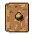 | 40x40 | used | hide_primer | `pixel/icons/item_hide_primer.png` |

## offHand/tome G3

| Name | Picture | Size | Status | Used by | Source file |
| --- | --- | --- | --- | --- | --- |
| `item_iron_codex` |  | 40x40 | used | iron_codex | `pixel/icons/item_iron_codex.png` |

## offHand/tome G4

| Name | Picture | Size | Status | Used by | Source file |
| --- | --- | --- | --- | --- | --- |
| `art_ph_offHand_tome_g4` |  | 64x64 | placeholder |  | `pixel/items/offHand/tome/ph_g4.png` |

## offHand/tome G5

| Name | Picture | Size | Status | Used by | Source file |
| --- | --- | --- | --- | --- | --- |
| `art_ph_offHand_tome_g5` |  | 64x64 | placeholder |  | `pixel/items/offHand/tome/ph_g5.png` |

## offHand/tome G6

| Name | Picture | Size | Status | Used by | Source file |
| --- | --- | --- | --- | --- | --- |
| `art_ph_offHand_tome_g6` |  | 64x64 | placeholder |  | `pixel/items/offHand/tome/ph_g6.png` |

## offHand/tome G7

| Name | Picture | Size | Status | Used by | Source file |
| --- | --- | --- | --- | --- | --- |
| `art_ph_offHand_tome_g7` |  | 64x64 | placeholder |  | `pixel/items/offHand/tome/ph_g7.png` |

## offHand/tome G8

| Name | Picture | Size | Status | Used by | Source file |
| --- | --- | --- | --- | --- | --- |
| `art_ph_offHand_tome_g8` |  | 64x64 | placeholder |  | `pixel/items/offHand/tome/ph_g8.png` |

## offHand/tome G9

| Name | Picture | Size | Status | Used by | Source file |
| --- | --- | --- | --- | --- | --- |
| `art_ph_offHand_tome_g9` |  | 64x64 | placeholder |  | `pixel/items/offHand/tome/ph_g9.png` |

## offHand/tome S1

| Name | Picture | Size | Status | Used by | Source file |
| --- | --- | --- | --- | --- | --- |
| `art_ph_offHand_tome_s1` |  | 64x64 | placeholder |  | `pixel/items/offHand/tome/ph_s1.png` |

## offHand/tome S2

| Name | Picture | Size | Status | Used by | Source file |
| --- | --- | --- | --- | --- | --- |
| `art_ph_offHand_tome_s2` |  | 64x64 | placeholder |  | `pixel/items/offHand/tome/ph_s2.png` |

## offHand/tome S3

| Name | Picture | Size | Status | Used by | Source file |
| --- | --- | --- | --- | --- | --- |
| `art_ph_offHand_tome_s3` |  | 64x64 | placeholder |  | `pixel/items/offHand/tome/ph_s3.png` |
