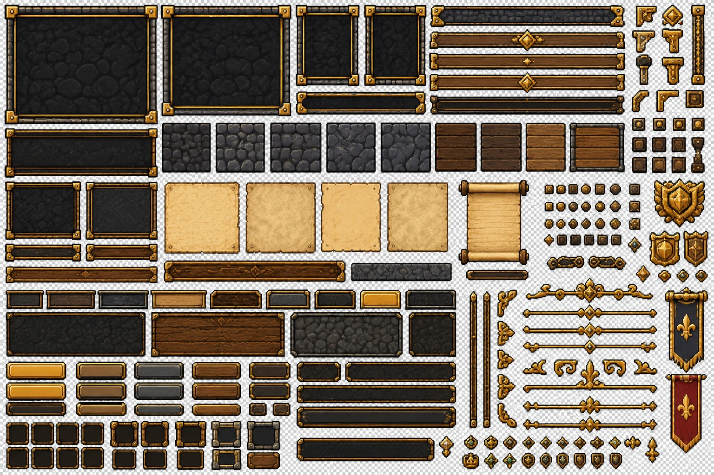
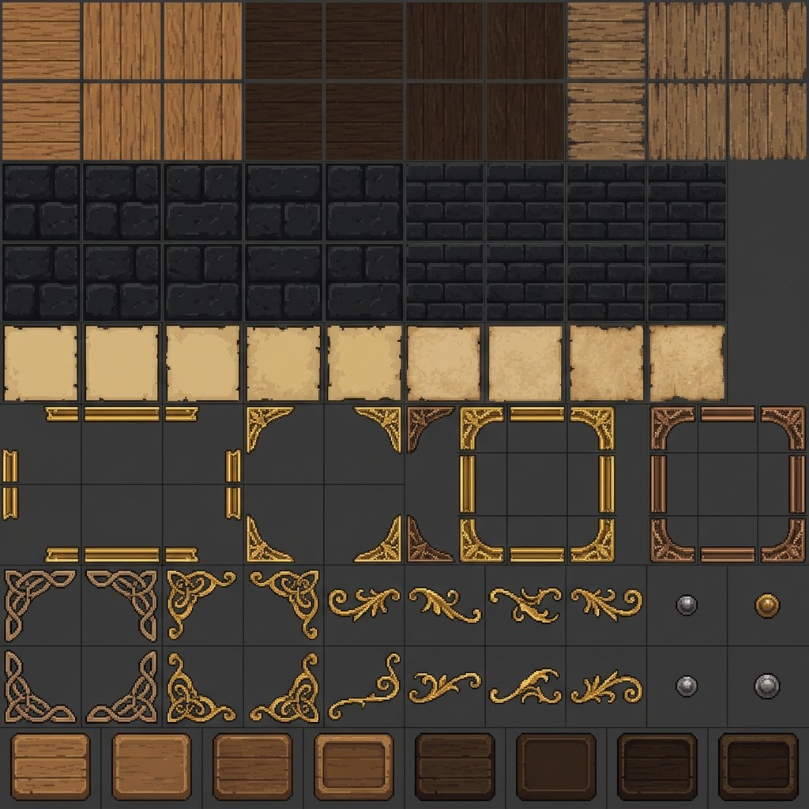

# UI refresh: layout and UX reference

**Status: reference, not built.** [design/idle-realm-ui-refresh.html](design/idle-realm-ui-refresh.html) is a Claude Design export (open it in a browser; it needs JavaScript). It holds seven static boards, each in its own frame.

**Treat it as a reference for layouts and UX, not as an art or asset refresh.** The boards already solve many UX problems; pictures, colours and art in them are not the target, and assets keep following the Sprite Fusion rule in [CLAUDE.md](../../CLAUDE.md). Where the boards and the code disagree once the design system exists, the code is the source of truth.

The aim is to settle the UI/UX style and layouts **before** new mechanics are wired, so new features are built into agreed layouts.

| Board | Frame | Game screen it maps to | UX problem it solves |
| --- | --- | --- | --- |
| Landing | 1440x1080 | landing page (`src/components/landing`) | to be written during the review |
| Game HUD | 1280x720 | header, map, side stack (`GameHeader`, `BottomRightStack`) | to be written during the review |
| Hero window (bag, stats, crafting) | 1280x720 | `Bag`, stats, crafting | to be written during the review |
| Tooltip system | 1280x760 | `ItemTooltip`, `BiomeTooltip`, `HeaderTip` | to be written during the review |
| Merchant (trade ticket) | 1280x720 | merchant window | to be written during the review |
| Hall of Deeds | 1280x720 | achievements | to be written during the review |
| Bestiary | 1280x720 | monster glossary and discovery | to be written during the review |

Desktop only (1240 px and wider); the boards have no mobile layout.

## UI kit sheets (art reference for building the interfaces)

Two sprite sheets kept next to the boards so the interfaces can be built from the same parts. They are reference sheets, not wired assets: cut what is needed in Sprite Fusion (CLAUDE.md), and register it in `public/pixel/` when it is used.

| Sheet | Holds |
| --- | --- |
| [ui-kit-sheet-frames-bars.webp](design/ui-kit-sheet-frames-bars.webp) | window frames (stone panel, gold trim), title and plaque bars, buttons in gold/wood/stone/dark, slot frames, parchment and scroll, gold dividers and corner pieces, rivets and studs, shield and banner emblems |
| [ui-kit-sheet-textures-ornaments.jpg](design/ui-kit-sheet-textures-ornaments.jpg) | tileable wood, dark stone brick and parchment textures, gold and bronze frame edges and corners, Celtic and flourish ornaments, studs, rounded wood slot tiles |

## Tickets

- [IDL-289](https://linear.app/idlarz/issue/IDL-289): review and refine the boards, fill the last column above, cut per-screen tickets.
- [IDL-290](https://linear.app/idlarz/issue/IDL-290): the design system in code (dumb `src/components/ui/` components on shared tokens); it implements the layouts from IDL-289.

The file is a self-contained bundle (the Figtree font inside is under the SIL OFL; its licence comment stays in the file). Do not edit it by hand; a refined version replaces it.
